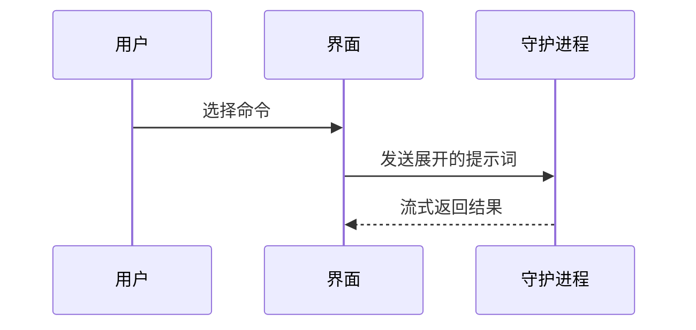

# PR 证据与说明

本文件已进行中文翻译与流程适配（2026-11-07）。

使用以下模板编写 PR 正文：

```markdown
## 概要

<图、差异草图或树形结构>

## 证据

- **之前：** <截图／输出／失败的测试运行>
  **之后：** <截图／输出／通过的测试运行>

## 合并风险

**门：** <单向门或双向门>

<可选：说明>

**影响范围：** <一个词的描述>

<可选：合并可能带来的后果>
```

## 各节

省去所有开场白，文字保持简短。使用 `GLOSSARY.md` 中用户的领域语言。

### 概要

选择能够说明关键点的最小视图。

- 用伪代码展示逻辑或算法：

```text
on(save)
  if content is unchanged
    return cached result
  write new content
  return fresh result
```

- 用调用树展示运行时控制流：

```text
submitForm
  createSession
    persistPrompt
    launchAgent
  navigateToSession
```

- 用组件树展示 UI 结构，包括重要的状态和模块边界：

```text
<SessionPage> (apps/example/src/routes/session.tsx)
  useSessionEvents()
  <SessionToolbar>
    <RunSkillButton> (packages/ui)
```

- 用浅层文件树展示文件职责或大范围重构：

```text
src/
├── commands/       # 解析用户动作
├── sessions/       # 拥有会话状态
└── transport/      # 发送 API 请求
```

- 用 Mermaid 展示组件交互、控制流或数据流：



- 如果重点是哪些内容发生变化，而周围结构已经存在，就使用 `diff`。让差异的形状与主题匹配。

组件变更：

```diff
 <SessionPage>
   useSessionEvents()
   <SessionToolbar>
+    <RunSkillButton />
   <SessionTimeline>
+    <SkillResultCard />
```

文件布局变更：

```diff
 src/
 ├── commands/
+│   └── show-me.ts       # 展开斜杠命令
 ├── sessions/
-└── transport.ts
+└── transport/
+    ├── client.ts
+    └── stream.ts
```

调用树或调用栈变更：

```diff
 submitForm
   createSession
     persistPrompt
+    expandSkillMention
     launchAgent
-  navigateToSession
+  navigateToSession
+    subscribeToEvents
```

状态或控制流变更：

```diff
 on(save)
-  write content
+  if content is unchanged
+    return cached result
+  write new content
+  invalidate cache
```

- 当大部分内容都是新增的、删减上下文会掩盖归属或顺序，或者用户需要一个可复制的目标形态时，展示整个代码块：

```ts
function expandSkill(command: string): string {
  const skillName = command.slice(1);
  return `use the ${skillName} skill`;
}
```

#### 指导

把每个视图放在它所支持的短文旁边。只保留回答用户当前问题或解决当前讨论点所需的调用、文件、属性、状态和边界。

可以只使用一种，也可以使用几种，几乎不会需要全部使用。自行判断，避免信息淹没用户。

### 证据

提供变更有效的具体证据。展示前后对比。

当环境已准备好且变更是视觉变更时，截图是最高等级的证据。

基于执行的证据也很强，包括测试结果、控制台输出。用伪代码展示同一个具体测试在变更前失败、变更后通过。

### 合并风险

说明这是单向门还是双向门。双向门可以走回来，单向门不能。容易回滚的 PR 风险更低。涉及破坏性操作或难以撤销的决定属于单向门。

影响范围是这个 PR 引入的变更可能造成的影响或覆盖范围。考虑所有可能性，例如布局偏移、对调用方的破坏、移动端响应式表现等。
