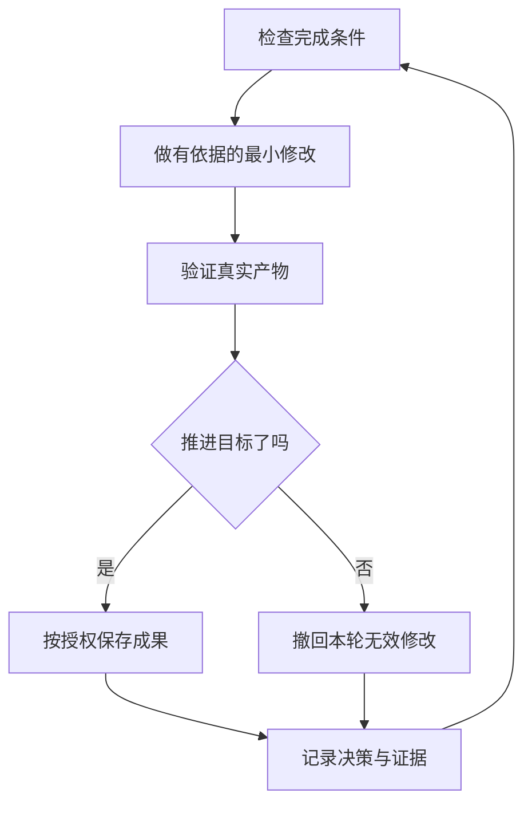

# 在用户离开后持续推进工作

可信的自主执行依靠可检查的完成条件、隔离工作区或真实远端执行环境，以及回来后可审计的决策记录。不是把会话留着就等于拥有后台运行能力。

## 先建立信任，再启用循环

不可信的循环只会更快累积未检查结果。交给它独立运行前，确认：

- 你亲手做过一次任务，或观察过完整执行，因此知道什么结果算好。
- 智能体具备实际会用到的验证工具、性能分析器、日志和其他信号。
- 每个阶段证明自己的产物，未达标准能停止进入下一阶段。
- 已阅读代表性执行记录，把重复失败变成适当工具、技能或检查。

这四项都满足，才适合减少人工观察；否则先运行一个有人关注的完整单元。

## 持续运行约定

交接写清目标、完成条件、权限和退出方式。可以简短，例如：

```text
我接下来离线，请继续。在从指定基础提交创建的新 worktree 中，把每个调用者迁移到新解析器。
完成意味着旧调用者为零、全部解析器夹具通过、旧 API 已删除。
保留决策记录。本任务允许本地提交，不用逐次问我；不合并或部署。
使用当前可用的持续执行机制。达到约定资源上限或确实无法推进时，安全停下并写明原因。
```

各部分分别解决不同问题：

- 用户离开且要求继续，表示继续推进已授权工作，不自动授予新增权限。
- “完成意味着”把目标变成每轮能检查的判据。
- 新 worktree 或等价隔离防止碰到其他未完成工作。
- 明确允许的提交、推送、合并或部署范围，避免每步重复询问，也避免越权。
- 有实际事件订阅、调度或后台机制才配置它。没有时，在当前会话内持续执行并保存恢复点，不声称会话结束或机器关闭后仍在运行。
- 退出方式和资源上限允许在真正死路停下，防止空转或悄悄改写目标。

复杂且需要回来后审查的任务，先按 `dev-workflow`（自定义工作流程） 设计阶段，再接上 `dev-workflow`（决策证据）。不为简单改动制造多层编排。

用户明确要求暂停或关停相关运行时，采用 `dev-workflow`（安全暂停） 保存或撤回当前原子步骤、按授权保存检查点，并写恢复说明。新会话按 `dev-workflow`（会话接续） 恢复。“继续”不触发暂停；仅用户暂时不回复也不是停止指令。

## 每轮执行什么



每轮一次有边界的修改、一次检查和一条决策记录。撤回只限本轮自己产生的修改，不能覆盖用户或其他执行者工作。停滞先换假设或方法；达到资源边界、缺失必要能力或真正死路时停止并说明，绝不放宽判据宣布成功。完整执行见 `dev-workflow`（自主执行）。

## 回来后的审计

`dev-workflow`（决策证据方法） 记录时间、阶段、决定、理由、证据指针和结果。新增记录统一用 Markdown 写入 `.agents/dev/changes/<日期-主题>/decisions.md`。确有表格处理需要才使用随包的可选 TSV，不强制日志格式。

新增记录统一留在 `.agents/dev/changes/<日期-主题>/`。任务范围较大、审查者需要过程证据时，按既有交付授权一并保存。公开提交前移除秘密、无关个人记录和不应公开的内部信息。

用户回来后可以这样要求：

```text
按决策证据告诉我昨晚完成了什么，哪些结论还需要我仔细检查。
```

有独立审查能力时，让新上下文阅读实际轨迹和授权范围的对话；不同模型确实可用且适合时再选择，不强制家族。没有独立能力时自行核对并说明限制。回复列出需要关注的结论及其证据，让用户审计决定，不必重读整晚。

若只要快速状态，使用 `dev-status`（进展回顾）：只读核对当前结果，用普通话说明变化、已有截图和小图，再列出每个等待用户的决定、建议、证据和风险。自己仍能完成的工作不伪装成用户待办。

## 队列与持续项目

一个任务对应一个完成条件；独立队列或跨多日项目需要明确所有权，但仍用同样的证据与授权约定。

`dev-workflow`（自动队列交付） 适用于已明确授权合并的独立事项。每个 PR 有一个负责人，从构建负责到交付；负责人不能只靠自己的结论合并。独立验证者检查实际将落地的代码。变基或小修核对受影响范围；新行为或大差异才扩大复核。新的头提交需要对应真实检查结果：

```text
推进这个独立事项队列。我已授权合并通过项目检查与独立复核的 PR；其余保留具体阻塞说明。
```

`dev-workflow`（准备待审队列） 使用同样的证明要求，但不执行合并。用户回来后看到验证过的 PR、各自结论和真正的依赖。只有确实依赖另一个 PR 才堆叠：

```text
处理这五项变更并准备验证证据，不要合并，我回来后自行审查和落地。
```

`dev-workflow`（持续项目协调） 适合超出单个执行上下文的多日项目。协调者分派、核对和维护依赖，工作者各自负责实现。没有委派能力或一个执行者就够时，回到单任务方法，不模拟不存在的智能体群：

```text
持续负责存储迁移，直到每个包达到已经约定的完成条件。我每天检查两次，授权范围保持当前约定。
```

## 并行推进多个项目

宿主确实提供持久项目线程或远端执行环境时，可以给每组工作独立空间，由协调上下文维护目标与证据。只有运行平台确认不依赖本机在线，才能宣称关机后仍继续。普通本地工作区不具备这种性质。

几个习惯有帮助：

- 按功能、迁移、性能改善或技术债任务分开项目，保持各自范围。
- 只加入与该项目有关且已授权共享的对话和资料，不默认把个人全部聊天作为公共上下文。
- 每个将交付的 PR 有适当独立验证，按用户选择采用待审或已授权合并模式。
- 先用数据和原型解决可实验的问题，再询问无法观察的产品取舍。

一个跨研究与执行的请求可以这样表达：

```text
研究这个仓库为何经常被改错。只读取本项目已授权提交、审查记录和相关会话，按错误类别与模块边界分析。
用小原型回答可验证问题，交付有真实证据的计划。计划获准后，按我指定的待审或合并范围推进。
```

## 让流程由事件或计划触发

用户明确要求自动触发且环境实际支持时，再配置计划或事件触发。维护工作可分为报告分诊、复现、修复、验证，每段仍需独立证据：

- 每个阶段可以停止后续处理。预期行为、不足以复现、修复超出授权或风险过高，都是有价值的结果，不能为了流水线完整而强行升级。
- 每个阶段传递证据。复现保留损坏状态，修复保留前后行为，让人可以先判断是否修对问题。

项目已有休眠自动化包时，先读取它的本地配置与职责说明，再针对用户指定仓库适配。没有包时，用现有调度和问题记录能力实现必要阶段；不虚构专有例程 API，也不自动外发聊天消息。发送通知、创建外部事项或触发实际部署，分别需要明确授权。

时长不是完成条件。“工作 4 小时”只给了预算，没有说明什么叫完成。用可判定通过或失败的目标驱动执行，同时遵守资源上限和停止条件。
