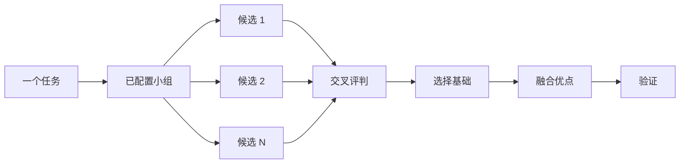

# 写代码前先设计

复杂设计只尝试一次，就会固定在模型最先想到的形状上。`$dev-architecture` 在实施前确定类型和边界；`$dev-parallel` 对同一简报尝试多个方案并融合优点；`$dev-review` 用独立审查视角尝试破坏结果；是否能使用其他模型以当前能力为准。目标是覆盖而非设计综合时，`$dev-parallel` 分派切片或竞速并汇总结果。

最常见的两项设计错误，是接受代理的第一个设计，以及打磨未经代码检验的计划。本页解决这两点。通过代码规划：原型回答开放问题，README 或教程设定目标，书面计划最后出现。


## 用 `$dev-architecture` 确定形状

```text
$dev-architecture 写任何代码前先设计导入流水线，我最关心调用者如何使用它。
```

`dev-architecture`（`$dev-architecture`） 先建立事实依据：对涉及代码运行 `$dev-learn`，移动所有权或层次时运行 `$dev-why`。随后用 `$dev-parallel` 产生相互竞争的设计草图，每份都先写调用者用法，再给类型、签名及模块图。

已有实施授权时，综合设计后继续实施；只要求设计时，设计就是交付物。需要保留人审节点时可直接说：

```text
$dev-architecture 实施前停下来让我看设计。
```

开始写代码后，设计并非不可改变。如果无关位置反复出现同样绕路，或类型只有靠 `any`、强制断言才能编译，`$dev-architecture` 会将其视为设计错误的证据。它舍弃草图重新开始，不是在周围不断打补丁。

## 用 `$dev-parallel` 展开多个尝试

```text
$dev-parallel 把同一份简报交给独立候选者，我想比较各方案并融合有证据的优点。
```

[`$dev-parallel`](capabilities.md) 是底层通用工具。在实际工具上限与预算内，让 N 个独立上下文完成同一简报，各自写入独立 worktree 或目录；没有并行能力时顺序进行。可用时选择不同模型的只读评判，否则用独立上下文或协调者按相同标准评判，并说明独立性限制。协调者从头到尾阅读每个候选，选出基础，嫁接其他方案的最好想法，再验证结果。



小组优先沿用项目实际角色配置；没有配置时继承当前可用能力，不把初始化当作门槛，也不假设一定有多模型。需要时按 [`$dev-setup`](capabilities.md) 核对。决定重要时增加候选，不重要时减少：

```text
$dev-parallel 这个问题要 5 个候选。缓存键格式以后修改成本很高。
```

## 用 `$dev-parallel` 覆盖切片与竞速

```text
$dev-parallel 按各自 check.sh 检查 packages/ 下所有包。一包一位执行者，一份报告。
```

`dev-parallel`（`$dev-parallel`） 根据当前真实能力，将工作分为独立切片、覆盖矩阵、挑战通道、探索分区或预先声明的竞速分支；具备委派能力才启动执行者，超额分批，无工具时顺序覆盖并说明限制。每个都有自己的范围与检查，再报告 `PASS`、`ISSUES` 或 `BLOCKED`。父代理等待执行者，返回一份包含缺口或退出情况的紧凑报告。

并行可以增加覆盖或让独立检查竞速时采用它。`$dev-parallel` 给每位执行者同一设计或代码简报，然后选基础并融合优点；`$dev-parallel` 覆盖切片或按预先声明的选择规则竞速，不执行选基础与嫁接的仪式。

## 用 `$dev-review` 尝试破坏结果

```text
$dev-review 带着怀疑审查整个分支。除非是真实缺陷或回归，不挑细枝末节。
```

`dev-review`（`$dev-review`） 将变更和意图交给实际可用的独立审查上下文，每位通过当前允许的真实检查尝试破坏它；没有委派能力时按同样视角顺序审查，并如实说明。他们会发现不同失败。只有重跑命令确实出现违背意图的失败，发现才会保留。报告列出每个已验证问题及发现它的对抗者，再列出各自丢弃了什么、为什么，并不应用任何修改。

也要读 Dropped 列表。你可以推翻裁决。

## 做原型，不争论

不接受第一个设计。要求几个方案，从能看到的证据中选择：

```text
$dev-workflow 为新下拉菜单做几个原型，截图或录视频让我比较。
```

`dev-build`（原型流程） 在临时目录构建可丢弃草图，用同一切换器展示变体，驱动每个变体并捕获截图或耗时。它也适用于行为和算法，不只是 UI。原型就是用代码规划，让代理运行一些东西来回答自己的开放问题，不必都来问你，也留出发现你没想到的选项的空间。

同样做法也可用于真实设计。将 `$dev-architecture` 与原型结合，并保留审查点：

```text
$dev-workflow 我们需要外部 webhook 限流。先 $dev-architecture，用原型回答开放问题，继续前让我审查。
```

不要让对抗者花力气审查抽象计划。`$dev-review` 会丢弃不能由实际执行证明的发现，没有代码支撑的计划几乎无从破坏。让原型解决问题，再审查构建出的东西。

## 共享代码先写 README

其他代码将使用的包或 API，先写用户会读的文档：

```text
$dev-workflow 先写我如何使用新配置包的教程，再 $dev-learn 它为什么优于当前版本。
```

先写教程会迫使你从调用者视角出发：向假想用户描述 API，再反推实施。文档也成为代理检查自身工作的具体目标。文档本身重要时指定 [`$dev-writing`](capabilities.md)，让教程保持为教程，不同时混成参考和解释。

## 设计确定后再计划

本项目提供可选的规格与计划技能。确实需要书面计划时，在设计确定之后提出：

```text
$dev-workflow 将这个设计变成计划。小而可验证的 PR，每个都有自己的验证步骤。
```

`dev-plan`（多阶段计划流程） 用原型解决剩余问题，然后每个 PR 写一节，每节都以变更有效的证据结束。仅测试套件通过不算这种证据。计划本身就是交付物，流程不会实施，并会说明下一步该用哪个执行流程。

迁移时在提示词里说明标准：

```text
$dev-workflow 规划将我们的 UI 库迁移到新样式系统。小而可验证的 PR，每个做视觉回归检查。结果必须与原版完全一致，包括已有 bug。
```

“包括 bug”防止迁移顺便悄悄修其他问题，否则新旧输出无法比较。跨多日项目可以暂时将计划提交到仓库，让其他代理看到进行中的工作；工作落地后按项目归档约定保留有价值的历史与证据。

## 一个任务值得多少设计工作

你可能在想是不是每次变更都需要这些。不，大多数变更都不需要。一个大致层次是：

- 已完成但仍不放心的小改动，只需 `$dev-review`。
- 跨函数边界或移动所有权的变更适合 `$dev-architecture`，它会带上 `$dev-parallel`。
- 名称、格式、算法等能从独立尝试中受益的单独决定，直接用 `$dev-parallel`。
- 覆盖矩阵、并行检查集合或已声明分支的竞速，用 `$dev-parallel`。
- 布局、耗时或实现方式等可以运行回答的开放问题，应做原型而非争论。
- 有争议且难逆转的设计，先 `$dev-architecture`，交付前再 `$dev-review`。
- 跨多个 PR 的工作，设计确定之后写计划。

`$dev-workflow` 已应用这套层次。跨边界工作会自行触发 `$dev-architecture`，所以直接调用这些技能，主要是想比默认更多或更少地审查时。

下一页：[构建并清理变更](guide-building.md)。
