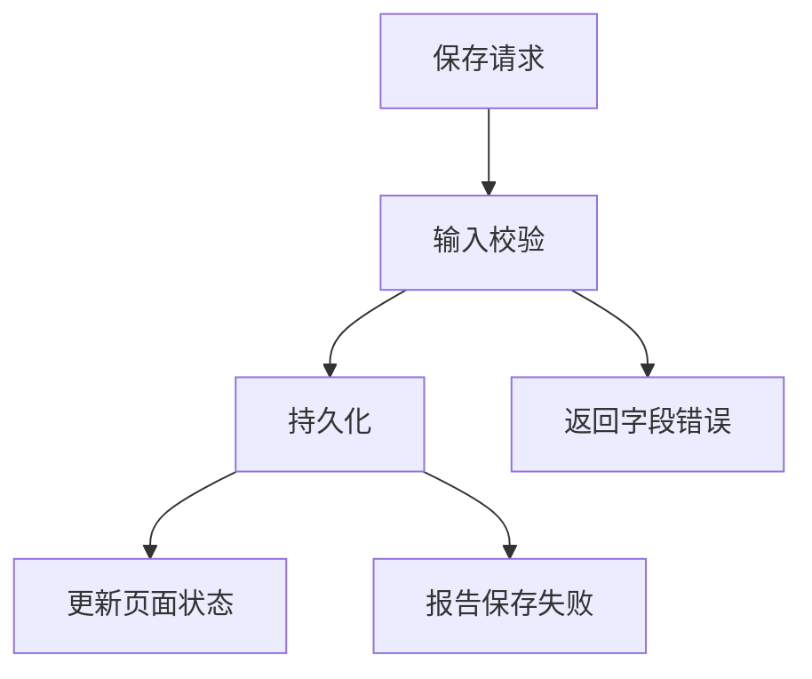

# 学习说明的写法

## 清晰表达

使用短句、主动语态、一句一意和一致术语。保持用户或项目语言，不因为采用清晰表达原则就声称符合某个受控语言标准。

为陌生领域读者先给日常解释，再给专业名称。简化时保留条件、边界和准确性；类比只帮助理解，不替代代码或运行证据。读者已经熟悉的内容不反复从零讲起。

## 按需采用的四个部分

以下结构适合完整导读；短答可省略不需要的栏目。

1. **先看全局。** 用一两段或一张紧凑关系图说明模块解决什么问题、谁和谁有关。不要用只列前端、后端、数据库的目录图代替功能机制。
2. **沿路径看。** 按真实用户动作解释入口、处理、数据与状态、输出、失败与恢复。移动的数据和转移的责任要分清；存在异常分支时另讲一小段或画一小图。
3. **术语小词典。** 只保留理解当前功能必需的项目词。给出日常含义、项目规范名、用户别名、真实实体和适用领域。通用编程概念在正文解释，不污染项目词汇表。
4. **可以复述什么。** 概括它是什么、为什么需要、如何流动或被调用，列出仍未讲清的问题。这是理解提示，不是宣称用户已经学会，也不强制变成考试。

## 图表选择

结构关系、分支、状态或时序用 Mermaid；明确的用户动作与代码位置映射用表格；单步骤直接写文字。不为了图数量堆积可视化。图中一条箭头必须能由实际调用、数据或状态变化支持。

此图是格式示例，真实文档应替换为项目中的动作、边界与代码证据，不把示例当成已验证运行流程。

## 解释依据

在有关文字附近引用真实项目文件、可搜索符号和章节，记录适用版本或实际检查的工作区范围。区分源码事实、实际运行、可定位设计理由、作者观点、类比、推断与未知。没运行检查就不写“已通过”。

旧规格、计划和当前实现不一致时，说明双方版本与差距。最新明确需求代表预期，代码代表当前现实，不能互相冒充。需要时单独解释真实失败和恢复方向，不编造事故。

带着需求学习时，在运行路径中说明参考思路解决了什么、可借鉴的部分和适用条件。尚未确定的本项目取舍保留为问题，不因为学习资料提到某架构就自动采用。

## 文件与导航

当前需求可写 `.agents/dev/changes/<date-topic>/learning.md`；长期可复用导读统一写 `.agents/dev/notes/learning/<topic>.md`，已有模块文档按真实位置引用。实际需要时才创建目录。可用[模块导读模板](../assets/module-map.md)。

同主题优先更新现有当前说明，保留必要版本依据。日记式学习确实需要历史时，可按日期另存，但不强制全局连续编号或永久只追加。导航只写主题、何时读和文件链接，不复制正文。

先保存完整正文，再更新导航并回读。若写入途中失败，保留已经完成的内容，检查现有文件后补齐，不重编号、不重复生成，也不覆盖别人的修改。未经用户要求，不把学习任务扩展成生产代码修改、部署或远程写入。
