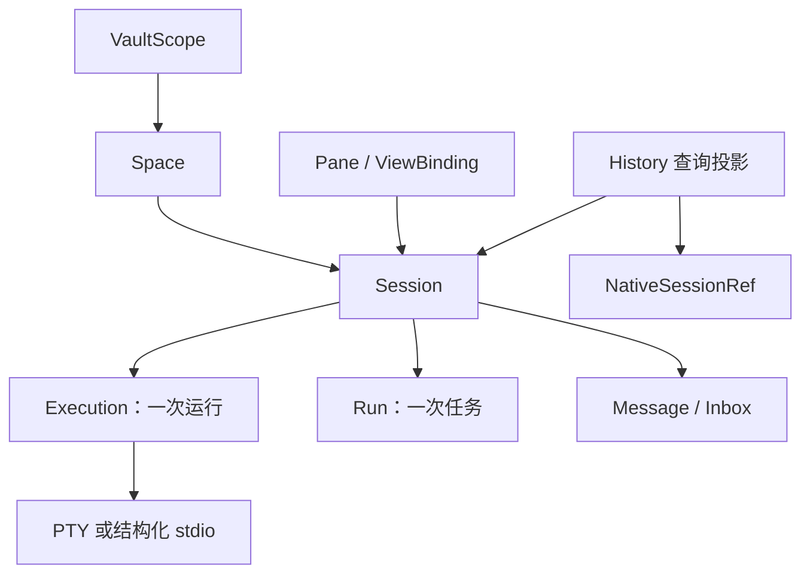
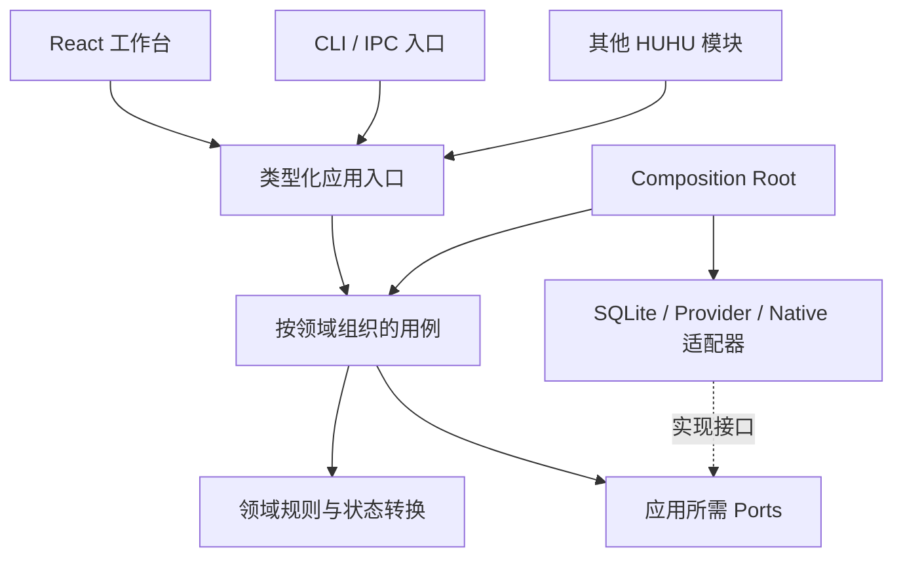
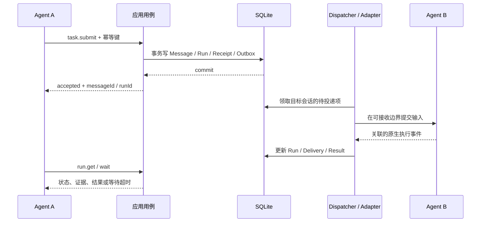

# HUHU 智能体工作台：全面架构审查与重构方案 v2

> **审查日期**：2026-10-25（Asia/Taipei）  
> **文档性质**：原方案审查、产品规格、架构决策与分阶段实施规范。  
> **目标项目**：[NAMEWTA/obsidian-huhu](https://github.com/NAMEWTA/obsidian-huhu)。  
> **源码核验基线**：`88c90cd319e1b37a627aeeabd7b1146c42bfaa5c`，对关键路径进行了只读核验；没有完成全仓代码审计、构建或实机运行。  
> **实施状态**：本次完成文档审查与重写；本文的新实体、命令、协议和目录均为目标设计，**不表示已在项目中实现**。  
> **替代范围**：替代旧方案中与本文冲突的模型、生命周期、存储、交互和实施顺序；用户笔记、账号、原生会话与其他模块的数据不因内部重构而删除。

## 0. 审查结论与明确决策

建议进行一次以领域模型和依赖边界为中心的全面重构。原文对 CLI、原生 PTY、多 Vault 路由和资源释放的考虑值得保留，但它仍以终端布局为业务主轴，没有充分覆盖本次真正的产品目标：

1. 顶层每次新建的是 **Space**。
2. 用户在 Space 内创建 **Agent 会话或普通终端**。
3. 多 Agent 能相互委派任务、交换消息、取得可关联的回复，并知道哪些结果尚不确定。
4. 智能体面板右侧有可展开的 **当前 Vault 会话历史**，能够查看、定位和按能力继续会话。

重构后的职责用一句话表达：**Space 组织工作，Session 保持会话身份，Run 记录一次执行，消息协议连接 Agent，Runtime 执行程序，Pane 展示会话，History 提供当前 Vault 的历史查询。**

### 0.1 本版推荐方案

| 决策 | 明确选择 | 解决的问题 |
|---|---|---|
| 产品组织 | `Vault → Space → Session`，Session 分 `agent / terminal` | 会话不再依赖分屏与进程存活 |
| 实现架构 | 模块化单体；按领域垂直组织，每个领域内部按需要分层 | 在一个插件内保持高内聚、低耦合 |
| 应用边界 | GUI、CLI、其他 HUHU 模块调用同一组类型化用例 | 避免多个入口各自实现业务规则 |
| 原生能力 | Rust 单一发行二进制；插件级 NativeHostBroker 管理租约 | 复用 PTY、历史、SQLite，并修正共享资源的所有权 |
| 执行后端 | `PTY` 与结构化 `stdio` 两种后端，能力显式声明 | 普通终端和可靠 Agent 编排可以共存 |
| 多 Agent 通信 | 持久 Message/Inbox、Run、结果关联、稳定幂等键 | 明确区分受理、提交、处理、回复与完成 |
| 数据 | Rust `rusqlite` 承载新业务数据库；单一业务写入入口 | 消息、Run、回执、Outbox 能在一个事务中提交 |
| 历史 | 当前 Vault 的查询投影；独立的右侧 HistoryDrawer | 不再把历史隐藏在终端布局或账号级列表里 |
| 会话恢复 | 保留 HUHU Session 身份，创建新 Execution generation | 旧 Hook 与旧进程事件不会污染新运行 |
| 首轮范围 | 两个经过验证的 Provider、普通 Shell、基础布局、完整通信与历史闭环 | 先证明核心，再增加 Provider 和复杂分屏 |
| 外部接口 | 本地 CLI + 带版本的契约 + 配套 Skill | 首轮无需 MCP、HTTP 服务或远程部署 |
| 资源保证 | Agent 停用释放它拥有的资源；所有 owner 释放后共享 Host 才停止 | 不再误杀浏览器导入或其他原生任务 |

本文不引入独立守护进程、微服务、Kafka/Redis、完整事件溯源、通用工作流引擎或新的桌面外壳。Obsidian 已经是宿主，不需要再引入 Tauri 或另建 Electron 应用。

### 0.2 首轮真正的完成标准

用户建立两个 Space，在第一个 Space 内创建 Agent A、Agent B 和一个终端。A 给 B 发送任务；B 在没有可见 Pane 时也能执行并产生关联结果。用户切换到第二个 Space，第一处的工作继续。关闭 B 的视图不会丢失会话；明确停止才结束运行。右侧历史栏默认显示当前 Vault 各 Space 的会话，点击可预览、打开已有会话或明确继续。重启后能恢复会话身份与历史，但不会偷偷重放旧任务或把“无法确认”显示成成功。

## 1. 证据、需求与范围

### 1.1 本次用户明确要求与设计决策要分开

| 类别 | 内容 | 处理方式 |
|---|---|---|
| 用户明确要求 | Space 是顶层创建对象；内部有 session/终端；多 Agent 通信；右侧 Vault 历史；允许全面重构；架构须有清晰技术栈与边界 | 作为 P0 产品要求 |
| 项目已有形态 | Obsidian 插件、TypeScript/React、Rust Helper、xterm、既有历史/账号/自动化集成 | 尽量复用可靠能力，重建错误依赖 |
| 原文沿用的产品假设 | 本机桌面端、Obsidian 托管运行、不跨宿主退出保活、CLI 优先 | 本版继续采用；不把它们伪装成本次用户逐项重新确认的要求 |
| 本版工程决策 | Session 独立、持久 Inbox/Run、SQLite 事务、NativeHost 租约、结构化适配器优先 | 给出理由、验收与失败处理，实施前可通过 ADR 变更 |
| 尚无证据的参照 | 用户提到的 Orca 未提供具体链接、版本或截图 | 只采用用户明确描述的“面板右侧展开当前 Vault 会话历史”交互，不声称核实其内部实现 |

Herdr 的官方概念包含 Workspace、Tab、Pane 和 Agent，但其 `Session` 指持久服务器命名空间，与本文的用户对话 Session 不同；不能直接照搬术语。Herdr 的后台服务模式也不属于本版目标。[S1]、[S2]

原文引用的 Ovis 是另一项目。Ovis 可作为 Chat/Terminal 表现的参考，不能推断它就是用户说的 Orca。[S3]

### 1.2 核心需求编号

| ID | 要求 | 验收要点 |
|---|---|---|
| U1 | 顶层新建 Space | 可建立空 Space；名称不是 ID；同 cwd 可建多个 Space |
| U2 | Space 内创建 Session/终端 | Agent 会话和普通终端都有持久身份；未运行也能出现在列表 |
| U3 | 多 Agent 通信 | 精确寻址、发送、排队、委派、回复、查询、取消与不确定结果 |
| U4 | 当前 Vault 历史 | 右侧展开；默认覆盖所有 Space；可预览、筛选、定位和按能力继续 |
| U5 | 生命周期稳定 | 切换视图不停止任务；停止、归档、删除与关闭视图区分 |
| U6 | 合理架构 | 边界可静态检查；业务不依赖 UI/PTY；适配器不向内泄漏外部模型 |
| U7 | 数据可迁移 | 历史、账号引用、布局、未归类旧会话与用户笔记得到明确处理 |

### 1.3 本轮边界

本轮重构智能体工作台及其必要的共享基础设施边界，不重写笔记、记账、联系人等无关模块。现有自动化、浏览器素材发送、技能列表等消费者需要适配新公共接口；“不兼容旧内部 API”不等于允许它们无声失效。

不纳入首轮：跨设备协作、远程访问、宿主退出后保活、动态第三方插件系统、多 Agent 自治规划框架、通用 DAG 编辑器、完整复制所有 Provider 的聊天 UI、所有原生历史格式的全文解析。保留账号配置和普通终端启动能力，并不等于承诺每个 Provider 都支持可靠协作。

## 2. 原方案全面审查

行号对应本次上传的旧版 Markdown，共 1,117 行。严重度含义：P0 会使核心目标缺失或引发错误行为；P1 会造成模型、可靠性或迁移缺陷；P2 为产品范围与维护性问题。

### 2.1 主要缺陷与修订

| 优先级 | 原文位置 | 审查发现 | 本版修订 |
|---|---|---|---|
| P0 | §6，L295–363 | 会话归属链是 Workspace→Tab→Pane→Terminal→AgentSession，仍由布局和进程驱动 | Session 直接归属 Space；Execution 与 Pane 分别引用 Session |
| P0 | §11，L681–711 | 未设计右侧当前 Vault 历史栏；原生 Chat/Transcript 被推迟 | 历史列表、预览、来源状态、定位和恢复列为首轮必交付 |
| P0 | §8，L501–565 | 多 Agent 通信被缩减为 prompt/wait/read | 增加 Message、Inbox、Run、回复关联与可查询回执 |
| P0 | §8.4、§13 | requestId、去重与任务接纳缺少明确事务边界 | requestId 负责单次传输；idempotencyKey 负责同一业务意图；事务提交后才返回 accepted |
| P0 | §5、§12、§14 | “无终端就关闭 Helper”忽略 Helper 既有历史和 Cookie 工作 | 将共享 NativeHost 从 Agent 模块提取；按 owner/能力租约释放 |
| P0 | §12 | 当前 Vault 历史的归属、摄入范围和已有账号历史混合问题未解决 | 摄入前判定 Vault 归属；不以 UI filter 代替数据范围约束 |
| P1 | §8.1、§11 | 创建 Agent 必须创建 Pane，CLI 也直接改布局 | 创建 Session/启动执行/附加视图拆为独立用例；后台 Agent 无需 Pane |
| P1 | §8.3 | `done` 被定义为“完成但未查看” | Run 执行状态与 lastReadEventSeq/未读状态分离 |
| P1 | §6.2、§8.4 | timeout 混入执行状态，易把等待超时当任务失败 | WaitResult 的 timeout 不改变 Run；执行 deadline 与主动取消单独处理 |
| P1 | §6.2、§11.2 | 一处说关视图保活，一处将关 Pane 等于杀 PTY | 默认关闭 Pane 只 detach；“停止运行”才结束进程 |
| P1 | §6.4 | 将“创建进程+写状态+建 Pane”承诺为一个原子操作 | 数据库受理原子；外部进程按 launchId 执行、核对与补偿 |
| P1 | §10.4 | 有快照/流要求但缺少订阅水位、解析完成和重连一致性 | 定义 terminalSeq、resizeEpoch、snapshot barrier、背压与丢失恢复 |
| P1 | §5.4，L286 | 先停止读写/订阅再关 stdin，可能堵住子进程输出与退出 | 先停接纳/输入，继续 drain 输出和退出事件，到截止时间再关闭读端 |
| P1 | §13 | 授权上下文未具体落到可核验身份；Pipe ACL 留到以后 | 握手绑定实例、调用者和能力；Windows 创建端 ACL 是平台交付门槛 |
| P1 | §14 | 全局 core/services/adapters/ui 为主，多个 Manager 易相互耦合 | 按 spaces/sessions/collaboration/history/workbench 垂直组织 |
| P1 | §14.3 | 改 on-demand 与 dynamic import 被等同于真正代码分包 | 区分代码字节、模块初始化、原生资源三类懒加载，按产物验收 |
| P1 | §17 | 到 P5 才验证 Agent 编排，最大技术风险暴露过晚 | 第一条执行切片就验证 A→B→结果，历史恢复紧随其后 |
| P1 | §12、§17 | 索引、业务历史、原生正文、旧回执没有区分可重建性 | 业务数据库、来源正文、历史索引、布局分别定义所有者及备份策略 |
| P2 | §1、§18 | 多个工程偏好被称为已确认硬约束 | 区分本次需求、原文假设、工程决策和待验证项 |
| P2 | §8.2 | 首轮列出很多 Provider，但没有能力矩阵和兼容等级 | 先验证两个 Provider；其余明确作为普通终端或能力有限的适配器 |
| P2 | §7 | Tab/Pane 低层命令过多，核心通信及历史命令不足 | 对外先稳定 space/session/message/run/history；布局命令后置 |

### 2.2 已核实的项目事实

以下来自固定 commit 的源码，而不是根据文件名推测。它们影响迁移方案，但不构成全仓正确性保证。

| 事实 | 证据 | 对重构的影响 |
|---|---|---|
| Agent manifest 为 `activation: 'startup'`，默认启用 | `src/modules/agent/manifest.ts` [R1] | 改懒加载前必须盘点其所有 service consumer |
| Agent 模块暴露自动化、技能、会话、浏览器联动及 NATIVE_HELPER_SQLITE | `module.ts`、`api.ts` [R2]、[R3] | 不可只替换终端 UI 后删除旧接口 |
| NATIVE_HELPER_SQLITE 实际仅提供 `readCookies` | `api.ts` [R3] | 它不是已存在的通用事务数据库 API；新存储端口必须实现 |
| 浏览器 Cookie 导入 acquire 该 Agent service，再 ensureHelper | `browser/module.ts`、`agent/module.ts` [R2]、[R4] | 当前跨域依赖方向错误；应改依赖插件级原生能力 |
| Helper 同时处理 PTY、history 和 cookies | Rust `main.rs` [R5] | Host 生命周期不能只由 PTY 数量决定 |
| 原生工程已经依赖 `rusqlite` bundled 和 `portable-pty` | `Cargo.toml` [R6] | 可以复用原生发行机制；无需新引入 Electron ABI 扩展 |
| 历史 scan/query/read 会调用 ensureHelper | `terminal/sessions.ts` [R7] | 读历史可以启动存储工作进程，但不能因此创建 PTY/Agent |
| `NativeHistory` 默认 scope 是 account，vault 使用独立 workspace-index | `platform/history/service.ts` [R8] | Drawer 必须使用明确的 Vault 归属模型及摄入规则 |
| 现有文档说明“本库/全部”可以只是显示筛选 | `docs/agent-workbench.md` [R9] | 重构不能把过滤后的账号全量索引宣传成 Vault 数据隔离 |
| 现有模型主要是 tabs/groups/layout/closedTabs | `core/workspace/model.ts` [R10] | Space 是新业务实体，不能只重命名 tab group |
| 技术基线包含 React、Zustand、xterm、虚拟列表、esbuild、Vitest | `package.json` [R11] | 复用现有栈，不做无关版本升级 |

### 2.3 应保留的设计资产

保留宿主控制进程生命周期、二进制校验、真实 PTY、headless 屏幕模型、按实例路由、未知状态保守处理、路径规范化、显式 argv、现有账号/历史适配经验和迁移备份机制。需要重构的是所有权、接口和业务状态的组织方式。

## 3. 产品信息架构与交互

### 3.1 三个区域

| 位置 | 主要内容 | 行为 |
|---|---|---|
| 左侧 | Spaces；当前 Space 下的 Agent 会话、终端及状态汇总 | 顶层 `+` 创建 Space；Space 内 `+` 创建会话或终端 |
| 中央 | 当前 Session 的 Chat、Terminal 或历史预览；可选分屏 | 显示层绑定 Session；分屏不决定 Session 是否存在 |
| 智能体面板右侧 | 可收起的“本 Vault 会话历史”抽屉 | 默认全 Vault；按 Space、Provider、时间、归档状态筛选 |

顶层统一叫 **Space / 空间**。实现中避免再与 Obsidian 的 `Workspace` 类、现有首页 workspace、Git worktree 混名。Tab 和 Pane 是工作台布局概念，不是用户必须理解的业务层级。

### 3.2 创建与打开

1. `新建 Space`：创建名称和目录绑定，允许空置；不自动启动 Shell 或 Agent。
2. `新建会话`：在当前 Space 中选择 Provider/配置，建立 Session；可先显示输入框，首次发送时再启动。
3. `新建终端`：建立 terminal Session 并启动 PTY，使用已校验的 Space cwd。
4. 无当前 Space 时，GUI 的快捷入口显式走“创建第一个 Space”流程；CLI 返回 `SPACE_REQUIRED`。不隐式把所有工作塞到默认空间。
5. 从历史打开已有 Session：优先定位该会话已存在的视图；没有视图就 attach，不重复启动进程。
6. Agent 通过 CLI 建立协作者：默认后台 Session，不抢焦点；Space 列表立即能看到，可由用户打开。

### 3.3 历史抽屉

抽屉标题明确为“本 Vault 会话历史”，默认覆盖当前 Vault 中所有 Space，包括已归档会话。每项显示标题、Provider、Space/未归类、更新时间、运行状态、来源可用性。

历史默认展示 Agent 会话；可切换“包含终端记录”，普通终端仅保证元数据和执行回执，完整屏幕录制另行开启。这里的“所有”是当前 Vault 内已管理或已可靠归属的历史，不是扫描用户机器上的所有账号对话。

| 操作 | 精确语义 |
|---|---|
| 单击历史项 | 只读预览，不运行 Agent，不改变原始记录 |
| 打开会话 | 定位/附加同一个 HUHU Session |
| 继续会话 | 在 Adapter 确认支持时创建新 Execution，保持原 Session 身份 |
| 从此创建新会话 | fork/import 新 Session，记录来源关系，不冒充原地恢复 |
| 加入 Space | 为已确定属于 Vault 的未归类历史建立显式归属 |
| 归档 | 修改 HUHU 的可见性标记，不删除原生 transcript |
| 从索引移除 | 隐藏或建立 tombstone；不等于删除原生记录 |
| 删除原始记录 | 独立的明确操作，首轮可以不提供 |

搜索首轮至少支持标题/元数据。全文搜索仅在 Provider 内容已解析且允许索引时开启，并显示索引覆盖范围。列表使用虚拟滚动、稳定游标和分页；新历史到来显示更新提示或稳定刷新，不能因为 offset 滚动而跳行/重复。

宽界面可采用右侧停靠栏，窄界面使用覆盖抽屉；开启抽屉不替换当前 Session。宽度建议 320–420 CSS px，视 Obsidian 容器可用宽度调整，这属于待实机验证的初始设计值。

右侧抽屉须支持键盘开关、Esc 关闭、焦点返回、空态、索引中、部分来源失败、来源缺失、无恢复能力等状态。一次 Provider 扫描失败不应让其他 Provider 的可用历史消失。

### 3.4 关闭、停止与归档

| 动作 | 视图 | Session/历史 | 进程 |
|---|---|---|---|
| 切换 Space | 切换可见内容 | 保持 | 继续 |
| 关闭 Pane/工作台叶子 | detach | 保持 | 继续 |
| 停止运行 | 显示已停止 | 保留 | 终止对应 Execution |
| 归档会话 | 从活动列表隐藏 | 保留，可在历史查询 | 先关新接纳、取消未提交任务，再停止活动执行 |
| 归档 Space | 隐藏活动导航 | 保留其会话与来源标签 | 对其中会话执行相同的队列与运行收束 |
| 停用智能体功能 | 关闭相应视图/操作入口 | 保留持久数据 | 停止本模块拥有的执行 |
| 关闭 Obsidian | 所有视图结束 | 保留持久数据 | 宿主控制的进程结束 |

首轮不支持运行中的 Session 跨 Space 迁移。Pane 在同一 Space 内调整只改布局；以后若支持迁移 Session，应是独立用例，校验未决消息、权限和目录，不能用拖动 Pane 暗中完成。

归档 Session/Space 的默认策略是：关闭新任务接纳，取消尚未提交的 queued 项，核对 dispatching 窗口，再停止活动执行，完成后才提交归档状态。用户主动“停止运行”则将待投递队列暂停，保留记录；显式继续后才恢复。归档和暂停范围不能被 `startIfStopped` 自动唤醒。

历史“继续”按钮发现已有活动 Execution 时只定位它。导入时先按 NativeSessionRef 查重；已有可写 Session 就打开原记录，不为另一个 Space 再导入第二份可写副本。需要复制语义时使用明确的 fork。

## 4. 领域模型与状态

### 4.1 对象关系



图表示归属或引用，不表示把全部子对象放进一个巨大内存树。Space、Session、Run 分别有自己的更新边界；Space 不因新消息到来而重写整个聚合。

| 对象 | 生命周期与职责 | 不应该承担 |
|---|---|---|
| VaultScope | 逻辑数据范围、物理路径绑定、设备/实例路由 | OS 沙箱 |
| Space | 名称、cwd、会话归属策略、归档 | PTY 句柄、终端屏幕、Provider 客户端 |
| Session | 持久会话 ID、类型、标题、Provider/配置引用、原生会话映射 | React 组件、具体 PID |
| Execution | 本次运行 ID、generation、后端、进程引用、运行状态 | 长期历史身份 |
| TerminalStream | 某 Execution 的 PTY、尺寸、屏幕模型、字节序号 | Agent 任务完成判定 |
| Run | 一次请求执行、结果、证据、取消及关联链 | 用户是否看过答案 |
| Message / Delivery | 发送者、接收者、内容引用、投递事实、回复关联 | Pane 布局 |
| NativeSessionRef | Provider、配置/账号范围、设备源、原生 ID | 凭证内容 |
| HistoryEntry | Session 与原生来源的查询投影、可读/可继续状态 | 第二套可独立修改的会话真相 |
| ViewBinding / Pane | Session 的展示位置、视图类型和尺寸 owner | 启停进程的隐含所有权 |

Agent 是 agent 类型的 Session 在运行时的角色。首轮无需额外建立一套重叠的 Agent、AgentSession、AgentInstance 全局实体；CLI 的 `agent` 可以是针对 agent Session 的便利命令。

### 4.2 必须保持的不变量

1. 新建 Session 必须属于当前 Vault 的一个 Space；未导入的原生历史可以暂时没有 HUHU Session。
2. 持久业务 ID 全局随机且跨重启不复用；名称只是显示名，模糊寻址返回 `AMBIGUOUS_TARGET`。
3. Session 与 Pane、PTY、原生 session ID 不是同一个 ID。
4. 同一 Session 默认最多一个活动可写 Execution；原生引用另有唯一占用约束，不能被两个 Session 同时恢复写入。
5. 同一 Session 同时最多一个活动 Run；后续请求进入有界 FIFO。允许并行时应建立新的协作者 Session。
6. 输入默认在回合边界投递，不能把协作文本打进正在运行、权限询问或身份不明的 TUI。
7. `fromSessionId` 从已认证调用上下文得到，不能相信请求正文自报身份。
8. 进程 PID 不是稳定身份；每条运行事件带 executionId/generation，拒绝旧代事件。
9. cwd 不是 Space 主键，不是历史唯一归属证据，也不是 OS 级隔离。
10. 幂等成功回执与业务变化同时持久化；不同 payload 复用同一幂等键返回冲突。
11. 历史可读、原生来源存在、可恢复是三个独立能力，不能相互推断。
12. UI 已读变化不会改变 Run 结果；等待超时不会把 Run 变成失败。

### 4.3 状态分别建模

| 状态维度 | 建议值 | 说明 |
|---|---|---|
| Session 生命周期 | `active / archived / deleted` | deleted 为元数据 tombstone，物理清理是另一个操作 |
| Execution | `starting / ready / running / blocked / stopping / exited / failed / lost` | lost 表示连接/宿主失效，等待核对 |
| Run | `queued / dispatching / running / blocked / cancel_requested / succeeded / failed / cancelled / indeterminate` | 后四个为本次执行的收束状态；indeterminate 保留核对入口 |
| Delivery | `queued / dispatching / submitted / confirmed / rejected / indeterminate` | submitted 只证明提交尝试，confirmed 必须有对应接收证据 |
| WaitResult | `matched / timed_out / aborted / disconnected` | 只是调用者等待结果 |
| Attention | `unreadCount / lastReadEventSeq / needsInput` | 独立 UI/用户状态 |

`Run.succeeded` 表示提供方对该回合给出了可信的完成结果，不表示生成代码已经正确、测试已经通过或现实任务已经达成。测试结果和产物验收是独立证据。

对于 `indeterminate`，后续核对可登记 Resolution，并使查询投影展示最终证据；原来的失败窗口与事件不能被覆盖抹去。没有明确证据时只能保持不确定，不能定时自动改成成功。

`indeterminate` 不证明外部 Agent 已经空闲。Session 保持 `executionGate=reconciliation_required`，继续阻止下一任务输入；只有核对已结束或明确停止旧 Execution 并完成核验后才能解除。一个 Run 收束为“不确定”不能自动释放同一原生会话的可写占用。

## 5. 技术栈与选型理由

以下为本版推荐，而非对所有依赖最新版本的承诺。实施时以固定基线的 lockfile 为起点，分别升级确有必要的依赖，避免架构重构与全量版本升级混在一起。

| 层 | 选择 | 理由与边界 |
|---|---|---|
| 宿主 | Obsidian Desktop API | 保持插件形态；不新增桌面外壳 |
| 业务代码 | TypeScript strict | 与现有项目兼容；领域规则不依赖 Obsidian/Node/React |
| UI | React + 现有组件/主题体系 | 复用现有样式变量、可访问性和交互组件 |
| UI 状态 | Zustand selector + 轻量 ViewModel | 只存视图状态与业务投影；不作为业务数据库 |
| 列表/布局 | 现有 `@tanstack/react-virtual`、`react-resizable-panels` | 先做基础分屏与历史列表，不引入新布局框架 |
| 终端 | `@xterm/headless` + `@xterm/xterm` + serialize/fit | headless 为权威屏幕；可见 xterm 是观察者 |
| 进程 | Rust + `portable-pty`；结构化程序用 pipes | 原生 PTY 和 JSON 进程各有适用通道 |
| 数据库 | Rust `rusqlite` bundled | 项目已有原生依赖；减少 Electron/Node ABI 适配问题 |
| 外部 CLI | Rust `clap` + `serde` | 同一发行二进制输出帮助、Schema、Skill并连接插件 |
| IPC | 本机 Socket/Named Pipe；受限长度帧 | 不增加公网端口；传输与业务契约分离 |
| 契约 | 版本化 JSON Schema + 生成的 TS/Rust DTO + 运行时校验 | 统一错误/字段/兼容性；生成物由 CI 检查 |
| 并发 | 每接收 Session 的串行邮箱、单一 DB writer、短事务 | 不需要分布式队列；长任务不持事务或全局锁 |
| 测试 | Vitest、Rust cargo test、契约 fixture、平台实机 E2E | 重点验证边界、崩溃窗口与资源归属 |
| 构建 | 现有 pnpm/esbuild/Rust CI | 首轮不切换工具链；是否物理分包单独验证 |

SQLite WAL 只用于本机文件系统；它允许读写并行，但一个数据库仍只有一个 writer，不能当作多机共享数据库。[S6] 不能依赖运行中 SQLite 文件的普通同步来实现跨设备业务一致性。

`@xterm/headless` 与可见 xterm 的版本须成组锁定；序列化快照包含哪些状态要通过真实终端程序验证，而不能假设它覆盖所有私有模式和输入状态。

### 5.1 暂不采用的选项

- LangGraph/AutoGen 等编排框架：核心需求是管理现有 CLI Agent 的会话与通信，先用明确的用例和邮箱即可。
- Redis/Kafka/RabbitMQ：单机插件无相应部署必要，SQLite 事务 Outbox 足够承担本轮受理可靠性。
- 独立微服务：增加部署和进程治理，无法自然满足 Obsidian 托管生命周期。
- Electron 内新引入 `better-sqlite3`：会增加原生 ABI 的另一条发行链；已有 Rust SQLite 可复用。
- 全局事件总线驱动所有写操作：难追踪事务与错误；写操作用显式用例，事件用于通知与投影。
- 完整 Event Sourcing：保留当前状态、事务 Outbox 和审计事件即可，不以全量事件重放重建整个产品。

## 6. 分层、垂直领域与设计模式

### 6.1 采用“按领域切块，块内分层”

水平分层回答“这是业务规则、用例还是技术实现”；垂直切块回答“这段代码为哪个业务能力负责”。二者可以同时使用。



依赖方向由外向内：UI 与平台适配器可以依赖应用契约，领域不能 import React、Obsidian、Node、SQLite、xterm、供应商 SDK。通过构造参数装配依赖，不在领域里调用全局 service locator。

### 6.2 五个垂直领域及基础设施

| 模块 | 拥有的事实/职责 | 对外用例 | 禁止直接依赖 |
|---|---|---|---|
| `spaces` | Space 定义、cwd 绑定、归档策略 | create/rename/archive/list/get | xterm、Provider、PTY |
| `sessions` | Session 身份、NativeRef 映射、Execution 生命周期 | create/start/stop/resume/get | UI Store、跨 Agent 调度细节 |
| `collaboration` | Message/Inbox、Run、Delivery、幂等受理与回复 | send/submit/reply/wait/cancel/get | DOM、原生 transcript 格式 |
| `history` | Vault 归属判定、查询投影、历史导入及来源状态 | list/search/preview/import/resolve | 隐式创建 Agent/PTY、绕过 Broker 启进程、其他领域私有 Store |
| `workbench` | Pane/Tab、焦点、抽屉和视图绑定 | attach/detach/split/focus | 直接写数据库、kill/spawn |
| 插件级 `native-host` | 安装、版本握手、共享进程、租约、PTY/pipes、原生存储 | acquire/release/native operations | Space 名称规则、Agent任务业务策略 |

`history` 可读取 sessions/collaboration 的已发布查询模型，也可维护可重建投影；不直接改它们的内部表。跨域写流程通过明确的应用用例组合。不能让每个 Manager 持有所有其他 Manager。

### 6.3 各层的真实工作

| 层 | 应包含 | 示例 |
|---|---|---|
| Domain | 不变量、纯状态转换、标识和值对象 | Space 可归档条件、Run 合法迁移 |
| Application | 授权、调用编排、事务、失败补偿、重试决策 | SubmitTask、ResumeSession |
| Ports | 应用实际需要的外部能力 | SessionRepository、ProcessPort、AgentExecutionPort、Clock |
| Outbound Adapters | 外部接口到内部模型的转换 | Codex/Claude 事件归一、SQLite Repository、Rust RPC |
| Inbound Adapters | 输入解析、版本/参数校验、调用用例 | IPC Handler、CLI command mapping、模块 API façade |
| Presentation | 视图状态、动作绑定、错误/进度展示 | SpaceTree、SessionPane、VaultHistoryDrawer |
| Composition Root | 创建与连接上述对象，登记释放顺序 | `composition.ts` |

纯 CRUD 不必机械建立十几个类。领域内简单用例可以是函数；只有跨技术、跨进程、可替换实现或需要测试替身的边界才抽端口。

### 6.4 采用的模式及限度

| 模式 | 实际应用 | 不扩大的范围 |
|---|---|---|
| DDD 的有界上下文/聚合 | Space、Session、Collaboration 各自拥有状态与规则 | 不做仪式化的大量 Entity/ValueObject 包装 |
| Ports and Adapters | Provider、存储、原生运行和宿主依赖放外侧 | 不把业务判断藏在 Adapter |
| Vertical Slice | 一个用户行为贯穿入口、用例、规则、存储与最小 UI | 不按“先写全部 services 再写全部 UI”交付 |
| 轻量 CQRS | Command 走用例；列表/历史用专用查询投影 | 不拆两套数据库，不引入 CQRS 框架 |
| Unit of Work | 一个 SQLite 事务提交 Message/Run/Receipt/Outbox | 不跨进程启动或等待网络响应持有事务 |
| Transactional Outbox | 持久接纳后驱动投递，并可检查失败窗口 | 不宣称外部 Agent 执行 exactly-once |
| Policy / Strategy | Provider 能力、投递策略、恢复策略显式选择 | 不自动回退到能力更弱且语义不同的通道 |
| Anti-Corruption Layer | 外部 Thread/Turn/Hook 映射成内部 Session/Run 证据 | 原生对象不会流入 UI/领域到处使用 |
| Lease / Resource Scope | 插件级 Host 与模块内 Execution 可独立释放 | 不用全局终端计数替代所有资源所有权 |
| Observer | 已提交状态推送给 UI，丢失后可重新查询 | UI 事件不承担持久任务投递 |

“CommandDispatcher”只是类型化路由、横切校验与观测入口。它不能成为拥有全部业务状态和所有副作用的超级 Controller。

## 7. 目标代码组织

目录是设计方向，可以在现有路径规则下调整；import 边界比命名更重要。

| 路径 | 内容 |
|---|---|
| `src/modules/agent/manifest.ts` | 轻量声明，不导入 xterm/Provider/账号扫描 |
| `src/modules/agent/api.ts` | 跨模块稳定公开接口，仅 contracts 与 façades |
| `src/modules/agent/composition.ts` | 应用与适配器装配、生命周期容器 |
| `src/modules/agent/domains/spaces/{domain,application,ports}` | Space 能力 |
| `src/modules/agent/domains/sessions/{domain,application,ports}` | Session/Execution 能力 |
| `src/modules/agent/domains/collaboration/{domain,application,ports}` | 消息、Run、投递与回执 |
| `src/modules/agent/domains/history/{application,ports,model}` | 历史归属与查询，轻量模型无需强造聚合 |
| `src/modules/agent/workbench/{model,application,ui}` | 布局、ViewBinding、Space 页面、历史抽屉 |
| `src/modules/agent/adapters/providers/{codex,claude,generic}` | Provider 执行与历史适配 |
| `src/modules/agent/adapters/storage` | Agent 业务存储/历史索引 Repository |
| `src/modules/agent/adapters/runtime` | ProcessPort、屏幕与输入仲裁 |
| `src/modules/agent/adapters/ipc` | 命令解析与结果映射 |
| `src/app/desktop/native-host` | 跨模块 HostBroker、安装器、RPC、资源租约 |
| `src/app/contracts/native-host.ts` | 其他模块能依赖的最小原生能力契约 |
| `contracts/agent-api/v1` | CLI/IPC 请求、响应、事件与错误 Schema |
| `native/huhu/src/{cli,runtime,storage,ipc,platform}` | 原生入口、进程、存储、客户端及平台实现 |

垂直切片示例 `submit-task` 的请求 DTO、用例、事务批次、adapter fixture 与用例测试应靠近所属领域，而不是散到全局 `utils/services/helpers`。

### 7.1 必须由 CI 检查的边界

- Domain 不导入宿主、Node、React、xterm、Provider SDK。
- UI 不直接引用 SQLite/NativeRuntimeClient，不调用 spawn/kill。
- 其他 HUHU 模块只导入 `agent/api.ts` 等公开契约。
- Provider adapter 不导入 workbench 的 Pane/layout。
- NativeHostBroker 不导入 Agent domain。
- `shared` 仅放已有多个消费者且无业务所有权的代码；不能成为跨域任意访问通道。
- CLI 和 Skill 的命令清单来自同版本契约；新增 Provider 不要求编辑 Pane 模型。

## 8. 应用编排与事务边界

### 8.1 核心用例

| 用例 | 输入与检查 | 持久变化 | 外部副作用 |
|---|---|---|---|
| CreateSpace | 名称、已验证相对 cwd、幂等键 | Space + Receipt | 无 Agent/PTY；必要时获取存储租约并启动 Host |
| CreateSession | Space、类型、Provider/profile 引用 | Session + Receipt | 默认无，按用户动作可继续启动 |
| StartExecution | Session、后端能力、当前 generation | starting Execution + launch intent | 获取 Host 租约并启动 |
| SubmitTask | 认证发送者、目标、容量、幂等键 | Message + Run + Outbox + Receipt | 后续 worker 投递 |
| SendMessage | 接收者及消息类型、范围 | Message + Inbox + Receipt | 不自动生成推理任务 |
| AttachMaterial | Session、材料、输入区状态与权限 | 未提交的草稿/材料记录 | 只附加或粘贴，绝不隐式提交新 Run |
| ResumeSession | 原生引用、账号、可恢复性、无活动 writer | 新 Execution generation | 以精确原生引用继续 |
| OpenHistoryEntry | Vault 归属、可读来源 | 只读；显式导入时才写 Session | 读取历史，不启动 Agent |
| StopExecution | 精确 executionId、控制权限 | stop intent / cancel_requested | 发中断并核验退出 |
| DisableAgentModule | 模块 epoch、活动操作 | queued/active 的明确收束记录 | 释放本模块执行与租约 |

### 8.2 创建 Session 与启动进程分开

先提交 Session，再显示一个明确的“未启动/正在启动”会话。启动失败时保留该 Session、失败原因和重试动作，不为了实现所谓“无幽灵 Pane”删除已有记录。

启动流程：持有存储租约，建立 `launchId + executionId + generation` 的意图 → 提交 → 获取执行租约 → 按 launchId 请求 spawn → 保存实际启动结果。Host 在同一实例内对 launchId 去重，并提供查询接口。连接中断时先查执行记录，不能立刻重启第二个进程。

停用期间使用 moduleEpoch 与 AbortSignal，所有异步阶段提交前检查 epoch。即使 spawn 在取消后迟到成功，也必须立即终止那个确切 Execution，并写出中断结果。

### 8.3 接纳任务的事务

应用侧先完成 Schema、身份、范围和基本业务校验。读取目标状态并构建短事务计划；提交时以 revision/唯一约束再次保护并发条件。

```ts
// 目标伪代码；不是已经实现的项目 API。
async function submitTask(cmd: SubmitTask, caller: AuthenticatedCaller) {
  const scope = policy.resolveTarget(caller, cmd.targetSessionId);
  const key = idempotency.scope(caller, scope, "task.submit", cmd.idempotencyKey);
  const digest = canonicalPayloadDigest(cmd);
  const prior = await receipts.find(key);
  if (prior) return requireSamePayload(prior, digest);

  const target = await sessions.get(scope.targetSessionId);
  const plan = planTaskAcceptance(target, cmd, caller, key, digest);
  // 一个事务：Message、Inbox、Run、Receipt、Outbox 及并发前置条件。
  const receipt = await agentStore.commit(plan);
  dispatcher.wake(); // 提示可丢；事实已在 Outbox，下次仍能查询。
  return receipt;
}
```

不允许 `await provider.submit()` 位于数据库事务中，也不允许持有 Session 的全局互斥锁等待整项任务完成。Rust 存储适配器只实现受限的查询、约束和原子批次；业务调度、权限与任务策略仍在 TS 应用层。

SQLite 端口不能暴露给外部 CLI 作为任意 SQL。新 `agentStore.commit` 是需要实现的私有能力，现有 Cookie 读取服务不具备该语义。[R3]

`receipts.find` 预查不能代替数据库最终裁决：并发提交命中同一幂等唯一键时，事务内核对摘要并返回已有回执。同键不同摘要才返回冲突。事务内还须校验目标 revision、归档/暂停门禁和队列容量。

### 8.4 取消语义

- 取消 queued Run：在事务中标记 cancelled，worker 不得再领取。
- 取消 dispatching：只有确认尚未提交外部输入才可直接 cancelled；否则进入中断/核对流程。
- 取消 running：先 `cancel_requested`，发 Provider interrupt 或进程中断；按可关联最终证据记录实际结果。完成先于取消生效时允许 succeeded，仅收到取消请求不能直接判 cancelled。
- 取消等待：仅结束 WaitResult；任务继续。
- 普通父 Agent 退出：协作者 Session 默认独立存在；任务关联仍保留。只有显式创建的临时子任务组才按声明的生命周期级联取消。

## 9. 多 Agent 通信的完整语义

### 9.1 首轮通信范围

首轮支持同一 Space 的点对点通信、任务委派和关联回复，既支持父子关系，也支持已有同级 Session。跨 Space 调用默认拒绝并返回 `CROSS_SPACE_DENIED`；后续可以增加用户显式授予的共享协作范围。跨 Vault 通信不在本轮范围。

每个 Agent Session 是一个稳定地址。Runtime 会变，地址不变。Space 同名、Agent 同名、cwd 同名都不能替代 ID。

### 9.2 两类调用必须分开

| 调用 | 语义 | 是否新建 Run |
|---|---|---|
| `message.send` | 向接收者邮箱放入通知/信息 | 否；被动入箱，不自动唤醒模型 |
| `task.submit` | 请求目标 Session 对输入进行一次受控执行 | 是 |
| `message.reply` | 将回复绑定到原请求与 correlationId | 不因回复本身再新建 Run |
| `run.wait` | 等待已有 Run 达到条件 | 否 |
| `run.cancel` | 请求停止已有执行 | 否 |

首轮消息收取提供 `inbox.list/read/ack`。ack 表示该会话的受授权工具消费者确认读取，不证明模型已经理解。通知消息可以在下一次受控输入边界按明确策略加入上下文；默认不自动变成新任务。

任务执行结果保存到 Run，并产生发给原发送者的 `result` 消息。原发送者正在运行且等待工具结果时，由 `run.wait/get` 返回；原发送者已经停止时，结果留在邮箱与历史里，不需要盲打进其旧终端。

### 9.3 消息信封

```ts
interface AgentMessage {
  messageId: string;
  vaultId: string;
  spaceId: string;
  sender: { kind: "user" | "agent" | "automation"; principalId: string; sessionId?: string };
  recipientSessionId: string;
  kind: "notification" | "task" | "result";
  correlationId: string;
  causationId?: string;
  replyToMessageId?: string;
  parentRunId?: string;
  bodyRef: string;
  createdAt: string;
  schemaVersion: 1;
}
```

正文以文本或受限结构化内容存储；文件结果用经过授权的 artifactRef，避免在消息里复制任意大文件。引用必须带来源与有效性，不能把机器路径不加校验直接开放给接收者。

### 9.4 受理、投递与执行



只有持久事务成功，CLI 才能输出 accepted；它不是成功完成任务的意思。`submitted` 证明 Adapter 已执行输入尝试；`confirmed` 需要可关联的原生接收或启动证据。PTY write/回车成功最多支持 submitted。

### 9.5 幂等与崩溃窗口

幂等键范围固定为 `(vaultId, principalId, scopeId, commandName, idempotencyKey)`。Space 内操作以 spaceId 作为 scopeId；CreateSpace 等操作使用固定的 Vault scope。保存 canonical payload digest；同键同参数返回原 receipt，同键不同参数返回 `IDEMPOTENCY_CONFLICT`。

| 崩溃位置 | 恢复行为 |
|---|---|
| 事务前 | 未受理，允许以同一键重试 |
| commit 后、CLI 响应前 | 重试返回原 messageId/runId |
| queued 尚未领取 | 仍在队列；宿主重启后默认暂停待确认，不自动恢复外部写操作 |
| 标记 dispatching 后、发送前后无法区分 | 核对 Provider；没有可证明的幂等提交能力时标为 indeterminate |
| Provider 已确认结束、保存结果前 | 尝试按 nativeRunId 拉取对应结果；不可确认则记录不确定 |
| UI 事件推送丢失 | 重读权威状态，不重发任务 |

本轮承诺“持久受理可去重、内部投递有记录、外部副作用不确定时不盲重试”。不承诺任意 CLI/TUI 的端到端 exactly-once。

详细回执可按保留策略压缩；首轮在其作用域仍存在时保留最小幂等 tombstone，作用域已删除的写请求直接拒绝。若以后按时间删除 tombstone，须引入可验证的 key epoch/有效期协议后才能返回 `IDEMPOTENCY_KEY_EXPIRED`，不能清掉记录后凭空识别旧键。Run/消息正文删除策略与最小去重记录保留策略分别配置。

### 9.6 队列、背压与循环调用

- 同一接收 Session FIFO，多个发送者按数据库接纳序号排序，不声称全 Space 的全局因果总序。
- 起始容量建议：每接收者 32 项待办、每 Vault 8 个活动 Agent、每协作链深度 4；这些是保守的可调初值，须压测，不是已测性能结论。
- 队列满时返回 `QUEUE_FULL` 与可查询状态；不悄悄丢任务。
- blocked 不继续投递下一个任务；需要用户响应或明确取消当前 Run。
- 任务已受理不代表自动启动已停止 Session；`startIfStopped` 必须在请求策略中明确，模块关闭时始终拒绝。
- 跟踪 parentRunId/correlationId 与等待关系；A 同步等待 B，而 B 的任务又排到正在被 A 占用的同一 Session 时，返回 `DEPENDENCY_CYCLE` 或改为显式异步通知。
- 保留 stop/cancel 高优先级路径。任务等待不得占用全局调度锁。
- UI 事件可以有界丢弃后重读；持久 Message/Outbox 不能使用同一套丢弃队列。

Dispatcher 是插件内的可恢复异步循环。Inbox、Delivery、Outbox 是轻量记录与规则，不代表新增多个调度服务。首轮 Inbox 可由 messages 查询及 read cursor 实现，Delivery 和任务 Outbox 可合并成同一张 `deliveries` 表，避免保存相互漂移的投递状态副本。

### 9.7 共享文件修改不是通信问题的自动解答

两个 Agent 同一 cwd 工作仍可能写同一文件。首轮不隐式创建 worktree。协作任务携带建议的读写策略：审查角色默认只读；写角色按模块/文件分工；实际权限仍由 Provider/宿主执行边界控制。

协作 UI 显示哪些会话共享目录。要求严格并行修改隔离时，应显式创建 Git worktree 或其他执行环境。Space、消息协议、API capability 都不能被宣传为文件系统沙箱。

## 10. Provider 适配层

### 10.1 将大 Adapter 拆成具体端口

| 端口 | 职责 |
|---|---|
| ProviderCatalog / InstallationProbe | 发现安装、版本与支持能力，不扫描整个用户目录 |
| LaunchProfileResolver | 解析账号配置引用、argv/env、工作目录和权限策略 |
| AgentExecutionPort | start/resume/submit/interrupt、事件订阅与结果核对 |
| NativeHistoryPort | 只读查询原生会话、分页读取 transcript、报告来源状态 |
| TerminalTransportPort | PTY 字节输入、尺寸、输出，不理解 Agent 任务 |

一个 Provider 可以实现其中部分端口，不必为不支持的功能编写假实现。

```ts
interface ProviderCapabilities {
  executionModes: readonly ("pty" | "structured-stdio")[];
  submit: "native-correlated" | "pty-guarded" | "unsupported";
  completion: "turn-correlated" | "session-observed" | "unknown";
  transcript: "structured" | "native-readonly" | "metadata-only";
  resume: "native" | "fork-only" | "unsupported";
  interrupt: "turn" | "process" | "unsupported";
  interactiveApprovals: boolean;
}
```

Provider/CLI 版本是能力判定的一部分。probe 失败时将能力降为 unknown/unsupported，并返回原因，不能因“这是 Codex/Claude”就永久假定所有版本均支持。

### 10.2 两种执行模式

**结构化模式优先承担可验证的协作。** 使用原生 thread/session、turn/run 和结构化事件来关联输入输出。Codex App Server 公开了 thread、turn、item 和双向协议；Claude Code 提供可编程 CLI 输出和精确会话恢复入口。这支持采用专用适配器，而不是只依赖终端截图。[S4]、[S5]

**PTY 模式保留真实交互终端。** 供普通 Shell、用户喜欢的原生 TUI 和缺少结构化能力的 Provider 使用。必须经过输入仲裁、ready 检查、Hook 关联与可信度标注。

同一个活动原生会话不能同时由结构化进程和 PTY/TUI 双写。切换后端需要先停止旧 Execution，验证 native resume 能力，再建立新 generation。UI 的“Chat / Terminal”切换只在确实可显示同一执行的数据时开放；不能为了显示 Terminal 再启动一个会改写同一 transcript 的 CLI。

结构化执行没有真实 PTY 时，显示 Chat、执行事件和日志；不能把日志窗口标成可交互 Shell。

### 10.3 首轮 Provider 建议

| Provider | 首轮推荐路径 | 必须完成的验证 |
|---|---|---|
| Codex | 结构化 App Server adapter；PTY 作为独立可选模式 | 初始化握手、thread/turn 映射、完成/错误/审批、中断、恢复、断线核对 |
| Claude Code | 受控非交互 CLI/结构化输出 adapter；需要完整交互审批时采用已验证 SDK 能力或 PTY 模式 | 精确 session ID、结构化 result、退出错误、恢复、stdin/输入协议、权限失败和阻塞语义 |
| Generic CLI | 普通 PTY | 输入/输出/退出码；不冒称能解析答案或知道任务完成 |
| 其他已配置 Provider | 保留账号引用和终端启动，逐个扩展能力 | 未通过契约测试前不开放“可靠任务委派”标记 |

首个技术切片可以先用一个 Provider 的两个独立 Session 验证机制；进入首轮产品完成门槛前用第二个 Provider 验证抽象，避免设计被单个原生协议绑定。

### 10.4 完成证据与输入仲裁

每个 Run 的结果记录 evidence：`native-correlated / process-result / session-observed / heuristic / unknown`，包含 executionId、nativeRunId（若存在）、事件序号和来源。只有满足该 Adapter 契约的完成证据才能将相应 Run 标为 succeeded。

Hook 不是天然可信的本轮完成凭据。Claude 的 Stop/SubagentStop 等事件具有各自的阻止与继续执行语义，Adapter 必须理解这些差异；只看统一的“Stop”字样不够。[S10]

PTY 的 `InputArbiter` 同时接收 UI 键盘、粘贴、CLI raw input 和自动化。提交文本与提交键组成一个短输入事务；自动输入期间防止交错，用户接管动作则中止该自动输入并记录。不能只把两个 `write()` 排在一起就声称和用户输入互斥。

Agent 已 busy/blocked/unknown 时，raw input 仍属明确的用户控制能力；普通协作 prompt 必须排队或拒绝。审批问题必须通过 Provider 支持的明确审批通道处理，不能把下一条任务当作权限提示的回答。

## 11. 持久化、历史和恢复

### 11.1 四类数据分开管理

| 数据 | 权威来源 | 是否可直接重建 | 策略 |
|---|---|---|---|
| Space、Session、Message、Run、回执、归档/标注 | HUHU 业务数据库 | 否 | 事务、备份、迁移、保留策略 |
| Provider 原生 transcript | Provider 的来源文件/API | 取决于 Provider | 默认只读；保存精确引用与可用性 |
| 历史摘要/全文搜索索引 | 从业务记录与已认可来源生成 | 是 | 可丢弃重建，不删除用户标注 |
| Pane/Tab、焦点、抽屉宽度 | 本设备展示设置 | 可重置，但应保留用户布局 | 独立版本；不作为会话身份来源 |

HUHU 自己接纳的任务输入、消息与最终结果默认持久保存，支持本次要求的历史。原生 transcript 可按需读取；完整 PTY 屏幕录制默认关闭。不要以“不录屏”为理由不保存 HUHU 自己的业务会话记录。

### 11.2 数据库位置与单写者

**本版选择**：新业务数据库、活动索引、IPC locator、凭证和锁放在 OS 每用户的本机私有数据目录，以本地 Vault 绑定 ID 分区。二进制暂时保留现有按 Vault/设备/版本安装方式，迁移范围较小；安装路径仍不是授权凭据。

建议逻辑路径：`<LocalAppData>/HUHU/vaults/<localVaultBindingId>/agent-v2/state.sqlite`。`LocalAppData` 是平台适配器解析的本机应用数据位置，不是让业务层硬编码 Windows 环境变量。Unix Socket 使用更短的私有 runtime 目录。

本地绑定登记 `{logicalVaultId, canonicalVaultPath, localVaultBindingId}`：复制 Vault 不能复用活动 endpoint；重命名/移动 Vault 要通过受控的重新绑定，不能仅因路径 hash 改变就丢失全部历史。多个进程同时打开同一个物理 Vault 时，由本机锁选择唯一写入 owner，第二个明确报冲突或进入受支持的只读模式。

这是相对原文“全部运行数据放 Vault”作出的有意调整。Space 与历史仍按 Vault 组织，但不会依赖同步软件忽略活动数据库。跨设备历史同步不属于本轮；需要便携备份时导出版本化快照/内容包，而不是同步活动的 DB/WAL/SHM。该改变必须在项目数据文档和备份入口中解释清楚。

### 11.3 实际事务实现

- 一个 NativeHost 中的 AgentStore worker 管理同一 Vault 业务 DB 的写入；TS 应用是唯一业务写入口。
- 使用受限的命名 query 与 atomic write batch，不向公开 IPC 暴露文件路径任意打开或任意 SQL。
- 开启 foreign_keys；写事务短小，使用 revision/条件更新与唯一约束处理并发。
- 对已返回 accepted 的业务数据采用 `synchronous=FULL` 等经过验证的耐久配置；仍受 OS/存储设备正确性约束，不承诺硬件断电下绝对不丢。
- 历史搜索缓存可以采用较弱耐久等级，不能把原缓存的参数直接沿用到业务消息数据库。
- DB reader、history scanner 与 PTY 输出不共用无界阻塞执行队列；慢扫描不得阻塞 stop/cancel。
- 事务提交失败、磁盘满、只读目录时不启动外部任务，并返回 `STORAGE_UNAVAILABLE`。
- 使用 SQLite 备份机制或停止 writer 后的一致快照备份；不要仅复制一个仍在使用的 `.sqlite` 文件而遗漏 WAL。

### 11.4 核心表与索引

| 表 | 主要字段/约束 |
|---|---|
| `spaces` | id、vault_id、name、cwd_ref、archived_at、revision |
| `sessions` | id、vault_id、space_id、kind、provider_id、profile_ref、title、archived_at、revision |
| `native_bindings` | session_id、provider_id、canonical_profile_ref、source_device、native_session_id；来源组合唯一 |
| `executions` | id、session_id、generation、backend、launch_id、state、started/ended；同 Session 活动 writer 唯一 |
| `runs` | id、target_session_id、message_id、parent_run_id、correlation_id、state、evidence、result_ref |
| `messages` | id、scope、authenticated_sender、recipient_session_id、kind、reply_to、body、created_seq |
| `inbox` | recipient_session_id、message_id、delivery_state、consumer_ack、attempt、lease_owner/expiry |
| `command_receipts` | scoped_idempotency_key、payload_digest、operation_id、result_ids、created_at、retention_state |
| `outbox` | id、kind、aggregate_id、state、attempt、next_attempt_at、fencing_token |
| `business_events` | event_id、sequence、entity_id、kind、revision、safe_payload |
| `history_annotations` | source/session key、title_override、favorite、archived、space_assignment |
| `history_entries` | 查询投影、归属证据、来源可用性、索引版本与水位 |
| `view_layouts` | device/leaf/space key、layout_schema_version、纯展示配置 |

上表表达逻辑职责，不要求一行一个物理表。首轮采用 messages + deliveries + inbox cursor；Delivery 与任务 Outbox 共用同一事实源，不维护两份任务投递状态。

最重要的索引是 `(vault_id, space_id, updated_at, id)` 的会话列表、`(recipient_session_id, created_seq)` 的邮箱、幂等唯一键、原生绑定唯一键，以及活动 Execution/Run 的部分唯一约束。外键中携带作用域或做等价约束，防止同库内把 Space A 的消息错误连到另一个 Vault 的实体。

同一系统账号的原生 Session 可能被两个 Vault 看到，单个 DB 的唯一约束不足以阻止双写。恢复前另获取本机跨实例 native-session 写锁，键来自 Provider、规范化账号源和 nativeSessionId；锁由 OS 句柄管理，不能仅用残留 PID 文件判断。该锁只防 HUHU 内部重复恢复，不能约束不使用此机制的外部 Provider 客户端。

### 11.5 Vault 历史的摄入规则

新 HUHU Session 在创建时记录明确 Vault/Space 归属。旧原生历史按以下优先级处理：

1. 已有准确的 HUHU native binding：直接归属原 Session。
2. 可信来源 metadata 的真实 cwd 属于当前 Vault：可进入本 Vault 的“未归类历史”；不能只据 cwd 合并到某个 Space。
3. 用户明确选择导入的精确来源：记录导入动作、来源和目标 Space。
4. 无法证明当前 Vault 归属：不自动加入 Drawer；显示可选的导入入口，不把全账号正文先复制进本 Vault 数据库。

同一 cwd 可能对应多个 Space，因此从旧历史推断 Space 必须保守。新会话以显式 spaceId 为准；目录变化不重写历史归属。系统账号与托管账号来源要区分，引用必须包含 profile/source namespace，而不只保存 nativeSessionId。

摄入前先读取最小必要 metadata，再决定是否读取/索引正文。需要解析正文才能判断归属的格式，应进行有界读取并丢弃不属于当前 Vault 的内容，不将其写入索引。Provider 只允许访问配置中明确登记的来源根。

### 11.6 索引与查询

- Drawer 先读已存在投影，按需刷新认可来源，避免每次打开重扫所有历史。
- 扫描保存 provider/source 的 watermark、mtime/hash 与 parserVersion；变化后增量更新。
- 历史分页使用 `(updatedAt,id)` 稳定游标并绑定查询快照/索引 revision；更新时可要求重新查询，不静默重复/漏行。
- 标题、收藏、归档是 HUHU 业务标注，不能被索引重建覆盖。
- 文件消失后保留业务条目与来源缺失状态，不直接删除用户标注。
- 来源文件被轮换、截断、正在写入或格式升级时，显示 partial/unsupported，不能把解析失败当空历史。
- 正文预览限制字节/条数并返回 truncated、nextCursor；原生完整内容和屏幕 scrollback 不混为一谈。
- 未知或未安装 Provider 的已有记录仍显示元数据；不能因当前不能启动而隐藏全部过去记录。

### 11.7 恢复协议

“查看历史”永远是读；“继续会话”才会启动。恢复前验证 Provider 版本/能力、账号引用、原生来源、cwd 授权和活动写锁。

已有活动 Execution：返回它的身份并 attach；已经结束且支持 native resume：创建新 generation，保持 sessionId；只支持 fork：明确创建新 Session 并保存 derivedFrom；不支持/来源缺失：返回准确原因，禁止偷偷启动空会话。

尚未导入的原生历史没有 HUHU sessionId，预览不得为此创建 Session。用户选择“继续”时先明确目标 Space，按精确 NativeSessionRef 查重并导入或复用 Session，再执行恢复。只读历史预览的 ViewBinding 可以只引用 historyEntryId。

重启后恢复 Space/Session/布局与历史引用，旧活动 Execution 记 lost，Run 进入待核对/indeterminate；未投递队列默认暂停，用户明确选择后继续。不能仅因历史里某轮最后状态是 running 就自动重新执行提示词。

## 12. 原生运行时、终端和屏幕一致性

### 12.1 NativeHost 的边界

单一 Rust 发行二进制包含离线 CLI 和 `runtime --stdio` 模式。每个当前 Vault/插件实例拥有自己的 NativeHost；不同 Vault 的 PTY、存储、endpoint 和权限上下文分别隔离。插件级 NativeHostBroker 是该 Vault 插件实例内的基础设施，不意味着所有 Vault 共用一个全局进程。

Host 可以同时承载 PTY、结构化子进程、存储/历史工作和本地 IPC 传输。它不拥有 Space 业务规则、不决定任务权限、不选择 Agent 目标、不进行应用编排。TS 应用是这些决策的唯一 owner。

每个 owner 显式申请 lease，例如 `agent.store`、`agent.history-query`、`agent.execution:<id>`、`agent.gateway`、`browser.cookie-import:<id>`。资源任务结束或模块停用后释放各自租约；仅当所有 lease、在途写入和待关闭子进程都为空，Host 才可在有界空闲期退出。

首轮租约是本机进程内的幂等 acquire/release 与 owner scope，不引入分布式续租算法。若 Host 失联，Broker 通知所有 owner：Execution 记 lost，无法确认的 Run 记 indeterminate，历史与 Cookie 查询分别失败。重启 Host 不自动重放旧任务输入或其他外部副作用。

### 12.2 PTY 与结构化子进程

| 内容 | PTY 后端 | structured-stdio 后端 |
|---|---|---|
| 输入 | 字节、键、paste、尺寸 | 原生协议消息/JSON |
| 输出 | ANSI/VT 字节流 | stdout 协议与 stderr 日志分离 |
| 展示 | xterm 终端 | Chat/事件/执行日志 |
| 完成证据 | 进程退出或 Adapter 原生证据 | 原生 turn/result 事件及错误 |
| 宿主关闭 | 受管 process group/Job 结束 | 同样受管，不因叫 App Server 而常驻 |

Provider App Server 是 Obsidian 所有的子进程，不等于部署一个独立后台服务。进程池复用只能在同 Provider/profile/授权范围内进行；首轮可每 Session 独立执行，避免过早池化导致取消或账号串线。

PTY 结束但结构化 Agent 仍运行时 Host 必须保持；无 PTY 但历史数据库在查询也可以持有 Host。产品承诺是“不意外启动 Agent”，不是“任何操作都不能启动原生辅助进程”。

### 12.3 输出与输入通道

- Host stdio 使用带类型、requestId/executionId 和长度上限的帧；stderr 只输出脱敏诊断，不混入协议 stdout。
- PTY output 使用独立帧类型，控制回复使用高优先级有界队列；按 Session 公平调度，避免日志淹没 stop/resize。
- 每个 TerminalStream 有单调 `terminalSeq`，新 Execution 重置流 epoch。
- 结构化协议 parser 必须限制行/帧长、总缓存与超时；不可把 stderr 当业务结果。
- 所有输入走 InputArbiter；terminal.send 与 task.submit 是不同语义。
- 普通程序退出码来自真实 process exit；不从终端打印的数字猜测。

### 12.4 headless 为权威屏幕

PTY 字节先进入唯一 headless parser。可见 xterm、CLI read 和截图只消费其快照/增量，关闭 UI 不影响解析。

xterm 的 `write()` 返回只表示进入缓冲；解析完成应以回调确认。[S7] 因此由 headless 的回调归还字节信用，高低水位控制 Rust 对该 PTY 的读取。慢 UI 或 CLI 观察者单独设限；超限提示 resync，不能阻塞整个 Host，也不能让权威流悄悄丢 ANSI 字节后继续声称一致。

终端设备查询只由权威模型回答；可见 xterm 的自动响应不得再回写 PTY。用户键盘输入必须与终端查询回复在适配层区分，不能将所有 `onData` 无条件连接到 stdin。

### 12.5 快照与增量接入协议

快照返回至少包含 `executionId, generation, terminalSeq, screenRevision, resizeEpoch, cols, rows, serializedScreen`。附加视图时：

1. 建立观察者并缓存后续有界增量。
2. 在权威解析完成的序列边界取快照，确定水位 S。
3. 视图恢复快照，只回放 S 之后的增量。
4. 缓存溢出、版本不匹配或序列缺口时重新取快照。

**解析完成回调不等于 VT parser 一定处于完整控制序列的边界。** 需对跨 chunk 的 UTF-8、CSI/OSC/DCS、alternate screen 和 resize 做专门验证；若序列化不能表达当前 parser continuation，接入端应使用经过验证的有界尾部重放/安全检查点方案，或返回暂不可快照并重试。不得读取 xterm 私有字段凑出未经验证的“精确快照”。该机制作为终端技术切片的明确通过门槛，不是默认已经成立的假设。

尺寸由一个选定的交互视图 owner 控制，其他观察者不 resize PTY；没有可见视图时保留最后有效尺寸，不缩成 0×0。CLI 临时读取不改变尺寸。

### 12.6 进程回收边界

正常关闭先中断，再等待有界退出，再升级到强制终止。Windows 使用已验证的 Job Object 配置，检查加入时序、继承和 breakaway；Unix 使用受管进程组及退出核对。`portable-pty` 的 kill 不能被直接解释为所有后代都受控。[S12]、[S13]

Host 观察 stdin EOF，并执行全局结束流程；但 handle 继承、主动 daemonize/setsid 的程序或 OS 异常可能逃离普通进程组约束。承诺应是“已验证的受管进程回收和异常报告”，不能保证任意外部命令的所有后代在所有情况下绝不存活。

## 13. 对外提供：应用 API、CLI 与 IPC

### 13.1 统一的业务面

公开能力按 `space / session / agent / message / inbox / run / terminal / history / api / skill / status` 组织。内部 GUI 直接调用类型化应用 façade；CLI 通过传输映射到同一个用例。未来 MCP 只是新入口 adapter，不增加第二套状态系统。

| 命令组 | 首轮命令 | 说明 |
|---|---|---|
| space | list/get/create/rename/archive | 顶层业务对象 |
| session | list/get/create/start/stop/resume/archive | 会话身份与运行生命周期 |
| agent | providers/create | agent Session 的便利入口；返回 sessionId |
| message | send/get/reply | 被动消息与关联回复 |
| inbox | list/read/ack | 读取自己有权限的持久邮箱 |
| run | submit/get/wait/cancel/result | 一次任务执行及结果 |
| terminal | create/read/send/send-keys/exec/stop | 真实终端；raw input 不提供任务成功语义 |
| history | list/search/preview/import | 当前 Vault 范围，正文读取有界 |
| view | open/close/focus | 可选显示控制；不做业务执行的前置条件 |
| api/skill/status | schema/capabilities；skill print；status | 同版本能力发现和状态 |

`pane.split/move`、完整补全和复杂布局控制可在核心闭环后加。原 `workspace` 命令若尚未发布不必引入别名；若确已发布则短期映射到 `space`，给出弃用说明，不能维护第二套 Workspace 数据。

### 13.2 机器调用契约

所有写命令要求 `--idempotency-key` 或由受控客户端在首次调用前生成并保留键。`requestId` 每次传输可不同。多行文本支持 stdin/文件通道，避免 shell 拼接、命令行长度限制和敏感内容进入进程 argv。

```json
{
  "requestId": "req_7f...",
  "apiVersion": "1.0",
  "method": "run.submit",
  "scope": { "spaceId": "sp_42..." },
  "idempotencyKey": "op_93...",
  "params": {
    "targetSessionId": "ses_b...",
    "input": { "text": "审查当前改动，只读并返回发现" },
    "startIfStopped": false
  }
}
```

Vault、instance、principal 和调用者 Session 由已认证连接上下文绑定；请求中携带的 scope 只是待验证的目标，不是授权来源。

```json
{
  "ok": true,
  "requestId": "req_7f...",
  "operationId": "op_93...",
  "instanceId": "inst_...",
  "result": {
    "acceptance": "accepted",
    "messageId": "msg_...",
    "runId": "run_...",
    "runState": "queued"
  }
}
```

`run.wait` 超时仍返回 runId 和最新已知状态，字段 `waitOutcome=timed_out`；不会把 Run 改成 timeout。`run.result` 只在结果可用时给出结果，包含 evidence、truncated、sourceRef 等。

空参数、未知子命令和帮助查询不得创建资源；创建操作默认不抢焦点。业务查询返回一致性 revision/event cursor，订阅从该水位继续；事件保留窗口已过时返回 `EVENTS_LOST` 并要求重读快照，而不是无声漏掉状态。GUI 的投影缓存不是独立权威状态。

JSON 模式的 stdout 只输出结构化 envelope：成功与业务错误都使用同一格式；stderr 放人类诊断，退出码非零表示命令/等待条件未达成。建议固定：0 成功；1 业务失败；2 参数错误；3 未连接/实例不匹配；4 等待超时/调用取消。Run 任务失败的具体原因以结构化 error/result 为准。

### 13.3 最小错误集

`SPACE_REQUIRED`、`NOT_FOUND`、`AMBIGUOUS_TARGET`、`CROSS_SPACE_DENIED`、`FORBIDDEN`、`AGENT_NOT_ACTIVE`、`MODULE_DISABLED`、`SHUTTING_DOWN`、`VERSION_MISMATCH`、`PROVIDER_UNSUPPORTED`、`AGENT_BLOCKED`、`QUEUE_FULL`、`DEPENDENCY_CYCLE`、`IDEMPOTENCY_CONFLICT`、`IDEMPOTENCY_KEY_EXPIRED`、`REQUEST_INDETERMINATE`、`STORAGE_UNAVAILABLE`、`NATIVE_SESSION_IN_USE`、`SOURCE_UNAVAILABLE`、`RESUME_UNSUPPORTED`、`EVENTS_LOST`。

无法连接 listener 时，客户端只能可靠声明“目标入口不可用”；没有握手证据，不能假装精确区分模块关闭、尚未激活与宿主退出。连接成功后的服务端可以返回准确的模块/版本错误。

### 13.4 本地 IPC 的明确选择

本版选择 **Rust NativeHost 持有本地 Socket/Named Pipe 传输入口，经私有 stdio 将请求转交 TS 应用层**。本地 IPC 入口属于 `agent.gateway` lease，模块激活后登记；不是另一个守护服务或额外常驻 bridge 进程。

这样可在 Windows 创建 Pipe 时显式使用合适的 DACL，而不假定当前 Obsidian 内置 Node 的 `node:net` 暴露了所需权限能力。Windows 默认 Named Pipe 安全描述符不应被当成满足本项目最小权限的保证，必须显式配置并实测。[S11]

Unix 使用私有短目录和 0700/0600 等权限；Windows 拒绝远程 Pipe 连接并限定本机当前用户/必要系统主体。协议传输只做帧、大小、握手和转发，业务授权仍在 TS 用例入口执行。

CLI→Rust Gateway→TS 用例→Rust 存储/进程是一条会回入 Host 的调用链。**Host 与插件之间必须采用双向异步多路复用 RPC**：转发请求与原生操作使用独立方向/ID 命名空间，等待 TS 响应不能占住 stdio 读循环或全局 mutex。SQLite/扫描/Cookie 读取使用专用有界工作队列；控制、退出与取消持续可分派。

Gateway handler 注册绑定 moduleEpoch/API version；停用先停止新接纳，在途请求与清理回调有界收束后撤销该 epoch 的 handler。外部 listener 只能进入公开 Agent 命令，不能借同一连接直接调用私有 commit、任意 SQL 或低层 spawn。

建议首版最大控制帧 1 MiB、prompt 256 KiB；更大内容使用带权限的引用或分页。握手校验 protocolMajor/minor、binaryVersion、instanceId、Vault 本地绑定和 capability。主版本不兼容立即拒绝，不自动连接另一实例。

### 13.5 身份与权限

由宿主签发或登记短期 capability，绑定 instanceId、principalId、sessionId（若有）、Space 范围、动作集合、有效期与撤销状态。子 capability 只能收窄 scope 与动作集。

凭证不放进 argv、布局、普通日志、可同步 locator 或原始历史。优先使用继承的受控句柄或本机受保护的凭证引用；若具体 Provider 只能接受 env 注入，必须将其视为 bearer secret 并限时、脱敏、可撤销，不能将普通 HUHU_* 路由变量当作认证凭证。

GUI 用户身份、自动化调用和 Agent 身份分开。普通 `--vault` 只选择目标，不授予操作权。外部 CLI 首次配对应通过用户的明确 GUI 动作建立范围授权；Skill 不能自行创建更高权限。

这些限制作用于 HUHU API。拥有同一 OS 用户 Shell 权限的恶意进程仍可能读本机文件；cwd、Vault 逻辑边界和 capability 不能替代真正 OS 沙箱。

### 13.6 离线能力与激活策略

`huhu --help`、`--version`、`api schema --json`、`skill print` 离线可用，前提是二进制已安装；不得连接或激活任何模块。

**首轮取消“功能启用但从未使用时，外部 CLI 也必须唤醒一切”的要求。** 这是旧文的扩展便利性，不是本次核心目标。模块未激活时不登记 listener，不因 Agent 功能开关打开而启动 Host。用户首次打开工作台/使用历史/创建 Space 后，激活轻应用能力；需要数据时取得存储租约，启用该会话期的本地 CLI gateway。

模块已激活且保留 gateway 时，即使无 PTY，Host 也可以继续存活。若将来支持空闲彻底休眠，应清楚告知外部 CLI 暂不可连接。不能同时承诺“零监听、零原生进程”与“任何外部 CLI 始终可唤醒”。

## 14. 懒加载、资源租约与关闭顺序

### 14.1 三种懒加载分别验收

| 层面 | 本版保证 | 不混淆的事实 |
|---|---|---|
| 模块初始化 | 未使用时不创建 AgentController/Provider/历史扫描/Hook | manifest 的 on-demand 只是其中一项 |
| 原生与系统资源 | 不因功能开关启用就创建 PTY、Provider 进程、listener或下载资产 | 其他模块明确使用原生能力时可以启动共享 Host |
| 代码字节/打包 | 首轮保持现有发行方式，控制启动初始化副作用 | 单文件 CommonJS 不等于真正独立 chunk 按需下载/解析 |

现有项目文档描述 esbuild 单 CommonJS `main.js`；esbuild 的 code splitting 仅支持 ESM，没有 splitting 时 dynamic import 仍可被合进同一 bundle。[R12]、[S8] 因此本版不承诺“切换 on-demand 后 Agent 字节完全不在 main.js”。如未来要求物理分包，须单独验证 Obsidian 加载、升级、离线资产和版本配套，不能仅改一个 import。

React 为整个插件其他功能共享时，也不能把“没有加载任何 React”当成 Agent 懒加载的验收。检查应聚焦 Agent 的初始化、扫描、订阅、进程和 CPU/内存增长。

### 14.2 状态与资源表

| 状态 | Agent 业务/索引 | Agent gateway | Agent PTY/结构化进程 | 共享 NativeHost |
|---|---|---|---|---|
| Agent 禁用 | 不运行其业务/扫描；静态设置可读 | 无 | 无 | 其他模块有 lease 时可以存在 |
| 启用但从未使用 | 不初始化重业务 | 无 | 无 | 不因 Agent 而启动 |
| 首次打开工作台/历史 | 按需加载，查询元数据/历史 | 激活后可登记 | 无 | 必要时安装/启动 storage/history 模式 |
| 创建终端/发送任务 | 必要业务运行 | 有 | 按实际需要创建 | 有 |
| 关闭所有可见视图 | 不丢后台 Session/Run | 已激活期内可保留 | 活动执行继续 | 按 lease 保持 |
| 最后一个执行结束 | 可保留查询/入口 | 可保留 | 无 | gateway/storage/其他 owner 决定 |
| 停用 Agent | 暂停/收束任务并释放其状态资源 | 关闭 | 终止本模块执行 | 仅剩其他 owner；全空才停 |
| 关闭 Obsidian | 所有 owner 结束 | 关闭 | 全部受管执行结束 | 关闭 |

首次使用可靠业务存储可能需要安装已校验的 Rust 二进制。这是 SQLite 复用方案的代价；UI 应展示准确的初始化/安装状态，不把“创建 Space 不启动 Agent”写成“绝不启动任何辅助进程”。

### 14.3 有界关闭算法

1. 将模块 gate 设为 stopping，递增 epoch，拒绝新的业务命令、启动、输入与普通租约；保留 shutdown scope 对已登记资源的停止控制、退出事件与终态写入。
2. 停止 gateway accept；取消该模块的 wait/subscription，逐个结束已有连接，到截止时间强制关闭；在途处理与清理回调收束后撤销旧 handler。
3. 停止队列领取，等待或有界收束已在途的受理/存储提交；停用期间成功提交的待投递项统一暂停，不再产生外部执行。取消未完成启动，旧 epoch 不可新建资源，其已登记资源的退出/补偿事件仍由 shutdown scope 处理。
4. 停止新输入，但继续读取 Host stdout、状态与 process exit，避免管道堵塞。
5. 请求停止本模块的 Execution；等待有界退出，超时升级终止；不碰 Browser 等其他 owner 的任务。
6. 保存最终或 indeterminate 结果；取消历史查询、Hook 观察和 UI 订阅。
7. 释放本模块的 DB/gateway/进程 lease；Broker 确认所有 owner 结束后再停止整个 Host。
8. 最后清理 locator、临时文件和句柄；保留已验证二进制与持久业务数据。

每次 dispose 幂等；不得出现“dispose 已返回，延迟 spawn 又创建了新进程”。如果保留旧 Node listener 的过渡实现，`server.close()` 不会主动断开既有连接，仍必须逐个结束长连接。[S9]

收尾持久化失败要报告并留待下次核对，但不能因此跳过停止进程或无限等待；DB lease 在在途写入结束或明确失败后释放。进程已结束却未能保存最终状态时，下次启动保守核对，不自动重放。

初始关闭预算建议软停止 3 秒、总计 10 秒；超时报告具体残留 Execution/资源，不将“发出 kill”当成已回收。这是可调整的验收目标，需平台实测。

## 15. 迁移、兼容边界和回滚

### 15.1 可以重写什么

允许重写 AgentController、旧 Workspace 布局主模型、内部服务 API、原生协议、CLI 命名和 UI 组织。无需为了旧类名保留错误模型。

必须保全用户笔记、系统/托管账号与凭证引用、原生 transcript、技能副本、历史标题/收藏/归档、旧布局和既有自动化定义。现有系统 Hook 可能由多个 Vault 共用，迁移只能管理本次注册和事件范围，不能因为某个 Vault 停用就删掉所有共用脚本。[R9]、[R13]

### 15.2 跨模块消费者的迁移

| 旧入口/依赖 | 新归属 | 迁移规则 |
|---|---|---|
| NATIVE_HELPER_SQLITE / readCookies | 插件级 NativeHost capability + Browser 端口 | Browser 不再为 Cookie 操作激活 Agent |
| AGENT_BROWSER_TABS | 独立工作台外壳/浏览器展示契约 | 保留已有浏览器页面承载，不绑到 Agent 功能开关 |
| AGENT_PROMPT_RUNNER / AGENT_DISPATCH | SubmitTask / Run façade 与 AttachMaterial | 真正执行走 SubmitTask；旧 existing 投递保留只粘贴、不自动提交，不能统一转换成 Run |
| AUTOMATION_AGENT_RUNTIME | Agent 公共应用 API | 自动化仅在执行动作时激活，不因列表渲染激活 |
| AGENT_SESSIONS / 素材附加 | Session 查询 + AttachMaterial 用例 | 保留只附加、不自动发送；提交另走 SubmitTask；长期目标使用 sessionId |
| AGENT_SKILLS / 技能目录 | 轻量技能能力/独立 discovery owner | 首页列技能不启动 PTY、Provider、历史扫描 |
| AGENT_USAGE | 查询投影 | UI 查看统计不启动 Agent 执行 |

允许短期 façade 帮助同步切换消费者，但 façade 必须调用新用例，不能继续运行第二套独立 Controller/回执数据库。切换清单记录每个消费者的 owner 与通过的场景。

### 15.3 数据迁移流程

1. 固定目标 commit 与应用版本，盘点当前数据版本、来源、文件大小及可解析性。
2. 停止旧 Agent 写入与执行；保存原始布局、标注、自动化回执和相关配置的一致快照，保留校验摘要。
3. 在新目录创建 v2 DB，运行事务迁移；旧文件只读，不就地覆盖。
4. 旧工作台本身没有 Space 身份时，默认导入一个明确命名的“导入空间 · 旧工作台”，保留 group/tab 布局。不能自动把每个 group 宣称成原本就存在的项目 Space，也不能按相同 cwd 把所有会话合并。
5. 对每个旧运行记录建立 Session 映射，优先匹配精确 Provider/profile/nativeSessionRef；没有原生引用的保留为可查看的 terminal/legacy 元数据，不捏造可恢复对话。
6. 原 account 索引可能包含库外记录：只迁移有证据的当前 Vault 归属和对应业务标注；新历史索引从认可来源重建。未能归属的标注进入迁移报告，不当空数据丢弃，也不混入正常 Vault Drawer。
7. 生成 oldId→newId 与 nativeRef 映射，校验计数、重复项、无法恢复项和来源可用性；布局引用不存在的 Session 时报告并保留待处理项。
8. 切换一个 schema/version 指针，让新入口成为唯一 writer；保留旧快照及迁移日志。
9. 验证右侧历史、正常创建、A→B 调用、自动化消费者、浏览器 Cookie/页面与功能关闭，再结束迁移模式。

迁移必须可重入，使用 migrationId 与来源摘要；再次启动不能重复导入。损坏或无法解析的文件阻止相应迁移，保留原文件并报告，不读取为默认空对象后覆盖。

### 15.4 回滚的准确含义

只在 v2 尚未产生新业务写入时，才能安全地回到旧快照继续使用旧版本。v2 已有新消息或会话时，先停写并备份 v2；旧程序不能直接写新版数据库。要么保留 v2 数据只读查看并回滚程序，要么实现显式反向导出。不能声称“切回旧 JSON”就完整恢复了新版本产生的工作。

迁移、回滚和重建索引均不得自动恢复旧进程或重放旧提示词。所有数据保全操作和外部执行恢复分别处理。

## 16. 垂直实施切片与发布顺序

核心原则：先用最薄的真实路径验证核心风险，再扩大布局、Provider 和接口覆盖。每个切片同时具有数据、用例、入口和可验证结果；不先造完整基础框架再到最后做协作。

| 阶段 | 可交付切片 | 完成门槛 | 暂不加入 |
|---|---|---|---|
| P0 基线与风险实验 | 固定源码；提取 Host 所有权试验；一个 Provider 的结构化执行、恢复与完成证据 | Rust↔TS 回入不死锁；能真实识别一轮结果；数据布局/消费者清单明确 | 新主题、多 Provider 扩展 |
| P1 Space + Session + A→B | 新 Space、两个 Agent Session、最小中央视图、CLI submit/get/wait、事务受理与结果 | 无 Pane 的 B 能执行；幂等重试返回同一 Run；超时不重复投递 | 复杂分屏、自由编排图 |
| P2 Vault 历史闭环 | 右侧抽屉、元数据/正文预览、归属、重复导入保护、精确恢复 | 历史覆盖当前 Vault；不混其他 Vault；读历史无 PTY；继续不双写 | 所有原生格式全文搜索 |
| P3 第二 Provider + 普通终端 | 第二个结构化 adapter、PTY 会话、InputArbiter、基础分屏、共享 Host 回收 | 跨 Provider 的同一 API 语义成立；终端镜像/流控测试通过 | 增加所有供应商、终端图形协议全兼容 |
| P4 生命周期与迁移收口 | 故障注入、禁用/崩溃恢复、队列暂停、旧数据迁移、跨模块适配 | 不丢业务数据、不重复任务、不误杀其他模块资源 | 自动休眠、跨设备同步 |
| P5 产品化与发布 | 完整帮助/Schema/Skill、键盘与错误体验、平台矩阵、发行校验 | 所声明平台实机通过，资料与实际命令一致 | 公网接口、独立守护服务、MCP 包装 |

P1 的持久受理、精确 ID 和基本身份校验不能推迟到“以后补可靠性”；P4 是扩大故障覆盖与迁移收口。P0 只是短技术实验，不应变成长期重写基础设施的理由。

建议首先打通 Windows x64 和一台主要 macOS 开发环境，同时维护 Linux 编译检查。正式支持清单只有在真实主机验收后才生效；若继续承诺旧文的五种 OS/架构组合，发布前就必须完成这五种组合的验证，不能用“能交叉编译”代替。

### 16.1 发布资产

保留按插件发行版锁定 NativeHost 的策略；binaryVersion、内部 host protocol、外部 API version 分别记录。CLI/Skill/Schema 随同一发行二进制提供。

下载先写临时文件，用可信发布清单校验摘要、平台、版本与来源，再原子安装；不能把“从同一不可信位置拿文件和摘要”当作来源可信证明。Windows 不覆盖正在运行的 exe；旧版本在所有使用者退出后清理。

二进制离线已安装时 help/schema 可用；首次需要存储/历史/PTY 而安装失败时 UI 明确报错，不用未经验证的版本勉强运行。公开日志不写用户凭证、完整提示词或原生 transcript。

## 17. 测试、验收与可观测性

### 17.1 用不变量指导测试

本项目需要验证的是进程、数据和调用之间的语义，不能只给每个 Manager 写一份镜像单测。建议四层：纯状态/路径规则、真实 SQLite 事务、可控假 Provider 的故障注入、真实 Provider 与 OS 端到端。

| 编号 | 场景 | 必须观察到的结果 |
|---|---|---|
| T01 | 新建空 Space | 无 Session/PTY；有明确 Space 记录 |
| T02 | 两个 Space 同 cwd | Session 与通信范围不同；历史归属不靠 cwd 猜测 |
| T03 | 后台 B 接收 A 任务 | 无 Pane 仍能受理、执行和查询结果 |
| T04 | 两客户端同键并发 submit | 一个 Message/Run；同键异参明确冲突 |
| T05 | commit 后响应丢失 | 重试返回原 Run，不再次执行 |
| T06 | 投递前后崩溃 | 不盲重放；不确定会话仍保留输入 fence |
| T07 | wait 超时/CLI Ctrl-C | 仅结束等待，任务继续或按显式策略取消 |
| T08 | cancel 与 completion 竞争 | 以实际证据得出 succeeded/cancelled 等，不伪造取消成功 |
| T09 | busy/blocked 收新任务 | 按策略排队/拒绝，文本不会进入权限问题 |
| T10 | 用户键盘与自动粘贴竞争 | 输入不交错成第三种命令，接管可追踪 |
| T11 | A 等 B，B 再同步请求 A | 检测依赖环或给出可诊断拒绝，不永久挂起 |
| T12 | 停止/归档但仍有 queued 项 | 不被 startIfStopped 重新启动；队列暂停/取消明确 |
| T13 | 关闭 Pane、切 Space | Execution 保持，重新打开不重启 |
| T14 | 同一原生会话重复恢复 | 唯一写入占用，跨 Vault 的 HUHU 实例也不双写 |
| T15 | 旧 generation Hook 迟到 | 不改变新 Execution/Run |
| T16 | 右侧历史首屏 | 默认本 Vault 各 Space；包含归档与未归类的有效条目 |
| T17 | 旧 account 索引含其他 Vault | 不摄入正常新索引；原数据保留并有迁移说明 |
| T18 | 原生正文丢失/损坏/格式变更 | 元数据与标注保留，显示准确来源状态 |
| T19 | 历史点击/继续 | 预览只读；继续精确 resume；失败不偷建空会话 |
| T20 | 高频输出与慢观察者 | 单终端受控背压；stop/resize/其他终端仍响应 |
| T21 | 快照/增量/resize 竞争 | 序号、尺寸与控制序列一致；不重复回复终端查询 |
| T22 | Rust Gateway 转 TS 再调 Rust DB | 双向多路复用无死锁；阻塞扫描不挡控制消息 |
| T23 | disable 与异步 spawn 竞争 | 无迟到存活进程；长 wait 有界关闭 |
| T24 | Agent 停用同时 Browser 导入 | 仅释放 Agent owner；Browser 请求不被误杀 |
| T25 | Host 崩溃 | 所有 owner 收到失败；重启不重放副作用 |
| T26 | 磁盘满/DB 不可写 | 不返回 accepted，不先执行外部任务 |
| T27 | 两实例打开同一物理 Vault | 唯一 writer 或明确冲突；不覆盖对方 locator |
| T28 | 复制 Vault/过期 endpoint/同名 Agent | 不错误连接或跨范围读取 |
| T29 | 非法路径/符号链接/junction | 在使用端再校验，拒绝越界；不只做字符串前缀比较 |
| T30 | 迁移中断、重入、回滚 | 不重复导入，不覆盖损坏源，不丢标注与新数据 |
| T31 | 功能启用但未使用 | 无 Agent 初始化/扫描/listener/下载/进程副作用 |
| T32 | Skill 与 CLI 实际发行不匹配 | 契约测试失败；不发布无法执行的示例 |

### 17.2 性能目标与测量条件

以下是建议验收目标，不是当前项目已经测出的数字。应记录 OS、CPU、内存、Obsidian/Electron、Provider 版本与数据规模，再按实测调整。

| 指标 | 初始目标 | 条件/排除项 |
|---|---|---|
| Space 切换 | p95 ≤ 150 ms | 已激活、元数据已加载；不含 Provider 启动 |
| 历史首屏 | p95 ≤ 300 ms | 已有索引，1 万条摘要，首屏 ≤ 50 条 |
| metadata 搜索 | p95 ≤ 300 ms | 1 万条摘要；未索引全文不算进承诺 |
| 消息受理 | p95 ≤ 100 ms | 本机健康 SSD、已启动 Host；不含模型推理 |
| 高输出下 stop 请求 | 1 秒内进入 stopping | 终止完成按平台预算核验 |
| 模块停用 | 默认总预算 10 秒 | 正常受管进程；超时必须给残留诊断 |
| 容量 | 1/3/8/15 个活跃终端档位 | 15 是压测档位，不等于默认全部开放 |
| 内存 | 所有流/订阅/队列有上限 | 连续输出与打开关闭循环不应无界增长 |

Provider 模型响应时间不纳入 HUHU 本机调度延迟，但必须单独记录 queued、dispatching、running、blocked 时长，避免把本地队列卡住误认为模型慢。

### 17.3 观测字段

统一使用 `traceId/correlationId/operationId/messageId/runId/sessionId/executionId/generation/moduleEpoch` 关联一次调用。记录命令名、范围 ID、状态、耗时、错误码与证据类型；默认不记录消息正文、凭证、完整环境变量或真实账号文件。

面向用户的“协作活动”可以显示 A 向 B 发送了哪个任务、是否排队、是否需要输入、结果是否可用以及证据限制。故障诊断可导出脱敏的版本/资源/状态链；日志导出不是自动上传。

## 18. 关键 ADR 与尚需实测的门槛

### 18.1 架构决策记录

| ADR | 决策 | 代价/为什么接受 |
|---|---|---|
| A01 | Session 脱离 Pane/PTY | 多几个明确 ID，换取历史、恢复与后台协作的稳定性 |
| A02 | 模块化单体 + 垂直领域 | 需要 import 约束；无需部署额外服务 |
| A03 | 现有 TS/React/Rust 栈保留 | 不借重构顺手换工具链，降低迁移变量 |
| A04 | Rust SQLite 作为事务存储 | 首次数据操作可能需要 Host；避免散落 JSON 的自制事务协议 |
| A05 | NativeHost 上移为基础设施 | 共享崩溃影响多个 owner；以失败通知与清晰租约管理，而非错误耦合 |
| A06 | 可靠 Agent 协作优先结构化适配 | 需要维护 Provider 版本能力矩阵；不能把所有 CLI 宣称成等价 |
| A07 | Message/Run/Receipt + 单一投递事实源 | 需要少量持久调度代码，换取可追踪与不盲重试 |
| A08 | 右侧 Vault HistoryDrawer 为 P0 | 必须提前解决归属与正文来源，符合用户主要交互目标 |
| A09 | 原生 IPC Gateway 转发 TS 用例 | 需要双向异步多路复用；Windows 权限可在原生层明确处理 |
| A10 | 首轮无“未激活 CLI 自动唤醒” | 使用前先激活工作台，换取清晰零副作用启动 |
| A11 | 业务 DB/locator 放本机私有目录 | 不自动随 Vault 同步；提供明确备份与迁移绑定 |
| A12 | 重启不自动重放任务 | 用户需明确继续；避免不确定副作用被重复执行 |
| A13 | 关闭视图只 detach | 必须清楚显示后台运行状态及停止入口 |

### 18.2 不应再留给实现者猜测的事项

Space、Session、Run、Message、Execution 和 Pane 的职责已经确定；业务 API 的唯一入口、事务受理、同 Space 默认通信、历史默认 Vault 范围、原生 Host 所有权、停止与归档行为也已经确定。

尚需通过 P0/P3/P5 实测的是：各 Provider 版本的输入/审批/恢复能力；xterm 快照跨控制序列行为；Windows DACL、ConPTY/Job 细节；宿主实际版本；数据库耐久与容量目标；各 OS/架构二进制的签名/运行策略。这些是明确技术门槛，不能用文档里的愿望替代实测结果。

## 附录 A：建议的公共类型片段

以下用于统一术语，不是可以直接放进项目就完成的实现。

```ts
type SessionRecord = {
  id: string;
  vaultId: string;
  spaceId: string;
  title: string;
  state: "active" | "archived" | "deleted";
  executionGate: "open" | "paused" | "reconciliation_required";
  revision: number;
} & (
  | { kind: "agent"; providerId: string; profileRef: string; nativeRef?: NativeSessionRef }
  | { kind: "terminal"; launchProfileRef: string }
);

interface NativeSessionRef {
  providerId: string;
  canonicalProfileRef: string;
  sourceDeviceId: string;
  nativeSessionId: string;
}

interface ExecutionRecord {
  id: string;
  sessionId: string;
  generation: number;
  launchId: string;
  backend: "pty" | "structured-stdio";
  state: "starting" | "ready" | "running" | "blocked" | "stopping" | "exited" | "failed" | "lost";
  terminalStreamId?: string;
  startedAt?: string;
  endedAt?: string;
}

interface RunResult {
  runId: string;
  state: "succeeded" | "failed" | "cancelled" | "indeterminate";
  evidence: {
    kind: "native-correlated" | "process-result" | "session-observed" | "heuristic" | "unknown";
    executionId?: string;
    nativeRunId?: string;
    detail?: string;
  };
  resultRef?: string;
  truncated: boolean;
}

interface WaitResult {
  runId: string;
  waitOutcome: "matched" | "timed_out" | "aborted" | "disconnected";
  latestRunState: string;
}

type ViewBinding =
  | { paneId: string; viewKind: "chat" | "terminal"; spaceId: string; sessionId: string }
  | { paneId: string; viewKind: "history-preview"; historyEntryId: string; spaceId?: string; sessionId?: string };
```

一个结构化 Provider 可以使用长寿命进程，也可以每个 Run 启动一次受管进程并按精确 nativeSessionId 继续。两者都实现同一会话/任务语义，但 Execution 数量不同。对需要初始 prompt 才能启动的 Provider，首次输入与 launch 由同一个投递用例协调，不强行伪造“空进程已 ready”。

Run 在尚未生成 Execution 前取消/失败时可以没有 executionId；`native-correlated`、`process-result` 等实际执行证据必须带 executionId。正式 Schema 应以联合类型表达这一条件，不为了满足字段而伪造执行实例。

## 附录 B：拟议 Skill 的最小完整规范

此规范只有在 CLI 实现、帮助与契约测试通过后才能正式发布。本文示例均为目标命令。Skill 随二进制版本提供，不无条件覆盖用户维护的技能文件。

### 触发范围

用户要求在 HUHU 中管理 Space、Agent 会话、终端或让 Agent 协作时使用。调用者必须有本地命令执行能力；Skill 本身不提供额外权限。

### 环境与发现

检查宿主注入的 `HUHU_BIN`、`HUHU_INSTANCE_ID`、`HUHU_VAULT_ID`、`HUHU_SPACE_ID`、`HUHU_SESSION_ID` 和当前 Execution 上下文。这些用于定位，不是授权本身。禁止扫描其他 Vault 或猜第一个可连接 endpoint。

先执行本版本帮助与能力查询：

```bash
"$HUHU_BIN" --help
"$HUHU_BIN" api capabilities --json
"$HUHU_BIN" agent --help
"$HUHU_BIN" run --help
```

PowerShell 使用 `& $env:HUHU_BIN ...`，不要套用 POSIX 变量语法。模块未激活、关闭或协议不兼容时报告准确结果，不能偷偷启用模块或另起后台守护进程。

### 协作工作流

1. 确认当前 Space 与目标能力，使用精确 ID；名称不唯一时停止猜测。
2. 为每个写意图生成并保留幂等键；超时重试必须复用同键。
3. 在当前 Space 创建协作者 Session，默认后台，不抢焦点。
4. 提交任务，保存 messageId/runId，再等待或查询。
5. 等待超时只表示此次未等到结果；查询原 Run，不能重复提交新任务。
6. 只有适配器给出与该 Run 对应的完成证据，才能报告本轮已完成；业务正确性仍看产物/测试。
7. 任务 blocked 时向用户显示原因，不用新 prompt 回答权限提示。
8. 不再需要协作者时，按本次任务的明确所有权停止；不误停用户其他会话。

```bash
# 以下变量须来自当前会话及真实创建响应，不要按示例文字猜 ID。
"$HUHU_BIN" agent create \
  --space "$HUHU_SPACE_ID" --provider claude --title reviewer \
  --idempotency-key "$CREATE_KEY" --json

"$HUHU_BIN" run submit \
  --to "$REVIEWER_SESSION_ID" --input-file "$TASK_FILE" \
  --start-if-stopped --idempotency-key "$TASK_KEY" --json

"$HUHU_BIN" run wait --id "$RUN_ID" --timeout-ms 180000 --json
"$HUHU_BIN" run get --id "$RUN_ID" --json
"$HUHU_BIN" run result --id "$RUN_ID" --json
```

大正文通过 stdin/文件输入；记录中只保留授权的内容。`terminal send` 仅是原始终端操作，不能替代 `run submit`。读取输出与历史必须有条数/字节上限；不把其他会话中的秘密自动转发给协作者。

## 附录 C：旧版约束的处置映射

| 旧文约束 | 本版处置 |
|---|---|
| Obsidian 托管，无独立 Daemon | 保留 |
| 每 Vault 独立运行/路由 | 保留；本机绑定、活动锁与 capability 具体化 |
| 每 Vault/设备/版本下载二进制 | 暂保留原安装结构；不把路径当身份 |
| Rust 只负责 PTY，没终端就退出 | 修正：共享 Host 负责原生能力，按所有 owner 租约退出 |
| 一个可执行文件 CLI + runtime | 保留发行形态；进程角色/协议分别定义 |
| Workspace 为一级对象 | 产品/API 统一为 Space，避免宿主术语冲突 |
| Pane→Terminal→AgentSession | 替换为 Space→Session，Pane/Execution 分别引用 |
| 无 Space 时自动建默认 Workspace | 改为 GUI 显式创建首个 Space；CLI 要求范围 |
| agent create 自动创建 Pane | 改为后台 Session 优先，视图可选 |
| prompt/wait/read | 升级为 Message/Run/Inbox/结果证据 |
| done 表示未查看 | 拆执行状态与已读状态 |
| 历史/Chat 以后再加 | 当前 Vault 历史、预览、继续提升到 P0；完整 UI 富化可后置 |
| 未激活时 CLI 必须可唤醒 | 首轮取消；第一次使用后才开放 gateway |
| 改 on-demand 就算代码未加载 | 分别验收初始化、原生资源、代码打包 |
| 运行状态与活动 SQLite 放 Vault | 调整到本机私有目录；提供版本化备份/导出 |
| 一次兼容全部 Provider | 先验证两个可靠 adapter，普通终端能力单独标注 |
| 不兼容旧内部 API | 保留自由；所有现有消费者必须同步迁移/适配 |
| 五平台首轮承诺 | 所声明组合必须实机通过后发布，不能仅凭编译 |

## 附录 D：来源与证据索引

### D.1 公开源码：固定审查基线

所有 R 编号链接固定到 `88c90cd319e1b37a627aeeabd7b1146c42bfaa5c`。源码仅核对所列关键路径，不表示通过构建或全仓审计。

- [R1] Agent manifest：激活方式、默认启用与对外服务。
- [R2] Agent module：服务装配与 dispose、Cookie Helper 依赖。
- [R3] Agent API：公开服务、readCookies 的实际接口。
- [R4] Browser module：对 Agent 原生能力与工作台的依赖。
- [R5] Rust main：PTY/history/cookies 的共享入口与协议。
- [R6] Rust Cargo：portable-pty、rusqlite bundled 等依赖。
- [R7] TerminalSessions：Helper 按需启动、historyClient、remove/dispose。
- [R8] NativeHistory：account/vault scope、索引路径和来源。
- [R9] 智能体工作台文档：原生历史、账号与 Hook 范围。
- [R10] 现有 WorkspaceState：tabs/groups/layout/closedTabs。
- [R11] package.json：现有前端、状态、终端、构建与测试栈。
- [R12] 项目架构：Obsidian 宿主、单 CommonJS 产物和工程边界。
- [R13] 项目数据与恢复：既有数据位置、账号/Hook、备份规则。

### D.2 官方技术与产品参考

- [S1] Herdr Concepts：Workspace/Tab/Pane/Agent 和不同含义的 Session。
- [S2] Herdr Agent automation：布局、终端、Agent 控制面的区分。
- [S3] Ovis 项目：原文引用的 Web/Chat/Terminal 产品参考，不等同于用户所述 Orca。
- [S4] Codex App Server 官方文档：结构化 thread/turn/item 与协议能力。
- [S5] Claude Code 官方可编程运行文档：结构化输出与精确会话继续。
- [S6] SQLite WAL：本机、多读/单写、WAL/SHM 与备份相关约束。
- [S7] xterm Flowcontrol：write 缓冲、回调和端到端背压。
- [S8] esbuild API：code splitting 的 ESM 限制与 dynamic import 打包行为。
- [S9] Node net：旧 listener 迁移时对 server.close 的关闭语义参考。
- [S10] Claude Hooks：Stop/SubagentStop 等原生事件的实际语义。
- [S11] Microsoft Named Pipe Security：创建端安全描述符/DACL。
- [S12] Microsoft Job Objects：受管进程及 breakaway 边界。
- [S13] portable-pty ChildKiller：进程终止接口的实际契约。

官方文档在 2026-10-25 核对。外部产品/Provider 会变化；实施时锁定已验证版本并用契约 fixture 管理兼容范围。本文中的架构选择、字段、容量和性能目标是工程建议，不是这些来源声称 HUHU 已具备的能力。

[R1]: https://github.com/NAMEWTA/obsidian-huhu/blob/88c90cd319e1b37a627aeeabd7b1146c42bfaa5c/src/modules/agent/manifest.ts
[R2]: https://github.com/NAMEWTA/obsidian-huhu/blob/88c90cd319e1b37a627aeeabd7b1146c42bfaa5c/src/modules/agent/module.ts
[R3]: https://github.com/NAMEWTA/obsidian-huhu/blob/88c90cd319e1b37a627aeeabd7b1146c42bfaa5c/src/modules/agent/api.ts
[R4]: https://github.com/NAMEWTA/obsidian-huhu/blob/88c90cd319e1b37a627aeeabd7b1146c42bfaa5c/src/modules/browser/module.ts
[R5]: https://github.com/NAMEWTA/obsidian-huhu/blob/88c90cd319e1b37a627aeeabd7b1146c42bfaa5c/native/pty-server/src/main.rs
[R6]: https://github.com/NAMEWTA/obsidian-huhu/blob/88c90cd319e1b37a627aeeabd7b1146c42bfaa5c/native/pty-server/Cargo.toml
[R7]: https://github.com/NAMEWTA/obsidian-huhu/blob/88c90cd319e1b37a627aeeabd7b1146c42bfaa5c/src/modules/agent/services/terminal/sessions.ts
[R8]: https://github.com/NAMEWTA/obsidian-huhu/blob/88c90cd319e1b37a627aeeabd7b1146c42bfaa5c/src/modules/agent/platform/history/service.ts
[R9]: https://github.com/NAMEWTA/obsidian-huhu/blob/88c90cd319e1b37a627aeeabd7b1146c42bfaa5c/docs/agent-workbench.md
[R10]: https://github.com/NAMEWTA/obsidian-huhu/blob/88c90cd319e1b37a627aeeabd7b1146c42bfaa5c/src/modules/agent/core/workspace/model.ts
[R11]: https://github.com/NAMEWTA/obsidian-huhu/blob/88c90cd319e1b37a627aeeabd7b1146c42bfaa5c/package.json
[R12]: https://github.com/NAMEWTA/obsidian-huhu/blob/88c90cd319e1b37a627aeeabd7b1146c42bfaa5c/docs/architecture.md
[R13]: https://github.com/NAMEWTA/obsidian-huhu/blob/88c90cd319e1b37a627aeeabd7b1146c42bfaa5c/docs/data.md
[S1]: https://herdr.dev/docs/concepts/
[S2]: https://herdr.dev/docs/agent-automation/
[S3]: https://github.com/devswha/ovis
[S4]: https://developers.openai.com/codex/app-server/
[S5]: https://code.claude.com/docs/en/headless
[S6]: https://www.sqlite.org/wal.html
[S7]: https://xtermjs.org/docs/guides/flowcontrol/
[S8]: https://esbuild.github.io/api/#splitting
[S9]: https://nodejs.org/api/net.html#serverclosecallback
[S10]: https://code.claude.com/docs/en/hooks
[S11]: https://learn.microsoft.com/en-us/windows/win32/ipc/named-pipe-security-and-access-rights
[S12]: https://learn.microsoft.com/en-us/windows/win32/procthread/job-objects
[S13]: https://docs.rs/portable-pty/latest/portable_pty/trait.ChildKiller.html


