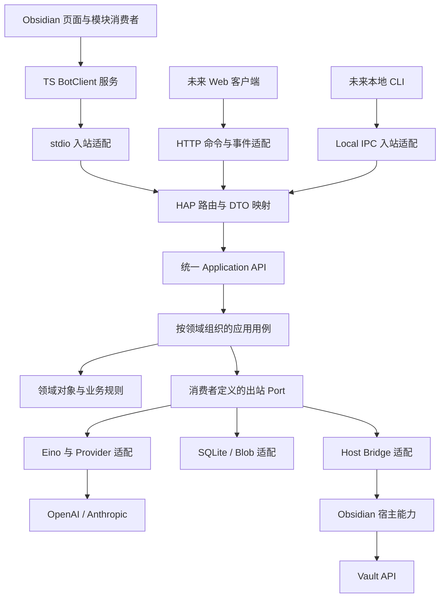

# HUHU Bot 领域架构与工程设计

本文件是一份重新组织的独立设计，描述待实现的目标架构。当前 HUHU 代码基线为 `66083cdb9f7f31a4bcbd3e380c6c7f64f2e74e93`。用户在 LOG-029 确认的初版已由 LOG-032–035 扩展为首版多 Bot 协作与自动私有记忆。架构取舍由同 change 的 ADR 负责；外部行为和验收唯一以 <Path>{roots.state}/specdev/changes/2026-10-25-huhu-bot-architecture/spec.md</Path> 为准。用户在 LOG-040 确认 UI-001/final 为唯一界面；页面合同以 DESIGN revision 2 为准。本文不是产品已实现的声明。

原始 v1.1 完整保存在 <Path>{roots.state}/specdev/changes/2026-10-25-huhu-bot-architecture/inputs/HUHU-Bot_架构审核与工程设计规范_v1.1.md</Path>。本设计不依赖未取得的 v1.0，不继承无法回读的 FR/AC 条款。原报告中的审核措辞、旧编号和候选版本不再充当当前合同。

## 1. 产品目标与边界

HUHU Bot 是 HUHU 内由多个个人 Bot 组成的助手工作台。用户可以单独与一个 Bot 对话，也可以创建群聊，由协调者规划并调用其他 Bot；任何获准的 Bot 都可发现、通信和派遣其他 Bot。所有 Bot 与临时 sub-agent 使用同一个引擎合同，具有隔离的工作上下文。它拥有独立于现有 CLI Agent/PTY 的业务后端。

| 能力 | 首版 P1 合同 |
| --- | --- |
| 助手 | 默认 Bot 与用户创建的多个持久 Bot；稳定 ID、描述、人格、模型、权限和私有记忆；不因一次派遣自动增殖持久身份 |
| 模型 | OpenAI Chat Completions、OpenAI Responses、Anthropic Messages 三条协议均为必验目标；模型 ID 可配置 |
| 会话 | 单聊与群聊、多会话、分页历史、流式输出、来源引用；每可见会话一个活动前台根 Run，成员子执行使用隔离工作线程 |
| 协作 | 群聊协调者默认回应；用户可 @成员；发现/通信/派遣已有 Bot、按任务创建临时 sub-agent、受控再委派、子结果汇总和取消 |
| 资料 | 默认只使用用户明确附加的资料；用户可另授文件夹或全库权限，授权同时限定模型接收方 |
| 写入 | 单笔记创建/改写经过预览、单次审批、修订检查和效果回执；删除笔记、批量移动另行设计 |
| 记忆 | 各 Bot 独立短期上下文与自动维护的私有长期记忆；Profile 全局长期记忆写入需用户确认；来源、范围、修订、遗忘和删除传播可追踪 |
| 取消与恢复 | 所有非终态可取消；崩溃中断的运行在核查通过后等待用户点击恢复 |
| 数据管理 | 显式导出/导入，单会话及本机 Profile 永久清除；未决效果按第 10 节保留最小核查记录 |
| 生命周期 | 页面关闭继续运行；停用 Bot 或退出 Obsidian 结束受管运行；进程异常可诊断且不重复写入 |

未来 Web 客户端应在 Obsidian 开着时访问同一服务，读取同一历史、订阅同一 Run，并按自身权限提交命令。独立常驻服务是另一个运行模式；它与 Web 界面并非同一个前置条件。

## 2. 与当前 HUHU 代码的接缝

以下是当前事实与对应设计约束。已有模块、数据格式和原生 PTY 行为不因新增 Bot 被整体改造。

| 当前事实 | 设计处理 |
| --- | --- |
| <Path>src/app/contracts/module.ts</Path>、<Path>src/app/modules/registry.ts</Path> 已有 manifest、服务发布、按需激活和租约 | Bot 接入同一个 ModuleRegistry；服务只在激活完成后发布，停用时撤回 |
| <Path>src/modules/notifications/api.ts</Path> 与其 module/service 展示公共类型和实例分离 | Bot 的 api.ts 只公开类型与 ServiceKey；实现由 module.ts 装配，不能把 api.ts 当网络服务器 |
| <Path>src/shell/host/workbench-pages.ts</Path> 分开页面与模块生命周期 | 页面订阅可释放，后台 Run 不归 React 或页面 AbortSignal |
| <Path>src/app/main.ts</Path> 调用 disposeNow；Obsidian 不等待异步 onUnload | Runner 同时处理父 pipe EOF/父存活信号；安全收尾不只依赖插件 dispose Promise |
| <Path>scripts/verify-architecture.mjs</Path> 约束 core/platform/services/contrib/ui | TS 沿用现有分区，不套一套 Go 目录；Node/Electron 仅 desktop 路径可达 |
| <Path>src/host/obsidian/references.ts</Path> 使用全局活动视图和回退 leaf | Bot 新建带发起窗口、版本、scope 的快照适配，不能直接当作现成 HostContext |
| <Path>src/modules/agent/platform/desktop/pty/</Path> 是 agent 私有安装/进程实现，helper 会合并 process.env | 可抽取已被两个模块需要的底层安装机制；Bot 保持独立协议、环境和监督策略，不跨模块导入私有实现 |
| <Path>src/host/desktop/huhu-paths.ts</Path>、owned-permissions 的路径合同限定库内 .huhu | OS 本地 Profile 需要自己的路径/权限合同；现有 Electron safeStorage 回执能力不等于 Go 凭证能力 |
| <Path>src/app/settings/runtime.ts</Path> 已有库/设备命名空间 | 插件只保存 Profile 绑定和界面偏好；业务配置修订与历史归 Go |
| <Path>src/shared/storage/vault-layout.ts</Path> 的隐藏受管 Markdown 仅含看板与自动化定义 | Bot 默认不把整个 .huhu 当作可读写笔记库 |
| 自动化使用 terminalId；通知 target 绑定 automationId | 后续新增 Bot 执行目标和可判别通知目标，保持现有记录兼容 |
| 当前 Native 服务仅有 Rust PTY，且明确不监听端口 | Go Runner、HTTP 入口、客户端认证和平台验收均为新增工作 |

详细代码定位与只读核验范围见 <Path>{roots.state}/specdev/changes/2026-10-25-huhu-bot-architecture/LOG.md</Path> 的事实记录。

## 3. 运行拓扑与统一服务入口



图中箭头是运行时调用；代码依赖规则见第 4 节。HTTP/IPC 只在对应能力交付时创建和启用，P1 仅 stdio。

### 3.1 三个不同的公共面

1. **HUHU 模块公共面**：<Path>src/modules/huhubot/api.ts</Path> 为现有模块提供 BotClient 服务类型和 ServiceKey。该服务发命令、读投影，不执行另一套业务规则。
2. **Runner 应用公共面**：<Path>native/huhubot/internal/application/api/</Path> 定义分组的 Command、Query、Result 和服务接口。stdio、HTTP、IPC 都进入这里；访问检查、事务和运行状态行为一致。
3. **跨进程公共面**：<Path>contracts/hap/v0.1/</Path> 定义版本化 schema、错误、事件与 fixtures。它表达可序列化合同，不导出 Go 聚合、SQL 行、Eino 对象或 Obsidian App。

统一入口表示一套用例合同，可由 ConversationAPI、ExecutionAPI、AssistantAPI、CollaborationAPI、MemoryAPI、AccessAPI 等窄接口组合。它不意味着一个持有全部表、SDK 和方法的巨型 BotManager。

### 3.2 一次命令的责任链

```text
客户端请求
  -> 传输适配：认证真实连接，限制大小/速率
  -> HAP 路由：校验 schema，映射 DTO 与稳定错误
  -> 应用入口：接收可信 RequestIdentity 与命令
  -> 所属用例：授权、幂等、领域行为、事务提交
  -> 应用结果 -> HAP response / 持久事件 -> 各客户端投影
```

传输建立的身份是应用输入，普通 payload 不能自报 Principal 或 Host 身份。应用用例仍对对象、工作区、撤销状态和操作权限负责。定时任务等内部消费者也调用同一应用入口，不能写业务表绕过它。

## 4. 分层、依赖与设计模式

| 层 | 拥有的职责 | 依赖边界 |
| --- | --- | --- |
| Domain | 身份、修订、状态转换、权限/预算不变量 | 标准库和有限纯值类型；不依赖 SQL、网络、HAP、Eino、宿主 |
| Application | 用例、事务、幂等、执行管理、恢复策略、消费者 Port | 领域及窄合同；不构造具体 SDK/Store/Transport |
| Inbound Adapter | 连接认证、编解码、DTO 映射、入口路由 | Application API、HAP；不直接写库或调用模型 |
| Outbound Adapter | SQLite、模型、Host、凭证、Blob 的具体实现 | 实现消费者 Port；不私自决定权限或重放写入 |
| Bootstrap / Runtime | 构造装配、进程锁、生命周期、关闭资源 | 可见具体实现；不承载对话、审批和笔记改写业务分支 |

Application API 的类型与接口在 <Path>native/huhubot/internal/application/api/</Path>；具体用例可实现这些接口，组合门面只转交调用。用例包不反向依赖组合门面的具体实现，避免应用层内部形成环。

出站 Port 定义在真正消费它的用例附近。各业务上下文之间只用窄查询/命令合同，跨聚合事务由明确的协调用例负责。核心对象分别为 Domain Aggregate、Application Command、Wire DTO、SQLite Row、Client ViewModel；转换发生在边界，不使用贯穿所有层的巨大 Message。

| 模式 | 在本项目中的用途 | 使用限制 |
| --- | --- | --- |
| 门面 Facade | 为多入口提供稳定用例组 | 门面只组合，不汇集全部业务实现 |
| 端口与适配 Adapter | 替换 Eino、Provider、Store、Host、Transport | 依赖真实消费者；不为所有函数建接口 |
| 策略 Strategy | 模型能力、授权、重试与预算策略 | 策略返回决定，实际事务和副作用仍由原 owner 执行 |
| 工作单元 Unit of Work | 原子受理、审批发布、派发和终结 | SQL transaction 留在 SQLite adapter；事务不跨网络和人工等待 |
| 显式状态机 | Run、Effect、Approval 的合法变化 | 用状态方法与 CAS 维护不变量，不用任意 SQL patch |
| 持久事件日志 | 多客户端补读和去重 | 内存发布仅唤醒，不建设第二个运行事实库 |

暂不引入分布式事务、通用工作流平台、反射式依赖注入、通用 ORM、全局服务定位器或无用途的消息总线。新增基础设施须由真实消费者或测量结果证明必要。

## 5. 领域边界与事务归属

| 上下文 | 权威对象 | P1 职责 |
| --- | --- | --- |
| assistant | Agent、PersonaRevision、模型绑定修订 | 持久 Bot 身份、目录描述、人格、模型和可用性 |
| conversation | Session、GroupMembership、Message、SourceRef | 单聊/群聊、成员与协调者、可见历史、归档/删除意图与来源 |
| execution | Run、ToolCall、Effect、Receipt、RunEvent、恢复记录 | 执行、效果账本、运行事件、核查与终结 |
| access | Grant、Policy、Approval、客户端权限 | 可访问范围、资料流向、单次批准与撤销 |
| memory | MemoryItem、MemoryRevision、GlobalProposal、遗忘规则 | 自动私有记忆、确认全局记忆、人工固定/修正、来源和删除传播 |
| collaboration | Delegation、AgentMessage、ContextEnvelope、任务关系 | 既有 Bot/临时执行、投递与回执、父子关系、共享预算和结果归属 |

首版已有真实协作消费者，因此建立窄 collaboration 上下文；它不变成独立调度平台。以后需要跨会话长期计划时再增加 work；需要索引时增加 knowledge；需要扩展管理时增加 extensions。一个实体不等于一个 Go 包，一张表不等于一个 CRUD Service。

关键协作：

- StartRun 使用 conversation 与 execution 的领域行为，在同一 UoW 提交消息、占用、Run、首事件与幂等回执。
- 审批发布/派发横跨 access 与 execution，但仍是同一短事务；Approval 只拥有授权决定，Effect 只由 execution 拥有效果事实。
- 模型绑定归 assistant；每个 Run 固定配置修订，执行时仍检查最新撤销状态。Provider SDK 对象不成为领域对象。
- Profile 是本机数据库身份，Workspace 是资源授权域；P1 一个 Vault 绑定一个本机 Profile。路径仅是 locator，重命名、复制和迁移不能自动继承运行、权限或连接租约。
- 长期记忆不归临时 Context；历史不是记忆候选，索引不是来源权威。

### 5.1 同一引擎，三种身份与协作入口

```text
用户 -> 单聊 / 群聊 -> 根 Run（某个已有 Bot）
                         |
              同一 Engine Port + 可用工具描述
                         |
          +--------------+------------------+
          |                                 |
 agents.discover / agents.message      agents.delegate
          |                                 |
 已有 Bot 的有界消息与回执       target: existing | temporary
                                     |              |
                              既有 Bot 新子 Run    临时配置新子 Run
                                     +------┬-------+
                                            |
                             同一 Broker / Run / Effect 合同
```

Agent 是持久 Bot 身份，Run 是一次执行，sub-agent 是该执行在父任务中的角色。向已有 Bot 派遣只增加 Delegation/工作线程/Run；临时 target 使用任务级配置及独立记忆命名空间，不自动生成持久 Bot。新建持久 Bot 通过用户创建入口或用户明确确认的创建意图；模型普通文本不能伪造该授权。

Leader 是群聊协调者引用，用户可以更换，默认仅它回应未指定对象的消息。成员的发现、通信、派遣能力与 Leader 使用同一工具实现；它没有额外资料、审批或清除权限。目录只注入可访问 Bot 的 ID、描述、能力摘要、可用性与修订；其人格正文、会话及记忆不随目录公开。大目录按发现工具分页加载。

提示词描述协作方式与可用对象，工具请求进入应用用例。派遣用例持久化父子关系、上下文摘要、结果投递目标和幂等回执后才排队；内存 Promise 只优化等待。通信不是派遣：消息投递不代表任务完成，不因收到消息无限唤醒。共享根预算、可配置深度/数量/并发限制、循环检测和取消树防止无限协作。

群聊可见消息与每个成员的私有工作线程分开。只有明确共享的消息、所选来源、获准记忆摘录和结构化任务进入 ContextEnvelope；调用者不直接读取被调用 Bot 的私有记忆。被调用 Bot 在自身授权范围内召回，并在结果发布前检查目标群聊、接收方模型和来源流向。

### 5.2 记忆所有权

- **短期上下文**：按 agentId＋sessionId/workThreadId＋runId 隔离，包含工作摘要与 CP 引用；压缩不产生新的长期事实。群聊公共 transcript 只作为明确输入。
- **私有长期记忆**：持久 Bot 自动提炼/更新自己的 MemoryItem，记录来源、有效范围、版本与执行身份；用户可以查看、纠正、固定、遗忘或暂停自动维护。来源授权撤销后不可继续召回其派生记忆。
- **全局长期记忆**：Profile 内可共享的独立对象。Agent 只能提出 proposal；用户确认范围与内容后生效。修改和删除同样需要确认，Leader 不能代替用户批准。
- **临时执行记忆**：独立任务命名空间，可持久化以恢复；不自动并入任何 Bot 或全局记忆。结束后按任务删除/保留合同清理；显式保存为持久 Bot 需要用户创建意图。
- **删除传播**：自动提炼的条目跟随来源删除；人工固定或已确认全局条目是独立内容，删除预检逐项展示保留/删除选择。忘记后阻止旧作业写回，记忆自动维护与聊天、子任务共享模型流向和预算。

## 6. 目录与现有模块装配

以下是未来实现的职责地图，未实施的包不预建。

```text
contracts/hap/v0.1/            共同 schema、方法、事件与 fixtures
native/huhubot/               独立 Go module
  cmd/huhubot/                参数与根生命周期
  internal/
    domain/                   assistant / conversation / execution / access / memory / collaboration
    application/
      api/                    对入站消费者公开的窄接口与纯应用类型
      assistant/ ...          按上下文组织用例，Port 放在消费者旁
      tooling/                Broker 与授权/派发编排
    adapters/
      inbound/hap/            共享路由、DTO 映射
      inbound/stdio/          首版传输
      outbound/eino/          Engine、事件映射、Checkpoint、Provider factories
      outbound/sqlite/        SQL、UoW、约束、嵌入式 migrations
      outbound/hostbridge/    宿主能力调用与回执
      outbound/credentials/   秘密解析
      outbound/blob/          不可变内容与安全发布
    protocol/hap/             生成 DTO；不进入领域
    runtime/                  OS 实例锁和进程资源
    bootstrap/                显式构造器装配
  tests/contract/             真实跨层/跨进程合同
  testdata/
src/modules/huhubot/
  api.ts / manifest.ts        公共类型/ServiceKey；纯清单与字面动态 load
  module.ts                   装配、激活、释放
  settings.ts / i18n.ts       命名空间、en/zh
  core/                      纯协议、校验、frame、reducer、投影与客户端 Port
  services/                  BotClient、vanilla store、订阅、Host 协调
  platform/obsidian/         Vault 能力、发起视图快照、交付
  platform/desktop/          binary、supervisor、stdio client、本机路径
  contrib/                   有相应公共合同后接入自动化/通知
  ui/                        懒页面、会话、审批、记忆、设置
  styles/                    模块样式
```

Go application 组合对象由 bootstrap 构造，Provider factories 全部在 Eino 子树。数据库迁移脚本与执行它的 adapter 同包嵌入；日志使用统一配置的 slog，不创建通用 observability 框架。

TS 模块页面仍是现有工作台视图中的产品页；不增加新的 Obsidian 视图类型。接入时同步 ModuleId、WorkbenchFeature/owner、设置导航穷尽映射、启动词典、样式输入和激活包体预算。mobile 分支不触达 Node；Bot 可以桌面限定，插件整体继续支持移动端。

原生安装若出现 Bot 和 PTY 两个真实消费者，可将校验、staging、版本目录和保护回执抽为宿主桌面基础设施。协议、环境、重启预算和会话管理仍归各模块。现有只接受 .huhu 的路径/Windows ACL 函数必须保持其原边界，库外根使用明确的新合同。

## 7. 模型适配：三协议共享业务合同

本节实施对应 T-08/09/10。固定适配器子模块、Go/SDK 依赖差异、Eino 中断恢复问题与采用边界见 <Path>{roots.state}/specdev/changes/2026-10-25-huhu-bot-architecture/IMPLEMENTATION-REFERENCES.md</Path> 的 REF-01/02；同仓存在 adapter 不表示最终依赖组合已通过。

首版必须分别完成 `openai-chat-completions`、`openai-responses`、`anthropic-messages` 的真实调用与合同验收。这是用户选择的产品范围，不因某条上游路径尚不完善而静默缩减。

业务层只认识 ModelBinding、能力声明、预算和 CredentialRef。模型绑定至少区分服务身份、API 协议、明确配置的 endpoint、modelId、配置修订及资料接收方；同名模型通过不同 endpoint 提供时，不自动成为同一个受信目的地。

### 7.1 可以复用什么

EinoExt 固定源码中已有 `openai`、`claude` 的 ToolCallingChatModel 实现，也有 `agenticopenai` 的 Responses 和 `agenticclaude` 的 Messages 实现。具体包、构造函数和配置对象全部留在 Eino adapter 内。事实来源为固定提交的官方源码，详见日志研究记录。

OpenAI 官方把 Responses 作为新项目推荐入口，同时保留 Chat Completions；二者的请求、工具调用和结果形状不同。HUHU 不用一个“OpenAI-compatible”布尔值宣称两种 API 等价。[官方迁移说明](https://developers.openai.com/api/docs/guides/migrate-to-responses)

**可用适配器不等于可直接替换执行链。** 锁定的 Eino 源码分别支持 Message 和 AgenticMessage 路径；后者的注释指出采用单轮链路，模型流取消监控/重试尚未覆盖。P0 要核实三条路径的工具准入、审批中断、恢复和取消；不能用 Responses 文本生成成功替代工具闭环验收。[固定 Eino 源码](https://github.com/cloudwego/eino/blob/0a5ca53b9d3bf7b661dccc863465ec568a421eea/adk/chatmodel.go#L386-L392)

### 7.2 HUHU 要补齐什么

- Engine Port 只暴露 HUHU 的 Run/Resume 输入、内部事件与 finished/suspended/failed 结果。应用用例决定业务 Run 的终态。
- 优先让三种协议复用同一受控模型/工具循环。Responses 若需桥接不同消息模型，桥接及 Provider SDK 适配留在 Eino 子树；不得令应用层依赖两套 Eino 消息类型。
- P0 选择能够满足合同的具体集成路径并锁版；允许替换 adapter 内部实现，不能自行删去三协议、审批、取消或恢复要求。
- HUHU 工具只以 Broker 包装的函数工具暴露。Provider 的服务端内建工具、远端 MCP、自动路由和自动 failover 默认不启用，防止绕过本机效果日志与资料流向检查。
- 将身份、endpoint、模型参数和凭证显式传入 SDK，控制环境回退、重试及超时。不同 SDK 的默认环境读取不能改变用户选定身份和数据目的地。
- 默认由 HUHU 保存会话与上下文权威；Provider 的远端 response ID/cache 仅为 adapter 元数据。远端状态丢失不应造成 HUHU 历史不可读。若使用远端状态，必须验证资料授权、保留与恢复语义。
- 能力矩阵按“服务＋协议＋modelId＋适配器版本”登记，至少覆盖 streaming、tool use、取消、usage/错误；vision/structured output/reasoning 仅对验证的组合声明。
- 子 Agent、摘要、重试和后续 failover 使用同一资料流向与预算入口。费用未知时显示未知或估计，不声称精确金额封顶。

具体模型 ID、可用账户及三协议样本由 P0 执行时配置并写入证据；本次不发起真实模型调用，也不要求把 API Key 放进文档。

## 8. 运行状态、事务与恢复

### 8.1 状态模型

| Run 状态 | 可证明的事实 | 下一步 |
| --- | --- | --- |
| accepted | 受理事务已提交，尚未领取 | 扫描并 CAS 领取 |
| preparing | 正在组装上下文、核验资源 | 完成准备后运行；准备失败正式终结 |
| running | 模型或受控工具正在执行 | 输出、审批暂停、取消或终结 |
| waiting_approval | CP 引用和审批票据已持久发布 | 批准/拒绝/过期/取消 |
| waiting_children | 本 Run 等待已接纳子任务；子任务身份与回执持久可读 | 接收结果、失败处理、取消或中断 |
| interrupted | 运行被进程或资源中断 | 进入 recovering 核查 |
| recovering | 正在核对 CP、权限、效果和版本 | 安全时标记可恢复并等待用户；不自动调用模型 |
| blocked | 核查无法通过或需人工处理 | 明确原因；禁止循环重放 |
| canceling | 已禁止新派发，正在有界收尾 | 保存已知回执或 unknown，终结 |
| succeeded / failed / canceled | 编排已终结 | 不重开；可追加效果核查事实 |

可恢复提示用恢复记录表达，不另造一套 Run 主状态。用户点击恢复时再校验当前撤销、CP 版本和效果状态，通过 CAS 进入 running。原 waiting_approval 仍需明确批准；已 accepted 的新意图可按原合同领取。用户取消过的运行不因重启复活。

`succeeded` 要求没有未决审批、dispatching 或 unknown 效果；它表示本轮正常结束且结果可解释，工具拒绝仍可被明确告知。failed/canceled 可保留 effectsUnresolved。取消不是外部效果回滚。

### 8.2 原子受理

1. 认证、验证 schema/大小、会话可见性，固定发起来源和配置引用。
2. 短事务中优先查 `principal + method + idempotencyKey`；同输入返回原 receipt，异输入冲突。
3. 校验 Session revision、占用及领域不变量，同事务提交用户消息、Run accepted、配置引用、Session 占用/新修订、首事件和命令回执。
4. 提交后回应 accepted 并唤醒执行器；唤醒丢失仍能扫描已接受运行。
5. 外部 I/O 在事务外。请求 timeout 或页面断开不取消已接受运行。

终结也使用一笔事务：CAS 检查可终结 → 保存完整或明确部分完成的助手消息和 usage → 写终态及事件 → 释放 Session 占用。磁盘满导致提交失败时不能显示“已保存成功”。

### 8.3 执行身份与恢复身份

Resume 保留 runId/effectId，增加恢复代数；Retry 创建新 Run 并引用 retryOfRunId；编辑后发送创建新消息/Run。连接重建只恢复订阅和命令回执，不生成新用户意图。

所有非终态可取消。取消提交后不得获得新的工具派发资格；已领取的外部动作按在途事实结算。新会话或 Retry 触及同一受影响资源时仍要检查未决效果。

### 8.4 协作运行与群聊顺序

可见 Session 由一个根 Run 占用；子 Run 绑定隔离工作线程，不能冒充另一个前台消息绕过占用。一个 Bot 可服务不同工作线程，自动记忆更新以条目 revision/CAS 合并；同一工作线程仍只有一个活动 Run。群聊成员发言由持久队列排序，模型调用可以并行，公开 transcript 的顺序与实际完成/发布顺序可回读。

父 Run 等待 Delegation 时进入 waiting_children；它可以接收结果、请求取消、处理失败或转 interrupted。子任务的 running、waiting_approval、blocked、取消和部分结果均可在根视图追踪。根 Run 只有所有已接纳子任务已终结且无未决效果时才能 succeeded；子任务失败可由协调者明确报告部分结果并结束，但不能隐藏仍活动的后代。父取消传播整个调用树，不取消同一 Bot 服务的无关 Run；用户只停一个子任务时，父得到结构化取消结果。

恢复先核查整棵调用树及投递回执；已完成子任务结果去重复用，未知效果不重派。用户点击根恢复只恢复本树中核查通过的部分，不扩大权限或复活已取消成员。已受理的群聊成员快照用于在途审计，移除成员立即撤销其后续群聊投递和新派遣资格，并取消与该群绑定的在途工作；协调者更换在无活动根 Run 时提交。

## 9. 工具、审批与效果核查

```text
模型提出调用
  -> Broker 校验身份/范围/流向/版本/预算
  -> 持久效果意图
  -> [需要审批] 暂停准入 -> 写好 CP Blob -> 事务公布审批
  -> 批准用例校验并提交决定
  -> 派发事务重新校验并 CAS
  -> Host/外部服务执行
  -> 可信回执 / 后置条件核查 / unknown_outcome
```

effectId 绑定 Run、toolCall、能力及实现版本、参数摘要、目标修订和发起 epoch。相同参数的两次用户意图仍是两个不同 effect；重放同一意图不能换 ID。参数摘要避免公开可猜测的秘密 hash。

| Effect 状态 | 恢复解释 |
| --- | --- |
| prepared / awaiting_approval | 尚无已派发证据；检查资格后再派发 |
| dispatching | 可能已经发送；先核查，不能直接重发 |
| committed | 可信执行方回执可复用 |
| reconciled | 目标满足后置条件，但未证明原调用归属；保存证据种类 |
| rejected / failed_no_effect | 已知未发生效果；按策略返回或允许新尝试 |
| unknown_outcome | 无法判断是否发生；查询回执或人工核查 |

Approval 绑定一个确定 effect 的参数、目标版本、策略、实现版本与有效期。第一个待审批意图出现即关闭当前 Run 的后续效果准入；仅串行 mutex 无法覆盖模型一次返回多个工具调用的窗口。CP 先完成不可变写入和校验，再以同一业务事务公布 CP 引用、Approval、Run、Effect 与事件；孤儿 Blob 可回收。

Host 在实际写入前再次校验租约、工作区、范围和当前内容。笔记有未保存编辑器输入时返回 `UNSAVED_EDITOR_CHANGES`；当前内容不同于批准基线时返回 `SOURCE_CHANGED`，重新预览。创建目标已存在时拒绝覆盖。写成功但回执丢失时保留未知或核查证据，不能因取消、重连或 Retry 自动再写一次。

MCP 连接重建与 CallTool 重放分开。只读列举可以有界重试，有副作用调用由 Broker 根据效果证据和外部幂等合同决定。工具拒绝默认返回结构化 denied 结果，供助手解释或选择已授权替代步骤。

## 10. 数据权威、保留与永久清除

存储实现参考 REF-07/08，记忆/来源机制参考 REF-03/04/05，均见 <Path>{roots.state}/specdev/changes/2026-10-25-huhu-bot-architecture/IMPLEMENTATION-REFERENCES.md</Path>。驱动由 T-01 用共同真实 SQLite 夹具比较后选择；清除/portable/一致备份分别由 T-17/18/19 负责。

### 10.1 数据根与唯一所有权

| 内容 | 权威位置 |
| --- | --- |
| Agent/Persona、Session/Message、Run/Event、Approval/Grant/Effect、Memory | Profile SQLite |
| Checkpoint | 引擎私有不可变 Blob＋DB 引用及兼容信息 |
| Vault 笔记 | Obsidian Vault/用户文件 |
| Artifact | 明确的 Vault/Blob 内容 owner；DB 记录引用、hash 和权限 |
| 密钥 | 原生受保护 CredentialProvider 或会话内存；DB 只存引用 |
| UI 布局/本机绑定 | 现有 HUHU 设置命名空间 |

Profile 使用本机非同步根：Windows 的 LOCALAPPDATA/HUHU/huhubot/profiles，macOS 的 Library/Application Support/HUHU/huhubot/profiles，Linux 的 XDG_STATE_HOME/huhu/huhubot/profiles（缺省 ~/.local/state）。具体路径解析和权限检查由平台 adapter 提供；同步文档不能直接指定可信绝对运行根。

一个 Profile 拥有一个 SQLite、必要 Blob/CP、诊断日志、实例信息和自管备份。二进制按平台/版本另放受管 runtimes，避免业务清除误删其他 Profile 共用运行时。此设计新增库外数据例外，实施时必须同步项目数据与卸载文档。

使用一个写连接和有界读池作为初始策略；每连接初始化 PRAGMA。WAL 不能代替同步协议；订阅不持有长读事务。事务不跨模型网络、Host/MCP 调用或人工等待。Blob 先安全发布，再提交引用；GC 只依据已提交引用与在途使用。

### 10.2 保留、删除与核查记录

默认长期保留历史、Bot 配置及有效长期记忆，停用/卸载不自动删除。用户可发起单会话或整 Profile 永久清除；停用/删除 Bot 先处置其活动任务和记忆范围，不能删除其他 Bot 的数据。

| 场景 | 行为 |
| --- | --- |
| 存在活动 Run | 先请求停止并完成有界收尾；删除不能与继续派发竞争 |
| 会话无未决效果 | 删除正文、受管派生内容和已完成核查记录；旧会话身份不可复用，陈旧命令不能重建它 |
| 会话仍有未知效果 | 可删除正文，保留最小核查/防重放记录；界面明确显示仍有保留记录及其原因 |
| Profile 有未决效果 | 允许内容删除；整份 Profile 永久清除等待核查完成 |
| Profile 无活动 Run 且未决效果已处理 | 停止入口和写者，解除绑定，清除本机 Profile 及其受管副本；重建使用新身份 |

最小核查记录只保留 effect/command 身份、状态、目标必要定位或受控指纹、外部幂等键/回执定位、核查所需摘要与证据。它不继续保存整段对话、已删除笔记正文或可继续执行的 CP。记录仍可能包含敏感元数据，删除界面必须列明保留类别。

删除传播覆盖会话正文、关联 CP、仅由它持有的 Blob、派生摘要/索引、受管诊断副本及包含已删内容的自管备份。正在运行的候选记忆/索引作业必须失效，不能把内容写回来。共享 Blob 需核对其他仍有效引用。

自动提炼的记忆与子任务副本参与来源删除传播；用户手动固定和已确认全局记忆是独立内容，删除会话时列出关联条目并让用户选择一并删除或保留。明确保留需要确认该条目的独立范围，不继续依赖已删正文才能执行召回判断。清除整 Profile 包含全部本机记忆。普通正文删除不修改已经交付到 Vault 的笔记，也不自动删除用户自行导出的文件或 Provider 保存的数据；范围须在实际删除确认中清楚列出。

核查完成后可清除对应的最小安全记录。清除预检必须处置仍有效的命令重放窗口：使旧授权/命令代数失效，再清除记录；不能为防重放无限保留会话内容或已无必要的核查元数据。命令有效窗口、失效代数与陈旧请求错误由后续 Spec/HAP 合同固定。

删除命令有自己的幂等回执。整 Profile 清除后，旧连接、租约、Profile ID 和旧 command key 不得被重连请求自动恢复成新安装；普通导入不能恢复有效 Grant、在途 Run 或批准资格。中途清除失败保持可诊断的受限状态，禁止一面显示“全部清除”一面继续运行。

### 10.3 迁移与升级

Bot/Persona、选定长期记忆与单聊/群聊历史通过应用用例导入/导出；导入比较 revision/hash，形成明确冲突，不用修改时间静默覆盖。Agent/成员/来源 ID 需显式重映射，导入历史不能启动派遣。设备权限重新授予，普通 portable 不带 Secret、有效 Grant/Approval、运行队列、租约和 CP。

备份使用受支持的一致流程，包含数据库与必要 Blob 清单、版本和 hash；不能只复制运行中的 SQLite 主文件。升级先停止新受理、处理活动 Run、取得锁、预检与备份，再迁移并校验。schema 不兼容时拒绝旧 binary，程序回滚与数据恢复分开；坏库进入诊断，不覆盖成空库。

## 11. HAP、事件与客户端投影

### 11.1 线协议

采用 JSON-RPC 请求、响应、通知语义。请求 ID 为字符串，双方使用不同前缀及 pending map；反向 `host.invoke` 使用标准同 ID response。无 ID 的写通知不执行。hello 完成前拒绝业务请求，兼容性以实际测试的版本组合为准。

stdio frame 为 `u32 big-endian length + u8 kind + payload`，length 包含 kind；P1 仅 JSON kind。单帧 1 MiB、batch 最多 8 项是初始设计上限，P0 需测量冻结；batch 内每项独立，不构成业务事务。超限、零长、UTF-8/JSON 错误、半帧 EOF、错误 kind 都有确定处理。stdout 只写协议帧；stderr 有界、脱敏。

ID 使用 opaque string；seq/revision 等 64 位计数使用十进制字符串；时间使用 UTC RFC3339；费用使用精确字符串/最小单位与已知/估计标记。资源以 SourceRef/Artifact ID 表达，不把绝对路径当授权。外部 JSON 必须运行时校验，生成类型不是 validator。

### 11.2 用例组与公开方法

| 用例组 | P1 公共面 |
| --- | --- |
| 协议/诊断 | hello、health、service status、脱敏 diagnostics；受管 owner 才能 shutdown |
| 助手/模型 | Agent 创建/读取/目录发现/人格更新/停用、模型配置/测试/绑定、实际能力查询；不返回 Secret |
| 会话 | create/list/get/history/archive、删除预检与执行、导出 |
| 协作 | 群聊成员/协调者、消息定向、已有 Bot 通信/派遣、临时 sub-agent、任务查询/取消/结果续读 |
| 运行 | start/get/subscribe/cancel、受控 resume；支持根/子 Run，不接受任意客户端上传 CP |
| 授权/审批 | 范围与接收方 grant 管理、撤销、pending 列表和单次 resolve |
| 记忆/迁移 | 私有自动维护与 list/pin/correct/forget、全局 proposal/resolve、来源查询、导入预检与提交 |
| 宿主 | attach/detach/invoke、租约与回执核查；仅可信 Host 连接注册 |
| 本机数据 | Profile 清除预检/执行及结果核查；权限独立于普通聊天 |

准确 method 名称和参数由 HAP schema 固定；本表锁定职责，不伪装成已生成协议。后续功能只有实现并验收后才出现在 hello capability 列表。

### 11.3 续读与客户端状态

每条可续读事件先持久保存，按 Run 单调分配 seq。客户端从数据库 cursor 分页尾读，内存广播只唤醒；不能在补历史和监听之间留下丢失窗口。重复投递按 Run＋seq/eventId 去重。

慢消费者有界断开并给出可恢复错误；过期游标返回 CURSOR_EXPIRED 及一致快照的 snapshotSeq。客户端重建快照后仅应用后续事件。终态 Run 还可收到新的效果核查事实，不能因第一次 terminal event 永久忽略账本更新。

订阅建立、历史补读和每次持续事件投递都校验当前身份、工作区与对象读取权限。撤权后停止投递并通知客户端清理失效投影；快照或重连不能绕过当前授权。过滤发生在服务端，不能依赖 UI 隐藏事件。

TS vanilla store 只保存连接、分页、游标和已授权的 UI 投影。页面 selector 从投影读取，action 发命令；UI 的乐观状态不能冒充服务端终态、持久成功或已批准。

错误保持 JSON-RPC 数值 code，并以 `data.kind` 表达稳定业务码，包括 SESSION_BUSY、IDEMPOTENCY_CONFLICT、CAPABILITY_DENIED、SOURCE_CHANGED、UNSAVED_EDITOR_CHANGES、UNKNOWN_EFFECT、RECOVERY_BLOCKED、INSTANCE_CONFLICT、PROTOCOL_INCOMPATIBLE、CURSOR_EXPIRED、STREAM_SLOW_CONSUMER。retryable 只描述请求处理条件，不授予工具写重放权。

## 12. 宿主能力与未来 Web 接入

### 12.1 资料与窗口绑定

发送时固定 workspaceId、originClientId、originViewId、hostConnectionId、hostLeaseEpoch，以及选中资料的 revision/hash。授权范围在搜索、召回、摘要、rerank 和模型输入之前过滤；不能全库处理后仅在 UI 隐藏结果。

切换当前文件不改变既有 Run 的输入。必要宿主操作由 TS 有界异步执行；模型与索引计算归 Go。Host 断开立即失效能力租约；迟到回执按 effect 身份核查，旧连接不能取得新派发资格。

### 12.2 两种运行模式

| 模式 | Runner owner | Host 能力 | 客户端离开后的运行 |
| --- | --- | --- | --- |
| P1 受管桌面 | HUHU Bot 模块 | 当前 Obsidian 注册的能力 | 页面/订阅离开不取消；模块停用或宿主退出触发收尾 |
| 未来受管 Web | 仍由 HUHU Bot 模块 | 仍由同一 Obsidian 提供 | Web 离开不取消；Obsidian 退出关闭服务并保留可恢复事实 |
| 后续独立服务 | 明确配置的服务 owner | 仅在线且通过授权的 Host；可另加独立工作区 adapter | 由服务策略决定，不因一个客户端离开停机 |

受管 Web 模式直接给**同一个 Go Runner** 增加可显式启用的 HTTP 命令/事件适配；不另起第二业务服务器或 SQLite 写者，不要求先实现独立常驻模式。它可以与 stdio 同时存在，共用 Application API、RunExecutor、授权与事件日志。

### 12.3 Web 兼容性合同

- 初始网络入口显式启用、默认仅 loopback；LAN/远程访问、TLS 和跨设备身份是后续独立范围，不能靠绑定地址自动取得权限。
- Obsidian 中建立配对/撤销客户端的受控入口。Web 拿到自己的 Principal、权限与 scope，不能自报成 Host，也不能因能看历史就能审批写入或清空 Profile。
- 校验认证、Host/Origin、CSRF/CORS、请求大小、速率和连接撤销；长期凭证不能进入 URL、公开日志或普通同步配置。
- 命令使用相同 HAP envelope/方法语义；事件流使用同一持久 cursor。具体 HTTP/SSE 会话认证方式在 Web 实施合同中固定，不假设浏览器可读取本机 pipe。
- Web 只消费序列化 DTO、来源引用和能力声明；不接收 Obsidian App、DOM、Window、Vault 实例或文件系统绝对路径。
- Web 发起的“使用当前笔记”必须由已授权的 Host 捕获明确视图快照。多个视图时显式选择来源，不能把浏览器的当前页面当 Obsidian 当前笔记。
- Host 离线时，可以读取已授权的历史；需要宿主的操作返回 HOST_UNAVAILABLE 或进入解释清楚的阻塞状态。不能偷偷由 Go 直接写 Vault。
- 两客户端争用同一 Session 时仍由服务端决定 busy、revision conflict 和幂等；HTTP 接入不能绕过 P1 的并发与效果合同。

未来 Web 前端可复用 schema、纯客户端协议及投影规则；Obsidian 工作台 UI 继续使用现有宿主适配。只有出现真实第二前端时才提取公共 client 包，不把现有插件改成网页应用。

## 13. 原生进程、安全与退出

T-02/20/27 的系统凭证候选与平台前提见 <Path>{roots.state}/specdev/changes/2026-10-25-huhu-bot-architecture/IMPLEMENTATION-REFERENCES.md</Path> REF-09。凭证录入经专用受管登记能力与父子匿名管道或 OS 保护接口，业务 HAP 只携带 credentialRef；不以 argv/普通环境/持久文件传秘密。具体平台 adapter 必须验证这一约束，不能因选用 keyring 库就默认满足。

启动顺序：解析模式和本机根 → 路径/权限检查与实际 DB 身份锁 → schema 预检/迁移 → 装配 Store/Engine/Broker → 核对旧 Run/CP/效果 → 建立 transport/hello → ready。第二独立写者得到 INSTANCE_CONFLICT。

Runner 使用显式环境 allowlist 和受控工作目录。可继承的 OS/TLS/代理必要环境需被列明，CLI 身份、Skill 环境和 SDK 自动发现路径不默认继承。引擎私有恢复数据、工具版本和配置摘要必须经过兼容检查；坏 CP 隔离并显示 blocked，不能进入无限重启。

关闭由双方协作：插件停止受理并请求 shutdown，Runner 停止新派发、持久化取消/暂停决定、有界收尾，保存回执或 unknown 后关库释放锁。考虑 Obsidian 不等待 async unload，Runner 还必须监听受管父 pipe EOF/失联，独立进入同一关闭路径；Supervisor 在宿主仍存活时执行超时终止和限速重启。

强制退出可能打断最后一次落盘，恢复必须依据此前的持久事实保守核查；不能把 kill 成功说成所有外部效果已结算。每个 goroutine 有 owner、取消和收尾路径；Run/Resume 的同 goroutine recover 不宣称能捕获第三方其他 goroutine 的 panic。

发行仅执行可信来源、明确版本、平台匹配且校验通过的二进制，staging 完成后原子安装；失败保留旧版本，不退回 PATH 同名程序。校验和与发布身份分开，manifest/Runner/HAP/DB 兼容矩阵分别维护。模型密钥不进普通日志、HAP 广播、Persona、Memory、CP 配置或导出。

## 14. 分期与验证门禁

| 阶段 | 产品/技术目标 | 不可跳过的门禁 |
| --- | --- | --- |
| P0 核心探针 | 三模型协议、统一 Engine、协作/子运行、记忆隔离、事务/事件、stdio、Host 审批写入、恢复与删除 | 所有 P1 协议都能通过受控工具、取消和恢复接缝；核心 crash window 有可重复证据 |
| P0 发行探针 | Go/SQLite/EinoExt 锁版、凭证、安装、平台依赖 | 每个拟支持目标有真实启动/TLS/DB/关闭证据；不支持的平台明确排除发行 |
| P1 多 Bot 工作台 | 第 1 节完整闭环；单聊/群聊、已有 Bot 与临时 sub-agent、自动私有/确认全局记忆 | spec.md 的 P1 AC 全部满足、已批准设计、真实 Obsidian 验收、文档与产物一致 |
| 后续客户端扩展 | IPC 或受管 Web，多客户端一致性 | 同一个业务服务、独立认证、Host 能力边界、事件重连与退出行为 |
| 后续知识/扩展 | Skills/MCP、来源索引、Artifact 工作流 | 无透明写重试、内容版本和撤权有效、扩展代码信任边界明确 |
| 后续长期工作 | 跨会话持久计划、自动化/通知 | 复用 P1 协作和现有调度 owner，不建设第二任务事实库 |
| 后续独立服务/生态 | CLI、常驻、独立工作区、沙箱扩展 | 服务 owner、离线 Host 能力、独立工作区写入协调、实际隔离验证 |

后续客户端与知识扩展是独立能力分支，不人为要求 Web 必须等知识索引完成。P1 已包含工具驱动协作和自动私有记忆，不增加通用插件市场、任意脚本执行或跨设备运行队列同步。

Go/SQLite 具体版本是探针输入，最终版本和子模块依赖图在实现前精确锁定。前端沿当前 package/lockfile，不在设计文档中复制一张会过期的依赖版本表。版本存在、可编译、可运行、语义正确与已发行分别有证据。

### 14.1 验收合同归属

完整外部行为、AC-001 起的验收表、UI 页面/状态映射和验证接缝唯一保存在 <Path>{roots.state}/specdev/changes/2026-10-25-huhu-bot-architecture/spec.md</Path>。原 HB-AC-01–20 是 S 之前的输入，已归并到 Spec 的追踪表，不继续维护第二份验收。

### 14.2 测量与检查

按风险选择领域状态、事务/Store 故障、协议 fuzz、真实工具清单、模型适配、Host、模块生命周期和 E2E 检查。构建需新增 Go/协议/边界入口；当前 Rust check:native 不覆盖 Go。测试检查外部状态与不变量，不堆 getter 镜像测试。

性能目标先规定测量场景，再冻结数值：未激活启动增量、安装后的 spawn→ready、长会话分页/DOM、事件写入与 WAL、慢订阅、关闭时间及磁盘上限。Provider 网络时间单独记录。原报告中的 ready p95≤3s 可作探针目标，不是本次实测承诺。

正式实现还要确定有界队列、日志/事件保留、公开重试窗口及资源上限。它们由测量和已确定的用户可见合同收敛；任何导致丢历史、降低删除保证或改变恢复行为的调整需返回设计决定。

## 15. OpenHanako / HanaAgent 参考与本设计的取舍

现行多 Bot/群聊/自动记忆的比较已扩充至 Hana、OpenBot、DeepSeek-Bot 与 OpenClaw，见 <Path>{roots.state}/specdev/changes/2026-10-25-huhu-bot-architecture/learning/02_多Bot协作与记忆隔离.md</Path> 和 <Path>{roots.state}/specdev/changes/2026-10-25-huhu-bot-architecture/IMPLEMENTATION-REFERENCES.md</Path> REF-03–06；旧单助手/人工记忆选择仅保留为学习时序，现行合同以 Spec 和 ADR-023/024 为准。

学习基线为上游 `9a6cabf8c513db5edc6cf8179a538c9075885c6e`；OpenHanako 和 HanaAgent 是同一项目的仓库旧名与当前产品名。本次只读源码，未运行该项目。完整图解、逐项来源与事实/推论区分见 <Path>{roots.state}/specdev/changes/2026-10-25-huhu-bot-architecture/learning/01_HanaAgent整体架构与HUHU取舍.md</Path>。

| 参考实现 | HUHU 的采用与约束 |
| --- | --- |
| Electron、CLI、Web/PWA 连接同一 Server；路由使用显式 composition context | 采用多客户端共享一个应用入口；将认证、HAP、用例、Host 能力分开，避免把整个 context 做成 any 服务定位器 |
| Engine 门面统一委派 Manager，单会话加载共享一次创建 | 采用窄门面与单会话执行所有者；Domain 保持纯规则，应用上下文避免循环和巨型 Manager |
| 工具描述操作语义，宿主绑定 actor/server/session，审批后重验 | ToolDescriptor 描述能力；可信身份由应用/Host 建立，批准与派发两次校验 |
| 多客户端事件按身份、范围、稳定会话 ID 过滤 | 订阅初始及持续事件投递都检查读权限；撤权后停止投递，并通知客户端清理失效投影 |
| 自有会话身份与 SDK 原生会话身份分别存在 | HUHU 的 Session/Run/Effect ID 作为业务权威，SDK/Provider/连接 ID 仅作适配器映射 |
| SDK 有统一导入入口，但会话编排仍直接使用 SDK JSONL/私有字段 | 保持 Eino 私有对象、事件和 CP 编解码完全在 adapter 内；普通历史读取不依赖 Eino 可运行 |
| 主聊天走 SDK，辅助文本按三协议直接 HTTP | 主模型、摘要、记忆维护与子 Agent 使用同一模型治理合同；不同用途不产生绕过授权/预算的辅助调用通道 |
| 工具重复执行用内存 Map；流重放用有界内存数组 | 可用于短期去重/展示，不能替代持久 Effect、receipt 和 run_events |
| 会话删除保留已编译聚合记忆 | HUHU 按用户已选规则落实删除传播与最小核查记录，不沿用“删会话就够了”的语义 |
| 全部客户端断开可超时中止流；Electron before-quit 能等待 | HUHU 页面/订阅不拥有 Run；Obsidian 插件无同等退出等待控制，使用独立父失联收尾 |
| restricted 插件仍在同进程动态 import；Skill snapshot 只冻结清单和来源 | 扩展权限和执行隔离分别声明；Run 引用内容版本/hash，缺失或变化时阻止不兼容恢复 |

参考学习支持本设计的统一出口、能力治理和身份分离；它没有替 HUHU 证明三协议工具闭环、持久恢复、删除保证或平台发行通过。


本轮协作与记忆的进一步研究见 <Path>{roots.state}/specdev/changes/2026-10-25-huhu-bot-architecture/learning/02_多Bot协作与记忆隔离.md</Path>；第一篇中的旧 HUHU 单助手/人工记忆取舍属于 LOG-033–034 之前的历史解释，不再作为当前范围。

## 16. 实施拆分与复用纪律

<Path>{roots.state}/specdev/changes/2026-10-25-huhu-bot-architecture/tickets-map.md</Path> 是实施启动/恢复导航；票据拥有写集、依赖、风险、Skill 绑定和验证；<Path>{roots.state}/specdev/changes/2026-10-25-huhu-bot-architecture/goal-plan.md</Path> 拥有跨票 Gate、Agent Team 实施/独立审查安排，本文继续拥有结构与责任解释。研发团队模型偏好不改变产品内模型/协作合同。T-01 维护统一 API/schema/Go 依赖，T-20 维护模块入口与显式装配，T-27 维护共享构建产物及工程规则；消费者不得各自造第二套入口或数据权威。

遇到陌生功能先按 <Path>{roots.state}/specdev/changes/2026-10-25-huhu-bot-architecture/IMPLEMENTATION-REFERENCES.md</Path> 检索、比较并记录；复用设计、引入依赖和直接改编代码分别记录，不用“参考过”冒充许可/可靠性验收。三协议、预算、取消、恢复和删除传播的验收责任均在相应行为票中，不能只依据 SDK 或示例能力判定通过。
