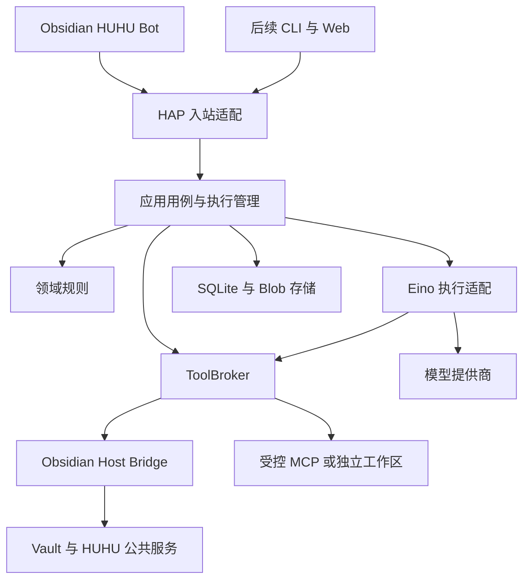
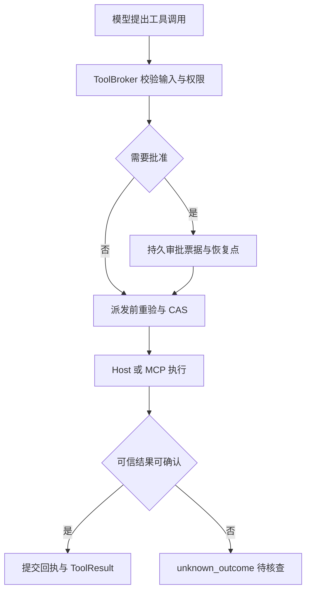

# HUHU Bot 架构审核与工程设计规范 v1.1

> 审核日期：2026-10-25，Asia/Taipei  
> 适用项目：[NAMEWTA/obsidian-huhu](https://github.com/NAMEWTA/obsidian-huhu)  
> 仓库审核基线：`88c90cd319e1b37a627aeeabd7b1146c42bfaa5c`  
> 输入：用户提供的《HUHU-Bot Go-Eino Native-Runner 产品需求与技术架构规范 v1.0》全文。  
> 定位：架构审核结论、修订后的工程设计与实施合同。保留原方案的产品方向和需求编号；冲突处以本文的明确修订为建议基线。  
> 证据边界：已只读核对 HUHU、Eino 和 EinoExt 指定版本源码及官方资料；本文没有把拟议功能写成已实现能力。未执行新 Runner 编译、真实模型调用、Obsidian 宿主或五平台运行验收。

## 阅读导航

- [0. 核心结论](#0-核心结论)
- [1. 审核证据与现有项目约束](#1-审核证据与现有项目约束)
- [2. 原方案的具体修订清单](#2-原方案的具体修订清单)
- [3. 技术栈建议](#3-技术栈建议)
- [4. 总体架构与依赖方向](#4-总体架构与依赖方向)
- [5. 业务上下文与数据所有权](#5-业务上下文与数据所有权)
- [6. 目录规范](#6-目录规范)
- [7. 核心模型与状态合同](#7-核心模型与状态合同)
- [8. 应用接口与事务](#8-应用接口与事务)
- [9. 工具、审批与效果日志](#9-工具审批与效果日志)
- [10. HAP 协议设计](#10-hap-协议设计)
- [11. Obsidian 接入设计](#11-obsidian-接入设计)
- [12. 数据、路径与迁移](#12-数据路径与迁移)
- [13. Eino 适配与模型治理](#13-eino-适配与模型治理)
- [14. 记忆、知识与可扩展能力](#14-记忆知识与可扩展能力)
- [15. 权限、凭证与运行治理](#15-权限凭证与运行治理)
- [16. 代码规范](#16-代码规范)
- [17. 验证、性能与发布门禁](#17-验证性能与发布门禁)
- [18. 分阶段实施与可拆分工作](#18-分阶段实施与可拆分工作)
- [19. 决议、未决验证与完成定义](#19-决议未决验证与完成定义)
- [20. 来源索引](#20-来源索引)

## 0. 核心结论

HUHU Bot 应采用 **现有 HUHU 单仓库中的模块化单体后端**：Obsidian 中新增独立的 `huhubot` 模块，Go Native Runner 拥有 Bot 的业务状态，Eino 是可替换的执行适配器。

原方案最有价值的决策应保留：业务数据由 HUHU 所有、引擎与宿主均处于适配层、Session/Run/Task 分离、工具调用经统一授权、运行状态与外部效果分别记录、默认不继承全局 AI CLI 环境。

需要修订的是 **可以直接指导实现的合同**：谁提交一笔事务、谁拥有一条回执、谁负责重试、谁决定当前文件、谁可以连接同一个进程，以及某个功能到底在哪个阶段承诺。

### 0.1 建议立即确定的十二项决议

| 决议 | 本文建议 |
|---|---|
| 部署结构 | Obsidian 插件进程 + Go Runner 进程；Go 内部保持单体，按业务上下文组织 |
| 业务归属 | Go 拥有 Agent、Persona、Session、Run、Approval、Effect、Memory；TS 只持客户端投影和宿主能力 |
| Go 分层 | `domain → 业务规则`；`application → 用例与事务`；`adapters → 外部实现`；`bootstrap → 装配` |
| TS 分区 | 严格沿用现有 `core / services / platform / contrib / ui`，不复制一套 Go 式目录 |
| 引擎隔离 | Eino 与 EinoExt Provider 全部限制在 `adapters/outbound/eino/**` |
| 存储权威 | 一个 Profile 的 SQLite 为事务权威；Markdown 是导入、导出或编辑投影 |
| 单写者 | 按规范化的实际数据根与数据库身份加锁；Workspace 不是写锁分片 |
| 首版传输 | framed stdio；同插件实例多视图共享连接，第二独立进程明确返回实例冲突 |
| 恢复合同 | 回执不明就是 `unknown_outcome`；重连不自动重放写操作 |
| 运行生命周期 | Run 归 Runner 执行管理器；页面、订阅和单次请求的生命周期不拥有 Run |
| 扩展机制 | Tool、Skill、MCP、Agent 模板分别建模，共用授权策略；不把安装文档当执行授权 |
| 交付顺序 | 可靠单助手闭环先落地，再扩展知识/MCP、多 Agent、独立服务与生态 |

### 0.2 首版的明确形态

首版交付：一个默认“虎虎”、多会话、可编辑人格、模型连接、手动固定记忆、流式聊天与取消、授权资料读取、引用、笔记改写预览与审批、持久历史和故障诊断。

首版每 Session 一个前台活动 Run；同一 Run 的有副作用工具串行执行。已有 PTY、CLI 账号和 `agent` 模块保持各自职责。关闭 `agent` 后，Bot 的基础聊天仍应可用。

后续可扩展性通过稳定的业务合同获得，不靠提前创建所有 Task、Channel、插件市场和 HTTP 包。

## 1. 审核证据与现有项目约束

### 1.1 已独立核对的现状

| 已确认事实 | 源码依据 | 对 HUHU Bot 的直接约束 |
|---|---|---|
| HUHU 是 TypeScript/React 插件，输出单个 CommonJS `main.js` | [架构文档][S01]、[构建与依赖][S02] | Runner 独立交付；React、Native 下载和进程启动不进入启动闭包 |
| 模块有清单、服务租约、贡献点及按需激活 | [模块合同][S03] | 使用现有 ModuleRegistry；不自建并行模块管理器 |
| 工作台由 Feature 和贡献列表装配 | [工作台合同][S04]、[工作台装配][S05] | 新入口及设置导航需同步扩展穷尽映射 |
| TS 模块分区有静态架构门禁 | [架构验证脚本][S06] | `huhubot` 的 TS 目录必须沿用现有 zone |
| 隐藏受管 Markdown 当前只覆盖看板与自动化定义 | [路径合同][S07] | 不能把整个 `.huhu` 开放为 Bot 普通笔记读写范围 |
| `.huhu` 不经 Obsidian Sync 同步 | [数据合同][S08]、[Obsidian Sync 官方说明][S21] | “可迁移”与“会自动同步”必须分别描述 |
| 自动化执行合同绑定现有 CLI Agent/终端 | [Automations API][S09]、[共享自动化类型][S10] | Bot 需要新的执行目标合同，不能复用 `terminalId` 表示 Bot Run |
| 通知 target 目前要求 `automationId` | [Notifications API][S11] | Bot 可先发普通文本；跳回 Run 要扩展目标联合和 opener |
| Native SQLite 公共服务是 Cookie 快照只读能力 | [Agent API][S12] | Bot 不复用此服务存储自己的业务数据库 |
| 整个插件 `isDesktopOnly: false` | [manifest][S13] | Native Bot 可以暂时仅支持桌面，但不能把整个插件改为桌面专属 |
| `check:native` 当前仅检查 Rust helper | [开发发布][S14]、[package.json][S02] | 必须新增 Go 检查、资产、许可和发布验收 |
| 新模块不会自动获得独立的激活包体预算 | [包体检查][S15] | 在预算配置中显式加入 `huhubot` |

这些是对接约束，不应借本次 Bot 设计要求现有所有模块一并重写。

### 1.2 上游源码核验结果

Eino `v0.9.22` 的源码提交为 `0a5ca53b9d3bf7b661dccc863465ec568a421eea`；本次核对的 EinoExt 提交为 `eee37f63ff9548c5eaec48fc157863339f8eda07`，均与原文一致。[S16][S17]

本次发现三个应进入实现合同的具体上游行为：

1. EinoExt 的受管 MCP Session 会在连接错误后重连并再执行一次 `CallTool`，没有区分只读与写入。HUHU 必须控制有副作用调用的重放。[S18]
2. Eino Skill 的 inline 模式也可根据 `model` 元数据切换模型，因此必须限制 ModelHub，不只限制 fork/AgentHub。[S19]
3. EinoExt local backend 的部分能力依赖系统 `rg` 和 `/bin/sh`，默认命令校验并不构成 HUHU 的权限策略。首版不把这个 backend 当成受限 Vault 实现。[S20]

这些是锁定源码的静态事实；本次没有运行恶意调用或故障复现。

## 2. 原方案的具体修订清单

“实施前”表示开始实现对应基础能力前应修订合同，不表示当前仓库已经存在生产事故。原文已经包含权限、效果日志、单写者和未知结果原则；下表指出的是原则之间的矛盾或尚未封闭的实现窗口。

| 编号 | 等级 | 原文位置或代码证据 | 问题 | 建议修订 |
|---|---|---|---|---|
| A01 | 实施前 | §9.1、§18.3 | Profile 单写，但锁键是 Profile+Workspace | 锁实际 DB/data-root；同库别名、软链接和不同 Workspace 不得取得第二写锁 |
| A02 | 实施前 | §11.2、§18.3 | stdio 单父客户端与第二独立窗口直接 attach 矛盾 | P1 多视图共享同一插件连接；跨进程冲突。P2 IPC 才承诺 attach |
| A03 | 实施前 | AC-005 | 写成功但回执丢失，被假定为 Runner 已有 committed receipt | 查询可信回执或验证安全后置条件；不能确认则保持 unknown，不自动重写 |
| A04 | 实施前 | §10.2、§6.5 | 幂等记录、用户消息、Session 占用、Run、首事件未明确原子提交 | 用一个短 SQLite 事务受理；终结同样原子保存结果、终态、事件和释放占用 |
| A05 | 实施前 | §10.1、§11.8 | 补历史与监听直播之间存在丢事件窗口 | DB cursor 尾读，或先订阅再取高水位；内存发布仅作唤醒提示 |
| A06 | 实施前 | §10.3—10.5 | CP、Approval、Run、Effect 的可见性和批准/取消/派发竞争不清楚 | CP 先就绪，再事务公布等待；批准与派发分别 CAS，派发前重验 |
| A07 | 实施前 | §7.1、Arch-03 | EinoExt Provider 与 Eino Adapter 分目录，违反唯一依赖边界 | Provider 工厂放入 Eino adapter 子树 |
| A08 | 实施前 | §8.5 | 引擎事件直接映射 HAP，容易使引擎依赖线协议 | EinoEvent → 内部 EngineEvent → 应用事实 → HAP DTO |
| A09 | 实施前 | §13.6、§17 | Markdown、SQLite、run-events 目录可能同时成为权威 | DB 权威；Markdown 和文件日志为显式导出/投影；Blob 仅按已提交引用访问 |
| A10 | 实施前 | EinoExt MCP Session | 透明写调用重试绕过效果日志 | 使用不自动重放的 SDK Session/受控 wrapper；由 Broker 决定重试 |
| A11 | 高 | Eino Skill 源码 | inline Skill 也可能换模型 | 首轮拒绝 model override；以后 ModelHub 逐次检查 Provider、资料流向和预算 |
| A12 | 高 | §9.4 | 取消只画出 running 状态；工具拒绝一律终结整轮 | 取消覆盖所有非终态；工具拒绝默认成为 ToolResult，按产品策略安全继续 |
| A13 | 高 | §8.8、§9.4 | Resume、Retry、attempt 与旧批准复用含糊 | Resume 是同 Run；Retry 是新 Run + retryOfRunId；Task attempt 指向新 Run |
| A14 | 高 | §11.3 | 声称仅借 JSON-RPC 灵感，却使用 jsonrpc:2.0 | 明确实现 JSON-RPC 外壳与 HAP 方法合同；反向调用使用标准 response |
| A15 | 高 | §11.8 | 幂等键缺命名空间、输入冲突与保留策略 | 唯一键绑定已认证 principal、方法与 key；同输入返回原 receipt，异输入冲突 |
| A16 | 高 | §12、§18 | 当前文件未绑定发起视图；旧 Bridge 回调可混入新连接 | 绑定 workspace、client、view、lease epoch；发送时冻结 fileRef/revision |
| A17 | 高 | §15.6 | 受管本地 MCP 容易被误认为已隔离 | 分开“调用授权”与“代码执行隔离”；无沙箱本地进程按高信任代码管理 |
| A18 | 高 | §8.8 | recover 的实际调用点与 goroutine 覆盖范围未明确 | 同 goroutine 恢复 + 进程监督；坏 CP 隔离，避免重启循环 |
| A19 | 高 | Automations/Notifications API | 现有公共 API 不是 Bot 的现成合同 | 新增 Bot action/runtime 与通知目标，不伪造 terminalId/automationId |
| A20 | 高 | §17.1 | “可同步资料”暗示 .huhu 原生同步 | 改为显式 portable export；同步通道、冲突和权限重新授权另立合同 |
| A21 | 高 | §6、§18 | Run 生命周期容易被请求 ctx 或 React unmount 取消 | 持久 Run 使用 Runner 所有的 context；连接断开只结束订阅 |
| A22 | 中 | NFR-003 | “文件搜索全部在 Go”与 Host Vault API 边界冲突 | CPU/模型编排在 Go；必要宿主 I/O 由 TS 异步、分页、有界执行 |
| A23 | 中 | §14.9 | 子 Agent、摘要、重试各自预算可能超父级额度 | 一个预算账本做预留、计量和释放；所有模型请求计入 |
| A24 | 中 | §17.5—18.7 | Blob/SQLite 备份、迁移和 GC 次序不够具体 | Blob 先就绪再入引用；一致备份；schema 不兼容禁止直接回滚旧 binary |
| A25 | 中 | §19.2、§20 | P0 混合选型探针、全部产品与五平台发布验收 | 拆 P0a 核心闭环、P0b 发行探针；发布前保留真实平台门禁 |
| A26 | 中 | §15.1 | Skill、模板和 Tool 在统一目录中容易混为可调用能力 | 一个扩展目录，多种类型视图；只有 Tool 具有 Invoke 合同 |

## 3. 技术栈建议

### 3.1 延续已有前端技术栈

以下版本来自当前仓库 package/lockfile，而非建议全仓库升级：

| 项目 | 当前基线 | Bot 使用方式 |
|---|---|---|
| TypeScript | 5.8.3 | 沿用 strict、unknown 边界与现有 ESLint/Prettier |
| React / ReactDOM | 19.2.8 | 复用 ReactSurface、所属窗口 Portal 和设计系统 |
| Zustand | 5.0.15 | services 中的 vanilla store 保存服务端投影 |
| esbuild | 0.25.5 | 沿用单 CJS 产物和按需入口 |
| Vitest | 5.0.3 | 纯 reducer、协议、模块生命周期与 DOM 合同 |
| pnpm | 11.1.3 | 按项目 packageManager 和 lockfile |
| Obsidian SDK / 最低宿主 | SDK 1.13.1 / minAppVersion 1.13.0 | 新 API 必须验证最低运行版本，不以类型可编译代替宿主支持 |

出处：[S02][S13][S32]。样式继续使用既有令牌、Tailwind/Radix 和 `huhu-ui` 作用域。

### 3.2 Go 后端的最小技术栈

| 类别 | 建议 | 决策理由与门禁 |
|---|---|---|
| 构建工具链 | P0 首选候选 Go 1.27.3；兼容回退候选 1.26.10 | 官方均已发布；固定补丁版本，验证完整依赖图。[S22] |
| Agent 引擎 | Eino v0.9.22 | 原方案基线可保留；先 ChatModelAgent，DeepAgent 分期进入 |
| 模型接入 | 必要 EinoExt Provider 子模块逐个锁版 | 首版一个真实 Provider 闭环；模型服务兼容性按实测登记 |
| 本地事务存储 | database/sql + modernc.org/sqlite v1.61.0 候选 | 纯 Go 路线；对应 libc v1.79.0；该 tag 要求 Go 1.26.0。[S23][S24] |
| 数据访问 | 显式 SQL + 用例事务；稳定后按需要引入 sqlc | 数据模型和领域模型分开；首版不做泛型 ORM Repository 框架 |
| 迁移 | go:embed SQL migrations + 版本/checksum 表 | 先锁、预检、一致备份，再迁移与校验 |
| 日志 | log/slog | 关联 request/run/effect ID，默认本地、脱敏、有界 |
| 协议 | HAP + JSON-RPC 2.0 消息外壳 + JSON Schema | TS/Go 共用 schema/fixtures；运行时校验必需 |
| 传输 | P1 stdio；P2 Unix Socket/Windows Named Pipe；P4 HTTP+SSE | 各入口调用相同应用用例 |
| MCP | 官方 Go SDK + HUHU 受控 session | P2 引入；避免写 CallTool 透明重放 |
| 检索 | 先 Vault 授权搜索，后本地 FTS5/混合检索 | 中文检索用真实语料验证；索引可重建 |
| 测试 | Go testing、fuzz、race；现有 Vitest 与架构检查 | 高风险状态和跨进程合同优先 |
| 未来插件隔离 | 独立评估 WASM/OS sandbox | 到真实第三方代码需求出现时再实现隔离边界 |

以上 Go 组合是有源码与官方元数据依据的 **P0 候选**，只有实际编译、数据库行为、TLS、取消与拟发行平台 smoke 通过后，才能写入正式支持矩阵。

Go 模块 `go` 指令、CI 工具链、EinoExt 子模块版本和动态运行依赖是不同维度。Eino 主模块的最低 Go 版本不能代表最终依赖图。[S25]

### 3.3 保持简单的基础设施

首版一个 Go module、一个业务 SQLite、一个受管 Runner。使用手写构造器装配，CLI 先用标准参数解析。暂不增加 Redis、Kafka、Kubernetes、分布式事务、独立向量数据库、通用工作流平台和反射式依赖注入。

以后增加组件应满足至少一个可核验条件：本地资源已不足、当前事务边界确实跨进程、存在真实的第二运行节点，或性能测量证明现有实现不能满足明确目标。

## 4. 总体架构与依赖方向

### 4.1 运行拓扑



这是运行调用关系。Go 代码的静态依赖必须向内，具体 adapter 实现应用层定义的 Port；应用层不 import 它的具体实现。

### 4.2 各层只回答一种问题

| 层 | 核心问题 | 允许的职责 | 禁止的职责 |
|---|---|---|---|
| Domain | 业务规则是否成立 | ID、聚合状态、权限交集、预算规则、版本不变量 | SQL、HTTP、Eino、Obsidian API、读环境/磁盘 |
| Application | 一件用户意图如何完成 | 用例编排、事务、授权时机、幂等、恢复、Port 调用 | 直接构造 SDK、拼 SQL、操作 React |
| Inbound Adapter | 外部请求如何进入系统 | 认证连接、解码校验、DTO 映射、路由、事件输出 | 绕过用例改库、重写业务状态机 |
| Outbound Adapter | 一个 Port 如何连接外部 | Eino、SQLite、Host、MCP、凭证、Blob 的具体实现 | 擅自决定权限、暗中重试非幂等效果 |
| Bootstrap | 具体实例如何装配与回收 | 配置、锁、创建依赖、注册、启动顺序、关闭 | 聊天流程和文件改写业务分支 |
| Protocol DTO | 进程间交换什么 | 版本化字段、schema、错误和消息格式 | 领域方法、数据库行、Eino 对象 |

**Domain Aggregate、Application Command、Wire DTO、SQLite Row、React ViewModel 是五种模型。** 它们可以共享稳定 ID 的概念，但不共享一个贯穿系统的巨大 `Message` 对象。

### 4.3 包依赖允许矩阵

| 来源 | 可以依赖 | 不可以依赖 |
|---|---|---|
| domain | 有限标准库、本上下文规则、极小稳定值类型 | application、adapters、protocol、Eino、数据库、宿主 |
| application | domain、消费者 Port、明确的跨上下文合同 | 具体 SDK/Store/Transport、全局服务定位器 |
| inbound | application、protocol、认证与编解码合同 | 直接 Eino 调用、直接业务表写入 |
| outbound | 消费者 Port、domain 值类型、相应 SDK | UI、其他具体 adapter、线协议之外的业务决策 |
| outbound/eino | Engine Port、Tool Invoker、Eino/EinoExt | HAP DTO、Obsidian、Session 权威 Store |
| bootstrap | 需要装配的具体实现 | 业务状态机实现 |

Port 定义在消费方 `application/<context>/ports.go`。存在跨进程边界、外部 I/O、可测试替身或可替换实现时就可以抽接口，不机械要求已有两个生产实现。没有明确消费者的“万能 Manager/Repository/Service”不进入基础结构。

应用上下文之间不通过“互相调用对方 Service”形成环。跨上下文读取使用窄查询合同；普通写入通过所属用例。StartRun 是明确的跨聚合事务协调用例，调用 conversation 与 execution 的领域行为，并通过同一个 RunUnitOfWork 提交；各上下文不另起事务。其他跨聚合操作同样要明确事务内合同，不能用两个独立 Service 各自提交假装原子。

## 5. 业务上下文与数据所有权

| 上下文 | 包含的业务对象 | 唯一所有权 | 首版范围 |
|---|---|---|---|
| assistant | Agent、PersonaRevision、模型绑定策略 | 助手身份与配置修订 | 一个默认 Agent；人格可改，ID 不变 |
| conversation | Session、Message、来源引用 | 对话历史、归档、修订 | 线性历史；不预建完整消息 DAG |
| execution | Run、ToolCall、Effect、Receipt、RunEvent、恢复记录 | 一次执行与外部效果账本 | 接受、执行、取消、审批等待、恢复与终结 |
| access | Grant、PermissionPolicy、Approval | 谁可操作什么、单次批准 | 本机用户、工作区范围、Agent 上限 |
| memory | Pinned、MemoryItem、来源与遗忘规则 | 长期记忆 | 用户显式固定、修正和删除 |
| work（后续） | Task、Delegation、WorkOrder | 长期目标与各次尝试 | P3 再创建 |
| knowledge（后续） | Source、索引作业、检索收据 | 来源目录与索引有效性 | P2 随真实索引需求创建 |
| extensions（后续） | Pack、Skill、Tool 描述与安装记录 | 扩展版本、来源和启停 | P2 按需要创建 |

Effect 的执行阶段和回执归 execution；Approval 的授权决定归 access。Approval 引用 effect ID、参数摘要和目标修订，但不成为第二套效果账本。

每个实体不必拥有独立 Go 包，每张表也不必拥有一个 CRUD Service。Session 与 Run 的身份和生命周期分离，不等于必须让它们通过远程 RPC 才能协调。

### 5.1 身份和 Profile 的规则

- `agentId`、`sessionId`、`runId` 使用不可变 opaque ID；“虎虎”和 `huhu` 是显示名/稳定别名，重命名不改 ID。
- `profileId` 标识一份本机业务数据库与配置域；`workspaceId` 标识资源授权域。P1 默认一个 Vault 对应一个本机 Profile，数据模型允许未来一个 Profile 注册多个 Workspace。
- Vault 路径是 locator，可迁移；不要把路径 hash 当永不可变的业务身份。
- 复制 Vault 到另一设备需要建立设备本地绑定，不能因复制了 portable metadata 就接管另一设备的 Run、Grant 和服务租约。
- 认证身份、客户端连接、Agent 执行身份分别保存，模型或普通请求字段不能自行声明可信 Principal。


## 6. 目录规范

以下是职责地图。标记“后续”的目录在对应能力开始实施时创建，不提交没有消费者的空包。Go 的 `cmd/internal` 布局参考官方建议；层级和上下文划分是 HUHU 的工程决策。[S26]

### 6.1 单仓库顶层

```text
obsidian-huhu/
├── contracts/
│   └── hap/
│       └── v0.1/
│           ├── envelope.schema.json
│           ├── methods/
│           ├── events/
│           └── fixtures/
├── src/modules/huhubot/
├── native/
│   ├── pty-server/                 # 既有 Rust helper
│   └── huhubot/                    # 一个独立 Go module
├── scripts/
│   ├── check-huhubot-architecture.mjs
│   ├── check-huhubot-contracts.mjs
│   └── build-huhubot.mjs
└── docs/huhubot/
    ├── architecture.md
    ├── domain.md
    ├── protocol.md
    ├── storage.md
    ├── security.md
    ├── development.md
    ├── runbook.md
    └── decisions.md             # 本方案决议提案与正式 ADR 索引
```

HAP schema 是共同合同的唯一权威；Go/TS 类型是生成产物。不要分别手写两份“同名协议”再依靠人工同步。生成器及其配置需要锁版，生成结果放在各语言所属目录，发布 CI 检查 drift。永久 ADR/context 仍遵循仓库既有唯一 owner 与治理入口；decisions.md 只放 proposed 决议或正式记录的索引，不建立第二份决策权威。

### 6.2 TypeScript 模块

```text
src/modules/huhubot/
├── api.ts                         # 公共服务类型、ServiceKey；不导出内部实现
├── manifest.ts                    # data-only，on-demand，字面量动态 load
├── module.ts                      # 本模块装配与 dispose
├── settings.ts                    # 库/设备 namespace；无密钥和完整历史
├── i18n.ts                        # en / zh
├── core/
│   ├── protocol/
│   │   ├── generated.ts           # 生成 DTO
│   │   ├── validate.ts            # unknown → 可信判别联合
│   │   └── frame.ts               # Uint8Array / DataView，无 Buffer
│   ├── projections.ts
│   ├── reducer.ts
│   └── ports.ts                   # 本模块消费的客户端和宿主小接口
├── services/
│   ├── bot-service.ts             # UI 请求门面，发命令、查投影
│   ├── bot-store.ts               # zustand/vanilla；投影、连接与游标
│   ├── subscription-service.ts
│   └── host-bridge-service.ts
├── platform/
│   ├── obsidian/
│   │   ├── vault-capabilities.ts  # scope、revision、Vault API
│   │   ├── workspace-context.ts   # ownerWindow / view / 当前文件快照
│   │   └── artifact-delivery.ts
│   └── desktop/
│       ├── runner-binary.ts
│       ├── runner-supervisor.ts
│       ├── runner-client.ts
│       └── runtime-paths.ts
├── contrib/
│   ├── notifications.ts           # 有 Bot 跳转目标合同后增加
│   └── automations.ts             # P3 对接，无第二个 cron
├── ui/
│   ├── workbench-page.ts
│   ├── ChatPage.tsx
│   ├── components/
│   ├── approvals/
│   ├── memory/
│   └── settings/
└── styles/
    └── huhubot.css
```

`module.ts` 的平台分支延迟触达 `platform/desktop`。普通 `core` 和 UI 不 import `child_process`、`fs`、Electron。模块级服务归 Module 生命周期；页面级订阅归页面生命周期；两者不能混淆。

若首版 `platforms.mobile=false`，工作台可显示不可用原因。整个插件继续 `isDesktopOnly=false`。未来移动端仅增加远端客户端实现，无需改领域模型。

Native 下载、校验、受保护安装回执等机制出现第二个真实消费者后，可提取到 `src/host/desktop/native-assets/`。不能跨模块 import `agent/platform/...`，也不应整段复制安全敏感安装代码形成两份维护分支。

### 6.3 Go Runner

```text
native/huhubot/
├── go.mod
├── go.sum
├── cmd/
│   └── huhubot/
│       └── main.go
├── internal/
│   ├── domain/
│   │   ├── assistant/
│   │   │   ├── agent.go
│   │   │   └── persona.go
│   │   ├── conversation/
│   │   │   ├── session.go
│   │   │   └── message.go
│   │   ├── execution/
│   │   │   ├── run.go
│   │   │   ├── effect.go
│   │   │   └── event.go
│   │   ├── access/
│   │   │   ├── grant.go
│   │   │   ├── policy.go
│   │   │   └── approval.go
│   │   └── memory/
│   │       └── item.go
│   ├── application/
│   │   ├── assistant/
│   │   ├── conversation/
│   │   ├── execution/
│   │   │   ├── start_run.go
│   │   │   ├── cancel_run.go
│   │   │   ├── resume_run.go
│   │   │   ├── executor.go
│   │   │   ├── recovery.go
│   │   │   ├── engine.go         # 中立 Engine 合同
│   │   │   └── ports.go          # 用例所需 UoW、存储、时钟等
│   │   ├── tooling/
│   │   │   ├── broker.go
│   │   │   └── ports.go
│   │   ├── access/
│   │   │   ├── resolve_approval.go
│   │   │   └── ports.go
│   │   └── memory/
│   ├── adapters/
│   │   ├── inbound/
│   │   │   ├── hap/             # 方法路由、认证上下文、wire mapper
│   │   │   └── stdio/           # framing、连接、背压
│   │   └── outbound/
│   │       ├── eino/
│   │       │   ├── engine.go
│   │       │   ├── chat_agent.go
│   │       │   ├── event_mapper.go
│   │       │   ├── broker_tool.go
│   │       │   ├── checkpoint.go
│   │       │   └── providers/
│   │       ├── sqlite/
│   │       │   ├── database.go
│   │       │   ├── transaction.go
│   │       │   ├── execution_store.go
│   │       │   ├── conversation_store.go
│   │       │   └── migrations/  # 本包 go:embed，避免跨父目录嵌入
│   │       ├── hostbridge/
│   │       ├── credentials/
│   │       └── blob/
│   ├── protocol/
│   │   └── hap/
│   │       └── generated.go
│   ├── runtime/
│   │   ├── instance/            # OS 锁、发现、进程身份
│   │   └── lifecycle/           # 有界启动与关闭
│   └── bootstrap/
│       ├── config.go
│       ├── app.go
│       └── shutdown.go
├── tests/
│   ├── contract/
│   └── integration/
└── testdata/
```

演进时增加：

| 阶段 | 新目录 |
|---|---|
| P2 | `adapters/inbound/localipc`、`adapters/outbound/mcp`、实际需要的 knowledge/extensions 用例 |
| P3 | `domain/work`、`application/work`、`outbound/eino/deep_agent.go` |
| P4 | `adapters/inbound/httpapi`、`internal/client`、独立 workspace adapter |
| P5 | 真正具备隔离合同的 plugin runtime |

`runtime` 仅包含进程、OS 锁和资源生命周期，不放业务执行规则；RunExecutor 仍在 application。日志直接采用统一 `slog` 配置，只有观测需求增长后再增加独立 observability 包。

### 6.4 命名与拆包准则

1. 包名描述稳定职责：`execution`、`access`，不用 `utils`、`common`、`manager` 承载业务。
2. 文件按一个业务概念或用例命名；不设强制行数制造碎片，但大文件应检查是否混合事务、SDK、UI 和规则。
3. 需要跨上下文共同使用的纯值类型可以提取极小 kernel；新内容必须证明两个真实消费者。禁止把所有接口堆入 kernel。
4. 测试通常与生产文件同包或外部测试包邻近；跨进程/迁移/黄金合同才进 `tests` 或 `testdata`。
5. 不建立对外 `pkg` 目录，除非已经有明确的外部 Go SDK 消费者。
6. `main.go` 只解析命令、创建根 context、调用装配、处理退出码。

## 7. 核心模型与状态合同

### 7.1 不变量

- 一个 Session 至多有一个活动前台 Run；限制由服务端事务和数据库约束共同保证。
- 同一 Run 只能终结一次；最终消息、终结事件和 Session 释放在同一事务。
- 一个 effect ID 对应一次业务效果意图；恢复不产生新 ID。
- 相同参数的两次合法操作仍是两个不同 effect；不能用参数 hash 全局去重。
- Run 使用不可变 Persona/Model/Skill/Capability 版本引用；当前撤销状态在执行时重新读取。
- 记忆删除影响召回和派生索引，不回写成“从未发生过的历史”。
- 所有有副作用调用经过 Broker；纯 `write_todos` 计划更新只产生运行内状态/投影。
- 客户端可读历史与可批准写入是不同授权，不能因订阅 Run 自动取得批准权。

### 7.2 Run 状态

| 状态 | 含义 | 可取消 | 恢复规则 |
|---|---|---|---|
| accepted | 已原子受理，尚未领取 | 是 | 启动扫描后 CAS 领取 |
| preparing | 组装上下文、验证资源和预算 | 是 | 未发生效果可安全重做准备 |
| running | 引擎运行 | 是 | crash 后先标 interrupted，再核查 CP/effects |
| waiting_approval | 已有持久票据与可解释恢复点 | 是 | 批准后重验，不能仅凭点击恢复 |
| interrupted | 执行进程/资源中断 | 是 | 进入 recovering |
| recovering | 核对 CP、工具版本和效果结果 | 是 | 安全才恢复 running |
| blocked | 需人工处理或无法安全恢复 | 是 | 明确原因；不能自动重放 |
| canceling | 已收到取消，阻止新派发并等待有界收尾 | 幂等 | 在途效果仍如实结算 |
| succeeded | 正常结束 | 无操作 | 终态 |
| failed | 执行失败 | 无操作 | 重试创建新 Run |
| canceled | 编排已停止 | 无操作 | 不表示外部效果已撤销 |

`blocked` 是非终态，原因可为 `UNKNOWN_EFFECT`、`CHECKPOINT_INCOMPATIBLE` 或 `HOST_REBIND_REQUIRED`。它不触发自动循环恢复。用户可以核查、取消，或在明确处理旧运行后发起新 Run。

所有非终态都能受理取消。拒绝一个工具默认返回结构化 denied ToolResult，让助手解释或采取已授权替代步骤；若启用“拒绝即停止”，以终态和明确原因表达，不混用多套状态名。

### 7.3 Resume、Retry、Task attempt

| 操作 | ID 规则 | 批准与效果 |
|---|---|---|
| Resume | 同一非终态 runId；增加恢复代数/epoch | 保留原 effect ID；重新验证批准有效性 |
| Retry | 新 runId，记录 retryOfRunId | 新意图、新批准；不得盲重做旧已确认效果 |
| 编辑消息后重发 | 新 messageId/runId，可记录来源 | 不覆盖原审计记录 |
| Task 的下一次 attempt | 指向新 runId | Task 目标与 Run 尝试分别记录 |
| 重连订阅 | runId 不变，仅更新游标/连接 | 不创建新 Run，不重复执行工具 |

P3 子 Run 必须明确 `kind=delegate/background`，前台 Session 独占约束只作用于 `foreground`。子 Agent 的事件不会自行写入父 Session 的正式助手消息；父用例负责汇总投影和最终交付。

### 7.4 用户输入与宿主上下文

发送时固定 `workspaceId / originClientId / originViewId / hostConnectionId / hostLeaseEpoch`。当前文件、选区和用户附加文件转为稳定 `SourceRef`，至少包含路径逻辑引用、内容修订/摘要和捕获时间。

用户发送后切换到另一篇笔记，不得改变这一 Run 原本被授权的资料。若原文发生变化，读取/写入按明确的版本策略处理，不能重新解释为“新的当前文件”。

## 8. 应用接口与事务

以下接口用于说明责任边界，未作为已经编译通过的完整脚手架。最终类型由实现收敛；不得把 Eino 类型装进 `any` 变相穿透边界。

### 8.1 Engine Port

```go
// Located near the consuming execution use cases.
type Engine interface {
    Run(ctx context.Context, spec ExecutionSpec, sink EventSink) (EngineResult, error)
    Resume(ctx context.Context, spec ResumeSpec, sink EventSink) (EngineResult, error)
}

type EventSink interface {
    Emit(ctx context.Context, event EngineEvent) error
}
```

`ExecutionSpec` 包含 HUHU 的 runId、模型引用、人格快照、上下文项、工具描述、预算和截止时间。它不含 `*adk.Runner`、`*schema.Message`、数据库连接或明文持久凭证。

`EngineResult` 描述 finished/suspended/failed 等引擎结果。Run 是否 succeeded、是否提交最终消息由应用用例决定。引擎结束不等于外部写入已确认。

### 8.2 用例事务 Port

```go
type RunUnitOfWork interface {
    WithinTx(ctx context.Context, fn func(RunTx) error) error
}

type RunTx interface {
    Commands() CommandLog
    Sessions() SessionRepository
    Runs() RunRepository
    Events() EventJournal
}
```

这个事务合同只服务执行用例，并非全系统 ORM。各接口按实际用例裁剪；`*sql.Tx` 不离开 SQLite adapter。应用调用领域方法校验不变量，adapter 负责 SQL/CAS/约束执行。审批暂停与派发另定义窄的 SuspendForApproval/AuthorizeDispatch 事务合同，把 Approval、Effect、Checkpoint 引用、Run 和 Event 放在同一 SQLite 事务；不得让 access/execution 两个 Service 各自提交。

不要在 Context 中偷偷保存 SQL transaction、Engine 实例、当前用户授权或其他需要显式类型的业务依赖。

### 8.3 StartRun 的原子受理

1. 用请求 context 完成认证、schema/大小检查、会话可见性检查；捕获输入与不可变引用。
2. 开启一个短事务，优先查询命令幂等记录。
3. 相同 key 且相同语义输入返回原 receipt；不同输入返回 `IDEMPOTENCY_CONFLICT`。
4. 校验 Session 状态、expectedRevision、前台活动 Run 占用，读取必要的策略修订。
5. 同事务写入用户 Message、Run accepted、执行配置快照引用、Session 新修订及 active_run_id、首条 run.accepted、命令 receipt。
6. 提交后返回 accepted，唤醒 RunExecutor。内存唤醒丢失不丢任务：执行器可扫描 accepted，并用 CAS 领取。
7. 准备模型上下文、召回和外部 I/O 在事务外执行；失败则进入正式终结用例。

`accepted` 的含义是“请求已被持久受理”，不等于模型已经开始，也不等于任务完成。源数据被撤销或模型不支持工具时，preparing 可以失败。

请求 context 结束不取消已经受理的 Run。Run 使用由 Runner 生命周期派生、带独立 deadline 的执行 context；用户取消由 `CancelRun` 用例触发。

### 8.4 终结事务

正常 succeeded 的前置条件是没有未决审批、dispatching 或 unknown 效果。failed/canceled 可以结束编排但必须保留 effectsUnresolved；以后可以追加效果核查事实而不重开终态 Run。succeeded 表示本轮交互正常结束且结果可解释，不保证用户原目标的每项操作都执行成功，工具拒绝仍应明确呈现。

同一事务内：

- CAS 检查 Run 仍可终结。
- 保存完整或明确标记部分完成的助手消息。
- 保存 usage 的已知值/估计状态。
- 更新 Run 终态与结束原因。
- 追加终结事件。
- 释放相应 Session 的 active_run_id，并推进修订。

若磁盘满导致事务失败，不能向 UI 推送“已完成并保存”。内存里模型返回了文本不构成持久完成证据。

### 8.5 会话并发策略

P1 明确选择 `SESSION_BUSY`，不默认排队。用户可停止当前 Run 或新建会话。以后若增加队列，需要公开排队位置、取消和预算规则，不能静默吞掉后来的输入。

SQL 的唯一约束和 CAS 是最终守卫；UI 禁用按钮只是体验。进程单写者也不等于无并发：同一进程仍可能有多个 goroutine 竞争。

## 9. 工具、审批与效果日志

### 9.1 一条受控调用链



Broker 同时处理身份、工作区、当前撤销、输入 schema、能力版本、效果账本、预算和可用性，但通过小的策略/存储接口协作，不把这些实现都塞进一个巨大类。

### 9.2 Effect 合同

`effectId` 由服务端生成，持久绑定：

`runId + toolCallId + capabilityId + providerId + implementationDigest + argsHash + targetRevision + originEpoch`。

originEpoch 是创建来源；每次派发的 dispatchAttempt/fencingEpoch 是另外的可版本化记录。Resume 保留 effect 身份，通过 CAS 领取新派发资格并拒绝旧执行者。处于 dispatching/unknown 的效果必须先核查，不能仅提高 epoch 后重新执行。

参数 hash 使用固定 schema 下的规范化表示；含秘密的输入不得以可离线猜测的普通 hash 作为公开日志。可记录受控 HMAC/fingerprint 或排除敏感字段。身份与版本由受信服务确定，不由模型填写。

推荐状态：

| 状态 | 可证明的事实 | 可采取的下一步 |
|---|---|---|
| prepared | 意图已记录，尚无已派发证据 | 重新校验后 CAS 派发 |
| awaiting_approval | 等待用户决定 | 批准、拒绝、过期或取消 |
| dispatching | 可能已经发往执行方 | 重启后必须核查，不能直接再次发送 |
| committed | 已有可信执行回执 | 复用结果；不再次执行 |
| reconciled | 目标状态经核查已满足，但未证明原调用归属 | 保存 evidenceKind 与核查证据；按业务规则接受目标状态，不冒充原调用回执 |
| rejected | 因策略或用户拒绝未派发 | 返回 denied 结果 |
| failed_no_effect | 执行方明确证明未产生效果 | 按政策允许新尝试 |
| unknown_outcome | 无法确定是否已发生 | 查询回执、人工核查或补偿 |

有些失败是已知未执行，有些仅知道连接断开；不得合并成一个可重试 error。`dispatching` 写入成功后即使进程在真正发送前崩溃，也可能保守进入 unknown；安全性优先于推断不存在的回执。

### 9.3 审批与 Checkpoint 的协调

1. 工具意图和参数/目标摘要先被持久记录，暂不向用户宣告可恢复等待。
2. Eino wrapper 触发中断，checkpoint 以不可变 Blob 写完并校验。
3. 一个业务事务登记 CP 引用、创建 pending Approval、更新 Effect 与 Run 等待状态、追加审批事件。
4. 事务成功后 UI 才显示可操作审批；CP 写成功但业务事务失败形成的孤儿 Blob 后续回收。
5. 批准用例校验批准者、Run、effect、参数、目标版本、能力实现版本、policyRevision 与 expiresAt，幂等提交决定。
6. 真正派发前，在同一事务内检查 Run 取消/状态版本、当前本机策略、有效期与预算，并 CAS 消费 Effect 派发资格。Host 在实际操作前再检查其租约、范围与目标修订。取消事务提交后不得领取新派发资格；此前已经领取的动作按在途效果处理，不能承诺取消与物理写入之间具有分布式原子性。

批准只是对一个确定效果意图的许可，不是执行完成，也不是给未来所有相似调用的通行证。政策/参数/目标变化，旧批准失效并重新预览。

首版用单 Run 副作用串行降低组合复杂度。工具执行适配器还必须实现暂停准入门：第一个需审批意图出现后，立即停止该 Run 后续效果派发，直至中断及审批状态安全建立；只有 mutex 串行不够，因为模型可能一次返回多个 tool calls。若未来并行批准多个效果，需要按 effect ID 独立中断/恢复，而不是一次 Resume 放开所有等待点。

### 9.4 修订 AC-005

测试在“外部写成功、Runner 尚未持久收到回执”时杀进程。恢复必须满足：

- 若有受信执行方持久回执，返回同一回执。
- 若只可确认目标状态已符合批准后置条件，可记录“已核验满足目标状态”，不要声称已证明具体调用归属。
- 若有任何歧义，标记 unknown，显示目标、原意图与核查选项。
- 不因超时、重连、模型 retry 或恢复循环自动执行第二次写入。

Host 回执账本和笔记文件不在同一个原子事务中，不能宣称天然 exactly-once。外部服务支持幂等键时，重试必须复用同一外部键且遵守其实际有效期。

### 9.5 取消与超时

取消阻止新的模型请求和工具派发，并请求在途执行协作停止。已经提交的效果保留回执；无法停止或无法确认的调用记录 unknown。取消按钮不能显示为“所有操作已撤销”。终结并释放 Session 不能清除未决效果：Retry 或任何新会话触及同一资源的冲突写入，都必须先检查未决效果；换会话不能绕过核查。

RPC timeout、模型 timeout、审批 expiry、Run deadline、用户 Cancel 是不同原因，统一映射成稳定错误码，但不丢失效果是否发生的事实。


## 10. HAP 协议设计

### 10.1 协议与传输分开

HAP 定义业务方法、身份上下文、事件、错误与兼容规则；stdio、Local IPC 和 HTTP 是传输/入口适配。使用 JSON-RPC 2.0 标准请求、响应、错误、通知语义，不再使用“仅借灵感”的含糊表述。[S27]

建议 P1 规则：

- 请求 ID 固定为字符串；客户端和服务端分别使用 `c:`、`s:` 前缀，双向 pending map 分离。
- `host.invoke` 是服务端发出的请求，结果使用同 ID 的标准 response；不另发含糊的 `host.reply` 请求。
- Notification 没有响应。客户端写命令必须携带 ID；无 ID 的写通知不执行，只记录协议诊断。
- 支持有界 JSON-RPC batch，每批最多 8 项；每项独立处理，不构成业务原子事务。超限、空数组和无效元素按已定义错误规则处理。
- `protocol.hello` 成功以前不接受业务方法；服务端能力以实际实现为准。
- 0.x 阶段只对明确列入测试矩阵的 minor 组合声明兼容，未知组合拒绝；不把 SemVer 名字当自动兼容保证。

实现前冻结批处理的错误 fixtures，避免不同语言端对无 ID、混合错误或重复 ID 的行为漂移。

### 10.2 最小方法集

| 方法 | P1 职责 |
|---|---|
| protocol.hello / health | 版本、身份绑定、能力、限制与实例状态 |
| agents.get / update | 默认 Agent 与人格修订 |
| models.list / test / bind | 已配置模型及能力；不返回 Secret |
| sessions.create / list / get / history / archive | 会话读写与历史 |
| runs.start / get / subscribe / cancel | 执行与事件 |
| approvals.get / listPending / resolve | 确定效果的单次审批 |
| memory.list / pin / correct / forget | 显式记忆 |
| host.attach / detach / invoke | 有身份与租约的宿主能力 |
| service.status / diagnostics | 脱敏诊断；shutdown 仅受管所有者可调用 |

`runs.resume` 先作为明确受控恢复入口，而不是让任意 UI 上传引擎恢复数据。P2/P3 的 skills、MCP、tasks、delegations 方法在真正实现后才出现在 hello capability 列表。

### 10.3 线协议字段

| 数据 | 表示 |
|---|---|
| ID | opaque string，不解析其格式推断权限 |
| seq、revision 等 64 位计数 | 十进制字符串，避免 Go/JS 精度不一致 |
| 时间 | UTC RFC3339；显示层按用户时区转换 |
| 费用 | 金额字符串或整数最小单位 + currency + estimate/known；不使用浮点作为精确账本 |
| 资源 | artifactId/sourceRef，禁止任意绝对路径被当成已授权资源 |
| 二进制/大附件 | 分离的 Artifact/Blob 合同，P1 不在 RPC 塞无限 base64 |
| 可选字段 | schema 明确 omitted 与 null 的差别 |
| 不可信输入 | 先运行时验证，再映射应用 Command；生成类型不替代 validator |

运行事件示例：

```json
{
  "jsonrpc": "2.0",
  "method": "runs.event",
  "params": {
    "eventId": "evt_112",
    "runId": "run_001",
    "sessionId": "ses_001",
    "seq": "112",
    "kind": "assistant.delta",
    "payload": {
      "messageId": "msg_023",
      "text": "我找到了三篇相关笔记。"
    }
  }
}
```

事件枚举由 schema 统一。内部 EngineEvent 可使用不同名称，但映射显式测试，禁止 `message.delta` 与 `assistant.delta` 在不同层被当成同一个未版本化公共合同。

### 10.4 stdio framing 与资源上限

帧格式保持独立 HAP codec：

`u32 big-endian length + u8 kind + payload`，其中 `length = 1 + payload bytes`。

P1 只实现 JSON kind。建议初始上限为单帧 1 MiB、连接收发缓冲各有固定预算、批量请求最多 8 项；这是待 P0 测量确认的设计值，不是已有性能事实。附件通过 Artifact 传输，不为方便不断调高 MAX_FRAME。

必须拒绝：零长度、超长、无效 UTF-8、半帧 EOF、错误 kind、无效 JSON。stdout 只写帧，日志进 stderr；stderr 有界且脱敏。每个 pending RPC 有 timeout、取消和连接断开后的确定完成路径。

### 10.5 命令幂等

逻辑唯一键：

`profileId + authenticatedPrincipalId + method + idempotencyKey`。

同一 Profile 独立数据库时 profileId 可由数据库身份隐含，但不得遗漏 principal 和 method。authenticatedPrincipalId 必须是跨重连稳定的已认证主体，不能使用 clientInstanceId、connectionId 或 lease ID；P1 身份来自受管 spawn 的可信启动上下文，hello 自报字段不产生身份或权限。

- key 相同且归一化语义输入相同：返回原 receipt。
- key 相同但输入不同：`IDEMPOTENCY_CONFLICT`。
- ACK 丢失：客户端重发同一个 key 取得 receipt，然后订阅原 Run。
- 不能因重连生成新 key，否则形成两次用户意图。
- 幂等记录与受理事实原子提交；至少覆盖 Run 全生命周期和公开支持的重试窗口。
- 归档/删除以后需要保留最小去重 tombstone 或返回明确过期结果，不能把旧 key 当全新执行。

不应使用传输 request ID 代替业务幂等键：同一业务命令在重连后可有新的 request ID。

### 10.6 事件回放

P1 选择简单明确的合同：**所有公开可续读事件都先存进 run_events，再广播。** token 可以先在服务端合并为小文本块；已经显示为可续读事件的 chunk 必须可重放。

- 每个 Run 单调 seq，由一个事务内的序号分配器产生；不承诺跨 Run 全局顺序。
- run_events 是权威；内存 publisher 只提示“可能有新数据”。
- 订阅端从数据库 cursor 有界尾读，通知丢失仍能补读；或先注册监听，再取高水位补历史，必须证明切换无丢失。
- 不在整个订阅生命周期持有 SQLite 读事务，避免阻碍 WAL 回收。
- 网络可重复投递，客户端按 runId+seq/eventId 去重。
- 慢客户端触发有界断开，返回 `STREAM_SLOW_CONSUMER`；不拖住所有 Run。
- 游标过期返回 `CURSOR_EXPIRED` 和可读取的 snapshotSeq；快照内容与 snapshotSeq 来自同一个短一致性读，客户端重建后只应用 seq > snapshotSeq 的事件。
- Run 终结以后仍可能追加效果核查事件；终态不可重开，但审计事实可以完善。

首版无需同时维护一套临时 delta 游标和一套持久游标。以后若增加临时展示帧，必须单独标识，不能占用持久 seq 却无法回放。

### 10.7 错误模型

协议 error 保留标准 JSON-RPC 数值 code，`data.kind` 是稳定 HUHU 业务码。至少包含：

`INVALID_ARGUMENT / NOT_FOUND / CONFLICT / SESSION_BUSY / RUN_TERMINAL / IDEMPOTENCY_CONFLICT / CAPABILITY_DENIED / APPROVAL_EXPIRED / HOST_UNAVAILABLE / SOURCE_CHANGED / MODEL_UNAVAILABLE / RESOURCE_LIMIT / UNKNOWN_EFFECT / RECOVERY_BLOCKED / INSTANCE_CONFLICT / PROTOCOL_INCOMPATIBLE / CURSOR_EXPIRED`。

错误的 `retryable` 只说明该请求可如何处理，不能自动授予工具重放权。客户端展示 i18n 文案，服务端保存脱敏诊断和内部错误链；不把 Provider 原始报错全文直接送入 UI 或日志。

## 11. Obsidian 接入设计

### 11.1 必须覆盖的接入点

| 现有文件或区域 | 拟议变更 |
|---|---|
| src/app/contracts/module.ts | 新增 ModuleId / MODULE_IDS |
| src/app/manifests.ts | 注册纯 huhubot manifest |
| src/app/contracts/workbench.ts | WorkbenchFeature 与 owner mapping |
| src/app/workbench/compose-workbench.ts | notifications 前的 bottom rail、availability、page loader、设置映射 |
| src/app/settings/nav.ts | SettingsProduct、顺序、模块 gates 和产品映射 |
| 模块 settings runtime | 绑定库/设备 namespace，不另开平铺 saveData |
| 启动词典 | manifest/rail 所需 en/zh 键，避免为文案导入整个懒模块 |
| scripts/module-strings.ts | 模块词典检查入口 |
| src/styles.json | 样式输入注册与可复现构建 |
| src/shared/storage/vault-layout.ts | 接受后的路径常量及明确受管类别 |
| src/host/obsidian/storage/* | 只有需要隐藏文档编辑时才精确扩展 |
| src/modules/sync/core/excludes.ts | 对任何新增库内设备状态明确排除；portable 单独分类 |
| scripts/bundle-budget.json | 新增 Bot 激活预算与测量依据 |
| package.json / scripts/run-all-tests.mjs | 新增 Go/协议/边界检查入口 |
| release workflow / notices | Runner 五目标资产、版本、哈希、许可与来源证明 |
| docs/architecture、data、privacy、development | 职责、数据根、同步、模型外发与发布合同 |

这是一份拟实施清单，本次没有把这些变更写入仓库。真实修改时遵循项目现有开发规则，重建受影响的 main.js/styles.css/第三方通知，并按风险选择测试。

### 11.2 Host Bridge 的职责

Host 只提供精确能力：read-selected、read-current-reference、search-approved、create-note、modify-note、open-source 等。请求中带 workspace、connection/lease epoch、effect ID、目标引用和预期版本。

- Host 把能力绑定到真实连接和当前 Vault，不接受普通客户端自报“我是 Obsidian”。
- 搜索只返回授权候选；不要先全库召回再在显示层过滤。
- 多窗口的当前资料由发起窗口捕获；打开引用也使用明确 ownerWindow。
- Host 断开后注销能力租约，旧连接响应拒绝；记录已知在途回执以供核查。
- Bridge 离线不自动改走 Go 文件系统。
- 模型/索引重计算在 Go；必须使用宿主 API 的操作由 TS 异步分批执行，限制每批数量、总字节、时间和取消。

### 11.3 笔记修改合同

官方 Vault 文档建议对“根据当前内容修改”的场景使用 `Vault.process()`，它在其 API 语义中保障读改之间的一致性；hidden folders 则不属于普通 Vault API 可见文件。[S28]

建议具体流程：

1. 读取真实文件版本和文本，生成拟写内容/patch，计算 before/after 摘要。
2. UI 展示目标、diff、来源版本和批准范围。
3. 批准后重新核对工作区、路径、安全范围、Host 租约及未保存编辑器状态。
4. 若目标有未保存用户输入，P1 返回 `UNSAVED_EDITOR_CHANGES`，让用户保存并重新预览；不绕开编辑器写盘。
5. 在合适的 Vault.process 回调中检查当前内容仍等于批准基线；不匹配返回 `SOURCE_CHANGED` 并重新预览。
6. 写后核对结果，返回结构化 receipt、目标引用和实际内容摘要。
7. 有明确创建意图的 Create 必须拒绝已存在目标，不能悄悄变成覆盖。

Vault.process 不应被解释为对任意外部同步程序和恶意文件系统操作提供跨进程事务。路径安全、外部变化检测与冲突报告仍需 Host 处理。删除、批量移动和跨文件重构以后单独增加合同，首版不借“修改笔记”顺带开放。

### 11.4 Automations 和 Notifications

**Automations** 继续拥有计划定义、时区、设备归属、触发、重试与投递记录。新增 `kind: "huhubot"` 的执行目标或受控 action provider，调用 Bot 的 StartRun，并等待 Run 的实际完成。提交成功只能表示 accepted，不得提前写 automation succeeded。

Automation 的一次触发把自身稳定 invocation/effect key 传给 Bot 作为幂等来源；重试复用它，新手动执行使用新 key。Bot 不把 runId 写进 terminalId，也不通过 `agent` 模块间接取得执行能力。[S09][S10]

**Notifications** 可先发送无 target 的普通文字。需要“点击回到这次 Bot 运行”时，向后兼容地扩展为可判别目标，例如 automation-run 与 huhubot-run，并新增 Bot opener。旧记录读入时兼容既有形状，不伪造 automationId。[S11]

Host 通知不可用时，Run/Task 状态仍保存在 Go；通知交付是独立效果，不决定底层任务是否曾完成。

## 12. 数据、路径与迁移

### 12.1 唯一权威表

| 数据 | 权威 | 投影/副本 |
|---|---|---|
| Agent / Persona 修订 | SQLite | Markdown 导出、编辑器草稿 |
| Session / Message / Run | SQLite | TS Zustand、会话导出 |
| Approval / Grant / Effect | SQLite | UI 审批卡与诊断视图 |
| Run events | SQLite run_events | 内存广播、脱敏日志 |
| Pinned / MemoryItem | SQLite | 导出文档、FTS/embedding 索引 |
| Checkpoint | Eino 私有 Blob + DB 元数据引用 | 无通用跨引擎读写 |
| Vault 正文 | Obsidian/用户文件 | 检索缓存与 SourceRef |
| Artifact 正文 | 明确的 Blob/Vault 内容所有者 | SQLite 保存定位、hash、归属 |
| 凭证 | 原生受保护凭证提供方或仅当前会话内存 | DB 只保存 credentialRef |
| UI 布局 | HUHU 有界界面设置 | 不包含完整消息或秘密 |

不同时维护 `data.sqlite` 与另一套 JSONL 权威事件历史。导出失败不回滚已经有效的 Persona 修订，导入必须经过应用校验与 expectedRevision。

### 12.2 设备本地数据根

建议接受一项明确 ADR，把 Bot 运行状态放在 OS 本地、非同步目录。P0/P1 实施时同步更新项目数据合同与卸载说明，避免在既有规则之外偷偷引入路径。

| 系统 | 建议根 |
|---|---|
| Windows | `%LOCALAPPDATA%\HUHU\huhubot\profiles\<profileId>\` |
| macOS | `~/Library/Application Support/HUHU/huhubot/profiles/<profileId>/` |
| Linux | `$XDG_STATE_HOME/huhu/huhubot/profiles/<profileId>/`；未设置时用 `~/.local/state/...` |

根内建议：

```text
<profile-root>/
├── data.sqlite
├── blobs/
├── checkpoints/
├── logs/
├── instance/
├── backups/
└── extensions/              # P2 后，代码版本与数据分开
```

二进制可放同一受管应用根的 `runtimes/<platform>/<version>/`，与 Profile 业务数据隔离。Runtime root 由受信解析器产生，不直接接受同步文档里的绝对路径；先校验属主/权限和链接，再取得 DB 锁。

Vault 的设备设置只保存 Profile 绑定等非秘密元数据。已有 HUHU helper 的机制可复用，具体路径通过共同合同扩展；不要不加区别地把 Bot DB 放进现有 PTY 目录。

### 12.3 Portable 与同步

P1 以显式导入/导出支持迁移，内容只含选定 Persona、Pinned 和会话导出。默认不导出 Secret、有效 Grant、审批票据、连接租约、运行队列或 CP。

`.huhu/huhubot/exports` 若采用，属于隐藏资料，并不会经过 Obsidian Sync。用户希望通过普通笔记同步时，可显式导出到可见的 `huhu/导出/虎虎/`；这份导出也不自动成为另一个设备的运行权威。[S08][S21]

收到外部修订要比较基准 revision/content hash，形成导入候选或冲突，不采用最后写入时间静默覆盖。导入的 policy 只能作为偏好提案，设备权限必须重新授予。

### 12.4 最小数据库模型

P1 表与关键约束：

| 表 | 关键字段/约束 |
|---|---|
| profile / workspaces | 不可变身份、locator、Workspace kind；一 DB 只属于一个 Profile |
| agents / persona_revisions | Agent 稳定 ID；不可变修订；current_revision 引用 |
| sessions | agent/workspace、revision、state、active_run_id |
| messages | messageId、sessionId、runId、role、content/ref、来源；最终消息约束 |
| runs | runId、sessionId、kind、state、version、retry_of、execution snapshot |
| command_receipts | principal+method+key 唯一；request digest、原 receipt |
| run_events | (run_id, seq) 唯一；event_id 唯一；版本化 payload |
| tool_calls / effects | 稳定调用与效果 ID、状态、目标/参数摘要、回执、未决标记 |
| approvals / grants | 批准主体、effect 绑定、范围、版本、过期、撤销 |
| checkpoint_refs | engine/config/tool/model/codec 版本与 checksum、Blob 引用 |
| memory_items | owner/scope/status/source/revision、遗忘标记 |
| artifacts | owner、hash、size、MIME、locator、权限 |

索引重点：Session 历史分页、最近会话、活动 Run、pending approval、未决 effect 目标、待执行 accepted、事件续读。不是每个字段都建索引。

示意约束：

```sql
CREATE UNIQUE INDEX runs_one_active_foreground
ON runs(session_id)
WHERE kind = 'foreground'
  AND state IN (
    'accepted', 'preparing', 'running', 'waiting_approval',
    'interrupted', 'recovering', 'blocked', 'canceling'
  );

CREATE UNIQUE INDEX command_identity
ON command_receipts(principal_id, method, idempotency_key);

CREATE UNIQUE INDEX run_event_sequence
ON run_events(run_id, seq);
```

这些约束配合用例事务；不能用它们替代授权或状态转换方法。P3 子 Run 通过 kind 和明确关联进入模型，不破坏前台独占约束。

### 12.5 SQLite 运行策略

SQLite WAL 支持并发读写，但同一时刻仍只有一个数据库写者，并要求相关进程在同一主机；WAL 不是文件同步或跨设备一致性协议。[S29]

建议初始一个写连接、有限读池；连接级 `foreign_keys`、`busy_timeout` 等对每一连接初始化，不能只对随机池连接执行一次 PRAGMA 就宣称生效。强持久事务优先 `synchronous=FULL`，在测量与明确持久性合同后再考虑调整。

禁止数据库事务跨越模型网络调用、Host RPC、MCP 或人工等待。长事件订阅采用短分页查询；WAL checkpoint、磁盘容量与数据库增长进入诊断。

### 12.6 Blob、备份和升级

- Blob 先写临时文件、完成校验与安全发布，再把引用提交进 DB。失败不会产生“DB 已引用但文件还未就绪”的可见记录。
- GC 根据已提交引用、保留窗口和仍在运行的引用进行；不能在事务提交前回收新 Blob。
- 在线数据库使用受支持的一致备份流程；或停止写者并安全关闭后备份。不能只复制正在写入的 data.sqlite 忽略 WAL。
- 备份包含 DB、必要 Blob 清单、版本和 hash；密钥单独处理。
- 升级前停止接收新 Run，等待、取消或明确处理活动执行，取得唯一写锁，预检与备份，事务迁移，校验后切换版本。
- schema 不兼容时拒绝旧 binary 打开新库。回滚程序版本与恢复旧数据是不同操作，不能宣称替换 exe 就完成回滚。
- 无法读取原库时进入诊断，不覆盖成“新安装空库”。

## 13. Eino 适配与模型治理

### 13.1 适配器职责

Eino adapter 负责创建 Agent/Runner、映射消息与事件、包装 BrokerTool、管理引擎私有 CP、消费模型流并把错误映射为 HUHU 内部错误。

Eino adapter 不拥有 Session 列表、Persona 当前修订、全局权限配置或任务调度。Provider factories 也在 Eino 子树中，避免把 `model.BaseChatModel` 泄漏到 application。[S16][S25]

### 13.2 首版与 DeepAgent

P1 使用标准 ChatModelAgent，不另写 ReAct 循环。为 P3 做有限 DeepAgent 探针，但产品功能按阶段开启。

DeepAgent 启用时：

- 明确提供 HUHU Persona/Instruction。
- 关闭默认广泛 general subagent，只注册受管子 Agent。
- 默认 Backend/Shell/StreamingShell 为空。
- 枚举实际最终工具清单，包括内建 task、write_todos、middleware 工具以及子 Agent 工具。
- 委派进入 HUHU Agent 身份、权限交集与预算；运行内 todos 只是计划投影。
- 持久 Task 属于 HUHU work 上下文；Eino task 的同步 Agent-as-Tool 不替代它。[S30]

### 13.3 MCP 的重连与重放

独立 MCP adapter 优先用官方 Go SDK 输出 HUHU ToolDescriptor/InvocationResult；Eino 只看到 Broker 包装后的工具。

若使用 EinoExt officialmcp，必须位于 Eino 边界，并提供受 HUHU 控制的 ClientSession。指定源码中的受管 Session.CallTool 连接失败后会再执行一次；不能直接用于写入。[S18]

规则：可以自动建立新连接，可以对明确安全的 Ping/ListTools 有界重试；工具写调用是否重试取决于效果账本和外部幂等合同。外部服务器报错、连接错误与工具结果失败分别分类，不把所有 error 交给统一 retry middleware。

### 13.4 Skills、模型切换与数据流向

首轮 Skills 只提供受管、版本固定的操作说明，拒绝自行更改模型、fork Agent 或执行脚本。以后开启时：

- AgentHub 仅返回有授权、受预算的 Agent。
- ModelHub 仅返回 Run 允许的 Provider/Model。
- 每次模型请求检查实际资料允许发送的目标；摘要、子 Agent 和 failover 也执行同一检查。
- Skill 的名称、工具描述、资料内容均不构成权限来源。
- 改变 Skill、工具实现、模型路由或 Persona 生成新配置修订；在途 Run 不被静默热替换。

锁定源码的 Skill inline model override 是必须覆盖的合同测试，而不是只测 fork。[S19]

### 13.5 Checkpoint 兼容与异常

Checkpoint metadata 至少包含 engine kind/version、codec version、config/graph digest、工具实现摘要、模型绑定、runId、恢复代数、checksum 和创建时间。Resume 前核对业务状态与当前策略。

上游 Issue #1246 的原报告针对 v0.9.18；本次在 v0.9.22 源码中看到无效恢复数据的同步 panic 分支，但没有进行运行重现。[S31][S35]

HUHU 在实际 Run/Resume 调用边界处理可预期异常；自己创建的 goroutine 各有 owner、取消、收尾和相应恢复边界。一个 defer recover 不能捕获其他 goroutine 的任意 panic。第三方内部崩溃依靠 Runner 进程隔离、限速 Supervisor 和持久事实恢复兜底。

不兼容 CP 进入 blocked，保留会话和已完成效果，允许用户取消后新发起执行。`blocked → recovering` 只在核查条件已满足时允许；不直接强制跳回 running。

### 13.6 统一模型预算

预算账本对父 Run/Task 原子预留并结算：主模型、摘要、重试、failover、子 Agent 全部计入。预算维度至少包含时间、输入/输出 token、工具数、并发、委派深度和 Artifact 字节。

Provider 没有完整 usage 或价格不明时，显示估计/未知。可按 token/时间/次数实施明确上限；金额估计受价格与 usage 误差影响，不宣传绝对精确费用封顶。


## 14. 记忆、知识与可扩展能力

### 14.1 三种数据分别治理

| 数据 | 回答的问题 | 处理原则 |
|---|---|---|
| Session History | 曾经说过、执行过什么 | 持久事实，带来源、修订和权限 |
| Context | 本次模型实际看到什么 | 临时组装，有窗口、资料流向和预算限制 |
| Long-term Memory | 哪些信息经允许长期保留 | 可解释、可修正、可忘记，有来源与 Scope |

Context 压缩不能自动把摘要变成用户事实。用户对一篇笔记的读取授权，也不自动变成“永久记住全部内容”。

P1 手动固定记忆；P2 再引入 candidate → accepted/superseded/forgotten 的事实流水线。记忆候选默认有可审阅来源，摘要失败不阻塞原始会话读取。

### 14.2 检索合同

检索前确定可访问的 Source 集合与当前模型允许的资料流向。结果包含 sourceId、workspaceId、逻辑定位、标题/段落、contentHash、retrievedAt、可见范围和截断说明。

读权限过滤不能放到最终 UI 才做；索引、rerank、摘要和给模型的上下文都要遵循相同范围。文件删除、重命名、授权撤销、编辑历史后，关联索引和摘要按版本失效。

中文 FTS5 是否满足需要通过真实语料验证：人名、项目名、中英文混排、短关键词与无空格中文句子都纳入评估。P2 可以加入可控 ngram/分词；只有召回质量或规模证明需要时，再选择 embedding/混合检索方案。

### 14.3 遗忘

`forget` 至少完成：禁用召回、更新状态/修订、移除派生索引、阻止旧 source revision 的候选作业重新写入，以及根据用户操作区分“删除记忆”与“删除原会话”。

抑制记录不应重新保存整段敏感原文；采用受控指纹或来源范围规则，并说明精确匹配的限制。不能承诺语义相似信息在所有未来来源中都被自动识别，更不能保证撤回已经发送给 Provider 的信息。

### 14.4 扩展分类

| 类型 | 本质 | 注册结果 | 权限意义 |
|---|---|---|---|
| Tool | 可执行操作 | 有 input/output schema 的 Capability | 每次调用经 Broker |
| Skill | 操作说明与方法 | SkillCatalog 条目 | 不授予读盘、联网、执行脚本权 |
| MCP Server | 外部工具提供方 | 受管连接与 Tool 描述 | 协议不替代 HUHU 授权 |
| Agent Template | 初始配置 | 可审阅模板 | 实例化时重新绑定模型和权限 |
| Workflow Template | 目标与步骤声明 | 可验证的工作定义 | 不创建第二执行权威 |
| UI Extension | 外部界面代码 | 后续隔离渲染合同 | 不默认获得 Obsidian DOM/凭证 |
| Local Process / WASM | 代码执行载体 | 对应 runtime 实例 | 隔离能力取决于实际 enforcement |

采用一个 ExtensionCatalog 管来源、版本、安装和启停；ToolCatalog、SkillCatalog 是分类型视图。不要为每一类扩展建独立授权中心，也不要把它们全部注册成可 Invoke 的工具。

本地无 OS sandbox 的 MCP 是高信任本地代码；精简 env、manifest 权限和 Broker 都不能阻止它在进程内部自行读盘联网。只有真正受到 OS 策略或受限 Host functions 控制，才声明 sandboxed。

### 14.5 用真实扩展场景检验耦合

| 新需求 | 正常变更范围 | 不应被迫修改 |
|---|---|---|
| 新模型 Provider | eino/providers、模型能力映射、合同样本 | Session DB 身份、React 聊天业务、HAP 运行事件主语义 |
| 新 Vault 工具 | Tool 描述、Broker 策略、Host adapter、验收 | 重新写模型循环 |
| 新 MCP 工具 | MCP 目录映射、版本/范围策略、输入输出样本 | 绕过 Broker 的新执行通道 |
| 新 CLI 客户端 | HAP client、CLI 命令与认证 | 直接读 SQLite 的第二后端 |
| 新引擎 | Engine Port 的另一个 adapter、合同测试 | Persona/Session/Memory 权威结构 |
| 新持久任务 | work 领域和用例、现有执行入口 | 用 Eino todo 替换任务数据库 |
| 新存储后端 | 窄 Repository/UoW adapter、迁移合同 | 业务状态机和 UI 消费方式 |

如果新能力改变业务规则，应明确修改 Domain；“任何需求都不改 Domain”不是低耦合目标。好的边界让变化集中在负责它的地方。

## 15. 权限、凭证与运行治理

### 15.1 权限是数据合同

有效权限是用户授予范围、Agent 上限、Session/Workspace 范围、当前撤销、提供方策略及预算的交集。人格、网页、工具结果和 Skill 文本不能扩大它。

首次资料授权应明确为“读取这些资料并发送到当前选择的模型提供商”。以后切换到新的 Provider、子 Agent 或远端服务，重新检查数据流向。工具输出也不能自动成为更高信任的 system instruction。

### 15.2 凭证

应用只持有 `credentialRef`。Provider adapter 通过 CredentialProvider 在需要时读取秘密，密钥不进入 Persona、Memory、HAP 广播、CP 配置快照或普通日志。

P0 验证原生 OS 凭证存储；缺失可靠保护时，P1 支持仅当前会话输入，不静默明文落盘。未来独立服务的凭证来源必须能脱离 Obsidian 使用；不要把只在 Electron 中可解密的密文写成 Go 已具备的通用凭证方案。

现有 HUHU CLI 登录文件和 Bot 模型密钥分别治理。显式导入账号也是独立用例，不能默认扫描用户 AI CLI homes。

### 15.3 连接安全与信任边界

P1 stdio 由 HUHU 受管父进程建立专用 pipe，不接受外部网络连接。协议身份绑定用于防止误接、跨 Profile 路由和普通客户端冒充 Host；它不宣称能防御已完全控制同一 OS 账户或 Obsidian 进程的攻击者。

P2 Local IPC 增加 OS peer/权限校验、受保护连接凭据、随机 instanceId、Profile/协议验证与租约 epoch。发现文件只是定位信息，不是写锁或信任根。

P4 HTTP 默认显式启用且仅 loopback。认证、Origin/Host、CSRF/CORS、请求大小、速率、token scope、连接撤销分别定义。绑定 127.0.0.1 不能代替身份验证。

### 15.4 单实例与生命周期

启动顺序固定：

1. 解析运行模式及受管数据根。
2. 校验路径和权限；获取实际数据根/DB 身份的 OS 写锁。
3. 验证 schema，备份并执行需要的受控迁移。
4. 建立 Store、Port、Engine 与 Broker。
5. 核对旧 Run、CP、unknown 效果；不自动重放。
6. 建立 transport，完成 hello，再宣告 ready。

P1 第二独立进程得到 `INSTANCE_CONFLICT`；同一插件实例的多视图共享 Supervisor。P2 有 IPC 后才能 attach 现有服务。不能在 P1 用发现文件把 stdio 包装成多客户端服务。

停机顺序：拒绝新受理 → 持久化取消/暂停决定 → 停止新派发 → 有界等待在途效果 → 保存已知回执/unknown → 关闭模型与子进程 → flush/关库 → 释放写锁。

| 事件 | P1 行为 |
|---|---|
| 页面关闭/切换标签 | 解除该页面订阅；Run 按原策略继续 |
| 明确点击停止 | 请求 CancelRun，界面保留结果与未决效果 |
| 停用 Bot 模块 | 注销 Host、停止受管 Runner、清理 pending RPC |
| 退出 Obsidian | 有界关闭受管 Runner；不留下隐形常驻 |
| Runner crash | 诊断/限速重启；从持久事实核查恢复 |
| 不兼容 schema/坏资产 | 拒绝启动，保留数据并提供修复路径 |

后续 local-service 的存活归属独立配置。Obsidian 脱离不能擅自停止其他客户端仍在使用的服务。

### 15.5 安装与发行

仅执行受管来源、明确版本、目标平台匹配且完成校验的产物；下载放 staging，验证后原子安装到版本目录。失败不覆盖旧已验证版本，不回退系统 PATH 中的同名程序。

校验和用于完整性，可信发布来源/签名或来源证明用于发行身份，两者分开描述。manifest、客户端、Runner、HAP 和 DB 版本通过兼容矩阵协调。

五目标保持现有工程目标：Windows x64、macOS x64/arm64、Linux x64/arm64。每项分别记录编译、真实启动、TLS、数据库、IPC、关闭和宿主验收；交叉编译不是平台运行通过。

## 16. 代码规范

### 16.1 Go

| 规则 | 工程理由 |
|---|---|
| context 是 I/O 入口首参数，显式传递取消/deadline | 取消传播可审查；领域状态不用 context 偷渡 |
| RequestCtx 与 RunCtx 分离 | 断线和 UI 生命周期不误取消持久 Run |
| 每个 goroutine 有 owner、停止信号和 wait | 模块关闭、超时和崩溃恢复可控 |
| Domain 使用构造/状态方法维护不变量 | 不允许任意 SQL patch 绕过状态机 |
| 应用层拥有事务；事务中无外部 I/O | 不把数据库锁跨模型、人工审批或网络持有 |
| 接口在消费者附近，按真实需求裁剪 | 依赖反转保持可理解，避免大型 ports 桶 |
| 使用 errors.Is/As 与稳定业务码 | 包装错误可定位，wire 不泄漏内部结构 |
| SDK 对象不进入 Domain/Application | 引擎升级与业务状态解耦 |
| 显式构造器装配，无隐式 init 网络/注册 | 启动副作用可见、可测试 |
| 金额和 wire 计数有精度合同 | Go/JS 不因浮点与 int64 丢精度 |
| gofmt、GoDoc、vet、静态检查 | 统一格式与基本工程质量 |
| 同一业务模块只选一种日志入口 | 日志字段、脱敏和相关 ID 一致 |

生产路径不把 panic 当普通业务错误；可预期失败返回 error。只有明确第三方边界做分类 recover，并保留效果事实。避免 `context.Background()` 在业务深处切断取消关系；根 context 由启动和长期执行所有者创建。

### 16.2 TypeScript / React

- 保持仓库 strict、noUncheckedIndexedAccess、useUnknownInCatchVariables 等配置。
- 外部 RPC/JSON 从 unknown 验证；`as SomeType` 不是校验。
- core 使用纯 reducer、可移植编解码；Node/Electron 仅 desktop。
- services 持有 zustand/vanilla，UI 使用 selector 和 action。UI 不直接写权威运行状态。
- bot-store 只保存授权投影、连接、分页和游标，不持久第二份完整消息数据库。
- 页面卸载只释放页面资源；模块 dispose 释放其服务租约、进程、listeners 和 pending RPC。
- 对每个 Promise 明确 await、cancel 或可观察错误回收，避免悬空调用。
- 用户文案经 t()，en/zh 同时维护；启动键不能拉入整个懒加载 UI。
- Portal、Toast、确认框与当前文档操作使用所属 ownerDocument/ownerWindow。
- 普通 TS 文件 kebab-case，React 组件遵循项目命名习惯；使用现有 ESLint/Prettier，不为 Bot 重排全仓库格式。

### 16.3 依赖与版本规范

- Go module、每个 EinoExt 子模块、schema generator、工具链都精确锁版，提交 go.sum。
- Go build 不执行 `go get @latest`；CI 关闭意外工具链漂移，明确预装版本。
- JS 依赖沿用 lockfile，新增库必须说明用途、包体与许可。
- Provider 支持项有能力矩阵：streaming、tool use、vision、structured output、reasoning、usage，以及实际验证版本。
- 不把 OpenAI-compatible 名称视为所有行为都相同；错误、工具流式拼接和取消仍需实测。
- 引擎、协议、数据库、插件 manifest 版本独立管理。
- 升级 PR 记录行为变化、CP 兼容、依赖/许可变化和回滚条件。

### 16.4 架构检查应检查什么

新增检查建议分析实际 import graph，而非只搜索字符串：

1. domain 不依赖 application/adapters/protocol、Eino、SQL、HTTP 或宿主。
2. application 不依赖具体 adapter；跨应用合同无循环。
3. Eino/EinoExt import 只出现在 outbound/eino 及对应测试。
4. protocol DTO 不进入领域；engine adapter 不依赖 HAP。
5. TS core 无 Obsidian/Node/Electron，跨模块访问只经 api.ts。
6. bootstrap 之外无全局 Service Locator 或隐式依赖创建。
7. 生成文件与 schema/fixtures 一致，禁止手改生成枚举。
8. 新模块启动与激活包体都纳入预算。

静态 import 检查之外，还要运行实际工具目录测试，证明 Eino middleware、默认工具和 fork 路径未绕过 Broker。单靠目录命名不能证明运行授权完整。

## 17. 验证、性能与发布门禁

### 17.1 测试以不变量和失败窗口为中心

| 层 | 必测内容 |
|---|---|
| Domain | 状态转换、权限交集、预算、身份和修订 |
| Application | 原子受理/终结、同 key 重试、Session 竞争、取消和批准竞争 |
| Store | constraints、磁盘满、事务回滚、迁移、备份恢复、连接 PRAGMA |
| Engine | 流式事件、工具清单、拒绝、取消、中断/Resume、坏 CP |
| Protocol | 半帧、超限、UTF-8、batch、通知、错误、重放游标与 schema drift |
| Host | 发起窗口绑定、未保存输入、scope、版本变化、回执丢失 |
| MCP | 服务端已完成写入后断开，证明没有透明第二次 CallTool |
| 模块 | 懒激活、移动端不加载 Node、dispose、Bot/agent 可独立启停 |
| E2E | 干净用户环境、真实 Obsidian、安装/升级/取消/恢复 |
| 发行 | 每个承诺平台的真实 smoke、资产校验、许可、来源与版本 |

不为 getter/setter 堆镜像测试，也不在每次文档变更跑全平台构建。实现按变更风险选测试；发布前完成相应平台和安全合同的完整门禁。

### 17.2 九个首版阻断案例

1. 两个客户端并发同一 StartRun 只受理一次；不同 key 同 Session 返回 busy。
2. 受理事务提交后、唤醒执行器前 crash，恢复能定位 accepted，不丢用户消息、不复制 Run。
3. 模型输出最终文本后、终结提交前 crash，历史不会误呈现持久成功。
4. 批准与取消并发，取消提交后无新的派发资格。
5. 目标笔记审批期间变化或有未保存输入，写入被拒绝并重新预览。
6. 外部写入成功但回执丢失，恢复保持可解释状态，不自动重写。
7. 重连补读与新事件并发，事件无丢失、重复可去重。
8. 损坏或不兼容 CP 不导致静默重置、无限重启或重复效果。
9. 页面关闭、Bot 模块关闭、Obsidian 退出分别产生既定生命周期结果。

P2 加入 MCP、模型覆盖、动态工具目录、索引撤权等验收；P3 加入委派预算与父子取消；不能用 P1 通过替代后续能力验收。

### 17.3 建议检查入口

Go 基础检查：`go mod verify`、gofmt 非修改式检查、`go vet`、`go test`、适用平台 `go test -race`、fuzz 合同、依赖边界与 `govulncheck`。静态工具本身锁版。

HUHU 沿用 lint、test:all、check:bundle、Rust check:native、check:notices；新增 `check:huhubot` 和 schema 检查，release workflow 显式调用。现有 Rust 命令通过不代表 Go 已被验证。[S14]

### 17.4 性能指标的测量口径

| 指标 | 应测量内容 | 初始建议 |
|---|---|---|
| 插件启动影响 | 未打开 Bot 时的增量耗时/内存/启动闭包 | 不启动 Runner、不联网；预算由仓库现状测量确定 |
| Runner ready | 已安装、正常本地盘、固定机器下 spawn 到 hello ready | 沿用原文 p95 ≤3s 作为探针目标，非实测承诺 |
| UI 输出 | token/chunk 更新、长会话 DOM 数量与滚动 | 合并渲染、虚拟列表、有界历史页 |
| 事件吞吐 | 并发 Run、慢订阅、DB 提交与 WAL 大小 | 队列与磁盘容量有硬上限 |
| 首 token | 拆分本地准备和 Provider 网络耗时 | 不把 Provider 波动归为本地固定 SLA |
| 关闭 | 新派发停止、在途收尾、子进程退出 | 全流程有超时，未知效果保留 |

报告必须附硬件、OS、工具链、模型、数据量、并发和测量次数，不能只提供一个脱离场景的数字。

## 18. 分阶段实施与可拆分工作

### 18.1 收敛后的阶段

| 阶段 | 交付 | 通过条件 |
|---|---|---|
| P0a 核心探针 | Go/Engine Port、stdio、一个 Provider、最小 SQLite、Host read/write审批 | 真正跑通一次端到端；核心 crash windows 可解释 |
| P0b 发行探针 | Go 依赖图、候选 driver、安装校验、目标平台启动 | 每个拟发行目标有明确证据或明确不发布 |
| P1 可日用单助手 | 入口、引导、Persona、手动记忆、多会话、流式/取消、来源和受控改写 | 原 AC-001～005 按本文修订通过；Bot/agent 可独立启停 |
| P2 知识与扩展 | Local IPC、Skills、MCP、候选记忆、索引与 Artifact | 多客户端一致、无写调用透明重试、撤权后索引不可泄漏 |
| P3 深度工作 | DeepAgent、专业 Agent、WorkOrder/Task、Automations/通知、群聊基础 | 权限交集、父级预算、任务真实完成、有限恢复 |
| P4 独立服务 | CLI、授权常驻、HTTP/SSE、独立目录工作区 | 同一业务核心；Host 离线不伪造宿主能力 |
| P5 生态 | 沙箱插件、主动性、高级记忆、跨设备一致性 | 每项独立设计与验收，不阻塞前期 |

DeepAgent 的早期技术探针用于排除选型风险，不要求先交付群聊/任务中心。五平台是发行目标，未完成真实验收的平台不标“已支持”。

### 18.2 建议的实现拆分

| 工作项 | 具体产物 | 前置 | 关键验收 |
|---|---|---|---|
| HB-01 结构与合同 | Go module、目录门禁、HAP schema/fixtures、fake Engine | 本方案决议 | Go/TS 合同一致；无框架类型泄漏 |
| HB-02 进程闭环 | TS client/supervisor、stdio hello、shutdown | HB-01 | 半帧/崩溃/超时无悬挂请求 |
| HB-03 数据闭环 | Session/Run、UoW、幂等、事件、单写锁 | HB-01 | 原子受理/终结与竞争测试 |
| HB-04 引擎闭环 | ChatModelAgent、Provider、流式/取消、中立事件 | HB-01/03 | 真模型与模拟错误都可解释 |
| HB-05 宿主读取 | workspace/view 快照、SourceRef、授权搜索 | HB-02/03 | 不跨库、不跟随焦点漂移 |
| HB-06 审批写入 | Broker、Approval、Effect、CP、Host write | HB-03/04/05 | 写后丢回执不重放；取消/批准竞态 |
| HB-07 首版界面 | 独立模块、rail、设置、引导、会话/工具/审批卡 | HB-02～06 | 懒加载、多窗口、模块独立 |
| HB-08 人格与手动记忆 | 修订、编辑、pin/correct/forget、导出 | HB-03/07 | 单权威、无静默覆盖、重启可读 |
| HB-09 安装与发行 | 受管 binary、兼容矩阵、Go notices、平台构建 | HB-02/04 | 干净用户机可运行；坏资产拒绝 |
| HB-10 恢复与诊断 | doctor、CP 隔离、迁移/备份、未决效果 UI | HB-03/06/09 | 九个阻断场景和真实宿主验收 |
| HB-11 P2 扩展 | Local IPC、受管 Skills/MCP、检索增量 | P1 | 单写者、多客户端、reconnect≠replay |
| HB-12 P3/P4 能力 | work、自动化目标、通知深链接、独立客户端 | P2 | 不引入第二数据/调度权威 |

HB-07 的视觉实现可以在协议冻结后用 fake client 并行，但不能以 mock UI 演示宣称执行可靠性完成。HB-09 平台编译也可以较早并行发现依赖问题。

### 18.3 原需求追踪

| 原 FR | 本文落点 | 阶段决定 |
|---|---|---|
| FR-001～004 初始化/模型/聊天/会话 | §5、7、8、11、13 | P1 |
| FR-005～006 Vault/写入 | §9、11、15 | P1；写前审批和版本检查不降级 |
| FR-007 手动记忆 | §12、14 | P1 明确完成 |
| FR-008 摘要/事实/遗忘 | §14 | P2；P1 已有手动删除/禁用 |
| FR-009～010 知识/Skill/MCP | §13、14 | P2；模型覆盖/脚本执行另设门禁 |
| FR-011～014 Deep/多 Agent/Task/群聊 | §5、7、13、18 | P3 |
| FR-015 书桌/Artifact | §11、12、14 | P1 可交付笔记，P2 增书桌工作流 |
| FR-016 主动建议/调度 | §11、15、18 | P3/P5；复用调度归属，默认关闭自主付费动作 |
| FR-017～018 独立服务/Web | §10、15、18 | P2 先 IPC，P4 产品化 |
| FR-019 扩展管理 | §14、15 | P2 基础，P5 沙箱生态 |
| FR-020 权限/隐私/诊断 | §9、10、15、17 | P1 起贯穿所有阶段 |

修订 AC-007 的跨进程多客户端验收到 P2/P4；P1 不再宣称 stdio 可以让另一个独立进程 attach。AC-008 在正式独立服务模式中验收，P1 退出 Obsidian 时按受管进程关闭。

## 19. 决议、未决验证与完成定义

### 19.1 拟接受的决议

| 主题 | 建议决定 |
|---|---|
| 架构风格 | 模块化单体 + 端口适配；保持单仓库 |
| 存储 | SQLite 权威，OS 本地 runtime root，显式 portable |
| 并发 | P1 Session busy 明确拒绝；单 Run 副作用串行并具备暂停门 |
| 协议 | HAP 版本化 JSON-RPC 合同，P1 stdio、P2 IPC |
| 恢复 | 效果账本主导安全恢复，CP 只解释引擎状态 |
| 用户数据 | Persona/Memory DB 修订；Markdown 经过导入导出用例 |
| 集成 | TS 按当前 zone；Automations/Notifications 以兼容新合同接入 |
| 扩展 | 统一治理、分类能力；无沙箱本地 MCP 明确为高信任代码 |

这些是 proposed 决议。正式记录遵循仓库 AGENTS 所规定的现有决策维护入口，本轮不创建额外审批流程、不修改永久知识。[S37]

### 19.2 只有证据能决定的事项

| 待验证项 | 当前默认方向 | 需要的证据 |
|---|---|---|
| 完整 Go/SQLite/EinoExt 组合 | §3 候选版本 | 构建、锁版、TLS、取消、数据库和平台 smoke |
| 默认支持的 Provider | 首先一个真实 Provider | tool/stream/error/usage/取消矩阵 |
| 原生凭证存储 | OS 保护；不可用时会话内存 | 各平台/无 keyring 环境行为 |
| 性能与包体预算 | 明确测量口径后冻结 | 同硬件基线和代表性 Vault/会话 |
| 独立服务工作区写入 | 后续独立 adapter，显式模式 | 与 Obsidian 在线写入的协调合同 |

这些不会妨碍先确定领域、事务、目录和协议所有权。不要把关键基础决策全部留给“实施时再看”，也不要把必须运行验证的事实提前写成通过。

### 19.3 完成定义

P1 完成的标准是：用户能独立启用 Bot，配置模型并持续聊天；人格/记忆/历史保留；授权资料有来源；改写有预览、版本检查与回执；取消和重启不造成无解释重复写入；页面和模块生命周期正确；拟发行平台有真实证据；协议、数据、许可和诊断文档与实现一致。

本次交付完成了方案审查、源码适配核验和工程设计。Go Runner 业务实现、编译测试、真实宿主和平台验收属于上述实施工作项，不能把本报告当成这些工作已经完成的证明。

## 20. 来源索引

源码事实优先固定提交链接。通用设计建议是本文推导；来源仅支持对应现状、API 或上游行为，不表示上游替 HUHU 验证了本方案。

| 编号 | 来源 |
|---|---|
| D0 | 用户附件《HUHU-Bot_Go-Eino_Native-Runner_产品需求与技术架构规范_v1.0.md》，全文 2,296 行 |
| S01–S15 | HUHU 指定提交的架构、模块、数据、API、构建与发布合同 |
| S16–S20 | Eino/EinoExt 锁定版本及关键工具行为 |
| S21–S29 | Obsidian、Go、SQLite、JSON-RPC 官方规范 |
| S30–S37 | DeepAgent、Checkpoint、依赖锁文件及仓库治理补充 |

- [S01 HUHU 架构][S01]
- [S02 package.json][S02]；[S32 pnpm-lock.yaml][S32]
- [S03 模块合同][S03]
- [S04 工作台合同][S04]；[S05 工作台装配][S05]
- [S06 架构边界检查][S06]
- [S07 Vault 路径与隐藏文档合同][S07]；[S08 数据与恢复][S08]
- [S09 Automations API][S09]；[S10 自动化共享类型][S10]
- [S11 Notifications API][S11]；[S12 Agent API][S12]
- [S13 manifest][S13]；[S14 开发与发布][S14]；[S15 包体检查][S15]
- [S16 Eino v0.9.22 Release][S16]；[S17 EinoExt 固定提交][S17]
- [S18 MCP Session 的 CallTool 重试][S18]
- [S19 Skill inline 模型覆盖][S19]
- [S20 EinoExt local backend][S20]
- [S21 Obsidian Sync 隐藏目录规则][S21]
- [S22 Go Release History][S22]
- [S23 modernc SQLite 官方包文档][S23]；[S24 v1.61.0 go.mod][S24]
- [S25 EinoExt officialmcp go.mod][S25]；[S34 Eino go.mod][S34]
- [S26 Go 模块目录建议][S26]
- [S27 JSON-RPC 2.0][S27]
- [S28 Obsidian Vault API][S28]
- [S29 SQLite WAL][S29]
- [S30 DeepAgent task 工具][S30]
- [S31 Checkpoint issue #1246 原报告][S31]；[S35 v0.9.22 Resume 源码][S35]
- [S33 MCP Go SDK][S33]；[S36 Go panic/recover 规范][S36]
- [S37 仓库 AGENTS 规则][S37]

[S01]: https://github.com/NAMEWTA/obsidian-huhu/blob/88c90cd319e1b37a627aeeabd7b1146c42bfaa5c/docs/architecture.md
[S02]: https://github.com/NAMEWTA/obsidian-huhu/blob/88c90cd319e1b37a627aeeabd7b1146c42bfaa5c/package.json
[S03]: https://github.com/NAMEWTA/obsidian-huhu/blob/88c90cd319e1b37a627aeeabd7b1146c42bfaa5c/src/app/contracts/module.ts
[S04]: https://github.com/NAMEWTA/obsidian-huhu/blob/88c90cd319e1b37a627aeeabd7b1146c42bfaa5c/src/app/contracts/workbench.ts
[S05]: https://github.com/NAMEWTA/obsidian-huhu/blob/88c90cd319e1b37a627aeeabd7b1146c42bfaa5c/src/app/workbench/compose-workbench.ts
[S06]: https://github.com/NAMEWTA/obsidian-huhu/blob/88c90cd319e1b37a627aeeabd7b1146c42bfaa5c/scripts/verify-architecture.mjs
[S07]: https://github.com/NAMEWTA/obsidian-huhu/blob/88c90cd319e1b37a627aeeabd7b1146c42bfaa5c/src/shared/storage/vault-layout.ts
[S08]: https://github.com/NAMEWTA/obsidian-huhu/blob/88c90cd319e1b37a627aeeabd7b1146c42bfaa5c/docs/data.md
[S09]: https://github.com/NAMEWTA/obsidian-huhu/blob/88c90cd319e1b37a627aeeabd7b1146c42bfaa5c/src/modules/automations/api.ts#L54-L61
[S10]: https://github.com/NAMEWTA/obsidian-huhu/blob/88c90cd319e1b37a627aeeabd7b1146c42bfaa5c/src/shared/automation/types.ts
[S11]: https://github.com/NAMEWTA/obsidian-huhu/blob/88c90cd319e1b37a627aeeabd7b1146c42bfaa5c/src/modules/notifications/api.ts#L6-L24
[S12]: https://github.com/NAMEWTA/obsidian-huhu/blob/88c90cd319e1b37a627aeeabd7b1146c42bfaa5c/src/modules/agent/api.ts#L164-L168
[S13]: https://github.com/NAMEWTA/obsidian-huhu/blob/88c90cd319e1b37a627aeeabd7b1146c42bfaa5c/manifest.json
[S14]: https://github.com/NAMEWTA/obsidian-huhu/blob/88c90cd319e1b37a627aeeabd7b1146c42bfaa5c/docs/development.md
[S15]: https://github.com/NAMEWTA/obsidian-huhu/blob/88c90cd319e1b37a627aeeabd7b1146c42bfaa5c/scripts/check-bundle.mjs#L126-L128
[S16]: https://github.com/cloudwego/eino/releases/tag/v0.9.22
[S17]: https://github.com/cloudwego/eino-ext/tree/eee37f63ff9548c5eaec48fc157863339f8eda07
[S18]: https://github.com/cloudwego/eino-ext/blob/eee37f63ff9548c5eaec48fc157863339f8eda07/components/tool/mcp/officialmcp/session/session.go#L233-L248
[S19]: https://github.com/cloudwego/eino/blob/0a5ca53b9d3bf7b661dccc863465ec568a421eea/adk/middlewares/skill/skill.go#L430-L445
[S20]: https://github.com/cloudwego/eino-ext/blob/eee37f63ff9548c5eaec48fc157863339f8eda07/adk/backend/local/local.go
[S21]: https://obsidian.md/help/sync/settings
[S22]: https://go.dev/doc/devel/release
[S23]: https://pkg.go.dev/modernc.org/sqlite@v1.61.0
[S24]: https://gitlab.com/cznic/sqlite/-/blob/v1.61.0/go.mod
[S25]: https://github.com/cloudwego/eino-ext/blob/eee37f63ff9548c5eaec48fc157863339f8eda07/components/tool/mcp/officialmcp/go.mod
[S26]: https://go.dev/doc/modules/layout
[S27]: https://www.jsonrpc.org/specification
[S28]: https://docs.obsidian.md/Plugins/Vault
[S29]: https://sqlite.org/wal.html
[S30]: https://github.com/cloudwego/eino/blob/0a5ca53b9d3bf7b661dccc863465ec568a421eea/adk/prebuilt/deep/task_tool.go#L156-L174
[S31]: https://github.com/cloudwego/eino/issues/1246
[S32]: https://github.com/NAMEWTA/obsidian-huhu/blob/88c90cd319e1b37a627aeeabd7b1146c42bfaa5c/pnpm-lock.yaml
[S33]: https://github.com/modelcontextprotocol/go-sdk
[S34]: https://github.com/cloudwego/eino/blob/0a5ca53b9d3bf7b661dccc863465ec568a421eea/go.mod
[S35]: https://github.com/cloudwego/eino/blob/0a5ca53b9d3bf7b661dccc863465ec568a421eea/adk/chatmodel.go#L1581-L1615
[S36]: https://go.dev/ref/spec#Handling_panics
[S37]: https://github.com/NAMEWTA/obsidian-huhu/blob/88c90cd319e1b37a627aeeabd7b1146c42bfaa5c/AGENTS.md

