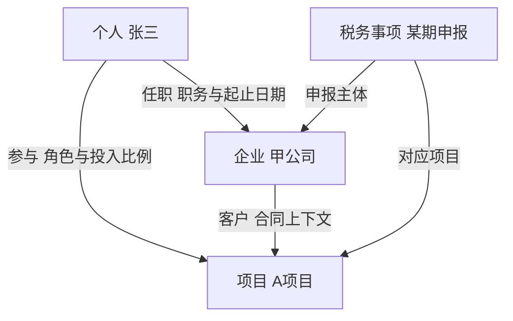
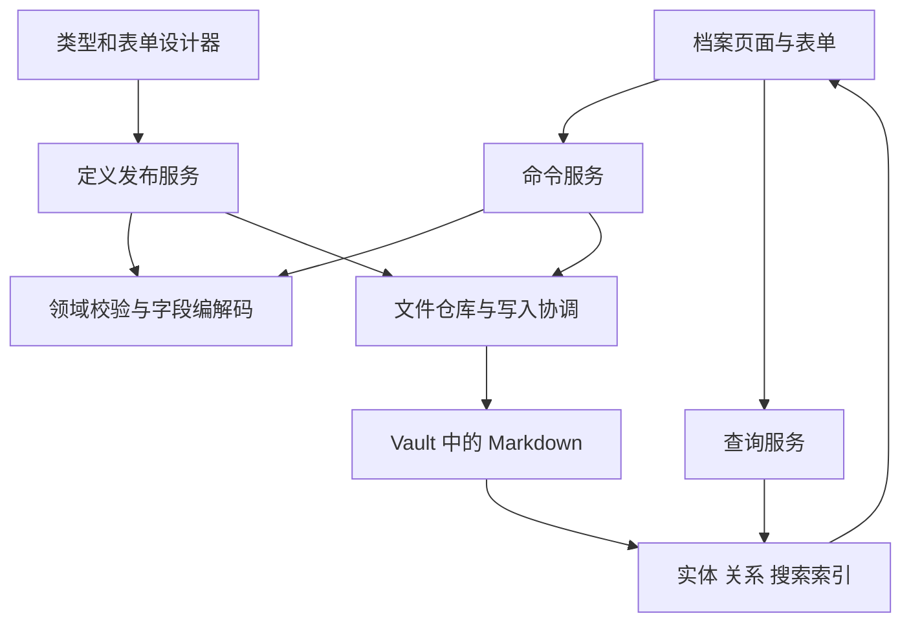

## 目标与实施跟踪

将当前固定的个人／企业档案升级为用户可定义档案类型、字段、表单模板和跨实体关系的通用档案系统，保留 Markdown 内容的可携带性与数据恢复能力。下方完整收录架构审计与重构设计，作为本 Issue 的需求、技术方案和验收依据。

- [ ] P0：确定数据合同、v2 文件协议与旧格式回归基线。
- [ ] P1：实现通用内核、个人／企业预设与旧格式适配。
- [ ] P2：打通自定义类型、字段、多表单、视图和动态导航。
- [ ] P3：实现通用关系、独立关系存储与双向查询。
- [ ] P4：实现可恢复迁移、回退、定义演进和同步冲突处理。
- [ ] P5：完善导入、Lookup／Rollup、局部图谱和项目集成。

P0–P4 为首轮可正式使用的重构范围；各阶段完成标准以以下完整设计为准。本文是设计与实施需求，不表示功能已经实现。

---

本方案面向 HUHU 档案模块从固定的个人与企业资料管理，升级为用户可定义类型、字段、表单和实体关系的档案系统。核心建议是：保留 Obsidian 文件优先和现有模块边界，在 archives 模块内建立统一领域内核，把个人、企业、任职和人际关系改成预置定义。

分析基线为 GitHub main 提交 [33c21e098ef3188cbab5a09f3e0a01fadb787715](https://github.com/NAMEWTA/obsidian-huhu/commit/33c21e098ef3188cbab5a09f3e0a01fadb787715)，提交时间为 2026 年 10 月 25 日 12:27:10（Asia/Taipei）。下文明确区分当前源码事实与目标设计；目标能力不表示已经实现。范围不包含用户设备未提交或未推送的工作树。

# 设计结论

建议确定以下八项架构决策：

1. 通用档案引擎继续归属于 `src/modules/archives`，复用 HUHU 的模块生命周期、设计系统、服务契约与 Vault 适配。
2. 个人、企业是可安装、可停用、可定制的预置档案类型。新建项目、税务等类型不再修改 TypeScript 枚举。
3. 类型定义、字段定义、表单模板、创建模板、实体、关系类型、关系记录和视图各有职责；多张表单编辑同一实体数据。
4. 实体、类型、字段、枚举选项和关系具有稳定身份。显示名称、文件路径和界面语言不承担身份语义。
5. 关系是一条有身份、有方向、可有属性和时间的事实。第一版采用独立可见 Markdown 关系文件，两端页面通过索引显示同一事实。
6. 类型和表单等业务定义与档案一起放在可见目录，采用 Markdown 承载；隐藏目录保留缓存、设备草稿和运行恢复材料。
7. 首期使用受限字段模型、声明式规则和 HUHU 现有 React 组件。不引入服务器数据库，不实现任意用户脚本或完整低代码平台。
8. 先完成旧格式适配和一个自定义类型的完整链路，再完成关系独立存储与可恢复迁移，最后丰富视图、计算和导入能力。

这里的“最佳状态”是明确的能力边界、可靠的数据协议和可持续扩展，不是第一版容纳所有低代码功能。

# 当前项目与代码基线

## 最新状态

| 项目层次 | 当前已核实状态 | 对本次设计的含义 |
| --- | --- | --- |
| 主分支最新提交 | `33c21e0`，2026 年 10 月 25 日，保存 Bot 架构规划与公共设计基线 | Bot 规划文档不能当作已实施 API |
| 前一提交 | `e19f607`，同日，保存终端重构方案、原型和计划 | 终端未来边界需要预留，但不能要求档案依赖未实现能力 |
| 已发布版本 | [0.0.1](https://github.com/NAMEWTA/obsidian-huhu/releases/tag/0.0.1)，2026 年 10 月 24 日 | main 和 release 的状态需要分开 |
| 插件形态 | TypeScript、React、esbuild；minAppVersion 1.13.0；非 desktop-only | 档案核心要兼容移动端，不依赖 Node 或原生数据库 |
| 架构 | app、shell、ui/theme、host、shared、11 个业务模块 | 保留模块化单体，改造集中在 archives 与少量契约 |
| 当前档案存储 | 可见档案目录、每实体一个目录和 `基本信息.md`、内存索引 | 内容与附件的可携带性是重构基线 |

源码与工程约束见 [架构文档](https://github.com/NAMEWTA/obsidian-huhu/blob/33c21e098ef3188cbab5a09f3e0a01fadb787715/docs/architecture.md)、[插件清单](https://github.com/NAMEWTA/obsidian-huhu/blob/33c21e098ef3188cbab5a09f3e0a01fadb787715/manifest.json)、[依赖清单](https://github.com/NAMEWTA/obsidian-huhu/blob/33c21e098ef3188cbab5a09f3e0a01fadb787715/package.json)。本次未安装项目依赖、未执行构建或测试、未进行真实 Obsidian 宿主验收；后文测试项是已核对的现有覆盖和新增验收要求。

## 硬编码已贯穿全链路

| 层次 | 当前事实 | 必须改变的内容 |
| --- | --- | --- |
| 领域类型 | `RecordKind = 'person' \| 'company'`，基本字段为固定字符串或字符串数组 | 引入类型注册表与字段类型系统 |
| 关系结构 | `EmploymentRecord` 指向企业；`PersonRelation` 指向个人并带企业上下文 | 通用关系类型、端点约束、属性结构 |
| 文件发现 | 仅识别两个固定中文分类下恰好三层的 `基本信息.md` | 由类型存储策略与文件身份标记识别 |
| 文件解析 | 非 person/company 的 `huhu-type` 返回 null | 未知类型进入可读诊断，不能消失 |
| 文件编写 | 固定字段白名单、履历表、关系表和正文分区 | 版本化 codec 与动态字段映射 |
| 查询 | 地区、标签、现任企业、曾任企业等固定条件 | 类型化查询表达式、字段运算符和关系查询 |
| 搜索命中 | employment、traits、habits 等固定来源 | 动态 fieldId、sectionId、relationId 与来源位置 |
| 表单与详情 | React 内写死字段、个人和企业分支 | Schema 驱动渲染与预置详情布局 |
| 侧栏 | 固定两种 KINDS | 类型目录与视图驱动 |
| shell 路由 | contacts.section 仅允许 person/company | 动态类型 ID 的有界语法检查 |
| 偏好设置 | layouts 只保留两种 key | 按 typeId/viewId 保存偏好 |
| 外部使用方 | 自动化来源 contacts、最近文档路径规则 | 兼容适配与公开分类接口 |

对应证据：[领域模型](https://github.com/NAMEWTA/obsidian-huhu/blob/33c21e098ef3188cbab5a09f3e0a01fadb787715/src/modules/archives/core/model.ts#L1)、[路径识别](https://github.com/NAMEWTA/obsidian-huhu/blob/33c21e098ef3188cbab5a09f3e0a01fadb787715/src/modules/archives/core/resources.ts#L3)、[Markdown 解析与保存](https://github.com/NAMEWTA/obsidian-huhu/blob/33c21e098ef3188cbab5a09f3e0a01fadb787715/src/modules/archives/core/persist/markdown.ts#L155)、[查询与关系索引](https://github.com/NAMEWTA/obsidian-huhu/blob/33c21e098ef3188cbab5a09f3e0a01fadb787715/src/modules/archives/core/index-store.ts#L11)、[表单](https://github.com/NAMEWTA/obsidian-huhu/blob/33c21e098ef3188cbab5a09f3e0a01fadb787715/src/modules/archives/ui/forms.tsx#L342)、[详情页](https://github.com/NAMEWTA/obsidian-huhu/blob/33c21e098ef3188cbab5a09f3e0a01fadb787715/src/modules/archives/ui/RecordDetail.tsx#L133)、[shell 路由白名单](https://github.com/NAMEWTA/obsidian-huhu/blob/33c21e098ef3188cbab5a09f3e0a01fadb787715/src/shell/navigation-state.ts#L20)、[布局偏好](https://github.com/NAMEWTA/obsidian-huhu/blob/33c21e098ef3188cbab5a09f3e0a01fadb787715/src/shared/contacts-settings.ts#L3)。

当前已经允许自定义“人际关系名称”，`PersonRelation.kind` 是字符串，表单也有自定义输入。但它仍限制在个人之间，只有可选企业上下文，缺少可定义的端点类型、基数和属性。不能把现状表述为完全不支持自定义关系。见 [关系表单](https://github.com/NAMEWTA/obsidian-huhu/blob/33c21e098ef3188cbab5a09f3e0a01fadb787715/src/modules/archives/ui/forms.tsx#L460)、[关系说明](https://github.com/NAMEWTA/obsidian-huhu/blob/33c21e098ef3188cbab5a09f3e0a01fadb787715/docs/contacts.md#L48)。

## 应保留的基础能力

现有实现已经具备稳定 huhu-id、同名实体区分、关系单份存储与反向投影、字段和正文分区的三方合并、未知 YAML 与自由正文保留、重复身份和链接冲突诊断、根目录切换保护、迟到读取失效控制、串行写入队列、附件递归与批量导入逐项回执。

尤其要保留 `patchMarkdown` 的非受管正文保真能力，不能把新保存逻辑退化为对象整体 stringify 后覆盖整篇笔记。现有关系表作为一个分区进行冲突检测；独立关系记录可以进一步缩小冲突单元。见 [三方补丁算法](https://github.com/NAMEWTA/obsidian-huhu/blob/33c21e098ef3188cbab5a09f3e0a01fadb787715/src/modules/archives/core/persist/markdown.ts#L257)、[应用服务](https://github.com/NAMEWTA/obsidian-huhu/blob/33c21e098ef3188cbab5a09f3e0a01fadb787715/src/modules/archives/core/application.ts#L263)、[回归测试](https://github.com/NAMEWTA/obsidian-huhu/blob/33c21e098ef3188cbab5a09f3e0a01fadb787715/src/modules/archives/archives.test.ts#L73)。

真实宿主编辑器仍需单独验收：生产 `vault-files.ts` 的 `checkEditor` 与 `checkFolderEditors` 为空操作，实际依赖宿主的 `Vault.process`；测试中的 memoryVault 没有打开的编辑器叶子。因此，应用层合并测试不能替代未保存原生编辑器与删除、迁移的真实验收。这是已确认的验证边界，不是已复现的数据损坏缺陷。见 [宿主适配](https://github.com/NAMEWTA/obsidian-huhu/blob/33c21e098ef3188cbab5a09f3e0a01fadb787715/src/modules/archives/platform/vault-files.ts#L69)、[测试宿主](https://github.com/NAMEWTA/obsidian-huhu/blob/33c21e098ef3188cbab5a09f3e0a01fadb787715/src/modules/archives/archives.test.ts#L401)。

# 用户能力与领域边界

## 用户最终能够完成的操作

用户可从空白或预置类型创建“项目档案”，配置项目编号、名称、状态、日期、预算等字段，建立“简版创建”和“完整编辑”两套表单，设置列表与卡片视图，再声明项目和个人、企业、税务事项之间的关系。整个过程不新增业务 React 页面，不修改内核枚举。

已有个人、企业继续开箱即用。新用户可以选择安装预设；已有用户的预设定义自动识别，但禁止升级插件时覆盖用户已经修改的版本。停用类型只停止创建或隐藏入口，已存在实体仍能读取和恢复。

## 八个概念需要分别建模

| 概念 | 解决的问题 | 示例 |
| --- | --- | --- |
| ArchiveTypeDefinition | 一类实体包含什么字段和约束 | 项目档案类型 |
| FieldDefinition | 字段的身份、数据类型、存储键和校验 | 项目编号、预算 |
| FormTemplate | 填写时哪些字段出现，如何分组和显隐 | 项目快速登记、项目完整资料 |
| RecordTemplate | 新建时使用什么默认值和正文骨架 | 咨询项目初始模板 |
| EntityRecord | 一个真实对象或业务记录 | A 项目、张三、甲公司 |
| RelationTypeDefinition | 两端允许连接谁，关系有什么属性 | 任职、项目参与 |
| RelationRecord | 一次具体关联事实 | 张三于某期间担任甲公司经理 |
| ViewDefinition | 如何查询和展示既有实体 | 进行中项目、按客户分组 |

表单只引用字段 ID，不拥有另一份字段值。不同表单中的“项目名称”应该落到同一字段。字段新增需要进入类型定义草稿，不能由某张表单偷偷造一个只在该表单有效的字段。

创建模板中的默认值只在创建或显式迁移时应用。修改模板不能覆盖已有档案；切换表单不能清除不在当前表单里的字段。

## 税务档案应该如何使用

“甲公司”是企业实体；“甲公司 2026 年某期某项申报”是另一条税务事项实体，具有期间、状态、日期、金额、附件，并通过“申报主体”关系指向甲公司。每期事项独立存在，方便查询和保留历史。

企业页面上的基础资料表单与银行资料表单可以编辑同一企业；每期申报表属于可重复发生的业务记录，应建独立实体，避免年年覆盖同一组企业字段。这里只定义资料模型，不内置未经业务确认的税率、申报规则或法定期限。

从属明细与实体也要区分。多个电话号码通常是数组值；申报明细可以是带 rowId 的子表；有独立编号、附件和流程的合同或申报应是实体。第一版用类型化二元关系、关系属性和中间业务实体即可，不需要任意超图模型。

# 字段系统与表单引擎

## 稳定身份与可读存储

字段至少有 `fieldId`、`storageKey`、`label` 三个不同属性：

- fieldId 是内部引用身份，供表单、查询、公式和迁移使用。
- storageKey 是 Markdown 中的稳定可读键，普通改名不改变它。
- label 是界面名称，可随业务习惯或语言变化。

定义发布必须拒绝 huhu- 系统保留前缀、同类型重复 storageKey 及未经显式映射确认的既有属性冲突。用户字段不能覆盖身份、协议、端点或迁移元数据；tags、aliases 等宿主属性只允许兼容映射。

枚举选项也需要稳定身份。把“进行中”改成“执行中”只改变显示标签，不能让历史值失去含义。停用选项保留旧值可读性；真正删除或重命名存储键属于迁移。

Obsidian 按整个 vault 的属性名称管理属性类型；同名属性共享类型。因此，不同档案类型如果需要不同语义，应采用兼容的共享键或带类型前缀的 storageKey，不能把同一个 budget 属性在一类定义成数字、另一类定义成列表。原生 Properties 不支持嵌套属性编辑；复杂值应明确使用 HUHU 表单或源码模式，不承诺所有高级字段都可在原生属性编辑器中编辑。来源：[Obsidian Properties](https://obsidian.md/help/properties)。

## 首期字段范围

| 字段类型 | 核心约定 |
| --- | --- |
| 单行文本 | 电话、税号、编号都用文本，保留前导零 |
| Markdown 正文 | 使用稳定 fieldId 的受管正文分区，非受管内容不重写 |
| 整数与小数 | 明确范围、精度与转换规则，不对非法输入静默置零 |
| 金额 | 十进制定点或 decimal 字符串与币种组合，避免浮点直接累加 |
| 布尔值 | 区分 false 与未填 |
| 日期与日期时间 | 日期不做时区平移；日期时间明确时区；保留年月精度 |
| 单选与多选 | 稳定选项 ID 或稳定存储值，标签可修改 |
| 字符串列表与标签 | 去重规则明确，不把空数组和缺失值一概混用 |
| 文件引用 | 通过资源服务解析；明确相对路径、范围与缺件状态 |
| 关系控件 | 读取和修改关系记录，不再保存一份独立 ID 数组 |
| 重复子表 | 每行稳定 rowId，从属值不自动成为全局实体 |

日期字段的 `2025-03` 不应被悄悄转换成 `2025-03-01`；这改变了信息精度。年月值应采用受控文本与 precision，由 HUHU codec 校验，不能声明成 JSON Schema 的 `format: date` 或 Obsidian 原生 Date。只有完整年月日才可映射原生日期属性；同一 storageKey 同时支持月和日精度时，原生属性统一保持文本。任职中的现任/曾任保留显式状态，不由结束日期单独推断。

缺失、空字符串、null、空数组和零值需要每种字段 codec 明确定义。保存既有记录时，未触及字段的原始表示应保持；不能因表单没展示某字段而写空。

## 数据定义与界面定义分离

建议采用“受控内部元数据模型 + JSON Schema 校验子集 + HUHU 自有渲染器”。JSON Schema 描述可表达的数据结构；关系完整性、唯一性和迁移由领域服务负责。JSON Forms 的 schema/UI schema 分离与自定义渲染机制可参考，但是否直接引入其运行时需验证包体、现有 React 版本和复杂关系控件，不预先承诺整套采用。来源：[JSON Forms UI schema](https://jsonforms.io/docs/uischema/)、[校验](https://jsonforms.io/docs/validation/)。

纯数据层维护 FieldCodecRegistry；React 层维护 FieldRendererRegistry。前者负责解析、序列化、校验、规范化、排序与搜索提取，后者负责输入控件和只读展示。core 不导入 React。

表单模板支持分组、顺序、响应式列、帮助文本、条件显隐与只读展示。条件是受限表达式树，首期仅提供字段比较、集合包含、AND/OR，不执行任意 JavaScript，不加载远程 schema 引用。

## 保存与校验合同

读取数据时生成可定位的诊断，不因值不符合新规则而隐藏整条档案。语法损坏、身份冲突和不支持的未来格式禁止覆盖；普通字段不完整则允许保存为草稿。

“保存草稿”校验结构和身份，“标记完成”执行必填与业务规则。若简版表单缺少该类型必填字段，创建时要提供草稿语义，不能用隐藏字段绕过规则。

FormSession 保存 entityId、打开时的 schemaRevisionId、基础内容 hash、基准值、脏字段和草稿。两份表单改不同字段可合并；同一字段冲突提供具体比较并保留草稿。字段或 schema 在编辑期间变更时，应检查兼容性，不能在旧草稿上套用新语义强行保存。

业务校验始终在命令服务执行，UI、导入和将来的 Agent 使用同一入口。

# 通用实体关系模型

## 一个具体例子



这里每一条线都可以对应独立的关系记录。所有类型都可以参与关系，但具体关系类型仍约束允许的两端，防止“任何对象随便关联”失去业务含义。

## 关系类型必须描述的约束

| 维度 | 需要定义的内容 |
| --- | --- |
| 端点类型 | sourceTypes、targetTypes；例如申报主体允许个人或企业 |
| 方向 | 有向或对称；正向、反向各自名称 |
| 基数 | 每个 source 可关联多少 target；每个 target 可关联多少 source |
| 关系属性 | 职务、部门、股比、角色、合同金额、说明等 |
| 时间 | 是否支持有效起止、年月精度、显式现任状态 |
| 重复政策 | 同端点是否可重复，按角色或期间如何判断 |
| 自关联 | 是否允许自己关联自己 |
| 图约束 | 特定关系是否禁止环；普通关系不一律禁止 |
| 删除政策 | 限制删除、保留断开引用、显式删除关联 |
| 展示 | 两端关系区块、排序、筛选、汇总方式 |

“项目只能选一个负责人，而个人可负责多个项目”是多对一。只有两端都限制最多一个，才是一对一。控件单选不等于数据模型的一对一。

基数还要区分所有历史关系、当前有效关系和草稿。一个项目同一时间只有一位负责人，不意味着它历史上只能有一条负责人关系。跨设备离线产生的基数冲突，合并后要诊断；本地索引不能提供跨设备强一致约束。

## 关系记录合同示意

以下是目标领域合同示意，不是现有源码，也不是最终完整类型定义。

```typescript
interface DefinitionRevision {
  revisionId: string;
  parentRevisionIds: string[];
  contentHash: string;
  displayVersion: number;
}

interface EntityRecord {
  id: string;
  typeId: string;
  schemaRevisionId: string;
  lifecycle: "draft" | "active" | "archived";
  values: Record<string, unknown>; // 以内核字段 ID 定位
  path: string;                   // 位置，不是身份
  raw: string;
  contentHash: string;
}

interface RelationRecord {
  id: string;
  relationTypeId: string;
  schemaRevisionId: string;
  sourceId: string;
  targetId: string;
  values: Record<string, unknown>;
  validFrom?: { value: string; precision: "month" | "day" };
  validTo?: { value: string; precision: "month" | "day" };
  lifecycle: "active" | "archived" | "deleted";
  contextRefs?: Record<string, string>;
  provenance?: {
    migrationId: string;
    legacyOwnerId: string;
    legacySection: string;
    legacyRowId: string;
  };
}
```

关系端点 ID 为权威身份；类型从实体索引解析并校验。可以保存名称快照和路径提示供 Markdown 阅读及缺件诊断，但不能依靠名称匹配身份，也不能把路径提示当第二个权威端点。

关系属性里的 contextRefs 只允许关系定义声明的角色，例如旧人际关系的企业上下文；这些引用同样参与完整性检查、删除影响分析和反向依赖更新。这样能保留既有信息，而无需第一版引入任意多端关系。

## 内置预设如何泛化

| 现有能力 | 新定义 |
| --- | --- |
| 个人档案 | person 预置类型与若干表单、视图 |
| 企业档案 | company 预置类型与表单、视图 |
| 任职经历 | employment 关系类型，含原有全部属性 |
| 企业人员列表 | employment 的反向视图 |
| 企业关键人物 | 对 current 任职及 keyRole 的预设过滤 |
| 领导与下属 | reportsTo 有向关系的两端展示 |
| 朋友与同事 | 显式声明为对称关系的预设 |
| 自定义人际称谓 | 保留原称谓和来源的兼容关系定义 |

同一个人离职后重新进入同一企业，需要两条任职记录。不要用 sourceId、targetId、relationTypeId 三项永远唯一；需要结合关系定义决定是否允许多段历史、兼任和不同上下文。

旧人际关系的语义是“对方是我的某种关系”。A 中的 leader 指向 B，转换成 reportsTo 时是 A → B；A 中的 report 指向 B 时，转换为 B → A。自定义文字不得自动推断反向语义。原 company 上下文、现任/曾任状态、keyRole 和时间精度都必须迁移。证据：[原有关系语义](https://github.com/NAMEWTA/obsidian-huhu/blob/33c21e098ef3188cbab5a09f3e0a01fadb787715/docs/contacts.md#L48)、[原有反向计算](https://github.com/NAMEWTA/obsidian-huhu/blob/33c21e098ef3188cbab5a09f3e0a01fadb787715/src/modules/archives/core/index-store.ts#L297)。

## 为什么首期选择独立关系文件

第一版建议每条关系一份可见 Markdown，统一由 RelationRepository 管理：

- 关系生命周期不依附于任一实体目录。
- 两端操作同一文件，省去镜像双写。
- 不同关系可以独立修改，冲突范围小于整张履历表。
- 实体被外部删除时，关系仍可作为端点缺失的历史记录保留。
- 关系属性、来源与时间可以单独读取、修复和索引。

代价是总文件数增加，以及新建实体并关联、合并实体等操作跨多个文件。这是需要测试和恢复协议约束的真实代价。过渡期允许 v1 与 v2 文件共存，但同一条关系只有一个权威写入来源；写入路由由格式和迁移来源映射决定，禁止同时维护内嵌和独立两份可写副本。

关系拥有独立文件，并不要求用户在日常界面里管理这些文件。一般用户仍在实体详情和关系表单里操作。

# 文件协议与可携带存储

## 业务定义与用户内容一起保存

建议路径如下。显示名称改动不自动移动实际文件夹，路径只是初次创建策略。

| 路径示例 | 内容 |
| --- | --- |
| `huhu/档案/档案集合.md` | 集合 ID、协议版本、必要包信息 |
| `huhu/档案/档案定义/类型/<typeId>/当前.md` | 当前发布修订指向 |
| `huhu/档案/档案定义/类型/<typeId>/修订/<revisionId>.md` | 不可变类型修订 |
| `huhu/档案/档案定义/表单/<formId>/...` | 表单定义及修订 |
| `huhu/档案/档案定义/关系/<relationTypeId>/...` | 关系类型及修订 |
| `huhu/档案/档案定义/视图/<viewId>.md` | 保存的查询和展示 |
| `huhu/档案/个人档案/<现有目录>/基本信息.md` | 现有实体可原位保留 |
| `huhu/档案/项目档案/<名称与短ID>/基本信息.md` | 新类型实体 |
| `huhu/档案/关联记录/<relationTypeId>/<relationId>.md` | 唯一关系事实 |
| `huhu/档案/迁移记录/<migrationId>.md` | 跨设备解释迁移所需清单和来源映射 |
| `.huhu/cache/archives/` | 可丢弃、可重建索引 |
| `.huhu/recovery/archives/` | 本设备恢复材料与冲突草稿 |

定义属于解释用户内容所必需的业务资产，应随档案一起备份和同步。只有本设备运行状态可以仅保存在隐藏区。完整目录恢复覆盖档案自身内容、定义、关系及已收纳的附件；目录外的项目管理笔记或其他文件仅恢复引用，目标缺失时显示诊断，需要内容一并携带时纳入明确的导出依赖范围。不能把恢复未完成迁移必需的事实只写在隐藏日志里。

这个选择需要在 HUHU 的存储 ADR 中明确“业务定义”与普通设置的区别。当前项目的“两块根目录”原则仍保留，只是把档案领域定义认定为内容组成部分。证据：[当前备份合同](https://github.com/NAMEWTA/obsidian-huhu/blob/33c21e098ef3188cbab5a09f3e0a01fadb787715/docs/contacts.md#L109)、[当前数据与同步边界](https://github.com/NAMEWTA/obsidian-huhu/blob/33c21e098ef3188cbab5a09f3e0a01fadb787715/docs/data.md#L83)。

Obsidian 官方说明普通点目录不参与 Obsidian Sync，配置目录有专门例外；JSON 等其他文件类型还受选择性同步设置影响。因此定义采用可见 Markdown 比只写隐藏 JSON 更符合档案现有的携带体验。来源：[Sync settings](https://obsidian.md/help/sync/settings)。

## V2 实体示例

以下 ID 和内容仅用于说明新协议。

```yaml
---
huhu-format-version: 2
huhu-type: archive-record
huhu-id: entity-project-a
huhu-archive-type-id: type-project
huhu-schema-revision: revision-project-01
huhu-state: active
project-name: A项目
project-code: P-2026-001
project-status: in-progress
project-start-date: "2026-10-01"
tags:
  - 咨询
---
```

正文仍可以包含用户自由笔记。长文本字段使用带稳定 fieldId 的受管区域；修改一个字段只更新相应区域。

在读取时，先检查档案根内允许的文件范围与身份标记，再解析 typeId。路径决定资源归属与初次创建位置，元数据决定实体类型；不能由中文目录名推断类型。可通过类型存储规则限定目录范围，第一版不需要把任意附件笔记自动变成实体。

文件状态至少区分：普通笔记、有效实体、缺失定义、未知未来格式、损坏文件、重复 ID、待同步引用。除普通笔记之外，异常档案进入诊断列表并保留原文，不能静默丢弃。

## V2 关系示例

```yaml
---
huhu-format-version: 2
huhu-type: archive-relation
huhu-id: relation-employment-001
huhu-relation-type-id: relation-employment
huhu-schema-revision: revision-employment-01
huhu-source-id: entity-person-001
huhu-target-id: entity-company-001
employment-status: current
department: 财务部
job-title: 经理
valid-from: "2024-05"
valid-from-precision: month
huhu-state: active
---
```

关系正文可以提供人物、企业的可读 Markdown 链接和备注。链接为可读定位信息，ID 为权威；发现链接与 ID 指向不同实体时，进入冲突诊断，不偷偷改端点。

所有简单实体关联控件也写 RelationRecord。若为了 Bases 展示导出关联属性，必须明确它是只读投影，不能两种格式同时接受修改。

# 模块架构与代码职责

## 保留现有模块化结构

档案引擎仍归属于 archives。schema、relations、query 可以成为该模块内部纯核心子域，先不提升为整个 HUHU 的共享实体底座。只有其他模块真正需要相同契约，才抽取稳定接口，避免让所有模块依赖一个尚未验证的新框架。



工作台、自动化和未来 Bot 通过公开 api.ts 服务契约接入。core 不导入 Obsidian、React 或 Node；Vault IO、文件事件和宿主编辑器协作位于 platform。表单设计器、图谱和批量导入按需加载，不进入插件启动闭包。工程约束见 [架构参考](https://github.com/NAMEWTA/obsidian-huhu/blob/33c21e098ef3188cbab5a09f3e0a01fadb787715/.agents/skills/dev/references/architecture.md#L32)。

## 目标目录职责

| 目录 | 主要内容 |
| --- | --- |
| `core/schema/` | 类型、字段、关系定义，支持子集编译，兼容性与发布差异 |
| `core/entity/` | 实体模型、校验、命令与生命周期 |
| `core/relation/` | 关系模型、方向、基数、重复和时间规则 |
| `core/query/` | 查询表达式、字段运算符、排序和查询计划 |
| `core/index/` | 实体索引、邻接索引、搜索投影与依赖跟踪 |
| `core/persist/legacy/` | 原 v1 parser、patch 与适配器 |
| `core/persist/v2/` | 新协议 codec、YAML AST 和受管正文补丁 |
| `core/migration/` | 预检、稳定映射、切换、续跑和回退计划 |
| `platform/` | Vault 读写、事件、宿主适配与缓存 |
| `services/` | 工作台、外部查询、命令和资源分类服务 |
| `ui/fields/` | 字段输入和只读 renderer |
| `ui/forms/` | FormSession、通用表单与关联选择器 |
| `ui/designer/` | 类型、字段、表单和关系定义编辑 |
| `ui/views/` | 表格、卡片、详情、关系视图 |
| `presets/` | 个人、企业、任职和人际关系的数据定义 |

实际拆分以职责与可独立验证为准，不要求一次性创建所有目录。

## 模块公开服务建议

| 服务 | 能力 | 边界 |
| --- | --- | --- |
| ARCHIVES_CATALOG | 查询类型、表单与视图摘要，订阅定义变更 | 返回数据，不暴露内部 registry |
| ARCHIVES_QUERY | 实体查询、ID 解析、关系列表和只读快照 | 明确加载状态、完整性和诊断 |
| ARCHIVES_COMMANDS | 创建、字段补丁、关联、归档 | 统一校验、版本前置条件和回执 |
| ARCHIVES_WORKBENCH | 动态分类、标题、选中项和导航 | 延续现有 PanelModel |
| 资源分类快照 | 标识实体主文件、关系文件、定义与普通附件 | home 不重新解释档案路径 |
| 自动化来源贡献 | 通用实体提醒与回跳 | 沿用现有 AUTOMATION_SOURCES |

未来 Agent 或导入功能必须调用相同命令路径，或遵循公开文件协议后进入同一诊断管线；不得绕过校验直接改内部缓存。

外部接口不返回可变的内部 Map。查询结果可携带 entityRevision、schemaRevision 和 isComplete；定义缺失或迁移未完成时，汇总不能把缺件默认为零。

# 写入一致性与数据恢复

## 单文件保存

一次实体或关系更新应当执行：

1. 读取表单基准的实体 ID、schema 修订与内容 hash。
2. 检查当前模块仍激活，档案根未变化，目标身份唯一。
3. 校验字段值及相关关系约束。
4. 在 `Vault.process` 内读取最新文本，比较 base/current/draft。
5. 仅合并互不冲突的字段与受管区域，保留未知节点、自由正文和附件。
6. 再次解析补丁结果，确认结构和身份合法后写入。
7. 发布已提交变更，按依赖更新索引和 UI。
8. 返回写入结果与可恢复诊断；失败保留草稿。

当前共享 Markdown 工具可帮助保留 YAML 节点与注释，但不能把它视为已经支持所有动态子表和 schema 演进。见 [共享 Markdown 补丁](https://github.com/NAMEWTA/obsidian-huhu/blob/33c21e098ef3188cbab5a09f3e0a01fadb787715/src/shared/storage/markdown-document.ts#L83)、[写入队列](https://github.com/NAMEWTA/obsidian-huhu/blob/33c21e098ef3188cbab5a09f3e0a01fadb787715/src/shared/storage/write-queue.ts#L19)。

Obsidian 官方保证 `Vault.process` 的当前内容读取与更新之间不被另一次文件变更打断；它是单文件读改写机制，不提供多文件事务或跨设备事务。来源：[Vault 开发文档](https://docs.obsidian.md/Plugins/Vault)。

## 跨文件操作

“新建实体并关联”“合并重复实体”“批量导入”“类型迁移”均需要可恢复操作计划。计划保存 operationId、目标路径、预期旧 hash、预分配 ID、各步骤状态、已写入内容 hash 与回执。

先写入并读回验证，再推进后续步骤。重试复用同一 ID 和目标路径，不能每次创建第二个对象。

新建目标成功而建立关系失败时，保留已经创建的目标，明确显示“目标已创建，关联待重试”。不能为了伪装原子事务而自动删除可能已经被其他记录引用的目标。

撤销或回退也要比较当前 hash。用户在迁移后已经修改的文件，不允许被旧备份直接覆盖；应生成比较与恢复副本。

## 外部编辑与多设备同步

文件事件统一进入分类、解析、校验、索引更新管线。对重复事件做有界合并，对迟到事件使用 generation/version 判断，延续现有保护。

同步是最终到达，不能假设定义先于实体、实体先于关系。缺失端点先显示待解析或待同步，保留关系事实；真正找不到时提供修复入口。跨设备发布冲突、实体唯一值冲突和关系基数冲突需要显式诊断，不使用最后写入者自动决定业务含义。

在主数据文件中保留解释数据必要的版本与迁移信息。缓存丢失应能完全重建；设备恢复草稿丢失不能导致已提交实体或关系无法读取。

## 删除与历史

默认用户操作是归档。类型、字段、选项和关系定义先停用或归档；数据清理为独立操作。

硬删除实体前显示附件数、入向和出向关系、受影响提醒及依赖。独立关系可保留为端点缺失的历史事实；外部直接删文件也按同一诊断处理，不自动连删其他实体。

关系逻辑删除可采用 tombstone，保存 relationId 和删除状态，帮助多设备及迁移防止旧关系复活。物理清理必须有明确范围和恢复政策。名称快照有助于缺件阅读，但不替代原实体，也不自动恢复端点。

字段的隐藏与只读是界面行为，不能作为磁盘访问权限或加密。敏感字段需要明确搜索和导出策略；若需要保险箱级保护，应另做专用集成，不自动把档案明文复制到 safe，也不突破 safe 当前不向自动化和智能体暴露记录的边界。见 [保险箱边界](https://github.com/NAMEWTA/obsidian-huhu/blob/33c21e098ef3188cbab5a09f3e0a01fadb787715/docs/safe.md#L22)。

# 定义版本与发布流程

## 版本需要分层

| 版本层次 | 负责什么 |
| --- | --- |
| formatVersion | 文件协议和编解码方式 |
| schemaRevisionId | 字段与约束的确切业务定义 |
| formRevisionId | 表单布局和填写流程 |
| viewRevisionId | 保存的查询和展示配置 |
| entity contentHash | 本次编辑依据的内容修订 |
| JSON Schema 的 $schema | JSON Schema 标准方言 |

JSON Schema 的 `$schema` 不能代替业务类型版本，官方将其定义为方言声明。来源：[JSON Schema 方言说明](https://json-schema.org/understanding-json-schema/reference/schema)。

## 不可变修订与并发发布

每份发布修订至少包含 revisionId、parentRevisionIds、contentHash 与 displayVersion。revisionId 唯一标识发布内容，父修订识别分叉，hash 对规范化语义内容计算，数字版本只用于显示。

两台设备可能都从 v3 发布不同的 v4，因此不能只用自增整数或时间戳选择“最新”。发布文件按 revisionId 保存，不让两个 v4 覆盖同一路径。类型的当前修订指向采用基准比较；分叉时显示比较与合并，不自动按时间最大覆盖。

修订 hash 排除修改时间等无关元数据，同时保留有业务意义的字段和选项顺序。hash 用于一致性识别，不把它当成权限证明。

基准比较只能保护本机发布动作，不能保证跨设备指针文件不被同步工具覆盖。加载时还需从全部已发布的不可变修订和 parentRevisionIds 构建修订图，检测尚未合并的多个分支头；即使“当前.md”只剩一个指向，也不能忽略另一个已发布分支。合并发布必须明确继承所解决的各个分支，未解决时暂停相关定义升级与新建。

实体按确切 schemaRevisionId 解释值。界面可采用兼容的最新标签和布局；新建使用当前发布修订。已有记录在下一次兼容编辑时可显式升级修订，破坏性变更必须先走转换计划。不能在每次读取时顺便重写所有旧记录。

## 改动分类

| 改动 | 默认处理 |
| --- | --- |
| 标签、说明、图标、字段顺序 | 更新展示定义，不批量改实体 |
| 增加可选字段 | 旧实体缺失仍合法 |
| 增加必填字段 | 新实体遵守；旧实体给出补全或迁移计划 |
| 文本转数字、单选转多选 | 先试算转换并列出失败值，保留原值 |
| 删除字段 | 停用定义，保留旧值；清理由用户单独执行 |
| 删除枚举项 | 归档选项，历史值仍可显示 |
| 修改 storageKey | 显式数据迁移，同时更新视图、公式和映射引用 |
| 缩小关系端点范围 | 检查所有现存关系，报告不符合项 |
| 多值关系变单值 | 显示冲突，选择处理规则后迁移 |
| 公式变更 | 更新依赖图，检测循环并重建派生值 |

发布流程是“编辑草稿、预览示例、检查受影响数据、发布”。普通用户看到的是可理解的变化说明与影响数量，不需要操作数据库迁移脚本。

缺少定义、定义损坏或出现未来版本时，档案仍显示标题、原始属性、正文和诊断，并限制可能破坏数据的编辑。不用空定义覆盖损坏定义。

# 产品界面与操作流程

## 导航

档案侧栏由已启用类型驱动，包含类型图标、名称、数量、常用视图以及“新建档案类型”入口。默认不一次展开几千实体，可按用户保留的展开状态懒加载或窗口化。

类型分组 ID 与名称分离。标题修改不会改变路由；类型停用或缺失时显示状态和恢复入口，不默默返回个人档案。

档案模块总览可以列出最近访问、待补全和诊断数量。首期不必以关系图作为默认首页；有大量数据时表格、筛选和稳定详情入口更实用。

## 类型设计器

建议分成基础信息、字段、表单、关系、视图五个配置区域，提供实时预览及草稿状态。

基础信息包括名称、图标、说明、标题字段、初始目录策略。字段面板支持新增、顺序、类型和约束；表单配置负责分组与显隐；关系配置负责端点与属性；视图配置负责列、卡片摘要、排序和过滤。

第一版允许按钮调整顺序和分组，确认元数据协议正确后再加拖拽。拖拽不是通用性成立的前提。

## 实体详情与关联选择

详情区块由 ViewDefinition 驱动，展示基本资料、正文、关系、相关资料和可选活动记录。个人预设可继续呈现“工作经历”和“人际关系”；企业预设可继续呈现“任职人员”和“关键人物”，但这些都是通用关系视图配置。

关系选择器应支持搜索、类型约束、去重识别信息、预览、快速新建与关系属性填写。同名对象展示次级信息；名称匹配不自动选第一条。由企业侧增加任职与由个人侧增加任职，写入同一 employment 关系。

用户建立关系时，清楚显示“谁、以什么关系、关联谁”；有向关系应展示一句完整可读描述，避免“领导”这类标签造成方向误解。

表单保留 IME、多值文本、键盘、窄窗口、错误定位、保存中防重复提交和脏数据离开确认。编辑失败不能清空表单；取消关系表单不能默默删除已独立创建的关联对象。

## 查询与视图

查询表达式以 fieldId 和 relationTypeId 引用元数据，支持类型、关键词、AND/OR、字段比较和关系存在条件。运算符由字段类型提供，日期有范围，枚举有包含，数字有大小比较，文本有包含与精确匹配。

每个类型可有多个命名视图。同一份项目数据可显示“全部项目”“进行中项目”“按客户分组”，不复制记录。

列表与卡片共享查询语义和稳定排序；详情按稳定实体 ID 读取，独立于列表过滤，并保留返回列表的查询和浏览位置。分页在查询层明确 total、cursor 或 limit；不能只把全量渲染改成每页 60 条就宣称查询已分页。

Lookup 和 Rollup 放在第二阶段：先支持关联目标字段、计数和合计，并明确当前/历史关系范围、空值规则和循环依赖。派生值可缓存，不成为第二份可写真源。

# 跨模块改造清单

| 位置 | 具体改造 | 兼容要求 |
| --- | --- | --- |
| [shell/navigation-state.ts](https://github.com/NAMEWTA/obsidian-huhu/blob/33c21e098ef3188cbab5a09f3e0a01fadb787715/src/shell/navigation-state.ts#L20) | contacts.section 放行合法 typeId，存在性由 archives 判断 | 旧 person/company section 映射到新预置类型 |
| [app/workbench/compose-workbench.ts](https://github.com/NAMEWTA/obsidian-huhu/blob/33c21e098ef3188cbab5a09f3e0a01fadb787715/src/app/workbench/compose-workbench.ts#L100) | 删除个人/企业静态子导航，由服务提供类型目录 | 档案 feature 旧入口可保留 |
| [archives/services/workbench.ts](https://github.com/NAMEWTA/obsidian-huhu/blob/33c21e098ef3188cbab5a09f3e0a01fadb787715/src/modules/archives/services/workbench.ts#L9) | 按类型注册表构建树、标题和选中项 | 保留 PanelModel 与订阅生命周期 |
| [shared/contacts-settings.ts](https://github.com/NAMEWTA/obsidian-huhu/blob/33c21e098ef3188cbab5a09f3e0a01fadb787715/src/shared/contacts-settings.ts#L3) | layouts 改为按 typeId/viewId 保存 | 迁移旧布局，不把定义塞进 settings |
| [archives/ui/panel-state.ts](https://github.com/NAMEWTA/obsidian-huhu/blob/33c21e098ef3188cbab5a09f3e0a01fadb787715/src/modules/archives/ui/panel-state.ts#L34) | 动态类型的筛选、视图、锚点恢复 | 保留旧状态恢复规则 |
| [archives/api.ts](https://github.com/NAMEWTA/obsidian-huhu/blob/33c21e098ef3188cbab5a09f3e0a01fadb787715/src/modules/archives/api.ts#L4) | 增加目录、查询、命令与资源分类契约 | 不暴露 controller 内部对象 |
| [archives/contrib/reminders-source.ts](https://github.com/NAMEWTA/obsidian-huhu/blob/33c21e098ef3188cbab5a09f3e0a01fadb787715/src/modules/archives/contrib/reminders-source.ts#L7) | 面向任意实体的提醒来源 | 保留 contacts wire identifier 或集中别名转换 |
| [shared/automation/types.ts](https://github.com/NAMEWTA/obsidian-huhu/blob/33c21e098ef3188cbab5a09f3e0a01fadb787715/src/shared/automation/types.ts#L15) | 如有必要扩展来源契约 | 不机械重命名已存提醒与历史回执 |
| [home/core/board/recent-doc-policy.ts](https://github.com/NAMEWTA/obsidian-huhu/blob/33c21e098ef3188cbab5a09f3e0a01fadb787715/src/modules/home/core/board/recent-doc-policy.ts#L16) | 使用档案资源分类快照 | 不把新定义、关系主文件误列为普通最近文档 |
| [home/services/projects.ts](https://github.com/NAMEWTA/obsidian-huhu/blob/33c21e098ef3188cbab5a09f3e0a01fadb787715/src/modules/home/services/projects.ts#L13) | 建立项目资料与任务执行的明确引用 | 不直接导入另一个模块内部 ProjectStore |
| 文档、格式说明与黄金样本 | 同步更新 v2协议、恢复和异常处理 | 明确保留旧格式支持期限 |
| 架构、i18n、包体检查 | 新设计器仍懒加载，新增 UI 文案 en/zh | 不能用自定义标签冒充静态 i18n key |

当前 app 的导航项有静态 labelKey 假设；动态用户名称需要明确的 label 契约，不能把中文用户输入注册成翻译键。

## 项目档案与已有项目管理

home 已有 ProjectStore，使用普通 `type: project` 笔记，主要按 path 定位并负责任务、阶段和工作日志。直接新增一套可独立编辑名称、状态、进度的“项目档案”会形成双重所有者。

首期建议明确分工：档案保存项目主资料及跨实体关系；现有项目管理保存任务、里程碑和执行进度。档案通过资源引用关联项目管理笔记，进度只读展示或跳转，不重复写入。

后续再通过 home/api.ts 的公开项目查询与操作契约统一身份；是否把项目执行完全建立在档案实体上，应当成为后续独立迁移项目。证据：[当前项目管理实现](https://github.com/NAMEWTA/obsidian-huhu/blob/33c21e098ef3188cbab5a09f3e0a01fadb787715/src/modules/home/services/projects.ts#L61)。

# 旧档案迁移与回退协议

## 兼容策略

采用“v1 可读、过渡期明确路由写入、v2 单一真源、显式迁移”。旧文件通过 LegacyArchiveAdapter 映射到统一内存模型，原 huhu-id、附件目录和提醒身份保留；新自定义档案直接使用 v2。

新关系引擎正式启用后，未迁移实体可继续通过 v1 codec 编辑其既有基本字段；编辑旧内嵌任职或人际关系前，先显式迁移该 owner。纯读取不自动迁移。修改类型结构或使用 v2 才支持的字段前，需要迁移该实体。不能让通用表单提交新字段后由旧 codec 静默忽略。

## 旧插件误写是必须防住的风险

当前 v1 parser 不检查格式版本，只检查 `huhu-type` 为 person/company。因此只加入 `formatVersion: 2` 无法阻止当前旧实现把升级后的实体当旧格式写入。证据：[旧解析器判断](https://github.com/NAMEWTA/obsidian-huhu/blob/33c21e098ef3188cbab5a09f3e0a01fadb787715/src/modules/archives/core/persist/markdown.ts#L183)。

建议 v2 使用新的外层识别值：

- 实体：`huhu-type: archive-record`，业务类型另存 `huhu-archive-type-id`。
- 关系：`huhu-type: archive-relation`，关系类型另存 `huhu-relation-type-id`。
- 文件协议：`huhu-format-version: 2`。
- 业务定义修订：`huhu-schema-revision`。

个人与企业新预置类型可使用 type-person/type-company。旧 person/company 路由与类型标识在兼容适配层映射。huhu-id 仍为原实体 ID。

本次审查的旧 parser 会忽略这些新识别值，旧表单在保存前重新解析时也会拒绝不匹配数据；新文件仍可作为 Markdown 阅读。这个策略保护了当前旧实现的写入边界，但不承诺旧版档案界面能显示 v2，更不承诺所有历史版本具备相同检查。

## 迁移前预检

至少输出：

- 有效实体、损坏实体、重复 ID 的数量与路径。
- 任职、人际关系和已有提醒数量。
- 无 ID 的手工链接、失效目标、身份与可读链接不一致。
- 无法解释的关系表、重复行 ID、手工行临时 ID。
- 迁移后类型、字段、关系与视图的依赖。
- 预计新增文件数、原文件改动范围和完整备份位置。

对同名对象不自动合并。对缺失定义和歧义引用不以猜测填补；合法实体可以分批迁移，异常项保留诊断。

## 稳定关系映射

当前手工关系行可能使用 `manual-<index>`，它只表示某次解析的位置，不是永久身份。迁移需冻结源文件基准，并将每个旧 ownerId、section、rowId 或已固定的手工行位置映射为一个新 relationId。

已有显式 rowId 保留为 provenance；新全局 relationId 可按档案集合、owner、分区与旧行 ID 生成稳定命名空间 ID，避免不同实体中的局部行号冲突。映射一旦生成即写入迁移清单，重试复用，不重复分配随机 ID。

只迁移原始存储关系，不把企业反向人员列表或人际反向展示再转成第二条关系。

## 可恢复切换顺序

1. 生成包含源 hash、预期关系 ID 集合和目标路径的可携带迁移清单，并保留原始文件备份。
2. 按稳定 ID 创建带 migrationId 与 legacy provenance 的独立关系文件。
3. 读回验证所有端点、属性、时间、状态与关系数量。
4. 在实体的 `Vault.process` 内重新核对源 hash，防止迁移期间的外部改动被覆盖。
5. 原子更新该实体为 v2，并记下本次迁移 ID 与预期关系集合。
6. 重新建立索引并核对语义等价，写入可携带的完成回执，保留已确认的 owner 切换事实和预期关系集合。
7. 原履历和关系表可以保留原字节作为历史区域，但从此不再接受结构化写入；清理可延后。

备份位于明确的迁移恢复区域，文件发现器按路径类别排除它们，不能把原始备份再次当成活跃实体而制造重复 ID。

## 迁移期间的读取不变量

| 文件到达情况 | 权威来源与显示行为 |
| --- | --- |
| owner 仍为 v1，无已提交切换证据，新关系文件已生成 | 旧内嵌表为权威；对应迁移关系视为 staged，不重复计数 |
| owner 已升级 v2，所有预期关系已到达 | 使用独立关系文件；历史表只读留存 |
| owner 已升级 v2，部分关系未到达 | 显示迁移未完成或待同步；查询报告不完整，不能当零条关系 |
| 新关系已被明确删除 | 以 tombstone 或删除回执为准，不从旧表复活 |
| 完成回执存在，owner 后续被删除 | 关系保持已激活的独立事实，显示端点缺失，不退回 staged |
| 完成回执存在，但 owner 又呈现 v1 或不同 migrationId | 进入回退或同步冲突，不重启旧表权威，不覆盖或隐藏已激活关系 |
| owner 缺失且无完成证据 | 保留数据并标记待判断，不猜测迁移已完成 |
| 旧表在切换前被外部修改 | hash 检查阻止切换，重新比较或生成新计划 |
| 无迁移来源的新建独立关系 | 走普通 v2 关系规则，可连接合法 v1/v2 实体 |

判断权威来源不能依赖某台设备的内存标志或隐藏日志。迁移信息与关系身份必须随可见档案同步。

## 回退

回退同时处理实体文件、对应迁移关系文件和迁移清单，并写入显式、可携带的回退回执。只有经过校验的回退协议才能改变已经提交的权威切换；owner 文件单独恢复成 v1 不构成完成回退。若迁移后已有新增、修改或删除，则根据预期内容 hash 报告冲突，保留用户新数据。不能只恢复旧实体而留下所有新关系继续入索引，也不能把新数据全部删除以换取表面一致。

新系统持续读取尚未迁移的 v1 文件。旧插件在看不到 v2 时仍可能新建 v1，新系统可以识别这些文件，但不按同名推断它们与已有 v2 是同一对象。

# 性能与索引设计

## 当前结构的扩展压力

代码存在几处值得优化的路径：

- `application.ts` 的非首次读取会遍历全部实体的未解析引用。
- `index-store.ts` 的未命中查询仍全量 filter/sort，结果缓存只保留一项。
- 工作台索引变化后完整侧栏树缓存失效。
- 搜索为原文和字段建立多个字符串投影，大正文情况下需关注内存。
- UI 分页和窗口化减少渲染量，但不减少全量查询的计算。

这些是结构观察，不是已测得的性能失败。证据：[应用层引用刷新](https://github.com/NAMEWTA/obsidian-huhu/blob/33c21e098ef3188cbab5a09f3e0a01fadb787715/src/modules/archives/core/application.ts#L213)、[查询缓存与过滤](https://github.com/NAMEWTA/obsidian-huhu/blob/33c21e098ef3188cbab5a09f3e0a01fadb787715/src/modules/archives/core/index-store.ts#L255)、[侧栏缓存](https://github.com/NAMEWTA/obsidian-huhu/blob/33c21e098ef3188cbab5a09f3e0a01fadb787715/src/modules/archives/services/workbench.ts#L64)。

## 目标索引

| 索引 | 用途 |
| --- | --- |
| entityById、entityByPath | 稳定身份与位置解析，重复 ID 诊断 |
| entityIdsByType | 动态类型计数与查询候选集 |
| relationById | 关系定位与 revision |
| outgoingByEntity、incomingByEntity | 双向关联查询与删除影响 |
| relationIdsByType | 关系约束和视图 |
| fieldIndexes | 对确实用于筛选/排序的字段建立选择性索引 |
| unresolvedByTargetId/path | 目标出现或改名后只刷新受影响记录 |
| derivedDependencies | 名称、Lookup、Rollup 和搜索投影的失效范围 |
| schemaDependencies | 定义变更时定位受影响字段、表单、视图和实体 |

索引在实体变更后按差量维护。单个名称变化不重新解析整个档案库；关系变更根据依赖索引更新两个端点、已声明的上下文引用和受影响的派生视图，不重扫全库。每个实体和关系只保留必要读取投影，详情原文按需获取或做有界缓存。

先使用内存 Map/Set 与有界查询缓存。若真实数据证明冷启动或内存成为瓶颈，再引入可重建的 IndexedDB 缓存；它始终不是业务真源。图谱按局部邻域展开，限制节点、边数和查询深度，避免默认一次加载整个关系网络。

## 性能验收的规模与条件

当前已有 100、1000、5000 实体与 0、2 KiB、20 KiB 正文的规模脚本，其中 1000 条、每条 2 KiB 的热查询有 P95 100 ms 目标。它不能证明新关系文件方案已达标，也不能代替宿主渲染。见 [现有规模脚本](https://github.com/NAMEWTA/obsidian-huhu/blob/33c21e098ef3188cbab5a09f3e0a01fadb787715/scripts/accept-contacts-scale.ts#L25)。

新增基准至少包括：

- 1000 实体、5000 关系的日常数据。
- 5000 实体、25000 关系的扩展样本，共约 30000 业务文件。
- 多类型、多字段、长正文、同名对象和多段历史关系。
- 首次冷扫描、缓存恢复、一次实体更新、一次关系更新、连续同步事件。
- 热查询 P50/P95、主线程阻塞、堆内存、首屏时间和事件积压。
- 桌面与移动端分别记录设备、宿主版本和同步方式。

100 ms 可作为常用热查询的初始目标，但最终预算要在明确硬件和数据规模上冻结。冷启动、移动端及 30000 文件场景必须先测再承诺。若文件数量超出可接受预算，应在发布前调整 RelationRepository 的物理策略，而非事后声称无限扩展。

# 分阶段实施路线

| 阶段 | 工作范围 | 完成判据 |
| --- | --- | --- |
| P0 数据合同与基线 | 固定 v1 样本、确定 v2 envelope、字段语义、关系协议、同步与恢复规则 | 设计决定清晰，旧数据样本可作为回归基线 |
| P1 通用内核和旧格式适配 | 类型注册表、字段 codec、统一实体模型、LegacyAdapter、个人企业预设 | 现有功能通过新读取模型得到等价结果，旧文件不自动改写 |
| P2 自定义类型完整链路 | 项目类型、动态字段、两套表单、视图、目录创建、动态路由 | 不改 TypeScript 即可定义并填写第三种档案 |
| P3 通用关系 | 独立关系仓库、属性表单、端点索引、双方编辑、跨类型查询 | 个人企业项目税务互相关联；多段任职和反向展示正确 |
| P4 可恢复迁移与定义演进 | 批量预检、来源映射、版本切换、失败续跑、schema 发布和冲突 | 中断与同步乱序不丢数据、不重复边，完整目录可迁移到新库 |
| P5 体验和扩展 | 可视化设计器完善、CSV 导入、Lookup/Rollup、局部图谱与项目公开 API | 扩展能力仍通过同一命令与查询服务，不制造旁路 |

P0 至 P4 组成第一轮可正式使用的重构。P5 可以按需求分批交付。关系图、复杂计算和导入不应抢在稳定身份、文件协议和迁移能力之前。

第一个端到端验证案例建议使用“项目档案”：创建类型与字段、简版和完整两套表单、新建项目、关联现有个人和企业、重启后恢复、复制完整档案目录后重建。它能很早暴露模型是否真正通用。

# 业务验收与回归矩阵

| 主题 | 必须证明的结果 |
| --- | --- |
| 自定义类型 | 无代码创建项目、税务类型；重命名后身份、导航和引用保持 |
| 多表单 | 同一字段从不同模板编辑保持一致；隐藏字段不被清空 |
| 字段语义 | 前导零、false、空值、decimal 金额和日期精度保留 |
| 关系 | 同类/跨类、有向/对称、两端基数、多次任职、角色和企业上下文正确 |
| 单份真源 | 任一端修改关系，两端同步显示；实体文件没有第二份可写镜像 |
| 文件保真 | 未知 YAML、注释、自由正文、提醒、附件路径完整保留 |
| 并发 | 不同字段合并，同字段冲突保留草稿，schema 变化不误套旧草稿 |
| 宿主 | 打开的原生编辑器、分屏、删除和迁移实测，不能仅用 mock |
| 迁移 | 每一步故障注入后可续跑；手工行稳定映射；旧新关系不双计 |
| 同步乱序 | 定义、实体、关系、迁移回执和删除状态乱序到达不造成静默丢失 |
| 旧版保护 | 当前旧 parser 拒绝将 v2 当作 v1 写入；旧路由、提醒有适配 |
| 恢复 | 清空所有索引后重建一致；完整可见目录可恢复到干净 vault |
| 异常数据 | 未知定义、未来格式、重复 ID、损坏区域可见且不会被空数据覆盖 |
| 跨模块 | 动态路由、提醒回跳、最近文档和项目引用保持正确 |
| 性能 | 以实体数、关系数、总文件数、正文大小衡量，桌面/移动端分别验收 |
| 工程边界 | 模块 API、core 隔离、生命周期、懒加载、i18n 与包体门禁通过 |

现有测试可保留为行为基线：[archives.test.ts](https://github.com/NAMEWTA/obsidian-huhu/blob/33c21e098ef3188cbab5a09f3e0a01fadb787715/src/modules/archives/archives.test.ts)、[表单 DOM 测试](https://github.com/NAMEWTA/obsidian-huhu/blob/33c21e098ef3188cbab5a09f3e0a01fadb787715/src/modules/archives/ui/archives.dom.test.tsx)、[侧栏 DOM 测试](https://github.com/NAMEWTA/obsidian-huhu/blob/33c21e098ef3188cbab5a09f3e0a01fadb787715/src/modules/archives/ui/archives-panel.dom.test.tsx)、[格式黄金样本](https://github.com/NAMEWTA/obsidian-huhu/blob/33c21e098ef3188cbab5a09f3e0a01fadb787715/test/golden/user-formats.test.ts#L302)。新增测试应围绕数据不变量、故障恢复和真实使用场景，而非只断言某个组件是否调用了某函数。

# 参考设计与技术取舍

| 参考 | 可借鉴的设计 | HUHU 的取舍 |
| --- | --- | --- |
| [Frappe DocType](https://frappe.io/framework/doctype) | 元数据驱动数据结构与界面；Link 与 Child Table 区分 | 学习类型定义，不引入 ERP 后端和 ORM |
| [JSON Forms](https://jsonforms.io/docs/uischema/) | 数据 schema、UI schema 与 renderer 分离 | 优先复用 HUHU 控件；运行时依赖另测体积与兼容 |
| [Directus Relationships](https://directus.com/docs/guides/data-model/relationships) | junction 关系记录与虚拟反向字段 | 借鉴一份事实、两端投影，不引入完整 CMS |
| [Baserow Link to table](https://baserow.io/user-docs/link-to-table-field) | 搜索选择、快速新建、多视图、Lookup/Rollup | 用 ID 选实体，不按重名文本自动选首条；删除保留历史要另定规则 |
| [Metadata Menu fileClass](https://mdelobelle.github.io/metadatamenu/fileclasses/) | Obsidian 内的类型字段定义与编辑 | 使用稳定 ID，避免将文件名当类型身份以及复杂隐式继承 |
| [Obsidian Bases](https://obsidian.md/help/bases) | Markdown 为真源，视图定义独立 | 可参考或提供导出适配，不把 Bases 当完整关系和迁移引擎 |

这些参考包含开源项目与官方产品设计文档，产品设计和代码许可需要分别判断。本方案借鉴元数据建模、表单分离和关系投影等设计，不要求 HUHU 依赖这些完整系统。实际引入某个组件前，应按该组件的确切版本与许可证决定使用方式；例如 Directus 的当前条款应查看其[仓库许可证](https://github.com/directus/directus/blob/main/license)。

如果准备真正引入代码或依赖，应针对所选确切版本、子目录、包体和声明重新检查，沿用项目现有第三方来源记录流程。

# 最优先的决定与明确边界

实施前应固定四个决定，并用代表性样本证明：

1. v2 文件识别、稳定身份与 typeId/fieldId 存储映射。
2. 独立关系文件及新旧关系权威切换规则。
3. 可携带定义、历史修订和迁移清单与档案一起保存。
4. 既有项目管理、自动化提醒和 shell 路由的兼容边界。

首期默认不做服务器权限系统、多用户实时协作、自动税务规则、任意脚本、无限类型继承或全量知识图谱。需要这些能力时，应在现有数据和命令合同上单独设计。

最终目标是：用户新增一种档案时只新增定义；新增一个实体时只新增内容；新增一种关系时只新增关系定义；既有数据在每次变化中保持可读、可定位、可迁移和可恢复。

# 关键源码索引

以下链接均固定到本次审查提交，便于后续实施时比较变化：

- [模块装配与生命周期](https://github.com/NAMEWTA/obsidian-huhu/blob/33c21e098ef3188cbab5a09f3e0a01fadb787715/src/modules/archives/module.ts)
- [领域模型和硬编码字段](https://github.com/NAMEWTA/obsidian-huhu/blob/33c21e098ef3188cbab5a09f3e0a01fadb787715/src/modules/archives/core/model.ts)
- [路径和资源归属](https://github.com/NAMEWTA/obsidian-huhu/blob/33c21e098ef3188cbab5a09f3e0a01fadb787715/src/modules/archives/core/resources.ts)
- [旧 Markdown 编解码及补丁](https://github.com/NAMEWTA/obsidian-huhu/blob/33c21e098ef3188cbab5a09f3e0a01fadb787715/src/modules/archives/core/persist/markdown.ts)
- [CRUD 与读写协调](https://github.com/NAMEWTA/obsidian-huhu/blob/33c21e098ef3188cbab5a09f3e0a01fadb787715/src/modules/archives/core/application.ts)
- [关系索引与查询](https://github.com/NAMEWTA/obsidian-huhu/blob/33c21e098ef3188cbab5a09f3e0a01fadb787715/src/modules/archives/core/index-store.ts)
- [搜索来源与命中定位](https://github.com/NAMEWTA/obsidian-huhu/blob/33c21e098ef3188cbab5a09f3e0a01fadb787715/src/modules/archives/core/search-text.ts)
- [宿主 Vault 适配](https://github.com/NAMEWTA/obsidian-huhu/blob/33c21e098ef3188cbab5a09f3e0a01fadb787715/src/modules/archives/platform/vault-files.ts)
- [工作台动态服务入口](https://github.com/NAMEWTA/obsidian-huhu/blob/33c21e098ef3188cbab5a09f3e0a01fadb787715/src/modules/archives/services/workbench.ts)
- [表单与详情](https://github.com/NAMEWTA/obsidian-huhu/blob/33c21e098ef3188cbab5a09f3e0a01fadb787715/src/modules/archives/ui/forms.tsx)
- [档案用户合同](https://github.com/NAMEWTA/obsidian-huhu/blob/33c21e098ef3188cbab5a09f3e0a01fadb787715/docs/contacts.md)
- [数据同步和恢复合同](https://github.com/NAMEWTA/obsidian-huhu/blob/33c21e098ef3188cbab5a09f3e0a01fadb787715/docs/data.md)
- [全局架构](https://github.com/NAMEWTA/obsidian-huhu/blob/33c21e098ef3188cbab5a09f3e0a01fadb787715/docs/architecture.md)

