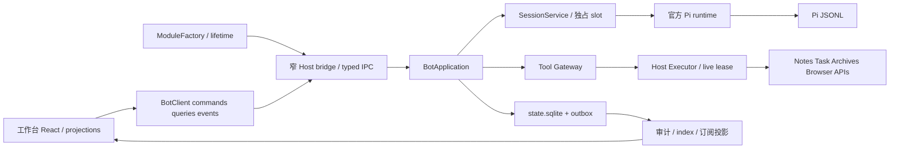

# 架构与运行边界

## 1. 依据与当前事实

固定基线 `974105b47e03c108df0f5e0c3fc9606fe4b79aee`。实际入口见 source 正文 D1–D7：<Path>.agents/speculo/.speculo/specdev/changes/2026-10-31-huhubot-pi-refactor/sources/issue-39-body.md</Path>。`manifest.ts` 仍为 on-demand；`module.ts` 的 chat/agents/groups/memory/tasks/access/approvals/data 都调用 runtime.start()。这不是简单改一行 manifest：必须拆开服务组合与页面创建、把启停 owner 放回模块生命周期，并保留页面按需 import。

`api.ts` 已有运行、来源、审批、预算和恢复类型；它们的领域意图可评审继承，旧 HAP wire 与客户端实现不保留。`src/host/desktop/electron-main.ts` 已有固定 bundled main bridge，但未在本轮验证 utilityProcess。现有 @types/node 与 Pi 发布包的 Node 基线不同，P0 检查 runtime 专用类型构建闭包，不为解决局部冲突盲目升级全仓类型。

## 2. 单模块、双执行侧

| 执行侧 | 唯一所有权 | 禁止行为 |
|---|---|---|
| UI | 草稿、展开、选择、布局与可丢弃投影 | 写数据库、决定审批消费、以自然语言判终态 |
| 宿主 | Obsidian App、业务 API、来源/编辑器状态、模块 lease、凭据保护 | 接受任意方法名/JS/CDP、缓存已撤销实例继续执行 |
| Runtime | Session slot、Run/Attempt、调度、授权/预算控制状态、outbox | 深 import 其他模块、重写 Pi loop、把用户 JS 当可信扩展 |
| Pi | 原生 session 格式、模型工具轮次、上下文/分支/compaction | 不把它错误当成跨 Agent 调度器或审批数据库 |

## 3. 依赖与构建边界

目标目录完整清单保存在 Issue §5；不生成空脚手架。core 无 Node/Electron/Pi/React/Obsidian import；services 仅依赖 core ports；platform 注入外部实现；ui 仅用 api/client。跨模块只 `api.ts` 与贡献点。Bot serviceKey 和路由可保持，但旧 API 一次性替换所有消费者，无 deprecated alias。

Runtime 作为独立发行资产入口，不把整个 Pi CLI/TUI 打入 main.js。SDK 静态/动态 import、WASM、native 和资源文件由 P0 闭包报告证明；动态 import 本身不证明 bundle 已减小。图形库只在运行图标签加载；数据树与基本聊天不需要画布依赖。

不另起 monorepo/DI/PluginManager/全局 Event Bus/配置中心。未来 HTTP/WS 仅接同一 Command/Query/Event adapter，不新增 session owner。

## 4. 生命周期与 owner fencing

启用桌面插件 → ModuleRegistry startup → 建立 proxy/lifetime/host adapters → 确认唯一数据根 owner → app-ready 主进程桥启动固定 entry → 握手 generation/协议/资源版本 → ready。登录、LLM、全库检索和历史水合不阻塞启动。未配置模型是模型能力的 unavailable，不是插件 startup 崩溃。

一个 local state root 一个 OS 级独占 owner，加代际 generation。锁由 Host/Runtime 生命周期明确持有；仅创建 deviceId 或写 PID 文件不够。旧客户端重连须重新 handshake，过期 generation 的 command、tool result、审批令牌一律拒绝。持久控制 owner 和 Pi session 单写者一起保护，不只在前端做 sessionBusy。

shutdown 顺序：停止新 admission → 撤销贡献/取消 UI 和外部入口 → 向 run tree 和工具传播 abort → 在有界截止期内等待各 owner 回执 → 已知效果结算，未确定效果标记 unknown → flush 权威状态/outbox checkpoint → dispose session → close DB → 终止进程并确认 exit。超时不声称已保存/已撤回；错误和清理失败分别报告。用户关闭一个页面不走这一流程。

## 5. 调度与会话

SessionService 是单一应用 owner。每个活跃 PiSessionRef 有独立 runtime slot 和串行命令队列；队列不等同于全局执行容量。两会话可并行但共享 root/profile 限制；同一会话不能同时 prompt/fork/switch。

排队输入带 run/attempt/branch/revision。steer 和 follow-up 通过所选 SDK 的真实接口，在契约测试中证明生效点；不要自建第二模型循环。发生 fork/resume/switch 时使用官方 factory/services 合同，在切换前结束旧 runtime；不能把 createAgentSession 的 options 当 runtime factory 参数。

父等待子时释放 global execution slot，但仍持有会话操作所有权；对子结果的唤醒是可幂等调度动作，必须受 root wake/attempt 配额。维护工作（标题/摘要/压缩）同样走预算，不藏成无计量副线程。

## 6. 可替换挂载点

| Port | 输入/输出边界 | 默认与禁止 |
|---|---|---|
| ToolCatalog/ToolExecutor | descriptor / typed invocation / receipt | 全部走 Gateway；无函数跨 IPC |
| SessionStore | SDK session refs/new/open/fork 适配 | 不提供另写 JSONL 的旁路 |
| StateStore | 控制事务与 outbox | 不与可删索引共享删除入口 |
| MemoryBackend | scope/revision/source 的事实检索与确认 | 本地 FTS5；不占 SessionManager |
| SkillResourceLoader | 批准根、hash、加载顺序与 snapshot | 不扫描整个 HOME；无自动安装 |
| EventPublisher | durable event + coalescible delta | typed module-local port，不全局总线 |
| NotificationChannel | 安全摘要 + 已授权跳转 | 现有 notifications owner；通知失败不改变已提交效果 |
| ModelCredentials | provider/auth-profile 引用 | 宿主保护，attempt 隔离，禁全局 env 切换 |

## 7. 可观测性与故障隔离

稳定错误 code + correlationId + run/attempt/tool/effect ID；展示理由与安全下一步，不依赖解析本地化文案。日志不记 token、完整受限正文或未脱敏 provider payload。给出 runtime health、state health、index rebuilding、MCP health，而非一个全局红点掩盖故障层级。

Pi 支持的诊断可以映射，但不得把内部推理用作 UI“计划”。有效部分文本保留；失败 notice 持续存在且不依赖已关闭页面。原型的消息和效果全部为虚构，不能计入这些生产证据。

## 8. P0 不能越过的条件

见 acceptance-plan.md：<Path>.agents/speculo/.speculo/specdev/changes/2026-10-31-huhubot-pi-refactor/acceptance-plan.md</Path> 的 HOST 矩阵。utilityProcess 要求主进程与 app ready；本轮仅查阅官方说明，未在 Obsidian 验证。安全隔离不能依赖 utilityProcess：任意 TS/JS 扩展默认关，主机 shell 需要独立授权与真实权限说明。任何替代运行方式都先回到 ADR-003，不偷偷维持两套产品链路。

依据：[Electron utilityProcess](https://www.electronjs.org/docs/latest/api/utility-process)、[Pi package](https://github.com/earendil-works/pi/blob/v1.4.0/packages/coding-agent/package.json)、[Pi SDK](https://github.com/earendil-works/pi/blob/v1.4.0/packages/coding-agent/src/core/sdk.ts)、[runtime factory](https://github.com/earendil-works/pi/blob/v1.4.0/packages/coding-agent/src/core/agent-session-runtime.ts)。
