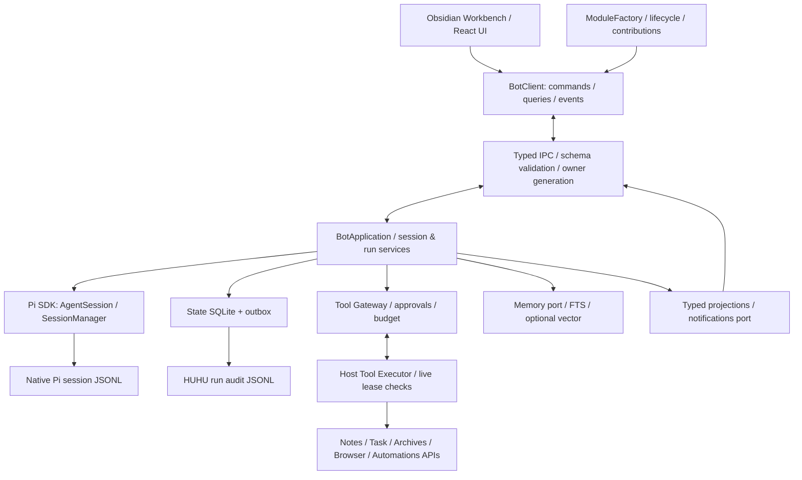

# 虎虎 BOT 全量重构：以 Pi coding-agent SDK 为唯一 Harness

## 0. 决策摘要、范围与审查基线

这是一次 **Huhu Bot 产品、代码、运行时、数据合同和 UI 的整体替换**，不是在旧 Go Runner 上继续增量堆叠，也不是只更换模型调用库。

- **名称**：本 Issue 将需求中的“虎虎报 / 呼呼 BOT”统一为仓库现有模块 **虎虎 BOT / Huhu Bot（`huhubot`）**。
- **仓库基线**：2026-10-31 核对的 [`dev@974105b47e03c108df0f5e0c3fc9606fe4b79aee`](https://github.com/NAMEWTA/obsidian-huhu/tree/974105b47e03c108df0f5e0c3fc9606fe4b79aee)。提交前再次读取 dev，仍为该提交。
- **重构授权**：Bot 旧实现可以全部删除；不保留 Go/Eino/HAP 运行链路、旧 BotClient 协议兼容、旧持久化格式自动迁移或双引擎切换。
- **唯一 Harness**：直接使用 `@earendil-works/pi-coding-agent` 的官方 SDK；由 Pi 负责模型—工具循环、消息上下文、会话分支和原生压缩。HUHU 只实现宿主接入、个人业务编排、授权、预算和交付闭环，不重新实现 Agent loop。
- **技术栈**：新增产品和编排代码全部 TypeScript；沿用本仓库 React UI、模块注册与桌面宿主架构。`better-sqlite3` 等原生依赖不等于恢复 Go Runner，但必须通过 Electron ABI 与分发验证。
- **当前运行形态**：Obsidian 启动且模块启用时启动 Bot 服务；页面只在 Obsidian 内渲染；关闭页面不终止运行，退出 Obsidian 不承诺继续工作。
- **推荐进程形态**：宿主桥启动独立 `utilityProcess`，承载 Pi、持久化和编排；UI、Obsidian API 与业务模块调用仍在宿主侧。该方案须先通过 P0 可行性门禁，不把 Electron 官方支持等同于所有 Obsidian 版本均可直接使用。
- **组织形态**：继续以 `src/modules/huhubot/` 为独立功能模块，内部做宿主无关分层；**不新增平行的 `src/bot` + 全局 `services/bot-runtime.ts` 框架**。
- **交付方式**：先冻结 Spec/ADR/设计原型与任务拆分，再分阶段实现，最终交付一个只包含新 Bot 的生产路径。本文是静态源码审查后的实施设计，不代表已经完成运行验证或代码替换。

> “可以删除旧代码”不等于“启动插件时自动删除用户历史文件”。代码与数据合同可以断代，但旧磁盘数据默认保持不动；清理必须由用户显式执行。

## 1. 与当前 dev 的真实对应关系

以下是本次核对到的约束，不以早期 main 或旧规划作为当前实现事实。

| 当前事实 | 本次设计结论 |
|---|---|
| `src/app/contracts/module.ts` 定义 ModuleManifest、ModuleFactory、ModuleInstance、ServiceAccess lease 和贡献点 | 使用已有模块生命周期与服务依赖机制，不自建 PluginManager/全局容器 |
| `huhubot/manifest.ts` 当前为 desktop-only、`activation: 'on-demand'`，提供 `BOT_RUNTIME` | 改为启用状态下的 `startup` 激活；模块服务与 UI 懒加载解耦 |
| 当前 Bot 有 `src/modules/huhubot/`、`native/huhubot/` 与 HAP 相关实现 | 新实现逐项替换并删除旧依赖闭包，不能只把 Pi 放在旧 Go/HAP 后面 |
| 仓库要求模块内 `core/services/platform/contrib/ui` 等分层，跨模块只通过 `api.ts` | Pi/Node/Electron 实现下沉 `platform/desktop`；业务类型由 Bot 自己拥有，不泄漏进 shared |
| 已有 `src/host/desktop/electron-main.ts` 的 `desktopRemote`、`bundledMain` | P0 验证能否复用窄宿主桥启动固定打包入口；不增加可由模型提供任意代码的远程执行接口 |
| 当前前端为 React 19，已有 Zustand、headless-tree、TanStack Virtual、dnd-kit、Ajv/Zod 等基础依赖 | 复用已有组件、校验与虚拟化设施；不引入另一套 UI 框架 |
| `agent` 模块是 CLI/PTY 工作区，不等同于 Huhu Bot | 不删除、不伪装、不接管其终端会话与 CLI 自动化能力 |
| Browser 正在由 #38 规划整体替换 | Bot 只消费浏览器公共能力，不依赖将被删除的 Native Browser 实现细节 |

源码依据见文末 [D1]–[D7]。保留 `huhubot` 模块标识、现有工作台接入位置，不等于保留旧 API；旧 API 的全部调用方应随替换原子更新。

## 2. 对参考方案必须做的六项修正

### 2.1 Pi 会话树不是多 Agent 执行树

Pi 原生 JSONL 中 `id/parentId` 表示**同一会话历史的条目祖先关系**；它不能自动表达跨会话委派、并行子任务、重试、Mailbox 或群聊关系。至少分开：

1. `SessionBranch`：Pi entry ancestry。
2. `Run/Attempt`：`rootRunId/parentRunId/retryOfRunId`。
3. `Communication`：发送方、接收方、投递/消费回执。
4. `ComposerQueue`：用户待发送输入，不冒充运行节点。

### 2.2 原生 JSONL 不等于所有事件自动持久化

Pi 保存消息、工具结果、压缩、分支等 session entries；流式 token delta、HUHU 审批、UI 状态、调度事件并不会全部自动变成原生 entries。保留 Pi 文件格式与唯一写入者；HUHU 的运行审计另用明确标记的 JSONL schema，引用 Pi session/entry，不冒充 Pi 原生记录。

### 2.3 MemoryBackend 不接管 Pi 的会话存储

记忆后端负责长期事实、摘要与检索；SessionStore 负责 Pi 会话。切换向量库、FTS 或关闭长期记忆，均不得改变会话文件、分支结构或正在运行的 Pi SessionManager。

### 2.4 SQLite 不全是“可删除重建的索引”

全文索引可以重建；审批消费、预算预留、幂等记录、外部效果回执和用户确认的长期事实不能随索引一起丢弃。分别定义权威状态库与派生索引库，不用“以后从日志重放”掩盖权限与资金状态丢失。

### 2.5 审批、预算必须先于可写工具

不能先开放 `write/bash/浏览器提交`，最后才补权限。第一条可产生副作用的工具上线时，就必须具备参数校验、来源授权、审批绑定、预算预留、撤销检查、幂等与结果回执。

### 2.6 插件渲染进程不是 Electron 主进程

`utilityProcess.fork` 是主进程能力，并要求 app ready。现有宿主桥是候选入口，不是已经完成验证的执行保证；换到 utilityProcess 也不会自动解决 `.node` ABI、平台签名、ESM、资源路径与分发问题。[P1][E1][E2]

## 3. 开源学习与复用决策

### 3.1 本次实际参考对象

“HANA / open HANA”按 **`liliMozi/openhanako`** 进行研究；“OpenBoard”按 **`OpenBoardLabs/openboard`** 进行研究。两者名称均存在歧义，这里明确仓库，不把同名白板、键盘或其他项目混为个人 Agent。

| 项目 / 固定参考 | 研究到的机制 | 在 HUHU 采用什么 | 不采用什么 |
|---|---|---|---|
| **Pi `v1.4.0`**；MIT；[P1]–[P4] | SDK session factory、runtime 生命周期、原生 JSONL entries、工具与资源注入 | 作为直接运行依赖，固定精确版本；官方 SessionManager、loop、compaction 与 tool calling | 不复制 SDK 源码自维护 loop；不直接使用 CLI/TUI 作为 Bot 后端；不默认开放 coding tools |
| **Hana/openhanako `9a6cabf…`**；Apache-2.0；[H1]–[H5] | Engine 薄门面、Agent/Session/Model/Skill 职责分离、session tool/skill snapshot、事实记忆 | 小型应用服务、显式依赖注入、会话操作串行、稳定工具快照、事实+来源+检索 | 不整包引入 Electron 应用；不照搬其本地 Pi 适配层、全局目录扫描、全部 manager 和隐含平台假设 |
| **OpenClaw `ec26807…`**；[C1] | 嵌入式运行接入、按会话串行、运行事件桥接、wait 语义、写入所有权与失效 fencing | 区分 accepted/run terminal、命令幂等、单会话所有权、取消与慢消费者治理 | 不复制整个 Gateway、渠道生态、Provider 重试系统或另一套 transcript 存储，更不再造第二个 harness |
| **OpenBoard `85303dc…`**；MIT；[O1]–[O3] | React 看板、任务活动、步骤状态与交接，BoardView 使用 dnd-kit | 任务详情聚合、计划/执行/审查状态、人工交接与可操作回执的交互思路 | 不引入 Express/sql.js/opencode/Git worktree 运行链路；不另造用户 Todo 模块；不以 README 功能表证明其运行时已足够成熟 |
| **MCP 官方 TypeScript SDK / Electron / SQLite / React Flow**；[M1][M2][E1][E2][S1][U1] | 标准协议、进程、持久化和图形基础设施 | 使用成熟库及官方合同，减少自写协议、布局和底层算法 | 不实现自定义 MCP 协议栈、手写图布局或“跨平台天然可用”的假适配 |

### 3.2 Hana 的具体吸收方式

- `core/engine.ts` 的薄门面与依赖分工，适合映射为 HUHU 的 `BotApplication`；不按上游文件数量机械拆出几十个 manager。
- `core/session-coordinator.ts` 的会话锁、资源快照和生命周期集中管理，适合映射为唯一 `SessionService + PiSessionAdapter`；不要同时出现 core/session-manager 与 managers/session-manager 两套 owner。
- `core/agent.ts` 提醒区分 Bot 身份/偏好/记忆与某一次 Pi 会话；临时子 Agent 不自动污染永久 Bot 列表。
- `lib/memory/fact-store.ts` 当前明确采用事实、标签与 FTS5，并包含 CJK 检索处理，而不是默认 embedding。HUHU 先交付可解释的本地记忆；向量检索是可选加速器，不是第一版前置条件。
- 不把该 FactStore 的 `synchronous=NORMAL` 等参数直接复制到审批/效果权威库；两者持久性要求不同。分词与 CJK 检索策略必须用中文、英文、混合文本夹具验证，优先复用已有实现并记录来源。

### 3.3 直接复用与许可交付

依赖优先于复制源码；确需复制小段代码时，新增 `reuse-map.md`，逐项记录仓库、commit、源文件、许可证/NOTICE、目标文件、修改点和对应测试。保留适用的版权与许可声明，更新现有第三方 notices 检查。UI 示例、图标与付费示例的授权需单独核验，不能把项目开源许可自动套到全部外部素材。

## 4. 目标架构：一个独立模块，两个明确执行侧



**运行侧**：Pi 会话、Run/Attempt、调度、权威状态库、预算、审批状态和运行投影归 Bot Runtime 所有。**宿主侧**：Obsidian API、模块 lease、实际笔记/任务/浏览器操作与凭据保护归 Host Adapter 所有。UI 不拥有任何执行真相。

两侧共享的是可序列化 DTO 和合同，不是 `App`、React store、Pi session 实例或执行函数。宿主注册工具的声明部分可传入 runtime，执行函数留在所属宿主，按 `toolId + revision` 调用。禁止跨进程序列化函数或通过任意代码字符串完成工具执行。

## 5. 建议目录与依赖规则

以下为**拟建目标结构**；按真实用例拆文件，不要求预先生成所有空目录。向量与 HTTP 适配器在相应阶段有真实消费者后再新增。

```text
src/modules/huhubot/
├── manifest.ts                    # startup、desktop-only、服务/贡献声明
├── api.ts                         # 公共 DTO、serviceKey、contributionPoint
├── module.ts                      # 唯一 Obsidian 组合根与生命周期
├── settings.ts
├── i18n.ts
├── core/                          # 纯 TS：无 Obsidian/React/Node/Pi imports
│   ├── model.ts                   # Bot、Conversation、Run、Attempt、Artifact
│   ├── commands.ts
│   ├── events.ts
│   ├── errors.ts
│   ├── policy/                    # 授权交集、审批绑定、预算不变量
│   └── ports/                     # runtime、store、memory、tools、events、notify
├── services/                      # 宿主无关应用层，运行于 Bot Runtime
│   ├── bot-application.ts          # 薄门面，不承担所有实现
│   ├── session-service.ts         # 唯一会话应用 owner
│   ├── run-service.ts             # admission、队列、取消、终结
│   ├── collaboration-service.ts   # delegate / mailbox / review
│   ├── tool-registry.ts           # catalog 与版本快照
│   ├── tool-gateway.ts             # 所有工具的统一决策入口
│   ├── approval-service.ts
│   ├── budget-service.ts
│   └── memory-service.ts
├── platform/
│   ├── obsidian/                  # 插件侧：ModuleContext、页面、来源、通知
│   │   ├── host-adapter.ts
│   │   └── host-tool-executor.ts
│   └── desktop/                   # 所有 Node/Electron/Pi 实现依赖闭包
│       ├── bridge/
│       │   ├── runtime-launcher.ts # 复用固定打包的 main bridge
│       │   ├── runtime-client.ts
│       │   └── protocol.ts        # 小型 typed IPC，不复活 HAP
│       ├── runtime/
│       │   ├── entry.ts           # utilityProcess 组合根
│       │   ├── composition.ts
│       │   ├── pi-session-adapter.ts
│       │   ├── pi-events-adapter.ts
│       │   └── pi-resource-loader.ts
│       ├── storage/
│       │   ├── pi-session-store.ts # 通过 SDK 管理；不另写 Pi JSONL
│       │   ├── state-store.ts      # 权威 SQLite 与事务 outbox
│       │   ├── run-audit.ts        # HUHU 审计 JSONL
│       │   └── index-store.ts      # 可重建 FTS/摘要索引
│       ├── memory/                # FTS backend；向量后续按需增加
│       ├── models/                # Pi ModelRuntime、provider/auth 适配
│       ├── tools/                 # 受控 Pi builtins / external MCP adapter
│       └── mcp/                   # 标准 server/client transport adapters
├── contrib/                       # 本模块对现有能力的贡献/接入胶水
├── ui/
│   ├── workbench-page.ts
│   ├── BotWorkspacePage.tsx
│   ├── chat/
│   ├── sessions/
│   ├── runs/                      # execution tree + lazy graph
│   ├── approvals/
│   ├── memory/
│   ├── settings/
│   └── state/                     # 可丢弃的 UI 投影，不是执行数据库
└── styles/                        # 现有 HUHU tokens、作用域与样式门禁
```

依赖方向：`ui → api/client`；`services → core/ports`；`platform → services/core + SDK/host`；组合根负责注入。纯 `core` 可单独单测，未来可提取 package，但现在不为未来 Web 提前创建 monorepo、第二套 DI、独立配置中心或全局 Event Bus。

其他模块通过现有贡献点提交工具/资源声明；Bot 不深层 import 对方 services/platform/ui。若当前某业务缺少公共 API，在该业务 owner 的 `api.ts` 增加最小能力，不复制其 CRUD 到 Bot。

## 6. Pi SDK 接入与 P0 运行可行性门禁

### 6.1 SDK 基线与调用方式

本次审查使用 **`@earendil-works/pi-coding-agent@1.4.0`**。其 package 为 ESM、要求 **Node >=22.19.0**，并依赖同版本 Pi 子包。此版本是候选实现基线，不代表已通过 HUHU 实机验证。[P1]

- 基础会话直接调用 `createAgentSession`，显式传入 agentDir、cwd、SessionManager、模型运行时、settings、resourceLoader 与工具策略。
- 需要统一 new/resume/fork 时，使用官方 `createAgentSessionRuntime` 及其 **runtime factory/services 合同**；它不是把 `createAgentSession(options)` 的参数原样传入的同义函数。以所选版本的真实声明与编译测试为准。[P2][P3]
- 每个活跃 session slot 独立管理 Pi runtime，不能用一个正在切换的 runtime 同时服务多个会话。
- 模型循环、工具调用消息格式、上下文裁剪、compaction 和分支构建交给 Pi；不得为了“更灵活”回到自写 while-loop 或自写 provider retry loop。
- UI 与公共 API 不导出 Pi 内部类型；SDK 变动集中在适配器，并以契约夹具验证。

### 6.2 禁止依赖不安全默认值

SDK 默认可能读取 `~/.pi/agent`，启用 read/bash/edit/write，并加载全局/项目资源；其工具 allowlist 与 MCP/codemode 的关系也不能按名称简单推断。[P2]

必须显式隔离：HUHU 私有 agentDir、授权 cwd、资源列表、provider 配置、MCP 服务器列表、工具 allow/deny。默认关闭未批准的 shell、extension 代码、codemode/tool-search 旁路、全局 HOME 扫描和自动包安装。测试证明**所有实际工具调用**都经过 HUHU Tool Gateway，而不是仅证明聊天界面没有显示某个工具。

### 6.3 实机门禁，不允许纸面绕过

P0 必须提交可运行的最小 spike 与报告：

| 验证项 | 必需证据 |
|---|---|
| 宿主能力 | Obsidian/Electron/Node/modules ABI、OS/arch、主进程桥与 app-ready 行为 |
| SDK | 实际 npm 发布包安装、ESM 导入、最小 prompt/stream/abort、工具调用、会话恢复与分支 |
| 分发 | 从真实插件安装目录运行；不依赖开发机 node_modules、系统 Node、npm 全局包或用户 shell PATH |
| SQLite | better-sqlite3 装载、FTS5、目标 Electron ABI、重启与写入；macOS 签名/库加载与 Windows 路径 |
| 资源闭包 | SDK 的动态 imports、native/WASM/assets、license 与版本锁定；不把 Pi CLI bundle 直接塞入 main.js |
| 生命周期 | 启停、崩溃、重复加载、独占 owner、限时退出与无孤儿进程 |
| 平台 | Windows x64、macOS arm64/x64、Linux x64 的支持矩阵；未验证项明确标记，不默认声称兼容 |

若 Node/ABI/宿主桥不满足，应形成明确的最低宿主版本或单一路径替代 ADR；**不得悄悄回退 Go、外部系统 Node、渲染进程重负载或同时维护多套生产实现**。utilityProcess 是故障隔离，不是恶意代码安全沙箱。[E1][E2]

## 7. 启动、关闭与模块生命周期

1. `huhubot` enabled + desktop supported 时，由现有 ModuleRegistry 执行 startup 激活；禁用/移动端不加载 SDK 或 native dependency。
2. `module.ts` 建立 service proxy、lifetime、host adapters 和贡献监听，启动本地 runtime；不等待登录、模型列表联网、首次 LLM、全库索引或全部历史加载。
3. 服务暴露 `starting/ready/degraded/failed/stopping` 等状态和结构化诊断；页面打开只连接服务，不充当进程启动器。
4. 启动时仅收集已可用贡献，不用 `collect({activate:true})` 唤醒所有模块；真正调用时按既有 ServiceAccess 获取 lease，检查 `revoked`。
5. 模块禁用、功能撤销、host lease 失效：停止新 admission，取消相应 pending 工具/审批；不能继续使用缓存的旧实例。工具目录变更形成新 revision，活跃 attempt 使用稳定快照并在副作用前重验授权。
6. 关闭页面只取消 UI 订阅。插件 unload/模块 disable 则按顺序停止 admission、取消 run tree、结算或标记未知效果、刷写关键状态、关闭数据库和进程。
7. 超过关闭期限的任务明确标记 interrupted/unknown effect；禁止 UI 显示“已保存成功”掩盖未确认效果，也不能无限阻塞 Obsidian 退出。
8. 一个 vault/device 本地状态根只允许一个 runtime owner；每次启动有 generation，过期客户端/迟到工具结果不得写入新 owner。

## 8. 存储、恢复与数据所有权

### 8.1 四类数据，不能混作一个“MemoryBackend”

| 数据 | 权威来源 | 可否直接删除重建 |
|---|---|---|
| 消息、工具消息、会话分支、Pi compaction | Pi 原生 session JSONL；仅 SDK 写入 | 否 |
| Bot 配置、运行状态、审批、授权、预算预留、幂等/效果回执、确认后的长期事实 | `state.sqlite`；事务 + outbox | 否 |
| HUHU 运行/调用树审计日志 | outbox 导出的 HUHU JSONL，携带稳定 eventId 与 Pi 引用；控制决策仍以权威事务为准 | 可从保留的完整权威事件记录补齐，但不是任意丢库后“神奇恢复” |
| 全文检索、列表、摘要检索、向量与统计投影 | `index.sqlite` / 可选 vector index | 可以，按 schema/checkpoint 重建 |

所有对话原文仍以 Pi JSONL 为主；事务型控制状态放 SQLite 是明确的边界，不宣称“一切都在 Pi 原生树中”。运行审计 JSONL 中的 `parentRunId/parentSpanId` 不是 Pi entry 的 `parentId`。

### 8.2 路径与文件策略

由 Host 的既有 vault/device 本地路径解析机制提供新格式独立根目录，再组织 `sessions/`、`run-events/`、`artifacts/`、`resources/`、`state.sqlite`、`index.sqlite`。P0 将真实根路径与 identity 规则写入数据文档；不使用共享 HOME，不假设复制 Vault 后两个实例仍可同时写同一个目录。

原生 SQLite/WAL 活跃状态必须位于支持的本地文件系统；不通过云同步合并数据库，也不把 deviceId 当成防并发锁。备份采用一致性快照/受控关闭，不简单拷贝正在写的数据库。[S1]

### 8.3 写入与崩溃规则

- 同一 Pi session 单写者、同一 turn 串行。只通过 SDK 建立、恢复、分支和追加其支持的 custom entries。
- Pi `custom` entries 用于必要关联元数据；`custom_message` 会进入模型上下文，不能把审计信息随意当作用户消息注入。[P4]
- 关键控制状态与 outbox 在同一 SQLite 事务提交；禁止先广播成功，再尝试落盘。
- 文件日志与 SQLite 之间不存在天然跨资源原子事务。使用稳定 ID、幂等消费、检查点、对账与缺口诊断，不宣传全系统 exactly-once。
- 外部副作用前持久化 prepared intent/审批消费/幂等键；调用后记录宿主回执。崩溃后缺少确定回执的调用进入 `unknown_effect`，先核查，不自动重放。
- 审批/效果账本采用经验证的耐久性设置；索引可采用较宽松设置。不能把“append 成功”或“Pi 使用 JSONL”等同于 power-loss durability。
- 恢复会话不等于恢复旧 JS 调用栈或内存中的等待 Promise。旧 approval/tool 等待需要 reconciliation；必要时新建 attempt，附上可靠回执后重新规划，不伪造成功消息。
- 对尾部不完整 JSONL，先隔离/备份并使用所选 SDK 支持的读取/恢复策略；不私自发明另一套 Pi schema 或静默裁掉中间记录。
- 索引损坏不应导致对话无法读取；权威状态库损坏则禁止新增副作用并进入恢复模式，不 fail-open。

### 8.4 分支、隐私与删除

上下文必须由所选 leaf 的祖先路径与 Pi compaction 规则生成，不能用 JSONL 最后 N 行混入兄弟分支。摘要与检索缓存至少绑定 session/branch、source revision 与权限快照。

用户“删除记忆”与“删除原始会话”语义分开说明：清除事实及其索引/向量/缓存后，不能从仍保留的会话自动重新抽取同一事实；需要 tombstone 或显式重新学习。数据导出、清理、备份保留期与脱敏策略可见，不声称只删除向量就完成彻底遗忘。

## 9. 核心领域与公共 API

核心领域至少区分：

- **BotProfile / AgentDefinition**：持久身份、说明、模型绑定、工具/Skill scope、记忆策略；临时子 Agent 使用配置快照而非自动创建永久角色。
- **Conversation / Membership / PiSessionRef**：用户会话、群组成员与各执行会话映射。群聊可见记录不等于每个成员可读取全部私有上下文。
- **Run / Attempt / Delegation / Mailbox**：一项工作、一次执行、父子委派、通信与投递回执；重试创建新 attempt，保留 lineage。
- **RunPlan / Artifact / EffectReceipt**：可解释计划、可核验交付物、真实外部效果证据。
- **Grant / Approval / BudgetReservation**：安全与资源控制，不由模型文本自行授予。

`api.ts` 暴露小型命令/查询/订阅门面，以下为**拟议能力合同，而非声称已存在的 SDK 方法**：

```ts
interface BotClient {
  command(command: BotCommand, signal?: AbortSignal): Promise<CommandReceipt>;
  query(query: BotQuery, signal?: AbortSignal): Promise<BotQueryResult>;
  subscribe(scope: BotEventScope, listener: (event: BotEvent) => void): () => void;
}
```

命令包括 bot/session CRUD、send/steer/follow-up、fork/select branch、cancel tree、approve/reject、delegate/review、memory confirm/forget。命令身份来自受信连接上下文，而非信任请求体自报 `principalId`。写命令带 idempotencyKey、expectedRevision 与 runtime generation；事件带 seq/cursor、实体 revision、run/session 关联。

`accepted` 只表示持久受理，不表示模型或工具完成。终态由受控状态迁移与效果回执决定。模型自然语言“已完成”不能改变运行状态。

Event Bus 是模块内可替换 typed port，不是全应用第二套事件平台。流式 delta 可合并；审批、错误、终态与效果事件不可悄悄丢弃。订阅有队列上限、重连游标、gap/resync 和快照查询；UI 可随时丢掉本地投影后恢复。

## 10. Tool Registry、模块接入与权限边界

### 10.1 一个目录，一个执行入口

Tool descriptor 具有稳定命名空间、revision、说明、输入/输出 schema、风险等级、可用条件、所需 capability、超时、结果大小限制与来源标签。Catalog 不包含密钥和任意可执行函数。

统一路径：

```text
Pi / HUHU command / MCP caller
  → 身份与资源范围解析
  → schema 校验与工具版本锁定
  → 授权交集 / 数据接收方检查
  → 预算预留与必要审批
  → 幂等执行记录
  → Host lease 与来源 revision 再检查
  → 所属业务 API / 已批准的外部 MCP
  → 效果回执 / 结果裁剪 / 审计 / 预算结算
```

Host Executor 是最后的执行防线：验证当前连接、owner generation、工具版本、审批凭证、lease 与资源版本；不会因为 runtime 已经“允许”就接受任意文件路径或任意方法名。内部 Agent 和外部 MCP 都不能绕过同一入口。

使用仓库现有 schema 校验设施，Pi 所需 schema/TypeBox 适配集中实现并测试；不得用 `as any` 把不兼容 schema 假装成安全合同。

### 10.2 HUHU 能力映射

| 能力 | 接入方式与约束 |
|---|---|
| 笔记/选区/文件夹 | 使用宿主文档 API 和显式 SourceRef；写入前展示 diff、检查 revision/未保存编辑，不直接 fs 覆盖用户编辑器 |
| Todo/任务 | 通过 task 公共查询/命令/工具贡献；RunPlan 与用户 Todo 分离，只有明确操作才创建真实任务 |
| 档案 | 走 archives 公共 API，按字段/来源授权；不以 Agent 全文搜索绕过私密档案边界 |
| Browser | 对接 #38 的 Space/Page 与公共 Agent Access；人工与 Bot 使用同一会话，不新起 Chromium、不复制 Cookie、不暴露任意 CDP/JS 执行万能工具 |
| Automations | 复用现有调度模块，新增明确的 Bot action；不能把当前 CLI agent runtime 假装为 Bot，也不另写 cron scheduler |
| Notifications | 通过现有通知模块适配，通知只携带允许展示的摘要和来源跳转 |
| Safe/凭据 | 默认不向模型开放秘密读取；必要时 Host 代为完成已批准动作，不能把密码保险箱当普通检索源 |
| 其他模块 | 遵守同样的 API/contribution 合同；owner 禁用立即撤销能力 |

### 10.3 文件与 shell

默认提供 HUHU 语义工具，而不是无边界的 Pi coding tools。确需基础 read/write/edit，只能用于授权 scratch/workspace，并统一处理路径规范化、symlink/越界、revision 和输出限制。`cwd` 不是安全沙箱。

`bash/powershell` 默认关闭；高级启用必须明确告知其真实主机权限，使用单独能力与审批。若没有 OS 级沙箱，不声称仅靠路径检查即可隔离任意 shell。不能用“让模型自行遵守规则”代替执行边界。

### 10.4 审批与外部输入

审批绑定 principal、root/attempt、工具 revision、规范化参数 hash、资源/来源 revision、能力快照、有效期与消费状态。参数修改、模型/接收 provider 变化、源文件变更或权限撤销后必须重评。

网页、笔记、MCP 返回值、SKILL 文本均是数据，不能授权自己安装代码、开放新工具或读取密钥。外部工具 schema 变更、服务器身份变化或重新连接后，重新建立快照和授权。

## 11. 模型、Skill、长期记忆与预算

### 11.1 模型与凭据

模型协议、stream、usage、compaction model 等优先通过 Pi ModelRuntime/官方能力，HUHU 只提供模型配置与凭据适配；不复制供应商 SDK 再建一套 provider manager。

provider/model/auth profile 与 Bot/attempt 关联；全局 `process.env` 不作为多 Bot 动态切换凭据的机制。密钥通过宿主受保护凭据引用取得，不进入 JSONL、普通 settings、工具列表、错误栈或导出包。无法满足受保护凭据存储时必须降级为不持久化或阻断相应功能，不能静默明文落盘。

模型 fallback 跨 provider 会改变数据接收方，必须重新检查来源共享权限；不能把透明容灾等同于允许将私密资料发送给任意服务商。

### 11.2 Skills 与扩展

复用 Pi 的 SKILL/资源加载机制，但限制为用户批准的根目录，记录来源、版本/hash、加载顺序和生效会话。更新在下一安全边界生效，不在运行中静默替换工具说明。

Markdown Skill 与执行任意 TS/JS 的 Extension 是不同信任级别。第一版仅开放被审查的内置代码扩展；第三方可执行扩展默认禁用。允许可信扩展执行必须明确其可能拥有 runtime 进程权限，utilityProcess 本身不能阻止恶意扩展绕过 JS 级 Tool Gateway。禁止自动扫描并执行用户所有 `~/.claude/~/.codex/~/.pi` 资源。

### 11.3 记忆

`MemoryBackend` 提供检索、确认事实、修改、忘记及健康状态；每条事实含来源 session/entry/sourceRef、时间、作者/确认方式、权限 scope、revision 与保留策略。

第一版：事实 + 标签 + FTS5，摘要必须可跳回来源；自动抽取进入候选区，不把幻觉直接固化为“用户事实”。用户能查看、编辑、删除、暂停学习和选择 Bot/vault/session 范围。分支删除或权限撤销使相关检索投影失效。

可选 vector backend 只负责派生检索；记录 embedding provider/model/version、维度与 source hash。使用远程 embedding 同样需要数据流授权和预算；更换模型重建索引，不能混合向量维度或泄漏被删除事实。

### 11.4 预算与资源

root run 是统一预算归属，覆盖子 Agent、重试、摘要、compaction、标题生成与 embedding。调用前 reserve、调用后 settle；并发子任务不能各自拿到完整根预算。金额用整数最小单位或可靠十进制，不用浮点累计。

区分 token/请求/工具次数/并发/深度/时长等可执行限制，与依赖供应商计量的费用上限。缺失 usage 标记 unknown，不记成零；不能承诺所有供应商都能精确卡住货币硬上限。价格表带来源与更新时间，用户可配置；通知预算接近/耗尽，并保留停止原因。

## 12. 多 Bot、Agent Team、委派与执行画布（承接 #9）

本阶段不以“加一个 spawn 工具 + 前端流程图”作为多 Agent 完成标准。

### 12.1 运行模型

- 持久 Bot 与临时 task-scoped Agent；Team membership、允许委派目标与权限是三个不同集合。
- 一次子委派创建独立 Pi session/attempt，携带明确目标、交付物、验收标准、允许来源及缩减后的能力。
- 默认 isolated context；公开协作材料按成员与接收 provider 授权过滤，不复制父 Agent 全部聊天、私有记忆、密钥或内部推理。
- `@Bot` 是路由意图，不授予额外权限。多人/多 Bot 会话记录明确谁发送、谁接收、哪些资料共享。
- root 配额事务化扣减，包含重试与再委派；深度、总 attempts、并发、队列和总预算都有限制。建议初始配置为子执行并发 2、最大委派深度 2、root 总 attempts 16，P0 夹具后定稿；这些是产品候选默认值，不是上游性能保证。
- 父任务等待子任务时释放全局执行容量，但保留本会话所有权；避免父占满 semaphore 导致孩子永远无法运行。

### 12.2 通信与闭环

提供 list/delegate/status/result/send/wait/question/answer/submit/review/cancel 等应用能力，统一进入授权入口。Mailbox 持久化并具有 pending/accepted/consumed/rejected 等回执；结果投递成功不等于子任务成功，子任务成功不等于根任务通过验收。

retry/resume 创建新 attempt 并保留 work lineage，不改写旧终态；cancel tree 向子任务和工具传递取消，但不会宣称已撤回不可逆外部效果。进程崩溃后未完成工作先标记 interrupted，结合幂等和效果核对后再允许续做。

### 12.3 三种视图各司其职

1. **会话分支树**：Pi 历史，选择 leaf、fork、查看 branch summary。
2. **执行树/图**：Run 父子关系、attempt、审批、时长、成本、产物与效果。
3. **通信覆盖层**：跨 Agent send/reply/结果交付，允许环；不能拿通信边重写执行 ancestry。

树列表复用已有 headless-tree/虚拟化；画布拟新增 `@xyflow/react` 与成熟 Dagre 布局，按需加载并通过体积/许可门禁，不手写布局算法。[U1] 先布局父子 DAG，再覆盖通信边；节点尺寸变化、折叠、聚合和大图测试单独验证，不假设库天然解决全部复合图问题。

点击节点进入真实 transcript/来源/审批/产物；支持取消、回答、复审与创建新 attempt。拖拽位置属于 UI 状态，不允许用户随意拖线改写已发生的执行事实。未来可编辑工作流定义与运行历史是两个模型，不能混用。

## 13. 全新 UI 与个人 Agent 产品闭环

### 13.1 信息架构

默认工作台采用“会话导航 / 主聊天 / 可收起详情”布局，不把复杂画布作为每次打开的首屏。主要区域：

- **Bot 与会话**：Bot 切换、搜索、会话列表、重命名/归档、分支位置、群组成员与共享范围。
- **聊天与输入**：流式回答、来源附件、模型与预算状态、steer/follow-up、停止；来源追加到 composer 默认不自动发送。
- **任务详情**：RunPlan、工具实际状态、子任务、费用、审批、错误、产物与回执；展示可解释步骤而非编造/泄露内部推理。
- **记忆**：候选/已确认事实、来源、范围、编辑/忘记/暂停学习与索引健康。
- **设置**：模型/凭据引用、工具权限、Skills、MCP、并发预算、数据与恢复诊断。

### 13.2 关键交互

审批卡必须能看懂“将对哪个资源做什么、发送给谁、改动差异、权限范围和有效期”，支持拒绝/单次批准；允许用户在真正执行前修改需求，但参数变化后旧批准失效。

明确区分 queued、running、waiting approval/user/children、retrying、interrupted、failed、cancelled、unknown effect。工具失败不伪装成绿色完成；生成文本与实际创建笔记/任务/浏览器提交分开显示。

长消息与列表虚拟化，stream 增量更新局部节点，不每个 token 重建整个 store/画布。Markdown、代码、图片与外部资源使用既有安全渲染设施；禁止执行任意 HTML/脚本。

复用 HUHU 统一 tokens、圆角、间距、菜单、Dialog、Tooltip、表单和 Radix/shadcn 约束，避免另起 UI 设计系统。覆盖深浅主题、窄屏、键盘、中文 IME、读屏、reduced-motion、ownerDocument/ownerWindow、弹出窗口与 portal 生命周期。

### 13.3 必须完成的纵向业务样例

**样例 A：周计划**：授权读取最近笔记与 Todo → 显示来源和计划 → 生成候选总结/任务 → 展示 diff 与新增清单 → 用户批准 → 真实写入 → 返回可打开的实体与效果回执。不得只输出一段“我已经创建”的文字。

**样例 B：浏览器共作**：用户在 Space 登录并打开页面 → Bot 获得同一 Page 的受控能力 → 读取/填写 → 提交前审批 → 人工能看到同一页面变化；无 Cookie 拷贝、影子浏览器或隐藏登录会话。依赖 #38 的能力交付，不重新实现浏览器。

**样例 C：多 Agent 研究**：Lead 委派两名隔离子 Agent → 用户在树/图中看到运行与消息 → 子任务可提问/取消 → 汇总带来源的结果 → 根任务验收后形成产物；失败、预算不足和崩溃恢复路径同样可操作。

**样例 D：自动化触发**：现有 automation occurrence 触发 Bot run → 按 occurrence 幂等受理 → 通知与结果回链原自动化。Obsidian 未运行时明确显示未执行/待补偿策略，不宣称插件是全天候云服务。

## 14. MCP 与后续服务化

### 14.1 当前可交付 MCP

- **Client**：先评估 Pi 当前附带 MCP 能力能否完整经过 HUHU 权限/审计钩子；可以则复用，不能则用官方 TS SDK 建一个受控适配器。生产中只有一套 client owner，不叠加多个发现/缓存/重连实现。
- **Server**：通过官方 TS SDK 暴露同一 Tool Registry 的允许子集。第一阶段至少实际完成一个只读工具和一个需要审批的写工具的外部调用闭环，而不是仅留下空 `server.ts`。
- Server 默认关闭、用户显式启用；具体采用单一标准 transport，并验证与目标客户端互操作。外部身份映射独立 grant，不自动继承内部 Bot 的全部权限。
- 本地 HTTP 方案仅绑定 loopback，校验 Host/Origin、身份 token、大小/速率/超时；token 不进 URL、日志、LLM 上下文。遵守所选稳定版 MCP transport/auth 合同，不把 draft 的行为混进稳定协议。[M1][M2]
- 配置本地 stdio MCP command 等价于允许执行主机程序：展示来源、完整命令和工作目录，必须用户授权；不自动执行工具返回的安装指令。

### 14.2 Web 演化边界

当前 UI 不需要 Hono 或 HTTP 才能工作。先稳定 Command/Query/Event DTO 与 IPC；后续在 desktop adapter 下增加 Hono HTTP/WS transport，接入同一 BotApplication、同一权限、同一 session owner。

Web 端只能连接现有 runtime，不自己创建第二套 Pi SessionManager 或数据库。连接具备身份、scope、重连/游标、snapshot/resync、慢客户端控制和终止能力；CORS 不是鉴权。远程联网部署、移动端、外部 IM 渠道和长期无人值守服务另立阶段，不阻塞本次 Obsidian 版完成。

## 15. 删除与替换清单

P0 必须生成引用/依赖图，P6 按实际路径逐项销账；下列是明确范围，不是假定已经找到所有调用点。

| 对象 | 处理 |
|---|---|
| `native/huhubot/` 与 Bot 专属 Go/Eino 依赖 | 删除，不保留隐藏 fallback |
| Bot 专属 HAP schema、生成客户端、codec、stdio transport 与兼容代码 | 删除；先确认没有非 Bot 消费者，全部调用方一次更新 |
| `src/modules/huhubot/` 旧运行、存储、协议、领域与 UI | 整体替换；保留模块位置/路由接入不构成兼容承诺 |
| Bot 专属下载器、bundle/digest/manifest、Go build/package/check 脚本与 CI | 删除或替换成 Pi runtime asset 构建/校验；清理 `package.json`、lockfile、release 产物与 `test:all` 引用 |
| 旧 API 调用与浏览器材料、自动化、通知等接线 | 更新为新 API/contribution；不留 deprecated alias |
| 旧架构/数据/协议/运行手册 | 标记 superseded 或替换；新的唯一运行说明与实际代码一致 |
| notices、license、诊断文案、设置与 i18n | 清理已无依赖的声明并添加新依赖；去掉 Go Runner 安装/EOF/HAP 配置入口 |
| 旧用户磁盘状态 | 不自动读取为新格式、不自动迁移、不默认删除；提供明确独立目录与显式清理说明 |

**禁止误删**：`src/modules/agent`、其 CLI/PTY 能力、非 Bot 的 `native` 组件、浏览器模块本身、其他模块公共 API、通用 secret-protector、工作台与全应用基础设施。不得用“所有 native 都删掉”替代依赖分析。

最终生产构建不得包含旧 Bot Runner、旧协议调用或同时活跃的新旧 UI；开发过程中的临时切换不能成为发布兼容层。

## 16. 与既有 Issue 的协调

| Issue | 本次关系 |
|---|---|
| #9 多 Agent/执行树/交互画布 | 承接身份与运行分离、隔离上下文、委派/消息回执、权限、取消、执行与通信分离等产品合同；其 Go/HAP/Eino 技术前提由本 Issue 替代。不能只做 spawn 就宣称关闭 #9 |
| #36 Personal Agent 增量升级 | **替代其“保留 Go/Eino/HAP”的实现前提**；保留业务工具、RunPlan、长任务、来源、产物、自动化与可验证交付目标，不要求先在旧引擎实现再重写 |
| #37 dev 稳定性/统一 UI 收口 | 复用全应用生命周期、组件/主题、bundle 和安全门禁；Bot 专属旧 Go 修补任务转为新实现的回归场景。非 Bot 修复继续由 #37 负责 |
| #38 Browser 全量重构 | Browser 拥有 Space/session/page、权限与宿主浏览器实现；Bot 拥有 Agent 执行与工具接入。#38 中“Bot 不在其改造范围”的边界继续成立，但不再解释为全项目必须永久保留 Go Bot |

不在本次提交时自动关闭、修改或移动这些 Issue；完成情况必须按实际验收映射，避免多个 Epic 对同一功能重复宣称完成。

## 17. 分阶段实施与依赖顺序

| 阶段 | 交付内容 | 退出条件 |
|---|---|---|
| **P0 可行性与冻结合同** | 锁定最新 dev；Pi/utilityProcess/SQLite 实机 spike；依赖与删除清单；源代码复用台账；ADR、数据合同、UI 原型、测试矩阵 | Node/ESM/ABI/宿主桥/真实分发路径可运行；不成立的假设已解决；不能仅提交接口空壳 |
| **P1 只读基础纵切** | startup service、typed IPC、单 owner、Pi session 创建/恢复/分支/stream/abort、只读聊天与诊断 UI | 不打开页面也启动服务；页面关闭不终止 run；重启可读历史；尚未授权的副作用工具不可用 |
| **P2 安全与首个真实交付闭环** | state.sqlite、审批/预算/幂等/效果回执、Tool Registry/Host Executor；笔记/Todo 工具；审批与产物 UI | 样例 A 完整通过，拒绝/撤销/源变更/崩溃均不能越权或重复写 |
| **P3 个人能力与新 UI 完整化** | Bot 配置、模型/凭据、Skill 快照、事实/FTS 记忆、会话搜索、全部主要页面、数据管理 | 记忆可查来源/修改/忘记；模型/工具/资源切换安全；不是只有 ChatPage 的半成品 |
| **P4 多 Agent 与协作** | Team、临时 Agent、delegate/mailbox/review、root quota、cancel tree、执行树/通信图与详情 | 样例 C 及 #9 合同映射通过，重试/等待/预算无死锁与无限递归 |
| **P5 跨模块与 MCP** | #38 公共 Browser adapter、现有 automation/notifications 接入、真实 MCP client/server、外部身份限制 | 样例 B/D 与 MCP 读写审批闭环通过；Browser 未交付前采用 mock contract 测试，但不冒称实机完成 |
| **P6 删除收口与发布** | 删除旧 Go/HAP/旧 UI/脚本/产物；文档、notices、跨平台、恢复/压力/安全回归 | 单一生产路径、全部门禁通过、无兼容残留、发布包可独立安装 |
| **后续，非本次关闭前提** | Hono/HTTP+WS、独立 Web UI、可选向量 backend、外部渠道 | 复用同一 runtime 与权限，不重写核心 |

P0 在现有 Specdev 工作流中形成独立 change，至少产出 spec、ADR、architecture/data contracts、UI prototype、tickets-map、reuse-map、deletion-map 与验收计划；名称与路径按项目规则落地，本文不声称这些文件已经创建。每阶段对应可验证 vertical slice，避免长时间只堆抽象层。

## 18. 验收矩阵

以下各项需要自动化夹具或明确的实机证据，不能只凭页面截图或一次成功聊天通过。

| 编号 | 场景 | 通过标准 |
|---|---|---|
| A01 | 启用/禁用、desktop/mobile | 启用桌面启动服务；禁用和移动端不加载 runtime/native 包 |
| A02 | 页面打开/关闭/弹出/重复挂载 | 无重复进程、订阅、窗口依赖与运行中断；ownerDocument 正确 |
| A03 | Pi session new/resume/fork/branch | 格式为官方原生 JSONL；选中分支上下文正确，无兄弟分支串入 |
| A04 | 两个请求同时写同一 session | 串行受理；旧 generation 不能提交迟到写入 |
| A05 | 不同会话/多 Bot 并发 | 受全局配额控制，无配置/凭据/工具快照串扰 |
| A06 | JSONL 尾损坏、索引损坏、state 库不可用 | 明确恢复/降级；索引可重建；控制库失败时副作用 fail-closed |
| A07 | 工具边界 | Pi builtin、MCP、codemode、extension 均不存在未批准的执行旁路 |
| A08 | 非法参数、超大返回、路径/symlink 越界 | 调用前拒绝或受控裁剪；不泄漏隐藏状态和凭据 |
| A09 | 审批后改参数/文件/provider、审批过期/撤销 | 旧批准无效；执行前重新检查 |
| A10 | notes 未保存编辑、revision 冲突 | 不覆盖人工修改；显示冲突并要求重新预览 |
| A11 | 重复命令、超时、效果发生后掉电/崩溃 | 幂等或 unknown_effect；无自动重复外部写入 |
| A12 | 主动取消、禁用依赖模块、关插件 | 取消传播、lease 撤销、生存期结束；不可逆效果如实展示 |
| A13 | 多子任务争预算、摘要/压缩收费 | 根预算统一预留/结算；unknown usage 不记零 |
| A14 | 永久 Bot 与临时 Agent | 临时委派不污染身份列表；快照可追溯 |
| A15 | 父等待子、子再委派、root 配额耗尽 | 无 semaphore 死锁、无限递归或重试绕额度 |
| A16 | Mailbox 重投递、目标已结束、结果已接受 | 可区分投递/消费/执行/验收，去重且不伪造根成功 |
| A17 | 会话树/执行图/通信图 | 数据关系分离、节点指向真实记录、拖线不改历史事实 |
| A18 | Skill 与 MCP server/schema 更新 | 版本变更可见、权限重验、运行快照稳定 |
| A19 | 记忆检索、中文/英文、删除/撤销来源 | 来源可追溯、作用域不泄漏、删除不被自动重学 |
| A20 | 模型 fallback 与远程 embedding | 数据接收方授权和预算仍有效；凭据不入日志 |
| A21 | Browser 人机同 Space/Page | 共享真实会话、操作可见、提交审批；无影子浏览器 |
| A22 | Automation 重复 occurrence | 只产生一个逻辑工作；无第二套调度真相 |
| A23 | 外部 MCP 未授权/越权/恶意 Origin | 拒绝，且不能继承内部无限权限；通过官方客户端互操作测试 |
| A24 | 流式背压/断线/gap/重连 | delta 可合并，关键事件不丢，UI 通过快照/游标恢复 |
| A25 | 10k 消息、500 执行节点、反复开关页面 | 虚拟化/聚合有效、无持续监听器增长；记录指定机器的延迟、RSS 与 CPU 基线 |
| A26 | UI 一致性与可访问性 | 深浅主题、窄屏、IME、键盘、读屏、reduced motion、portal 全覆盖 |
| A27 | 干净安装与升级插件 | 不依赖系统 Node/npm/开发目录；所有 runtime assets、ABI 和许可证齐全 |
| A28 | 生产闭包与删除清单 | 无旧 Go/Eino/HAP Bot 路径与 fallback，非 Bot 模块回归通过 |

通过现有 lint、unit、architecture、i18n、UI/lifecycle/styles、安全回归、docs、license/notices、build 与 bundle 门禁；Bot 专属旧 Go 检查替换成新运行时契约测试，并同步聚合脚本。不得通过放宽 bundle 限额、禁用测试或改成跳过来“通过”。

性能报告区分插件主加载、后台 runtime ready、首次会话、首 token、工具/审批、历史查询、画布与关闭；给出硬件、宿主版本、夹具、p50/p95、峰值内存与包体。本文未实测，不编造性能提升百分比。

## 19. 主要风险与决策条件

- **宿主 Node/ABI 不满足**：P0 阻断，明确最低支持版本；不降格为运行时偶发崩溃。
- **SDK 默认发现和工具绕过**：显式资源/工具策略与敌对夹具；不能只靠 UI 开关。
- **Pi/SQLite 跨资源恢复缺口**：权威控制事务、outbox、效果核对；不承诺无法证明的 exactly-once。
- **主包与依赖膨胀**：runtime 独立构建、UI 懒加载、真实 import closure 和安装包检查；动态 import 本身不等于单文件 bundle 一定缩小。
- **多 Agent 复杂度**：先单 Agent 可核验交付，再引入受限委派；不引入多套 scheduler、任务表和 provider loop。
- **#37/#38 并行变更**：按公共合同协调，merge 前重新核对 dev；不可把当前 native Browser 细节冻结进新 Bot。
- **开源复用漂移**：固定版本/commit、复用台账和契约测试；上游 main 变化不自动进入产品。

## 20. 可定位的源码与官方参考

### dev 基线

- [D1 架构规范](https://github.com/NAMEWTA/obsidian-huhu/blob/974105b47e03c108df0f5e0c3fc9606fe4b79aee/docs/architecture.md)
- [D2 模块合同与生命周期](https://github.com/NAMEWTA/obsidian-huhu/blob/974105b47e03c108df0f5e0c3fc9606fe4b79aee/src/app/contracts/module.ts)
- [D3 当前 Bot manifest](https://github.com/NAMEWTA/obsidian-huhu/blob/974105b47e03c108df0f5e0c3fc9606fe4b79aee/src/modules/huhubot/manifest.ts)
- [D4 当前 Bot composition](https://github.com/NAMEWTA/obsidian-huhu/blob/974105b47e03c108df0f5e0c3fc9606fe4b79aee/src/modules/huhubot/module.ts)
- [D5 当前 Bot 公共 API](https://github.com/NAMEWTA/obsidian-huhu/blob/974105b47e03c108df0f5e0c3fc9606fe4b79aee/src/modules/huhubot/api.ts)
- [D6 package.json / scripts / dependencies](https://github.com/NAMEWTA/obsidian-huhu/blob/974105b47e03c108df0f5e0c3fc9606fe4b79aee/package.json)
- [D7 现有 Electron main bridge](https://github.com/NAMEWTA/obsidian-huhu/blob/974105b47e03c108df0f5e0c3fc9606fe4b79aee/src/host/desktop/electron-main.ts)

### Pi：直接复用的运行核心

- [P1 v1.4.0 package、Node 要求、ESM、精确依赖与许可证](https://github.com/earendil-works/pi/blob/v1.4.0/packages/coding-agent/package.json)
- [P2 SDK options 与 createAgentSession](https://github.com/earendil-works/pi/blob/v1.4.0/packages/coding-agent/src/core/sdk.ts)
- [P3 AgentSessionRuntime / runtime factory / 切换生命周期](https://github.com/earendil-works/pi/blob/v1.4.0/packages/coding-agent/src/core/agent-session-runtime.ts)
- [P4 SessionManager / JSONL entry 类型 / custom 与 custom_message](https://github.com/earendil-works/pi/blob/v1.4.0/packages/coding-agent/src/core/session-manager.ts)

### Hana/openhanako：分层与个人记忆参考

- [H1 项目说明与许可](https://github.com/liliMozi/openhanako/tree/9a6cabf8c513db5edc6cf8179a538c9075885c6e)
- [H2 Engine 薄门面与依赖组织](https://github.com/liliMozi/openhanako/blob/9a6cabf8c513db5edc6cf8179a538c9075885c6e/core/engine.ts)
- [H3 SessionCoordinator / snapshot / operation lock](https://github.com/liliMozi/openhanako/blob/9a6cabf8c513db5edc6cf8179a538c9075885c6e/core/session-coordinator.ts)
- [H4 Agent 身份、工具与记忆组成](https://github.com/liliMozi/openhanako/blob/9a6cabf8c513db5edc6cf8179a538c9075885c6e/core/agent.ts)
- [H5 FactStore / FTS5 / CJK 检索](https://github.com/liliMozi/openhanako/blob/9a6cabf8c513db5edc6cf8179a538c9075885c6e/lib/memory/fact-store.ts)

### 其他编排与交互参考

- [C1 OpenClaw agent loop：串行、事件、wait、writer fencing](https://github.com/openclaw/openclaw/blob/ec26807c6c615db12011e83174924074e1f9ca8f/docs/concepts/agent-loop.md)
- [O1 OpenBoard 功能定位与架构说明](https://github.com/OpenBoardLabs/openboard/blob/85303dc2a0f09d619e3d0ffc801886549885e51e/README.md)
- [O2 OpenBoard React BoardView 实现](https://github.com/OpenBoardLabs/openboard/blob/85303dc2a0f09d619e3d0ffc801886549885e51e/packages/client/src/components/BoardView.tsx)
- [O3 OpenBoard 许可证](https://github.com/OpenBoardLabs/openboard/blob/85303dc2a0f09d619e3d0ffc801886549885e51e/LICENSE)
- [#9 已有 Lexora 对照与多 Agent 合同](https://github.com/NAMEWTA/obsidian-huhu/issues/9)：仅承接其已记录的研究与需求，不冒称本次重新运行验证了 Lexora。

### 平台、协议、存储与图形

- [E1 Electron utilityProcess 官方约束](https://www.electronjs.org/docs/latest/api/utility-process)
- [E2 Electron native Node modules / ABI / rebuild](https://www.electronjs.org/docs/latest/tutorial/using-native-node-modules)
- [M1 MCP 官方 TypeScript SDK](https://github.com/modelcontextprotocol/typescript-sdk)
- [M2 MCP 2025-11-25 稳定协议 transports 与安全要求](https://github.com/modelcontextprotocol/modelcontextprotocol/blob/main/docs/specification/2025-11-25/basic/transports.mdx)
- [S1 SQLite WAL / 本地文件系统与事务边界](https://www.sqlite.org/wal.html)
- [U1 React Flow 官方布局对比与 Dagre 接入](https://reactflow.dev/learn/layouting/layouting)

官方网页按 2026-10-31 调研阅读；外部依赖最终版本、传递依赖许可与可分发产物须在 P0 实现报告中再次冻结。

## 21. Definition of Done

- [ ] Pi 是唯一 Agent harness；没有自写模型工具循环或旧 Go/Eino/HAP fallback。
- [ ] Bot 是符合 dev 模块合同的独立功能；插件启动服务，UI 懒加载，宿主与运行侧分工清晰。
- [ ] 会话采用官方原生 JSONL；分支、执行树、通信、控制账本与索引的权威关系清楚且可恢复。
- [ ] 个人任务闭环、审批预算、事实记忆、Skills、多人/多 Agent 协作、画布、自动化与 MCP 达到对应验收，不以骨架冒充完成。
- [ ] Browser 接入 #38 公共能力，不复制浏览器运行时或登录态。
- [ ] 全新 UI 使用 HUHU 统一组件与主题，具备可访问性、窄屏、IME、多窗口及大数据量证据。
- [ ] 旧代码/协议/构建产物/文档假设完成删除或替换，非 Bot 能力不被误删，旧用户文件不被自动清空。
- [ ] P0 平台/分发门禁、28 项验收及现有工程门禁通过，附实机结果、恢复测试、许可与来源台账。

**最终目标：一个在 Obsidian 内可靠运行、能安全使用 HUHU 真实业务能力、支持可追溯记忆与协作、UI 完整统一的 Pi 原生个人 Agent，而不是给旧 Runner 换名字，也不是再造一个大型 Agent 框架。**
