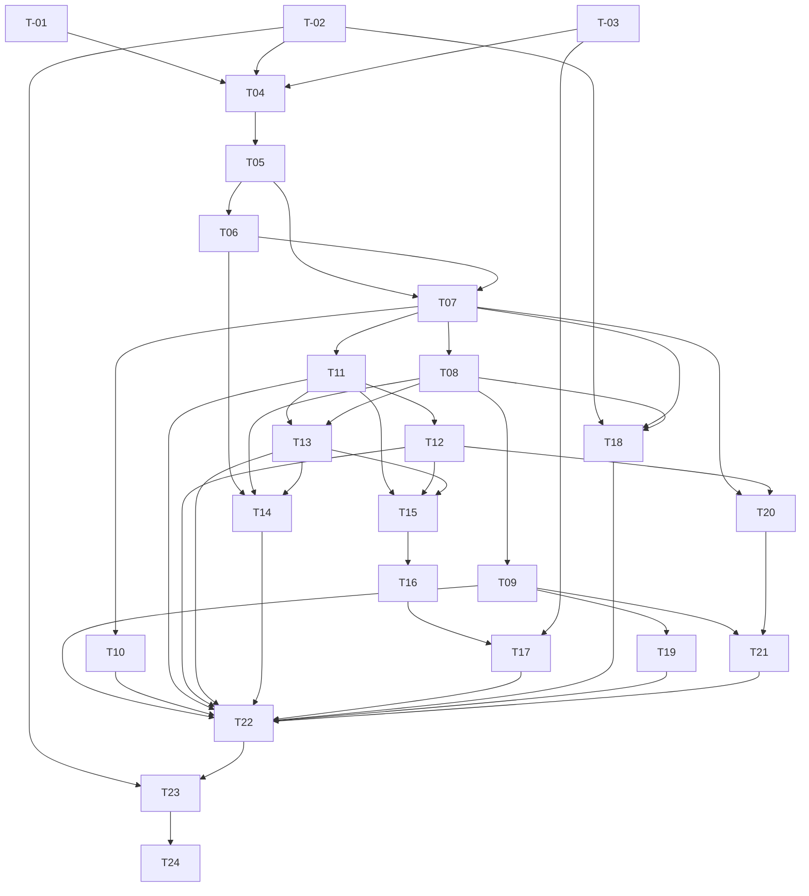

# Tickets Map：Huhu Bot 全量重构

## 1. 目标与拆分策略

24张完整draft票覆盖P0–P6与A01–A28。每票按用户可观察纵切拆分：实际宿主验证、受限会话、安全写笔记、周计划、记忆、协作、Browser、Automation、外部MCP、发行。不是先写所有ports再几年后有界面；数据/权限基础随最早纵切交付，第一条LLM已有基础预算，第一条写工具已有完整审批/幂等/效果链。

执行入口：获得独立实现授权后，Lead与实现者实际执行 <Path>.agents/speculo/workflows/specdev/specdev-i-implement/SKILL.md</Path>。本图不授予实现、部署或发布权限。单票状态、Ready、owner和写集以原票frontmatter为准，以下不复制进度。

### 总体背景

Pi唯一harness；一个独立huhubot模块、runtime和host双执行侧；单session writer+generation；四类存储权威；工具统一Gateway；无旧兼容；业务公共API与UI基线不复制。架构细节见architecture/data/tool/collaboration，行为唯一归spec。

### 项目 Skill

| 适用 | 方法 | 必需操作 |
|---|---|---|
| 生产实现/测试/构建票 | <Path>.agents/skills/dev/SKILL.md</Path> | 必需：按真实范围调用开发规则/适用参考，固定hash，输出工程证据 |
| UI相关票 | <Path>.agents/skills/ui/SKILL.md</Path> | 必需：设计/ownerDocument/portal/a11y，输出真实浏览器及宿主证据 |
| 所有票进入执行 | <Path>.agents/speculo/workflows/specdev/specdev-i-implement/SKILL.md</Path> | 必需：风险双轴审查、DoR与Evidence；只读入口不是完成 |

当前draft票明确列出缺少required skill hash绑定的Ready门，不能标optional绕过。进入Ready前在真实checkout取当前内容hash并记录operation/inputs/outputs/失败阻断。

## 2. 执行导航

| ID | Ticket | 阶段 / 前置导航 |
|---|---|---|
| T-01 | <Path>.agents/speculo/.speculo/specdev/changes/2026-10-31-huhubot-pi-refactor/ticket/01-host-feasibility.md</Path> — 真实安装目录中的 Pi/utilityProcess/SQLite 可行性 | P0；无票级依赖 |
| T-02 | <Path>.agents/speculo/.speculo/specdev/changes/2026-10-31-huhubot-pi-refactor/ticket/02-closure-and-contracts.md</Path> — 旧闭包、公共消费者、复用许可与集成合同冻结 | P0；无票级依赖 |
| T-03 | <Path>.agents/speculo/.speculo/specdev/changes/2026-10-31-huhubot-pi-refactor/ticket/03-design-freeze.md</Path> — 继承 UI-001 的新 Bot 设计确认 | P0；无票级依赖 |
| T-04 | <Path>.agents/speculo/.speculo/specdev/changes/2026-10-31-huhubot-pi-refactor/ticket/04-startup-lifecycle.md</Path> — 启用即启动、页面独立与唯一 owner | P1；T-01, T-02, T-03 |
| T-05 | <Path>.agents/speculo/.speculo/specdev/changes/2026-10-31-huhubot-pi-refactor/ticket/05-native-session.md</Path> — 有预算边界的首个原生 Pi 对话与分支 | P1；T-04 |
| T-06 | <Path>.agents/speculo/.speculo/specdev/changes/2026-10-31-huhubot-pi-refactor/ticket/06-event-recovery.md</Path> — 重连、背压与损坏后的可解释只读恢复 | P1；T-05 |
| T-07 | <Path>.agents/speculo/.speculo/specdev/changes/2026-10-31-huhubot-pi-refactor/ticket/07-safe-tool-gateway.md</Path> — 第一条写能力之前的 Gateway、批准与根预算 | P2；T-05, T-06 |
| T-08 | <Path>.agents/speculo/.speculo/specdev/changes/2026-10-31-huhubot-pi-refactor/ticket/08-note-diff-effect.md</Path> — 笔记预览、人工批准、真实写入与效果对账 | P2；T-07 |
| T-09 | <Path>.agents/speculo/.speculo/specdev/changes/2026-10-31-huhubot-pi-refactor/ticket/09-weekly-plan.md</Path> — Todo 与周计划完整纵向样例 A | P2；T-08 |
| T-10 | <Path>.agents/speculo/.speculo/specdev/changes/2026-10-31-huhubot-pi-refactor/ticket/10-archives-source.md</Path> — 档案字段与来源共享的受控检索 | P2；T-07 |
| T-11 | <Path>.agents/speculo/.speculo/specdev/changes/2026-10-31-huhubot-pi-refactor/ticket/11-profiles-models.md</Path> — 永久 Bot、多会话模型与安全凭据管理 | P3；T-07 |
| T-12 | <Path>.agents/speculo/.speculo/specdev/changes/2026-10-31-huhubot-pi-refactor/ticket/12-skill-snapshots.md</Path> — Skills 与资源快照可见、可撤销地生效 | P3；T-11 |
| T-13 | <Path>.agents/speculo/.speculo/specdev/changes/2026-10-31-huhubot-pi-refactor/ticket/13-fact-memory.md</Path> — 候选事实、FTS5、确认编辑与真正忘记 | P3；T-11, T-08 |
| T-14 | <Path>.agents/speculo/.speculo/specdev/changes/2026-10-31-huhubot-pi-refactor/ticket/14-data-recovery.md</Path> — 数据备份、导出、恢复与旧格式隔离 | P3；T-06, T-08, T-13 |
| T-15 | <Path>.agents/speculo/.speculo/specdev/changes/2026-10-31-huhubot-pi-refactor/ticket/15-delegation-budget.md</Path> — Team 与隔离子 Agent 的有界委派 | P4；T-11, T-12, T-13 |
| T-16 | <Path>.agents/speculo/.speculo/specdev/changes/2026-10-31-huhubot-pi-refactor/ticket/16-mailbox-review.md</Path> — Mailbox、问答、产物审查与取消树 | P4；T-15 |
| T-17 | <Path>.agents/speculo/.speculo/specdev/changes/2026-10-31-huhubot-pi-refactor/ticket/17-execution-views.md</Path> — 执行树、Pi 分支与通信覆盖层及样例 C | P4；T-16, T-03 |
| T-18 | <Path>.agents/speculo/.speculo/specdev/changes/2026-10-31-huhubot-pi-refactor/ticket/18-browser-cowork.md</Path> — Browser 同 Space/Page 共作样例 B | P5；T-02, T-07, T-08 |
| T-19 | <Path>.agents/speculo/.speculo/specdev/changes/2026-10-31-huhubot-pi-refactor/ticket/19-automation-notify.md</Path> — 既有自动化与通知样例 D | P5；T-09 |
| T-20 | <Path>.agents/speculo/.speculo/specdev/changes/2026-10-31-huhubot-pi-refactor/ticket/20-mcp-client.md</Path> — MCP client 单 owner 与协议版本冻结 | P5；T-07, T-12 |
| T-21 | <Path>.agents/speculo/.speculo/specdev/changes/2026-10-31-huhubot-pi-refactor/ticket/21-mcp-server.md</Path> — 外部 MCP 只读与审批写入真实闭环 | P5；T-09, T-20 |
| T-22 | <Path>.agents/speculo/.speculo/specdev/changes/2026-10-31-huhubot-pi-refactor/ticket/22-ui-accessibility-performance.md</Path> — 全 UI、可访问性与规模收口 | P6；T-09, T-10, T-11, T-12, T-13, T-14, T-17, T-18, T-19, T-21 |
| T-23 | <Path>.agents/speculo/.speculo/specdev/changes/2026-10-31-huhubot-pi-refactor/ticket/23-legacy-removal.md</Path> — 旧 Go/HAP/UI/脚本/产物逐项删除收口 | P6；T-02, T-22 |
| T-24 | <Path>.agents/speculo/.speculo/specdev/changes/2026-10-31-huhubot-pi-refactor/ticket/24-release-verification.md</Path> — 四平台发行、故障注入与最终验收 | P6；T-23 |

## 3. 依赖 DAG

每条边为开始所需上游合同/证据，不等于阶段自动Ready。T-18另受#38外部门；未批准设计只阻断相关闭包。T-24最终汇合不替代各票局部证明。

## 4. 合同覆盖

| Contract | 责任票 | 接缝 | 状态含义 |
|---|---|---|---|
| AC-001 | T-01, T-04, T-24 | module loader / installed-host | covered（已规划，非已测试） |
| AC-002 | T-04, T-22, T-24 | lifecycle / real Obsidian | covered（已规划，非已测试） |
| AC-003 | T-01, T-05, T-24 | SDK persisted fixtures | covered（已规划，非已测试） |
| AC-004 | T-04, T-05, T-24 | session queue / generation fence | covered（已规划，非已测试） |
| AC-005 | T-05, T-11, T-15, T-24 | attempt snapshot / provider canary | covered（已规划，非已测试） |
| AC-006 | T-06, T-13, T-14, T-24 | storage / recovery | covered（已规划，非已测试） |
| AC-007 | T-07, T-12, T-20, T-24 | real SDK tool dispatch | covered（已规划，非已测试） |
| AC-008 | T-07, T-09, T-10, T-24 | schema / host executor | covered（已规划，非已测试） |
| AC-009 | T-07, T-08, T-09, T-18, T-21, T-24 | approval CAS / owner checks | covered（已规划，非已测试） |
| AC-010 | T-08, T-24 | Obsidian document API | covered（已规划，非已测试） |
| AC-011 | T-07, T-08, T-09, T-14, T-24 | state transaction / effect owner | covered（已规划，非已测试） |
| AC-012 | T-04, T-08, T-14, T-16, T-19, T-24 | lifetime / cancellation | covered（已规划，非已测试） |
| AC-013 | T-05, T-07, T-15, T-24 | budget ledger / Pi hooks | covered（已规划，非已测试） |
| AC-014 | T-11, T-15, T-24 | profile / delegation | covered（已规划，非已测试） |
| AC-015 | T-15, T-16, T-24 | scheduler / root quotas | covered（已规划，非已测试） |
| AC-016 | T-16, T-24 | mailbox / review CAS | covered（已规划，非已测试） |
| AC-017 | T-17, T-24 | projection / UI | covered（已规划，非已测试） |
| AC-018 | T-12, T-20, T-24 | resource loader / MCP catalog | covered（已规划，非已测试） |
| AC-019 | T-13, T-24 | FTS / memory tombstone | covered（已规划，非已测试） |
| AC-020 | T-07, T-10, T-11, T-13, T-20, T-24 | model/credentials/security | covered（已规划，非已测试） |
| AC-021 | T-02, T-18, T-24 | Browser public API / host E2E | covered（已规划，非已测试） |
| AC-022 | T-19, T-24 | automation action / idempotency | covered（已规划，非已测试） |
| AC-023 | T-02, T-20, T-21, T-24 | MCP SDK / transport / Gateway | covered（已规划，非已测试） |
| AC-024 | T-06, T-19, T-21, T-22, T-24 | durable event / IPC | covered（已规划，非已测试） |
| AC-025 | T-17, T-22, T-24 | perf harness / installed host | covered（已规划，非已测试） |
| AC-026 | T-03, T-17, T-22, T-24 | UI + manual assistive tech | covered（已规划，非已测试） |
| AC-027 | T-01, T-24 | package / signed host | covered（已规划，非已测试） |
| AC-028 | T-02, T-14, T-23, T-24 | static closure / regression | covered（已规划，非已测试） |

## 5. 并行与共享所有权

默认auto调度不是自动执行。相同resource_claims、共享schema/API/composition或写集冲突必须串行，不能因目录不同就并行改语义。Lead唯一写正式状态、Evidence与Git index。共享合同owner见票frontmatter；新增依赖和root构建改动需显式重排集中owner，不能在T-23未Ready时偷执行未来工作。

同一change使用README指定current工作区；不按票创建worktree。明确需要调整并发/分工时以用户和真实config限制为准，不凭空设固定Agent人数。T-01隔离spike与T-02只读调查可以候选并行，但二者state正式回写由Lead串行；真实执行前仍需授权。

## 6. Gate、Wave 与集成

全局权威在goal-plan。此Map只导航；候选Wave不强制所有票等同阶段票全Done。有独立真实前置的票可分别重审DoR，#38阻塞不妨碍其他无依赖工作。

## 7. 横切合同

安全在第一写工具前；unknown效果不自动重放；父wait释放容量；子重试共享root额度；memory tombstone贯穿重建；MCP外部scope不继承内部；旧磁盘文件不清空；原型不替代宿主验收；无Go/HAP兼容发布路径。

## 8. 维护与数量

只在新增/删除/改ID路径/依赖/合同/写集时更新Map；进度仅改原票/Evidence。范围变化递增plan_revision并使受影响证据失效；已通过且输入未变不重复测。用户数量要求是1个文档+原型PR，不是24个远程Issue或PR。未发布真实PR不满足该数量交付。

## 9. 总控恢复

读取goal-plan、README Execution Context、原票和原Evidence；正式运行前ticket-control --map只读核对及原生validator。无真实checkpoint不虚构固定commit；有未决外部效果/远程发布先对账再重试。整体完成还需要全局Gate、数量与发布回执，不从所有单票done自动推断。
