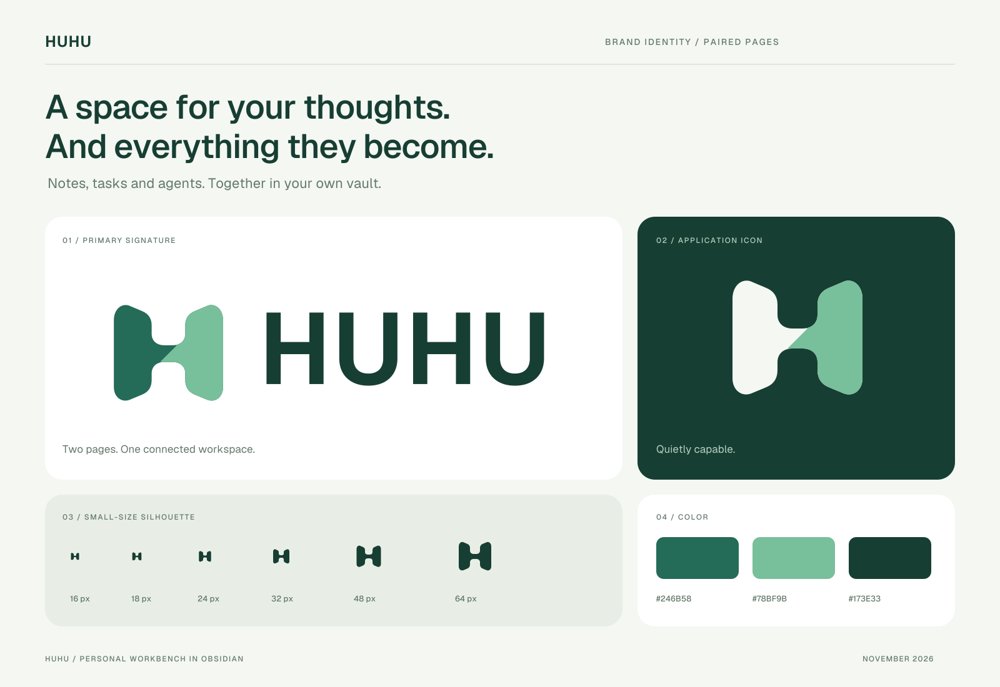

# HUHU 品牌标识

HUHU 是 [Obsidian 里的个人工作台](../README.ZH.md)：笔记、任务、看板、智能体、档案与自动化汇合在同一空间，内容留在用户自己的库中。品牌围绕“相接的双页”构成字母 **H**，表达从记录到行动的连接，以及可组合、由用户掌握的工作空间。

## 图形含义

- **H 是第一层识别。** 两侧圆润的页形与中央连接形成清晰的 H，对应 HUHU 的名称。
- **双页是第二层含义。** 相向的斜肩、内收的曲线与中间斜向接合，呼应笔记与行动、内容与工具在工作台中相连。它是抽象标记，不要求用户第一眼就把它看作书本。
- **轮廓优先。** 单色版保留完整 H；彩色版再用两块平面色区分双页。品牌不依赖渐变、阴影、细缝或小装饰才能成立。

这些是该标识的设计表达；产品实际能力以各模块指南为准。

## 正式资产

所有正式 SVG 都自包含，无外部图片、脚本、字体请求或位图嵌入。图形与文字均为路径，放大不失真。

| 资产 | 用途 |
|---|---|
| [huhu-mark.svg](../assets/brand/huhu-mark.svg) | 彩色主标记；透明底；256 × 256 画布；图形几何的权威来源 |
| [huhu-mark-mono.svg](../assets/brand/huhu-mark-mono.svg) | 单色标记，使用 `currentColor`；面向小尺寸与产品内主题适配 |
| [huhu-mark-inverse.svg](../assets/brand/huhu-mark-inverse.svg) | 固定白色的透明标记，适合深色底与外部 `` |
| [huhu-icon.svg](../assets/brand/huhu-icon.svg) | 深青绿圆角底的应用图标；256 × 256 画布 |
| [huhu-logo-light.svg](../assets/brand/huhu-logo-light.svg) | 用于浅色背景的横向组合；透明底；444 × 136 |
| [huhu-logo-dark.svg](../assets/brand/huhu-logo-dark.svg) | 用于深色背景的横向组合；透明底；444 × 136 |
| [huhu-mark-1024.png](../assets/brand/huhu-mark-1024.png)、[512](../assets/brand/huhu-mark-512.png)、[256](../assets/brand/huhu-mark-256.png)、[128](../assets/brand/huhu-mark-128.png) | 从正式彩色 SVG 导出的透明 PNG |
| [huhu-icon-512.png](../assets/brand/huhu-icon-512.png) | 512 × 512 应用图标，便于头像与项目展示 |
| [品牌概览 SVG](images/brand/brand-overview.svg)、[PNG](images/brand/brand-overview.png) | 展示主标记、字标、深色应用与实际尺寸轮廓 |

`huhu-mark.svg` 的两个路径分别是完整深色轮廓与覆盖其右侧的浅色页片。完整底形避免两块独立填色在斜接处产生透明细线。单色版只取完整轮廓；不要额外画细线来模拟双色接缝。

## 配色与字标

| 名称 | 色值 | 使用 |
|---|---|---|
| 青绿 | `#246B58` | 主标记左页 |
| 薄荷绿 | `#78BF9B` | 主标记右页，深色应用中的强调色 |
| 墨绿 | `#173E33` | 浅底字标、应用图标底色 |
| 纸白 | `#F4F7F2` | 深底字标与深底标记左页 |
| 纯白 | `#FFFFFF` | 固定反白版 |

字标使用项目已有的 **Geist，字重 650**，保持名称 **HUHU** 的大写形式。正式组合已把字形转为路径，不需要使用者安装字体。字体来源与原始许可保留在 [Geist 许可](../src/ui/fonts/LICENSE.txt)。

品牌色用于标识与品牌展示；产品界面仍遵循 [设计系统](design-system.md) 的语义令牌和宿主主题。

## 尺寸与留白

- **16–24px：** 使用单色标记。16px 是图形建议下限，产品现有 18px 图标槽也属于这个范围。彩色接缝不是这一尺寸的必要信息。
- **32px 及以上：** 可使用彩色主标记；在对比不足的背景上改用单色或反白。
- **横向组合：** 建议显示宽度不低于 180px；再小时使用独立图形。
- **安全区：** 保留 SVG 原有画布留白；在图形外轮廓之外额外保留至少一条中央横梁厚度的空间。以 256 画布计，横梁厚度为 32 单位。应用图标使用文件内已设计的边距。
- **比例：** 保持宽高比，不能拉伸、旋转、斜切、改变两页位置，或对字标重新排字。
- **背景：** 浅底使用 light 字标；深底使用 dark 字标或 inverse 标记。避免在复杂照片、与页片接近的颜色或低对比背景上直接叠放彩色标记。

概览中的小尺寸一行以 16、18、24、32、48、64 像素直接渲染。预览图在页面上整体缩放后不再对应屏幕物理像素，核对时应打开原尺寸或直接渲染 SVG。

## README 与产品内使用

根目录两份 README 使用相同的 `<picture>` 组合，通过 `prefers-color-scheme` 选择深浅字标；图片始终带有替代文本。不支持该媒体选择的阅读器会使用浅底字标。

内联单色 SVG 才能继承父元素的 `currentColor`。通过 `` 加载时，它是独立文档，不能依赖外部页面的文字颜色；深底图片应直接使用 inverse 或 dark 文件。

产品内接入时遵循现有 [界面规则](../.agents/skills/ui/SKILL.md)：

1. 功能按钮继续保留自己的语义图标。HUHU 标记用于品牌入口，不替换任务、自动化、档案等模块的功能含义。
2. 可点击入口的名称由按钮的 `aria-label` 与已有本地化文案提供；内部装饰 SVG 使用 `aria-hidden="true"`，避免重复朗读。
3. Obsidian 自定义图标应按宿主的坐标要求缩放，并保持现有 Ribbon 的稳定身份映射。具体入口为 `src/app/workbench/surfaces/ribbon.ts`，映射由 `src/app/ribbon.ts` 负责。
4. 涉及生产源码的接入应按 [测试选择表](../.agents/skills/dev/references/testing.md) 重建产物并验证宿主行为。品牌资产预览只验证图形，不证明 Obsidian 运行集成。

## 来源、编辑与许可

设计先使用 **image_gen** 生成双页 H 概念，再将选定轮廓整理为平面、可维护的原生 SVG。正式 SVG 对曲线、留白、颜色与接合位置作了统一处理；正式 PNG 从 SVG 导出，生成稿里的表面光影与边缘噪声不进入正式资产。

- [image_gen 原始概念 PNG](../assets/brand/source/huhu-imagegen.png)：保留生成结果原样，供理解设计来源；正式使用优先选择上面的 SVG 与其导出 PNG。
- [完整生成提示词](../assets/brand/source/prompts.txt)：记录概念生成与精修两次调用。
- [品牌概览 SVG 源文件](images/brand/brand-overview.svg)：可直接编辑的展示稿，文字同样已转路径。

调整图形时先编辑 `huhu-mark.svg`，再同步单色、反白、图标与横向组合；保留其相同轮廓，并重新导出 PNG 与概览。导出时使用 sRGB、透明 RGBA，保持尺寸与文件名对应，不在文件外另加阴影或底色。字体调整应继续从仓库现有 Geist 取得字形，保留来源说明。

原始品牌图形、品牌文档与展示资产遵循仓库 [LICENSE](../LICENSE)。字体仍受其自身许可约束；该说明不改变仓库对第三方材料的许可边界。
