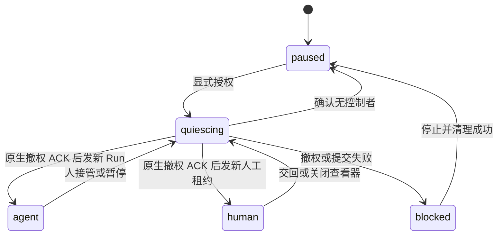

# Agent Browser v2 协议与模块契约

本文描述当前实现的公开接口与恢复语义。产品操作见[浏览器](browser.md)，原生进程、安装和支持平台见[运行时维护](browser-runtime.md)。重构设计来源是 [Issue #1](https://github.com/NAMEWTA/obsidian-huhu/issues/1)；设计目标不等于每个平台已经通过发行门槛。

## 模块和目录

browser 使用 HUHU 的模块化单体与端口/适配器结构，不增加 Obsidian View。外部模块只从 `src/modules/browser/api.ts` 导入，不能访问 runtime、凭据库、真实浏览器对象或内部路径。

| 目录/入口 | 职责 |
|---|---|
| `core/contracts.ts`、`identity.ts`、`files.ts` | 空间、租约、身份和文件的纯契约与规则 |
| `core/protocol.ts`、`rpc.ts` | 唯一 v2 schema、JSON Schema 生成与传输端口 |
| `services/workspace.ts` | 空间生命周期、控制权转换、权限检查与状态投影 |
| `services/operation-ledger.ts` | 持久意图、幂等键、派发状态与结果恢复 |
| `services/frame-broker.ts` | 多观察者背压、画面 ACK、输入有效性与几何屏障 |
| `services/identity-service.ts`、`identity-provision.ts` | 身份预检、不可变版本、两次目标校验和发布顺序 |
| `services/protocol-service.ts` | 按连接、Run 和能力裁剪的外部用例 |
| `platform/desktop/composition.ts` | Electron/Node 端口装配与原生文件选择 |
| `platform/desktop/runtime/` | utilityProcess、单一 CDP driver、固定 main bridge 与资产验证 |
| `platform/desktop/identity/`、`persistence/`、`files/` | 来源读取、认证加密、单所有者与授权文件副本 |
| `platform/desktop/rpc-server.ts`、`cli.ts` | loopback JSON RPC、CLI 与薄 stdio MCP |
| `ui/` | 独立工作台、只读/接管查看器、身份向导、文件页 |
| `native/browser-runtime/` | 最终 pipe writer、epoch fencing、进程收容、SQLite 只读入口 |

公开进程内服务是 `BROWSER_WORKSPACE`、`BROWSER_AGENT_ACCESS` 和 `BROWSER_OPEN`，材料出口是贡献点 `BROWSER_MATERIAL_CONSUMERS`。这些服务供可信的 HUHU UI/模块调用；它们不是可以全部原样暴露给模型的工具表。外部 Agent 仅获得下面的严格协议方法。Agent 模块关闭时，browser 不会主动激活它来寻找材料消费者。

主要模式是模块 Facade、依赖注入的 Port/Adapter、不可变身份值对象、按 Space 串行的控制转换、按 epoch 分离的动作队列、持久操作账本与有界发布订阅。控制转换队列和普通动作队列分开，撤权不等待被撤销的操作 Promise。

## 作用域与控制权

每次自动化动作绑定 `spaceId / pageId / runtimeId / runId / epoch`。页面引用还绑定文档与观察代次，人工输入同时绑定查看器、窗口、已显示 frameId、viewportVersion 和递增输入序号。服务、Worker 和 native 的检查共同防止旧命令进入新的控制代次，最终写入 Chromium 管道的权威在 native gate。



两分钟租约需要续期。Agent 使用 `run.heartbeat`；人工租约只在对应控制视图仍注册时续期。人工接管、暂停、停止、页面文档变化、运行时重启或取消都会使相应引用失效。只读观察不能授予写权限，个人空间不能通过协议变成任务空间。

控制权撤销无法撤回已经被浏览器或网站接受的副作用。native ACK 证明旧 epoch 不再获准继续向 pipe 写命令，不能作为网站事务回滚证明。调用者必须根据结果状态决定是否人工检查。

## 连接与传输

可信 UI 复制的是一个绝对连接文件路径。文件以私有权限创建，内容包含 `protocolVersion: 2`、`bootId`、`endpoint`、随机 Bearer token、Space ID、Run ID 和 capability。CLI 读取此文件，token 不通过 CLI 参数传递。

服务仅监听随机端口的 `127.0.0.1`。要求精确 Host、POST `/rpc` 和 JSON 内容类型；拒绝 Origin 与跨站 Fetch metadata。每个激活实例有独立 bootId。连接在创建、请求执行和发出结果之前均检查当前数据根所有权；最终授权检查在最后一个异步操作后同步执行，检查和序列化之间没有异步让步。

外部请求形式如下，实际凭证由 CLI 或 MCP 适配器从文件注入：

```json
{
  "protocolVersion": 2,
  "bootId": "CURRENT_BOOT_ID",
  "requestId": "TRANSPORT_REQUEST_ID",
  "method": "observe",
  "params": {
    "runId": "CURRENT_RUN_ID",
    "capability": "VALUE_FROM_PRIVATE_CONNECTION_FILE",
    "pageId": "EXPLICIT_PAGE_ID"
  },
  "deadlineAtMs": 1900000000000
}
```

上例只展示字段，不是可直接使用的请求。deadline 使用 Unix 毫秒；必须晚于当前时间且最多 60 秒。CLI 使用 30 秒 deadline。请求体最多 512 KiB、响应最多 12 MiB、最多 32 个真实在途 handler；HTTP 超时不会提前释放一个仍未结束的后端任务的配额。token 使用恒定时间字节比较，凭证错误不会输出内部异常或文件路径。

复制连接默认只有一个指定任务空间的授权。用户可单独允许该连接新建一个空白任务空间；该授权最多使用一次，不包含身份种子选择。相同创建 requestId 和相同参数返回同一结果，不同参数冲突。旧连接不能调用 `run.start` 来取得后来由用户创建的新 Run。

## 方法表

当前完整工具定义可直接读取生成的 JSON Schema：

```sh
node browser-cli.cjs schema
```

| 方法 | 参数要点 | 返回/限制 |
|---|---|---|
| `status` | 空对象 | 当前连接的 Space、运行时可用状态和工具 schema；无个人目录 |
| `space.create` | `requestId`、可选 label/ephemeral/url | 仅显式一次性授权；新空白 task Space 和已授权 Run |
| `run.start` | `spaceId` | 返回连接已经持有且仍有效的 Run；不能恢复暂停空间 |
| `run.stop` | Run scope | 撤销当前 Run 并暂停 |
| `run.heartbeat` | Run scope | 延长当前租约，不改变 epoch 或补发凭证 |
| `page.list` | Run scope | 仅本 Run 空间的页面 |
| `page.open` | Run scope、requestId、url | 持久操作记录，结果中返回新 Page ID |
| `page.close` | Run scope、requestId、pageId | 持久操作记录 |
| `observe` | Run scope、pageId | 当前文档的结构化观察、引用及截断信息 |
| `operation.prepare` | Run scope、pageId、requestId、command | 写入意图并分配 operationId |
| `operation.execute` | Run scope、operationId、原 command | 校验摘要与作用域，再执行或返回已有结果 |
| `operation.get` | Run scope、operationId | 已知调用方的记录；撤权后剥除正文结果 |
| `batch` | Run scope、pageId、requestId、commands | 最多 32 步；逐步校验，失败返回已分配 ticket 和 failedIndex |
| `file.list` | Run scope | 当前执行身份可见的 fileId 元数据，无任意路径 |
| `download.list` | Run scope | 当前执行身份的下载状态 |
| `events.poll` | Run scope、可选 afterSequence | 每 Run 最多 256 个脱敏事件；淘汰游标返回 resync_required，超前游标返回 invalid_event_cursor |
| `health` | Run scope | 当前 Run 的 runtimeId/epoch、eventCursor、页面、观察者、帧队列及请求数量 |

Run scope 是 `runId + capability`，CLI 默认从连接文件补充。操作 requestId 允许 1–96 个字母、数字、下划线、点、冒号和连字符；普通内部 ID 的协议边界为 160 字符。对象拒绝未知字段，不接受附加 raw CDP、任意 JavaScript、文件系统路径或 UI 控制方法。

## 事件游标与投影恢复

事件序号在当前 Run 内单调增加，`health.eventCursor` 是同步读取的最新序号；尚无事件时为 `0`。每个事件包含 `runtimeId`，当前发布的种类只有 `page` 和 `page-closed`，并且只进入与该运行时匹配的有效 Run。事件不含页面标题、URL、正文或凭证。文件、下载、请求和操作结果仍通过各自查询刷新，不应把当前事件流当作这些状态的完整变更日志。

首次建立本地视图或收到 `resync_required` 时，按以下顺序恢复：

1. 用当前 Run scope 调用 `health`，保存 `runtimeId` 和 `eventCursor`。
2. 用同一 Run scope 读取 `page.list`、`file.list` 和 `download.list` 等所需投影。
3. 从刚才保存的 `eventCursor` 调用 `events.poll`，按序处理返回事件。投影读取期间产生的页面事件会再次出现，客户端应幂等处理这些重复更新；不能改用投影读取完成后的新游标而跳过中间事件。
4. 每次只把游标推进到已处理的最后一个事件序号；空响应保留原游标。若读取投影期间又超过 256 个事件，服务器会再次要求恢复，而不会静默丢失更新。

`afterSequence` 必须是非负安全整数，且不得大于当前最新序号，否则返回 `invalid_event_cursor`。游标已落后于保留窗口时返回 `resync_required`；客户端重新执行上述读取流程。`run_revoked` 表示这一 Run 已失效，不能沿用旧游标或连接自行取得新授权，必须等待用户明确授权新 Run。这个顺序保证当前已发布的页面事件可被重放；其他投影仍需要显式查询更新。

## 观察与动作

`observe` 产生一次有界快照：页面、文档、runtime、epoch 和 observationId，以及可用节点引用。动作引用必须来自当前有效观察。导航后重新观察；元素跨 iframe 的 target/frame 归属由 driver 管理，调用者不能自己提交 backendNodeId。

动作集合包括 `navigate`、`back`、`forward`、`reload`、`stop`、`snapshot`、`text`、`screenshot`、`click`、`fill`、`type`、`select`、`press`、`scroll`、`wait` 和 `upload`。引用动作带 `observationId + ref`。`wait` 仅支持 URL、可见文字或加载状态，最长 15 秒；文本最多 65,536 字符。选择数组最多 64 项，上传最多 8 个已授权 fileId。

例如，在已复制连接的任务空间中查看页面并点击一个观察得到的引用：

```sh
node browser-cli.cjs --connection "/absolute/connection.json" call page.list '{}'
node browser-cli.cjs --connection "/absolute/connection.json" call observe '{"pageId":"PAGE_ID"}'
node browser-cli.cjs --connection "/absolute/connection.json" call operation.prepare '{"pageId":"PAGE_ID","requestId":"research-click-001","command":{"kind":"click","observationId":"OBSERVATION_ID","ref":"REF"}}'
node browser-cli.cjs --connection "/absolute/connection.json" call operation.execute '{"operationId":"OPERATION_ID","command":{"kind":"click","observationId":"OBSERVATION_ID","ref":"REF"}}'
```

替换上例占位符，保留 prepare/execute 的 command 完全一致。CLI/MCP 不提供“操作当前活动标签”命令；HUHU 中切换到另一个空间不改变此连接的目标。

批次不是数据库事务。前几步完成后，下一步可能失败、超时或被接管，已经发生的效果不撤销。返回体保留已分配操作记录；正文合计超过 8 MiB 时截断结果而保留 ticket，预算以 UTF-8 字节计算。父连接或子 Run 在处理期间撤销时，迟到的页面观察被拒绝，已有操作/批次结果仅保留授权允许的元数据。

## 持久操作记录与重试

操作幂等键包含 principal、issuer 和 requestId；命令摘要包括作用域和规范化参数，并使用本地 HMAC，避免把密码等短值直接变成可猜测的裸摘要。人、工作台与 Agent 使用不同 principal，不通过伪造 BrowserRun 共用权限。

执行顺序是：持久 `prepared` → 验证作用域 → 持久 `dispatching` → 进入运行时 → 持久完成结果 → 返回。相同 operationId 在途请求合并为同一执行；command 或 epoch 不同会冲突。只有结果落盘成功才报告完成。

| 状态 | 调用方应如何处理 |
|---|---|
| `prepared` | 已分配意图，尚未派发 |
| `rejected` | 验证阶段失败；根据错误修正权限/参数 |
| `cancelled_before_dispatch` | 未派发即取消或日志无法提交；不会自动重放 |
| `dispatching` | 已进入派发阶段，结果尚未确定 |
| `completed` | 完成结果已经提交 |
| `outcome_unknown` | 派发后连接、运行时、回包或结果持久化失败；先查询/观察，不盲目重新提交 |

实现对派发后的错误采用保守的 `outcome_unknown`，不根据一个 JS 超时猜测网页未执行。恢复时，残留 dispatching 变为未知，prepared 变为派发前取消。重启不会重新执行这些命令；旧 boot 连接失效，需要人工明确授权新 Run。账本最多 10,000 项；超过 30 天的结果正文在初始化时移除，保留幂等元数据。达到记录/磁盘配额时拒绝新意图，不自动删除证据重试网站动作。

## CLI 与 MCP 适配

CLI 是单独的 Node.js 22+ CJS 文件；它不加载 Electron，不需要 HUHU Agent 模块。stdio MCP 提供 `initialize`、`ping`、`tools/list`、`tools/call`，目前协商版本为 `2024-11-05`。它根据同一 schema 生成工具，隐藏 capability 字段，并把新获授权 Run 的能力保留在适配器内存中。它不拥有另一套 driver，也不开放身份导出或原生安装命令。

```json
{
  "mcpServers": {
    "huhu-browser": {
      "command": "node",
      "args": ["/absolute/browser-cli.cjs", "--connection", "/absolute/connection.json", "mcp"]
    }
  }
}
```

MCP 的 stdout 仅承载协议消息，错误不回显输入全文。连接文件路径与具体客户端配置由用户选择；不能把内部 token 写入共享项目配置或提示词。

## 验证与扩展边界

纯 schema/账本/租约测试证明规则；真实 loopback 测试证明传输边界；native probe 证明实际 Chromium/pipe/撤权；Obsidian probe 证明 utilityProcess、查看器、所属窗口和 UI/文件流程。四层不能互相冒充。

维护入口是 `pnpm run build`、`pnpm run lint`、`pnpm exec vitest run`、`pnpm run check:browser-native`，以及运行时文档中的 native/Obsidian 探针。发行产物同时校验主插件、Worker、CLI 及其摘要。Windows/macOS 的 supervisor、OS 剪贴板/焦点、系统密钥与签名发行门槛仍需各自实现和实机证据；当前显式 unsupported，不沿用 Linux 的隔离结论。


## 二阶段控制、结果与输入核验

`core/protocol.ts` 的 methodRegistry 汇总 18 个方法的输入/输出 schema 和权限策略；服务端与 CLI 使用相同结果校验及响应预算。`operation.get` 不存在时返回 null。操作 payload 保留 JSON 扩展边界，不宣称每一类动作结果都已由细粒度 schema 推导。MCP 仍是最小 stdio 适配，不是官方 SDK 接入完成声明。

可信 `BrowserWorkspace.handoffAgent` 不属于模型协议。用户或可信协调器提供当前 Space/Page/runtime/Run/epoch 和目标 consumer/Agent/Run/Attempt 身份；旧 A 撤权后，B 取得新授权但必须先 observe 同一 Page。Page/Target 不重建，旧 A 的 stop/cancel/heartbeat 不能作用到 B。人交回及已有 Run 的重新授权同样要求 fresh observe；旧连接不能换取新授权。执行身份是关联元数据，不是权限凭证。

fill 结果为 `{ok, verification, sensitive}`；verification 为 matched/rejected/truncated/transformed/unverified，只有 matched 的 ok 为 true，读回不可确认时 sensitive 可缺省。结果不回显字段值或密码。只执行一次插入，核验不符不自动重试；派发后失联或撤权由账本保留 unknown。操作 completed 不能代替网站业务成功确认。具体实现和边界见[二阶段交付](browser-phase2.md)。
