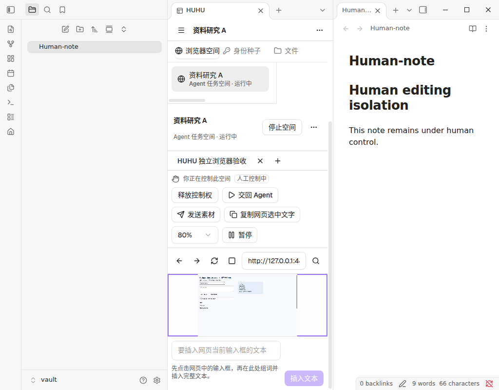

# Agent Browser 实施与验收记录

> 本文前部为既有版本的历史验收，摘要只适用于记录的产物，不是 PR #14 的复跑结果。二阶段现状、证据及未完成门禁见[二阶段交付](browser-phase2.md)。

本轮依据 [Issue #1](https://github.com/NAMEWTA/obsidian-huhu/issues/1) 重构独立 browser 模块。当前运行时启用 Linux x64；Windows、macOS、Linux ARM64 与移动端显示明确的不支持状态。Issue 中剩余的完整观察合同、事件种类、设计材料和跨平台门禁继续保留，本文逐项说明当前覆盖范围。

产品使用见[浏览器](browser.md)，技术合同见[浏览器协议](browser-protocol.md)，构建和进程边界见[运行时维护](browser-runtime.md)。本轮没有发布新版本或迁移旧资料。

## 实现范围

| 领域 | 已实现行为 |
|---|---|
| 模块与工作台 | 独立开关、空间目录、身份与文件页；关闭 Agent 仍可使用；保持三个 Obsidian View |
| 进程与页面 | 每个 Space 使用独立 utility Worker、Rust supervisor、Chromium 进程树和 Profile；显式 Page 寻址；无公开 CDP 调试端口 |
| 人与 Agent | personal/task 分离、默认只读观察、单 human lease、原生撤权 ACK、明确交回；旧 Run、文档、帧与请求 revision 拒绝继续操作 |
| 身份与 Cookie | 文本、文件、显式来源三入口；完整来源预检、精确域选择、不可变版本；staging 与目标分别完整读回；失败保留清理责任 |
| 文件 | 私有文件副本、保留安全原文件名、一次性 opaque fileId、Run/人工租约作用域、内容摘要；下载关联原始控制代次，导出由人选择目标 |
| 自动化 | 结构化观察与动作、持久 prepare/execute、并发幂等、保守结果未知、32 步 batch；单套输入 schema 驱动 loopback RPC、CLI 和最小 stdio MCP |
| 生命周期 | 只恢复目录、保留 desired Page ID、显式重新打开、故障隔离、可重试清理；停止失败时保留原模块实例与所有权 |
| 交互 | 多观察者背压、静态帧刷新、缩放几何、连续键盘输入、中文文本提交辅助、prompt/chooser、显式复制、真实弹出窗口 |
| 工程 | Worker 严格类型检查、独立 CLI、Rust 锁文件、Linux 原生构建与验收流水线、发行资产校验、完整依赖许可、生成产物漂移检查 |

### 本轮验收发现并修复的问题

- 私有上传副本原先以 UUID 作为文件名，导致网站得到错误的 `File.name`。现在每份副本置于独立目录，保留经过校验的原文件名；同名文件仍隔离，并检查目录身份、硬链接、摘要和执行作用域。
- 静态页面与缩放后的画面可能过期。运行时在有观察者时有界刷新，截图、几何读取与坐标输入保持一致；旧 frame 和旧 viewport 拒绝输入。
- 同一有效帧上的连续键盘输入可能被误判为旧输入。键盘/文本输入现在按递增序号串行执行；坐标操作仍要求更新的画面，排队期间更换文档仍拒绝执行。
- prompt/chooser 回复曾排在等待该回复的点击后面。回复与停止加载可以优先派发，同时保留日志、租约、文档、请求 revision 和文件授权检查。加载期间停止按钮仍可用，释放控制权也保持可用。
- 独立 Node CLI 曾误用 `window.fetch`。现使用 Node.js 22+ 的 `globalThis.fetch`，并用真实子进程验证 CLI/MCP；ESLint 例外仅作用于这个 Node 入口。
- 事件游标越过保留窗口曾静默丢失信息。现在返回 `resync_required`，通过同步 health cursor 重新读取投影；未来游标明确拒绝。

## 验证结果

本地验证使用冻结后的源码和下方构建摘要。全仓回归期间 `src/` 和 `test/` 未变化；只有包体预算文件按已完成的实测更新，随后单独执行预算门禁。

| 检查 | 实际结果 |
|---|---|
| 生产构建 | `pnpm run build` 退出 0，包含源码、测试、Worker 类型检查和所有 JS/CSS 产物 |
| 完整 Vitest | 396 个配置文件全部进入报告；395 文件通过、1 文件整体跳过；3,428 项通过、2 项既有 Windows 条件跳过、0 失败 |
| 其他测试脚本 | 其余 43 个 `test:*` 脚本全部通过；文档校验单独通过 |
| CLI/MCP | 真实 Node 子进程 4/4，包含在全仓结果中；验证连接 scope、schema 凭证裁剪和错误脱敏 |
| Rust | browser helper 8/8；既有 terminal helper 34/34 |
| 原生 Chromium | 19/19；真实 BrowserDriver、helper、完整 Chrome 与开启的 Chromium sandbox |
| 真实 Obsidian | 50/50；最终 `main.js` 摘要严格匹配，0 未处理宿主错误 |
| 静态门禁 | 全仓 ESLint 零警告、CSS lint、架构、i18n、Promise callback、文档、许可与包体预算均通过 |
| 运行包 | 完整清单验证 306 项；Worker/helper/Chrome/manifest 摘要见运行包记录 |

全仓 Vitest 使用 `TZ=UTC`、Chrome for Testing 156.0.8078.47 与两个 worker，耗时 228.121 秒。两项条件跳过为 Windows 系统身份与 PowerShell 恢复命令；没有为本次实现新增跳过。JSON 中 486 个 suite 包含嵌套 `describe`，不代表文件数量。

可直接复核的脱敏结果：

- [Vitest 统计、配置集合核对与新增回归](assets/browser/vitest-summary.json)
- [真实 Obsidian 的全部 50 项断言](assets/browser/host-linux-x64.json)
- [原生 Chromium 的全部 19 项断言](assets/browser/native-linux-x64.json)
- [实际测试运行包的摘要与清单数量](assets/browser/runtime-build.json)

### 构建绑定

| 产物 | SHA256 |
|---|---|
| main.js | `924d1ce5dd8b3b32d147927ac71039b685b1de1c02d713cc730ecfe2b4c42688` |
| styles.css | `8f85a0ac416ac46e1c8d65ff230cba9efbfcc2c7dd1acab69029890137f2eec1` |
| browser-worker.cjs | `62f09df67271d1218b39a3b99a3318f76a94a8e5bdfa815c31570fd977eca10b` |
| browser-cli.cjs | `a3cf84be7ae03676122be8141e93755bf67b2d16bd7a3d9dcc31edb983f3b3db` |

上述 main、styles 和 Worker 与真实宿主回执一致。运行包记录描述实际用于验收的包；源码安装器重新组装发行包时还会纳入该次构建的许可文件并重新生成 manifest。清单摘要证明完整性，发行方身份仍需对应发布与签名流程。

包体实测 main.js 为 6,185,759 字节，启动闭包 122,924 字节，browser 激活闭包 252,259 字节。增加的代码包含独立的生命周期、身份、文件、日志和严格协议服务；采用 Zod mini，Viewer/UI 继续延迟加载。启动闭包比初始实测增加 57 字节；styles.css 从初始 1,420,790 降为 1,418,223 字节。预算按 KiB 取整并记录原因，禁止启动加载的区域保持不变。

### 真实工作台截图

下图来自同一最终构建的 1024×800 测试宿主，左侧为笔记导航，中央为窄栏浏览器，右侧为人正在编辑的 Obsidian 笔记。截图没有 Cookie 值或连接凭证，未经图像编辑；窄栏缩放效果保留了真实测试环境。



## 复现入口

普通构建和回归：

```sh
pnpm install --frozen-lockfile
pnpm run build
pnpm run lint
pnpm run lint:css
pnpm run check:bundle
pnpm run check:notices
pnpm run check:browser-native
pnpm run check:native
TZ=UTC HUHU_CHROME_EXECUTABLE=/absolute/chrome-linux64/chrome pnpm exec vitest run --maxWorkers 2
pnpm run test:all
```

`test:all` 包含 Vitest 与其他项目脚本；不要把只运行 Vitest 写成全部脚本均通过。真实运行包的构建命令见[运行时维护](browser-runtime.md#构建和安装)。原生与宿主验收使用新的临时目录：

```sh
node scripts/verify-browser-runtime-native.mjs \
  /absolute/runtime/huhu-browser-runtime \
  /absolute/runtime/chromium/chrome \
  /absolute/new-native-evidence

HUHU_OBSIDIAN_EXECUTABLE=/absolute/obsidian \
HUHU_EXPECTED_MAIN_SHA=924d1ce5dd8b3b32d147927ac71039b685b1de1c02d713cc730ecfe2b4c42688 \
DISPLAY=:99 node scripts/obsidian-acceptance/agent-browser-v2.mjs \
  /absolute/new-host-fixture \
  /absolute/runtime
```

图形环境须事先可用。脚本仅用于新的、一次性的测试库；不会把现有用户库作为测试夹具。

## Issue 尚待完成的要求

| Issue 范围 | 当前边界与剩余工作 |
|---|---|
| G-01～G-06 与平台发行 | Linux 有上面的真实子场景证据；完整宿主/Worker/supervisor 分别强杀、饱和 IPC、popup POST/opener 与初始 Worker realm 时序矩阵仍需补齐。Windows/macOS 还需原生 containment、系统密钥、沙箱、宿主与发行实测 |
| FR-10 观察合同 | 指定基线已提供 AX/DOM/布局、coverage、frameErrors、viewportVersion 与 scope；本次保留并复测。真实全部 frame/控件场景仍需验收 |
| FR-13 与 §14.3 账本 | 指定基线已有 issued/lowWater、checkpoint 与结果回收；本次保留并复测，不能沿用旧“尚未实现”结论；全耐久崩溃点矩阵仍未闭合 |
| §14.4 事件 | 指定基线已有 control/operation/request/download/fault/cleanup 等元数据投影及 snapshot/cursor 一致性；本次补交接相关元数据，真实长时断连/饱和矩阵仍需补证 |
| FR-26 设计材料 | 指定基线已有元素 ref、选区截图/样式和草稿贡献点；真实完整 Bot 消费链路与 unknown 回执故障矩阵仍待验证 |
| 协议与 MCP | 二阶段已有方法级输入/输出注册表和双端校验；operation payload 仍通用 JSON，细粒度 outcome 待补。MCP 为最小 2024-11-05 stdio 适配，没有使用官方 SDK |
| 身份与权限扩展 | 目标为 owned-default Context；非空 localStorage/IndexedDB、无法无损保存的来源容器/分区和 v20/App-Bound Encryption 明确拒绝。HTTP auth 默认取消、敏感权限默认拒绝；没有按站点人工凭据授权面板 |
| 体验与性能 | 中文证明限于宿主文本提交辅助及组件回归；完整网页原位系统 IME、PRIMARY selection、长拖拽、撤权/输入 p95、CPU/RSS 基准仍需专项验证 |

真实文件上传使用了原生文件选择器返回路径的夹具接缝；复制、摘要、scope、RPC 和 Chrome 接收文件是实际链路，操作系统原生选择框本身没有实测。宿主环境的 Obsidian Electron 使用了夹具的 `--no-sandbox`，受管 Chromium 的 sandbox 保持开启；两者不能混写。真实 OS 凭据 provider 与第三方账号登录未在本轮验证，Cookie 导入成功也不等同于网站一定保持登录。

这些边界继续保留在 Issue 中。本轮 PR 使用 `Refs #1`，不把整份架构需求自动标记为已完成。
