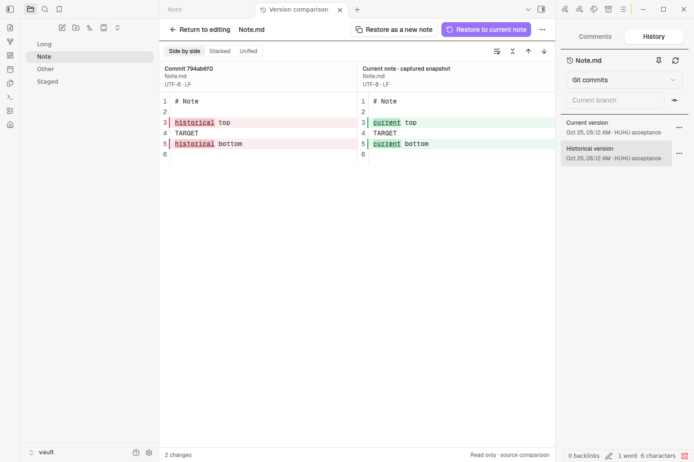
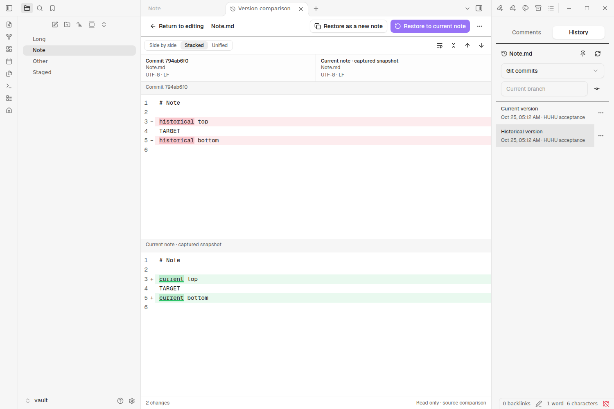

# 版本管理：Git、笔记历史与恢复

版本管理用本机 Git 浏览仓库和单篇笔记的历史，在独立比较页查看差异、恢复正文，并保留提交、拉取、推送与定时同步能力。它只在桌面端可用，新安装或未保存模块开关时默认开启；模块 ID 与设置命名空间为 `versioning`。模块开启只提供 Git 工具，不会自动创建仓库、配置认证或开启提交、拉取、推送计划。HUHU 不保存账号或密码，认证交给 Git 自己的凭据管理器或 SSH agent。

## 开启与接入

1. 在图标栏点击分支图标，打开“版本管理”工作区（更改、历史、比较三种模式）。如果此前关闭过模块，可在 **设置 → 常规 → 功能模块** 中重新打开“版本管理”。移动端仍不支持，不会加载桌面 Git 进程。
2. HUHU 依次查找：设置中填写的程序路径、`PATH` 里的 `git`，以及常见的安装位置（Windows 为 `C:\Program Files\Git`，macOS 和 Linux 为 Homebrew 和系统目录）。找不到时，同步页会说明原因，并提供打开设置的入口。
3. 库还不是 Git 仓库时，点“创建仓库”，HUHU 会在当前库或设置中指定的库内文件夹执行 `git init`。只接受根目录恰好等于该文件夹的独立仓库；父目录中的仓库不会被继承，界面会提示在当前目录初始化。工具栏显示仓库名称，悬停查看完整路径。读取历史和执行操作前都会重新校验此边界，并移除继承环境中的 Git 仓库、索引重定向。每次 Git 调用都限制向上查找仓库，当前 `.git` 被移除时会报错，不会退回父仓库。
4. 没有远端时，同步页顶部有“添加远端”；Git 不知道作者姓名和邮箱时，有“设置作者”，只写入本仓库的配置。
5. 第一次“提交并同步”会询问是否把当前分支推送到远端并设为上游，确认后执行 `git push -u`。

只接受当前库根目录或配置的库内文件夹自身的独立仓库，不继承它们的父目录仓库。设置中的“仓库文件夹”可以选择库内独立仓库。

要在新设备上使用已有仓库，在尚未初始化仓库时的 Git 同步页展开“克隆已有仓库”，填写仓库地址和当前库之外的新目录或空目录的绝对路径，父目录须已存在。确认目标后开始，运行时可点“取消克隆”。认证使用系统 Git 凭据；地址中包含密码或 HTTPS 凭据时会拒绝克隆。

HUHU 先克隆到相邻的临时目录，完成后再次检查目标目录，再将结果移入。目标中已有的文件，包括克隆期间新增的文件，都会保留。失败或取消不会触发递归清理；若留下文件，页面会显示临时路径，供你检查。成功后请在 Obsidian 的库切换器中选择“打开文件夹作为库”。切换前当前库会保持打开。

## 认证

推送和拉取使用本机 Git 的认证方式，只需在本机配置一次：

- HTTPS：使用 Git 的凭据管理器。Windows 版 Git 自带 Git Credential Manager；macOS 可用 `git config --global credential.helper osxkeychain`；也可以用 `gh auth setup-git`。
- SSH：把密钥加入 SSH agent，并确认在终端里 `git push` 不需要再输入口令。

HUHU 运行 Git 时关闭了交互提示（`GIT_TERMINAL_PROMPT=0`）。缺少凭据会立即以“认证失败”结束，不会一直卡住。添加远端或克隆时会拒绝含凭据、查询参数或片段的地址。错误详情中的 URL 凭据和查询参数会被遮去；请通过系统 Git 凭据管理器或 SSH agent 配置认证。

## 稳定的 Git 工作区

工作区分成三种模式，导航和正文彼此独立。选择提交或文件不会在列表中插入 Diff，也不会改变其他行的高度。

| 模式 | 导航 | 主区域 |
|---|---|---|
| 更改 | 冲突、未暂存、已暂存文件；平铺与目录树 | 当前选中文件的差异；提交说明只出现在此模式 |
| 历史 | 分支/引用过滤、提交图与摘要、所选提交的文件 | 所选文件相对父提交的差异；合并提交可明确选择父提交 |
| 比较 | 两个分支、标签或提交，以及变化文件 | 两个确定版本的文件差异 |

文件与提交行通常为 32px，粗指针设备至少 44px；长列表按固定行高虚拟化。历史详情不再嵌套在提交图中。窄容器先显示导航，选择文件后显示比较，可用导航按钮返回；自动布局以实际比较容器宽度为准。

提交说明支持 `Ctrl/Cmd+Enter`，输入法正在组词时不会触发提交。搜索、分支过滤和版本读取只查询对象，不切分支、不修改暂存区；提交、暂存、放弃更改仍是独立的显式动作。

### 差异的含义

| 入口 | 左侧 | 右侧 |
|---|---|---|
| 未暂存 | index 中的内容 | 打开比较时的磁盘工作树快照 |
| 已暂存 | HEAD（首次提交前为空） | index 中的内容 |
| 未跟踪 | 空版本 | 磁盘内容 |
| 笔记历史 | 选中的历史版本 | 首次打开该比较会话时的编辑器内容，包含未保存修改 |
| 某次提交 | 指定父提交（根提交为空） | 该提交的内容 |
| 两个版本 | 明确选定的版本 A | 明确选定的版本 B |

同一文件同时存在已暂存和未暂存内容时，两组的差异各自成立，不能把它们合成一次 HEAD 对磁盘比较。历史删除显示“该版本不存在”，不伪装为空文本；二进制、过大、无法读取分别显示原因。

左右、上下、行内三种布局共用只读 CodeMirror 比较表面，支持换行、未变化区折叠、词内高亮和上一处/下一处变化。上下模式使用两个独立正文视口。自动布局在窄容器使用行内模式；手动选择布局后不被自动模式覆盖。正文上方显示版本、路径与换行/BOM/末尾换行等信息；展示时的格式归一化不改写恢复使用的原始快照。

后台 Worker 计算差异；取消或换文件会结束旧任务。无 Worker 时只有有界的小文件回退，超过读取或展示上限明确说明原因；不会用被静默截断的文本进行恢复。复杂变更的近似对齐有标记，此版本只提供整篇恢复。

## 笔记历史侧栏

打开 Markdown 笔记后，执行 **打开笔记历史** 命令，或使用笔记文件菜单的同名入口。现有右侧编辑器面板提供 **批注 / 历史** 两个标签，一次只挂载当前贡献。主窗口使用右侧栏；Obsidian 弹出窗口没有对应的独立右侧栏 API，因此在来源笔记旁创建同窗口的工具面板。历史默认跟随所属窗口的来源笔记，进入比较页或聚焦侧栏不会清空来源；固定按钮可暂停跟随。

历史支持当前分支、指定分支/标签/提交，以及恢复前检查点。Git 记录每页 50 条，分页固定初次查询的提交，避免 HEAD 改变后重复或跳过记录。重命名沿单文件历史追踪；同路径删除后重新创建会开始新的历史段。

点击记录后，主工作区打开临时“版本对比”标签；同一来源编辑器持续复用它。原来的 Markdown 叶子保持存在。连续选版本只替换历史端点，当前内容快照固定不动；原文后来发生修改时显示提示，点 **刷新当前版本** 才重新捕获。返回编辑会回到原叶子。也可从版本菜单查看该次提交的修改，或与已选版本比较。

来源叶子关闭、换了文件或移到其他窗口后，旧文档身份不再有效，恢复不会猜测另一个活动编辑器。比较正文仅存在内存；工作区保存布局，不保存笔记正文，重启后的临时比较页会明确提示重新选择版本。

### 布局示例

同一篇示例笔记在真实 Obsidian 中的左右对照与上下对照，历史列表保留在右侧：

## 恢复、检查点与撤销

1. 选择历史版本，核对正文，再点 **恢复为当前笔记** 或 **恢复为新笔记**。
2. 准备阶段只读，确认框列出来源和目标。切换版本、关闭页面或取消确认会丢弃未提交的恢复计划。
3. 确认后先持久暂停自动提交/拉取/推送，验证恢复目录被 Git 排除且未跟踪，再保存当前 buffer、磁盘原文及目标内容的检查点。
4. 应用前重新核对正文、文件身份、源叶、其他同路径编辑器和 HEAD/index 指纹。预览后有新修改、多个叶子内容分歧、未完成合并或索引锁等情况会拒绝覆盖。
5. 打开的笔记通过原生编辑器事务应用最小修改并保存；关闭的笔记通过 Vault 的带比较写入。结果验证后记录回执，提供 **撤销本次恢复**。

恢复是一次新的正文编辑，HEAD 和 index 不随之重置。撤销同样核对当前内容并留下新检查点；如果恢复后又有新编辑，就通过历史比较或恢复副本继续处理，不自动覆盖。撤销创建副本会删除未改动的副本；副本已有正文变更或任何批注时拒绝删除。

批注模块通过 prepare/commit/abort 协调锚点，防止多个叶子重复映射；只恢复锚点和状态，不回滚评论正文、回复或作者。未改片段保留定位，删除或歧义引用标为脱离。详见[批注](comments.md)。

检查点保存在 `.huhu/recovery/versioning/<device-id>/`，正文对象以 SHA-256 校验。写入中断或保存不能验证时保留原阶段与检查点，重启只核对已有内容，不自动重放写入。点击继续同步时，若仍有待核对记录，会列出相关笔记；人工确认只记录“已核对”，不把失败记录改成成功。若核对期间又发生恢复，旧确认不会解除新的暂停。原有手动暂停也不会被解除。

自动同步不会按超时恢复。检查点和 journal 当前不自动清理；持续自动本地历史、检查点保留策略、精确按块恢复、阅读渲染比较和图片历史属于后续阶段。不要把恢复检查点当作持续的每次编辑历史。

## 设置与升级边界

此重构用 `versioning` 替代原 `sync` 模块、设置命名空间和工作台功能，不维护旧私有 API 或旧展开式 UI。旧 `sync` 的模块开关、设置及页面缓存不自动迁入；升级后应在 **设置 → 版本管理** 重新核对仓库位置及同步选项，自动计划默认关闭。普通笔记、Git objects、附件和批注正文保持原有数据身份。设备级同步状态仍位于 `.huhu/sync/`，它属于版本管理模块中的同步职责。

## 命令

命令面板中的命令都以“Git：”开头：

| 命令 | 结果 |
|---|---|
| Git：提交并同步 | 提交全部变更，然后按设置拉取和推送 |
| Git：仅提交已暂存并同步 | 只提交已暂存的内容，然后拉取和推送 |
| Git：提交（优先已暂存） | 提交已暂存的内容；没有暂存内容且设置允许时提交全部 |
| Git：仅提交已暂存 | 只提交已暂存的内容 |
| Git：提交全部变更 | 暂存并提交全部 |
| Git：拉取、Git：推送、Git：获取 | 单独执行对应的 Git 操作 |
| Git：暂停或恢复自动同步 | 暂停本设备的定时任务 |
| Git：打开同步页 | 打开版本管理的更改模式 |
| 打开笔记历史 | 在所属窗口的右侧面板显示当前笔记历史 |
| Git：暂存当前文件、Git：取消暂存当前文件 | 针对当前打开的文件 |

## 各操作提交什么

| 操作 | 提交什么 |
|---|---|
| 提交（优先已暂存） | 有已暂存内容时只提交这些；没有时，“没有已暂存内容时，提交会暂存全部”开启则提交全部，关闭则不提交 |
| 仅提交已暂存 | 只提交已暂存的内容；没有就不提交 |
| 提交全部变更 | 暂存库中的全部新增、修改、删除和重命名后提交 |
| 提交并同步 | 提交全部变更，然后按设置拉取和推送 |
| 仅提交已暂存并同步 | 只提交已暂存内容，未暂存的修改原样留在本地，然后拉取和推送 |
| 自动提交并同步 | 默认提交全部；开启“自动提交只包含已暂存内容”后只提交已暂存的 |

“提交并同步”依次执行三步，每一步单独报告结果，例如“已提交 3 个文件 · 已是最新 · 已推送 1 个提交”：

1. **提交**：没有变更时报告“没有可提交的更改”，但仍会继续执行后两步，所以尚未推送的已有提交也会被推送。
2. **拉取**（“推送前先拉取”开启时）：先获取，再按设置合并或变基。没有新内容时报告“已是最新”。
3. **推送**（“不推送”关闭时）：没有新提交时报告“没有可推送的提交”。

任何一步失败，后面的步骤不会执行，结果显示为失败，不会报告同步完成。拉取失败或出现冲突后不会推送。

## 拉取方式

- **合并（merge）**：保留双方历史，需要时生成一个合并提交。
- **变基（rebase）**：把本地的新提交接在远端提交之后，历史保持线性。

两种方式都带 `--autostash`：“仅提交已暂存并同步”时，未暂存的修改会在拉取期间被临时收起，拉取后放回。HUHU 不提供 `reset` 方式，也不提供自动选取一方（ours/theirs）的策略，因为它们会悄悄丢掉一方的历史或内容。遇到冲突一律暂停，等待你处理。

## 推送

- 分支没有上游时，手动操作会先询问；自动同步不会弹窗，也不会擅自创建上游。这时状态栏显示“Git：上次同步失败”，提示说明原因：分支没有上游，请手动同步一次以发布分支。
- 远端有本地没有的提交时，推送会被拒绝，提示“请先拉取”。HUHU 从不强制推送。
- 远端分支被删除后，下次推送会重新建立它。

### 推送前压缩未推送的提交

开启后，推送前会把尚未推送的多个提交合并为一个，保留最新那个提交的说明。只有同时满足下列条件才会压缩，否则跳过并照常推送：

- 远端分支是本地分支的祖先，即远端没有你尚未合并的提交；
- 没有已暂存但未提交的内容；
- 未推送的提交至少有两个，且其中没有合并提交；
- 没有其他引用（包括远端跟踪分支）包含这些提交。

HUHU 先读取并获取实际推送目标，再确定压缩范围。目标无法唯一确认时跳过压缩，普通推送仍按 Git 配置执行。结果会解释跳过原因。强制推送引用配置和镜像推送会被拒绝。

压缩提交失败时，分支恢复到原 HEAD。压缩成功但推送失败时，错误会显示原提交，并通过 `refs/huhu/pre-squash` 保留；可运行 `git branch huhu-recovery refs/huhu/pre-squash` 创建分支后查看原历史，不会改动当前文件。下次压缩前会更新此恢复引用。

## 自动同步

| 设置 | 作用 |
|---|---|
| 每隔多少分钟提交并同步 | 0 表示关闭。本设备重启后会接着上次的时间计算，短时间的多次启动也会按时同步 |
| 等编辑停止后再同步 | 在库中最后一次修改之后再等上面的间隔，而不是按固定时钟 |
| 推送使用单独的间隔 | 开启后上面的间隔只提交，推送按“每隔多少分钟推送”进行 |
| 每隔多少分钟拉取 | 独立的拉取时钟 |
| Obsidian 启动时拉取 | 工作区加载完成后执行一次 |
| 在本设备暂停自动同步 | 只停止本设备的定时任务，手动操作照常可用 |

- 手动操作、定时任务和文件变化触发的刷新都经过同一个队列，同一时刻只有一个 Git 操作在运行；同类操作在排队时只保留一次。
- Git 自己写文件引起的库变化不会被当成编辑，所以一次拉取不会立刻触发下一次自动提交。
- 存在冲突，或合并、变基进行中时，自动提交和推送会跳过，状态栏显示冲突。
- 需要人处理的失败（认证、权限、远端拒绝、没有上游等）连续出现三次后，本设备的自动同步会暂停，状态栏显示“自动同步因连续失败已暂停”。下一次手动操作成功后会自动恢复。断网、超时和仓库被占用不计入，下个周期会再试。
- 计时和暂停状态保存在 `.huhu/sync/<device-id>/<repository-hash>.json`，按库内设备与仓库相对路径隔离；旧 Git 目录状态经可恢复清单迁移。
- 关闭模块或卸载插件时，会停止定时器、取消排队中的操作，并结束正在运行的 Git 进程。

## 冲突

两台设备改了同一个文件的同一处，拉取就会停在冲突上：

1. 同步视图的“未提交的更改”行自动展开并出现“合并因冲突暂停”（或“变基因冲突暂停”），冲突文件列在“冲突”组，状态栏显示冲突数量。此时不会推送，自动同步也会等待。
2. 打开冲突文件。每个 `<<<<<<<` 行上都有“保留上方”“保留下方”“保留两者”按钮（diff3 格式的冲突还有“保留共同祖先”），也可以直接手动编辑。合并时，上方是本地内容、下方是远端内容；变基时两者相反，按钮上会标出 Git 给的标签。
3. 改好后点“标记为已解决”。文件中仍有冲突标记时会再确认一次。
4. 所有冲突都解决后点“继续”，HUHU 会完成合并提交或继续变基；之后“提交并同步”即可推送。
5. 想放弃这次拉取时点“中止”，仓库回到拉取之前的状态。你自己的提交会保留，已做的冲突处理会丢失。

其他情况：

- 一边删除、另一边修改：显示为冲突。要保留文件就暂存它，接受删除就在 Git 中删除它。
- 一边重命名、另一边修改：Git 通常能自动合并，修改会出现在新文件名下。
- 二进制附件（图片、PDF）没有冲突标记。可以中止，或在终端里用 `git checkout --ours/--theirs <文件>` 选择一份后标记为已解决。
- 未暂存的修改在拉取后放回时也可能冲突。这时 Git 会把它们保留在 stash 中，冲突文件同样列在“冲突”组。

## 失败与排查

| 提示 | 含义与处理 |
|---|---|
| 无法启动 git | 安装 Git，或在设置中填写 Git 程序的完整路径 |
| 不是 Git 仓库 | 创建仓库，或检查“仓库文件夹”设置 |
| 无法连接远端 | 离线、代理问题或服务器不可用。本地提交已保留，联网后再同步 |
| 认证失败 | 在本机配置凭据管理器或 SSH 密钥（见“认证”），然后在终端里确认 `git push` 可以直接成功 |
| 远端拒绝访问 | 远端返回了无权限或受保护分支的拒绝（来自 `remote:` 的提示），不是本地问题 |
| git 无法暂存部分文件 | 本地的 `git add` 失败：某些文件没有读取权限、被其他程序占用或无法读取。展开“git 原始输出”，第一行会指出出错的文件。HUHU 自己的私有运行数据已默认排除（见下），这类问题通常来自其他文件 |
| git 没有权限读写本地文件或文件夹 | `.git` 或库内的某处不可写。检查权限后重试 |
| 找不到远端仓库 | 检查远端地址 |
| 远端有本地没有的提交 | 先拉取。“提交并同步”会自动先拉取 |
| 另一个 Git 进程正在使用此仓库 | 终端或 IDE 正在操作仓库。等它结束后重试；残留的 `.git/index.lock` 要在确认没有 Git 在运行后才可删除 |
| 未提交的更改会被覆盖 | 先提交或暂存这些更改 |
| Git 需要先设置作者姓名和邮箱 | 在同步视图点“设置作者” |
| 不在分支上（游离 HEAD） | 先用 Git 切换到某个分支 |
| git 运行超时，已停止 | 网络操作上限为 10 分钟，其他操作为 2 分钟。大附件首次推送较慢时，可以先在终端里推送一次 |

失败不会丢失本地编辑或提交。重试前可以先刷新同步视图，确认当前状态。

## 默认不提交的 HUHU 私有数据

HUHU 在仓库的 `.gitignore` 与 `.git/info/exclude` 中维护带起止标记的托管区块，新旧仓库都会补全，每次连接仓库和执行 Git 操作前会补全它，用户自己写在区块外的规则不受影响。区块排除这些只属于某台设备、运行时产生、含凭据或可重建的内容：

| 排除 | 内容 |
|---|---|
| `.huhu/browser/` | 浏览器个人资料、Cookie、站点数据、缓存、下载和抓取附件 |
| `.huhu/terminal-agent/`、`.huhu/agents/` | 智能体标签布局和统计、历史与缓存、托管账号的登录环境与 Hook |
| `.huhu/config/devices/`、`.huhu/config/identity.json`、`.huhu/sync/`、`.huhu/notifications/` | 设备配置、设备身份映射、同步计时与通知运行状态 |
| `.huhu/helpers/` | 终端辅助程序 |
| `.huhu/automation/` 下除 `definitions/` 以外的内容 | 各设备的自动化运行状态、预检环境（`.huhu/automation/definitions/` 里的操作定义会同步） |
| `.huhu/cache/`、`.huhu/recovery/`、`.huhu/migrations/` | 缓存、恢复草稿与看板冲突副本、迁移回执 |
| `.huhu/**` 下的 `*.lock`、`*.tmp`、`*.backup`、`*.sqlite*`、`.DS_Store` | 锁、临时文件、本机恢复副本（`*.backup`）和可重建的索引 |

可以同步的内容仍然被提交：库里可见的 `huhu/`、`.huhu/dashboards/`、`.huhu/automation/definitions/`、`.huhu/config/settings.json`、`.huhu/editor/` 中的批注、`.huhu/icons/`、`.huhu/safe/vault.enc`，以及库里的所有普通笔记。`.DS_Store`、`._*`、Windows 桌面缓存、废纸篓、宿主工作区布局及 HUHU 插件安装目录（加载产物与旧设备数据）同样忽略。

已跟踪且命中托管忽略规则的文件会自动从 Git 索引取消跟踪，本地文件保留。取消前，HUHU 在当前库 `.huhu/recovery/git-untrack/<id>/` 保存完整索引与每个暂存版本的字节、对象标识和权限，并验证备份；使用 Git 索引锁与原子替换避免覆盖并发暂存。同步页显示移除数量和恢复目录。恢复目录属于设备私有数据，不提交。取消跟踪会形成下一次提交中的删除，已经推送的历史不会被重写或清理。

## 设置

在 **设置 → Git 同步** 中。提交说明、拉取方式、推送行为和定时间隔由整个库共用；“Git 程序”和“仓库文件夹”只属于本设备。

| 分组 | 设置 |
|---|---|
| 仓库 | 检测到的 Git 版本和仓库，以及“重新检测”；Git 程序（本设备）；仓库文件夹（本设备） |
| 提交 | 提交说明；自动提交说明；日期格式（Moment.js，用于 `{{date}}`）；在提交说明正文中列出变更文件；没有已暂存内容时，提交会暂存全部 |
| 拉取与推送 | 合并远端更改的方式（合并或变基）；推送前先拉取；不推送；推送前压缩未推送的提交 |
| 自动同步 | 上表中的间隔和开关；自动提交只包含已暂存内容 |
| 提示 | 没有可做的操作时也提示（手动操作）；自动同步失败时提示（手动操作失败总会提示） |

提交说明模板支持 `{{date}}`、`{{hostname}}`、`{{numFiles}}` 和 `{{files}}`。默认值为 `vault backup: {{date}}`，日期格式为 `YYYY-MM-DD HH:mm:ss`。

## 哪些内容会进入仓库

Git 可以提交库中纳入跟踪的文件，包括笔记、附件和 `.huhu/` 数据；实际范围由暂存内容与忽略规则决定。HUHU 默认排除的私有运行路径见[上方清单](#默认不提交的-huhu-私有数据)，配置文件并不在该清单中。共享配置在 `.huhu/config/settings.json`，退役前的微信读书 API 密钥、滴答清单 Cookie 等历史设备配置可能仍留在 `.huhu/config/devices/<device-id>.json`。浏览器登录数据、智能体托管账号、历史、评论和恢复副本也可能位于库内；完整范围见[隐私与数据边界](privacy.md#git-同步)。

推送前请检查变更列表、远端访问范围与内容的敏感程度，并把不想纳入版本管理的路径加入 `.gitignore`。忽略规则不会自动移除已经跟踪的文件，已经推送的内容也会留在历史里。[保险箱](safe.md)文件虽为密文，仍需遵循其备份和恢复边界；Git 不理解其中的记录，不能自动合并记录冲突。

## 桌面端与移动端

| 能力 | 桌面端 | 移动端 |
|---|---|---|
| 提交、拉取、推送、自动同步 | 支持，使用系统 Git | 不支持 |
| SSH 与凭据管理器 | 由系统 Git 提供 | — |
| 合并与变基 | 支持 | — |
| 子模块 | 不管理（由系统 Git 按其配置运行） | — |

Obsidian 移动端没有桌面版的 Git 进程接口，因此 HUHU 在移动端不提供 Git 同步。要在手机上同步，请用其他支持 Git 的应用操作同一个仓库。

不包含：行作者（blame）、hunk 级暂存、分支切换界面、子模块管理和原始 Git 命令。本模块的行为参考 [obsidian-git](https://github.com/Vinzent03/obsidian-git)（MIT 许可）；署名和许可原文见 [NOTICE](../NOTICE)。

测试使用真实 Git 和本地裸仓库进行。HTTPS 凭据管理器、SSH agent、托管服务的拒绝信息，以及真实网络上的大型首次推送，尚未验证。

## 与其他同步方式

Obsidian Sync 不同步以点开头的目录，所以 `.huhu/` 中的设置和运行记录需要用 Git 这类同步整个库的方式（见[数据与恢复](data.md#多设备与同步)）。不要让 Git 和其他同步工具同时管理同一个库目录：两边同时写入会产生难以分辨的冲突。

## autostash 恢复冲突

合并或 rebase 返回零，也可能在恢复未提交修改时留下冲突。HUHU 会读取真实 Git operation 和未合并条目，报告拉取冲突并阻止推送；通知与自动失败计数采用同一结果。三次需要处理的失败会暂停自动同步。

没有活动 merge/rebase 时，不执行不存在的中止操作；先检查冲突文件和 Git 保留的 stash，解决并暂存后再提交同步。`git checkout --ours/--theirs <file>` 会选择一侧内容，操作前应先检查双方。解决后的手动成功会清除失败计数和失败暂停。
